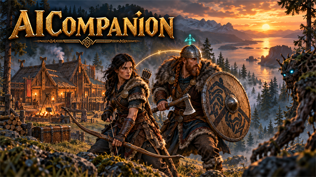
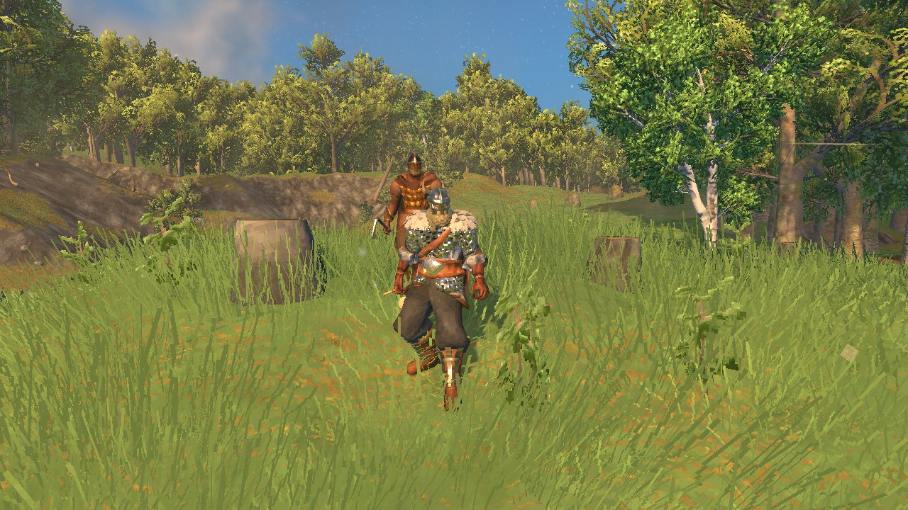
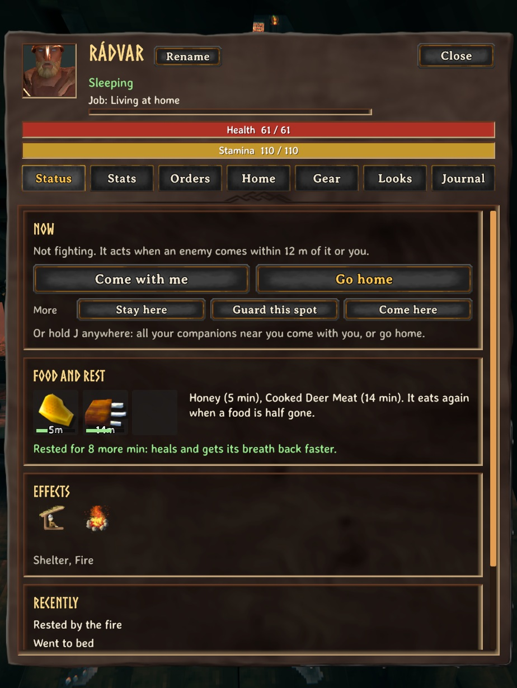
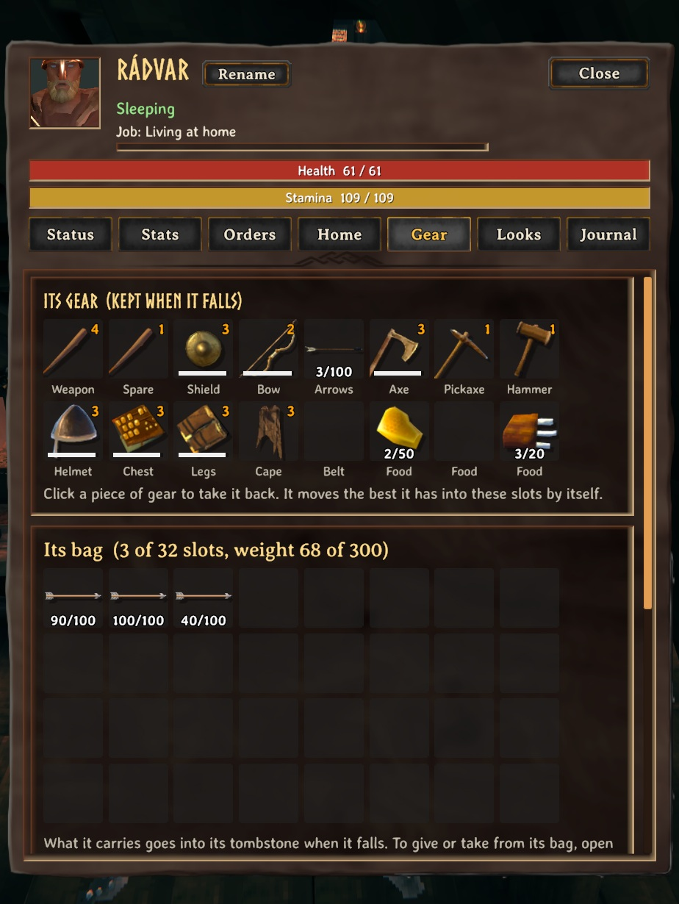
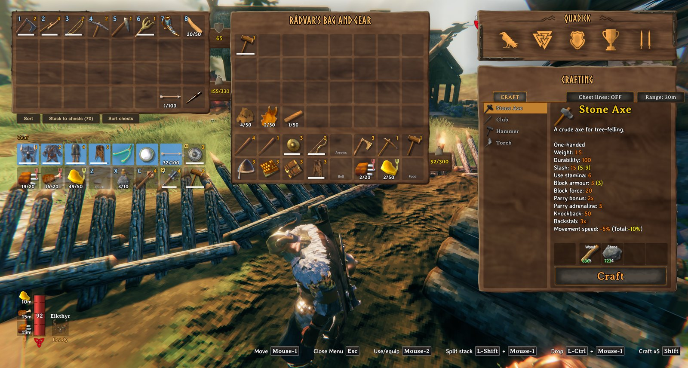

<!-- This page is made by tools/modpages/make_pages.py from the mod's thunderstore.toml, DESCRIPTION.txt, CHANGELOG.txt,
     settings and the repo's README. Change those, or the HAND-WRITTEN parts, not the rest of this page. -->

# 🧔 Quad's Companion

**A viking companion, a follower NPC who plays like a player: comes on your adventures, fights beside you, lives its own life at home, and gets better as it goes.**

    

<!-- GITHUB-ONLY -->[Thunderstore](https://thunderstore.io/c/valheim/p/Quads_Lab/Quads_Companion/)  ·  <!-- END GITHUB-ONLY -->[Source code](https://github.com/HardHeadHackerHead/valheim-mods/tree/main/mods/AICompanion)  ·  [Report a bug](https://github.com/HardHeadHackerHead/valheim-mods/issues/new?template=bug.yml&title=%5BQuad%27s%20Companion%5D%20)  ·  [Discord](https://discord.gg/EwTjQxEZPy)

  

<!-- GITHUB-ONLY -->**Install:** with [r2modman](https://thunderstore.io/c/valheim/p/ebkr/r2modman/) or Thunderstore Mod Manager from [Thunderstore](https://thunderstore.io/c/valheim/p/Quads_Lab/Quads_Companion/), or press **F7** in the game with our [mod manager](https://github.com/HardHeadHackerHead/valheim-mod-manager).<!-- END GITHUB-ONLY -->

## ✨ Features

- Press J to summon your companion or open its menu (E on it too). Hold J: your companions come with you, or go home.
- Point and press H: at an enemy (they attack it), a tree, rock or plant (it works it, and the thing glows with a note above it while it does), your chest (it puts its things in), a cart (it pulls it), the ground (it waits there), the sky (it comes back).
- "Let it decide": it reads what you are doing. It fights beside you, mines or chops beside you, and keeps close while you explore; where a place is too dangerous for its gear it tells you and only defends.
- It fights like a player: timed parries (it learns each creature's swing), rolls out of sweeps and shots, joins in on what you are hitting and gets round behind it, pulls enemies off you when you are hurt, sneaks up for backstabs, uses weapon specials, hits and steps back against heavy hitters, drinks the right mead, remembers what has killed it, kites with its bow (leading moving targets, allowing for arrow drop), and fights bosses with care (flanking, keeping its distance, drinking early).
- Follows you through portals, into crypts and caves, onto boats and through doors; it steers round stakes and fires, jumps streams and gets itself unstuck.
- Home and away by itself: when you head out it comes along; back home it lives there again. It takes a free bed and empty chests by itself.
- At home it works toward better gear: picks its next upgrade, gathers exactly what it needs (trips further out when nothing near has it), makes bronze and the like, crafts and upgrades at your workbench and forge.
- It hunts, cooks on your cooking stations, keeps its fires burning, repairs its gear and your base, sleeps in its bed at night, and sorts what it brings home into the right chests (with QualityOfLife).
- While you are away it catches up on all of it, and tells you what it did when you return.
- Needs like a player: food for health and stamina, skills that rise, stamina, carry weight, weather, rest.
- Its gear has slots of its own (weapons, shield, bow and arrows, axe, pickaxe, hammer, armour, and three food slots it keeps filled): change them from its menu from anywhere. When it falls everything goes into its tombstone, as a player's; it wakes wearing its gear again when its tombstone is near, else it goes back for it.
- Its bag shows beside your inventory: drag items between you. Hotbar keys give it food, potions or gear.
- Between jobs it acts like a person: sits by the fire or in a chair, gets out of the rain, takes a stroll, sits with you when you rest, waves when you come back, cheers after a big fight and answers your emotes.
- A journal of its life, small talk that fits the moment, and chat messages about what it is up to.
- Its menu: status, stats and every skill, orders, home, gear, looks and journal, and a Companions tab (when you can have more than one) to switch between your companions, release one or add another. Talk to it in chat: "Rádvar, follow me", "Rádvar go home".
- With PartyHud it shows in the party panel (face, health, food); it shows on the map, and where it fell is marked for everyone.
- Multiplayer: it belongs to whoever summoned it. Everyone in the world needs the mod (the host too), or the game deletes saved companions.

## 📸 Screenshots

<!-- HAND-WRITTEN: screenshots -->
**Your companion at your side out in the Meadows**

**Its menu: what it is doing, its food, what it has done**

**Its gear slots and its bag**

**Its bag and gear beside yours when you open your inventory**

<!-- END HAND-WRITTEN: screenshots -->

## 🎮 How to use

| Key | What it does |
|---|---|
| **J** / hold **J** | Summon your companion or open its menu / your companions come with you, or go home |
| **H** | Point: attack it, chop or mine it (a whole patch), pick it up, put its things in that chest, pull that cart, wait here |

<!-- HAND-WRITTEN: how-to-use -->

<!-- END HAND-WRITTEN: how-to-use -->

## 🧩 Other mods

**Goes well with**

|  |  |  |  |  |
|:-:|:-:|:-:|:-:|:-:|
| [Party HUD](https://thunderstore.io/c/valheim/p/Quads_Lab/Quads_Party_HUD/) | [Gear Slots](https://thunderstore.io/c/valheim/p/Quads_Lab/Quads_Gear_Slots/) | [Arena](https://thunderstore.io/c/valheim/p/Quads_Lab/Quads_Arena/) | [Bounty Board](https://thunderstore.io/c/valheim/p/Quads_Lab/Quads_Bounty_Board/) | [Dungeons](https://github.com/HardHeadHackerHead/valheim-mods/tree/main/mods/Dungeons) |

<!-- HAND-WRITTEN: other-mods -->
**Known clashes:** none known.

**Better together**

- With [Quad's Build Orders](https://thunderstore.io/c/valheim/p/Quads_Lab/Quads_Build_Orders/): it builds your planned ghosts near its home (a home duty, *Build our plans*), paying from its own bag and your chests, never from you.
- With [Quad's Quality of Life](https://thunderstore.io/c/valheim/p/Quads_Lab/Quads_Quality_Of_Life/): what it brings home goes into the chests you assigned with K.
- With [Quad's Party HUD](https://thunderstore.io/c/valheim/p/Quads_Lab/Quads_Party_HUD/): it shows under you in the party panel (face, health, what it's doing).
- With [Quad's Skal Tavern](https://thunderstore.io/c/valheim/p/Quads_Lab/Quads_Skal_Tavern/): companions within 12 m count as drinking partners for a Skål!
<!-- END HAND-WRITTEN: other-mods -->

Found a clash with another mod? [Tell us](https://github.com/HardHeadHackerHead/valheim-mods/issues/new?template=bug.yml&title=%5BQuad%27s%20Companion%5D%20) which one and what happened.

## 👥 Multiplayer

**Who needs it:** Everyone in the world, **the host too**: without it the game deletes saved companions.

It adds the companion (a new creature the world saves). Restart the game after updating so it registers cleanly: a companion whose area loads while it is not registered is deleted by the host, with everything it carries.

<!-- HAND-WRITTEN: multiplayer -->
Each companion belongs to whoever summoned it. Everyone sees each companion's state, and where one fell is marked for everyone. It never touches a chest someone else has open.

**The host decides:** how many companions, what they do while you're away, respawn time, base health and stamina, when they eat, starting skill. While you play on their world their values replace yours (your file isn't changed); a host without the mod leaves everyone their own.
<!-- END HAND-WRITTEN: multiplayer -->

## 🌍 Languages

**English, Русский (Russian), Deutsch (German), 简体中文 (Chinese), Português do Brasil (Portuguese), Español (Spanish), Français (French), Polski (Polish), Türkçe (Turkish).** It follows the game's own language setting.

The translations were made with AI, so a few words may be off. To correct one, or to add your language, put a file in `BepInEx/config/translations/com.quad.aicompanion/` named after the game's name for the language (`German.json`, `Italian.json`, `Japanese.json`...) with only the lines you change, copied from [English.json](https://github.com/HardHeadHackerHead/valheim-mods/blob/main/mods/AICompanion/translations/English.json) (it wins over the built-in one). Or [tell us](https://github.com/HardHeadHackerHead/valheim-mods/issues/new?template=bug.yml&title=%5BQuad%27s%20Companion%5D%20Translation%3A%20) the better words and we'll put them in for everyone.

## ⚙️ Settings

In `BepInEx/config/com.quad.aicompanion.cfg`, made the first time the game runs with the mod. r2modman and Thunderstore Mod Manager edit it under **Config editor**.<!-- GITHUB-ONLY --> With our mod manager: **F7**, then **Mod settings**.<!-- END GITHUB-ONLY -->

**Companion**

| Setting | Default | What it does |
|---|---|---|
| `MaxCompanions` | `3` | How many companions each player can have. In multiplayer the server's value applies. |
| `WhileAway` | `Mild` | What a companion living at home does while nobody is near. It always catches up on its work when you come back. Mild: it also fights off a few creatures and keeps their drops, and never falls. Real: those fights can go badly and it can fall. Off: work only. In multiplayer the server's value applies. |

**General**

| Setting | Default | What it does |
|---|---|---|
| `MenuKey` | `J` | Tap: your companion's menu (or the summon panel). Hold: all your companions near you come with you, or go home. E on a companion opens its menu too. |
| `CommandKey` | `H` | Point at something and press it: an enemy (they attack it), a tree, rock or plant (it works it), your chest (it puts its things in), its tombstone, a free bed (its bed), the ground (it waits there), or the sky (it comes back). |

**Companion**

| Setting | Default | What it does |
|---|---|---|
| `FightRange` | `12` | It fights enemies that come this close (in metres) to it or to you. In the menu: Orders. |
| `ShowDecisions` | `true` | Show what it decides in a fight above its head. In the menu: Brain. |
| `RespawnSeconds` | `30` | Seconds after falling before it wakes in its bed (or beside you). In multiplayer the server's value applies. |
| `BaseHealth` | `25` | Its health before food, as a player's (25). In multiplayer the server's value applies. |
| `BaseStamina` | `75` | Its stamina before food, as a player's (75). In multiplayer the server's value applies. |
| `EatBelowPercent` | `10` | It eats a food it is already under again once its time left drops below this percent (the game allows it from 50). Lower saves food: a meal lasts 80% of its time instead of 50%, and its effect weakens a little towards the end. In multiplayer the server's value applies. |
| `StartingSkill` | `0` | The skill level a new companion starts at (a new player: 0). In multiplayer the server's value applies. |

## 🤖 Made with AI

Made with the help of Claude (Anthropic), with Claude Code: designed, written and checked together, and tried in the game.

## 💬 Join us on Discord

Come hang out with the people who make and play these mods. In the **Quads Lab Discord** you can:

- 🛠️ **Get help** and report bugs straight to us
- 👀 **See new mods first**, and help test them before they're released
- 🗳️ **Suggest ideas** and vote on what we make next
- 🏰 **Share your builds**, bases and arena runs
- 🤖 **Talk AI coding and vibe coding** with people building things with AI, the way these mods are made

**[Join the Quads Lab Discord →](https://discord.gg/EwTjQxEZPy)**

## 🧪 About Quads Lab

Quads Lab is where **Quad H** ([HardHeadHackerHead](https://github.com/HardHeadHackerHead)) builds software with AI, of every kind:
these Valheim mods are one of its projects. Each mod is designed by a player, written with [Claude Code](https://claude.com/claude-code)
and tested in our own world, with **bobisme** as our tester.

- 🌐 [quadslab.io](https://quadslab.io)
- 🧰 [All Quads Lab mods on Thunderstore](https://thunderstore.io/c/valheim/p/Quads_Lab/)
- 💻 [Source code on GitHub](https://github.com/HardHeadHackerHead/valheim-mods)
- 💬 [Discord](https://discord.gg/EwTjQxEZPy)
- ☕ [Buy me a coffee](https://buymeacoffee.com/quadh)
- 🐞 Found a bug? [Open an issue on GitHub](https://github.com/HardHeadHackerHead/valheim-mods/issues/new/choose)

## ☕ Support my mods

Every Quads Lab mod is free, and it stays that way. If one of them made your game better and you'd like to say thanks, a coffee
helps me make new mods and keep improving the ones you already play. It's 100% optional, and always appreciated!

**[☕ Buy me a coffee →](https://buymeacoffee.com/quadh)**

## 📜 Recent changes

- **0.24.7** A Companions tab in the companion's menu (when more than one companion is allowed): all your companions in one list, each with Open, Call and Release forever (press twice; its gear must be taken out first, and a released companion can't come back), and the summon panel to add another.
- **0.24.6** Near a fallen companion's map marker, the check for its crate (every 2 seconds) no longer searches every container in the scene: it looks only at the saved objects around the marker. No more small hitch there in a big base.
- **0.24.5** On a server without AI Companion, no companion can be summoned there, and a message says why: the server would delete the companion and the gear it carries. Settings: edits to the config file now apply while the game runs (a server owner no longer has to restart), and a server's admins can change the server's settings from their own game with Configuration Manager, where other players see them greyed out. Your config file always keeps your own values while you play on a server (saving it there could write the server's in). Players on an older version still get the server's settings. Food it borrows from your chest now goes into a slot of its own in its bag, so what it does not eat goes back to that chest (it used to join a stack of the same food it already had and was kept).
- **0.24.4** Its windows no longer fill the log with "The LiberationSans SDF Font Asset was not found": each text is given the game's font before it starts (it looked for TextMeshPro's default font, which the game doesn't have, every time a text was made). Nothing changes on screen.

<!-- GITHUB-ONLY -->[Every change](CHANGELOG.txt)<!-- END GITHUB-ONLY --><!-- THUNDERSTORE-ONLY: Every change is on the Changelog tab. -->
