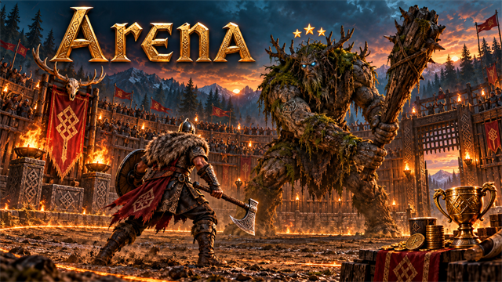
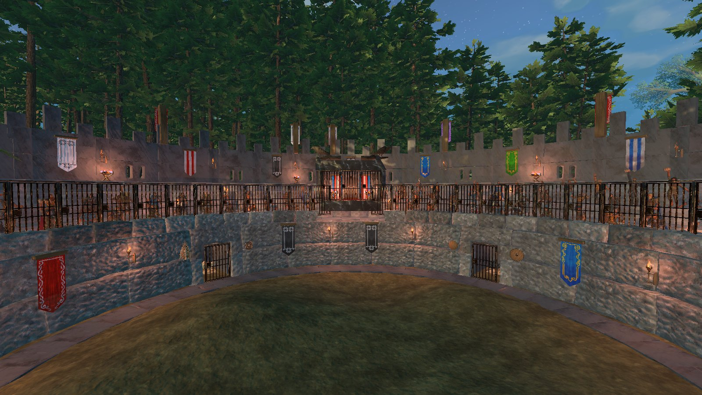
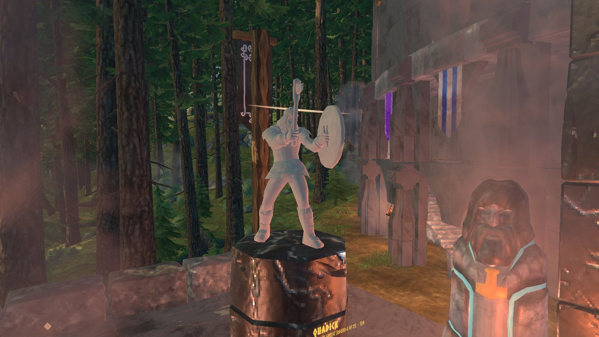
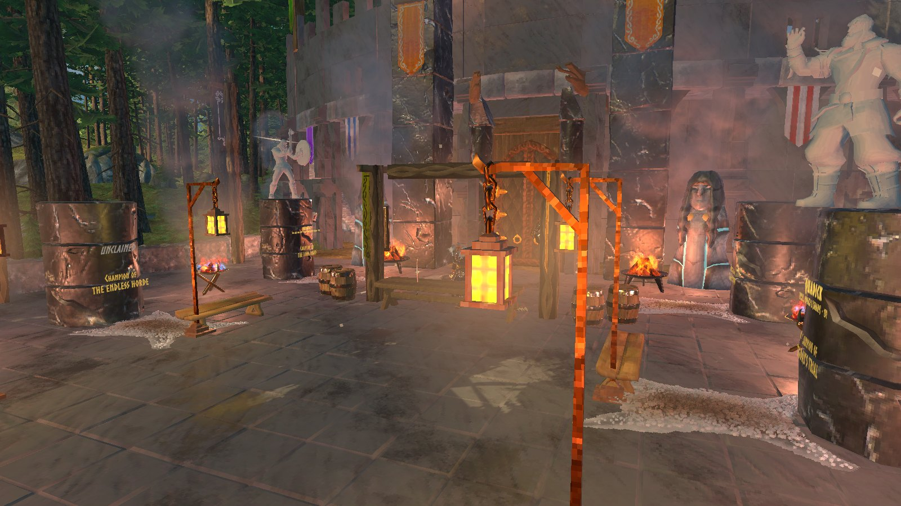
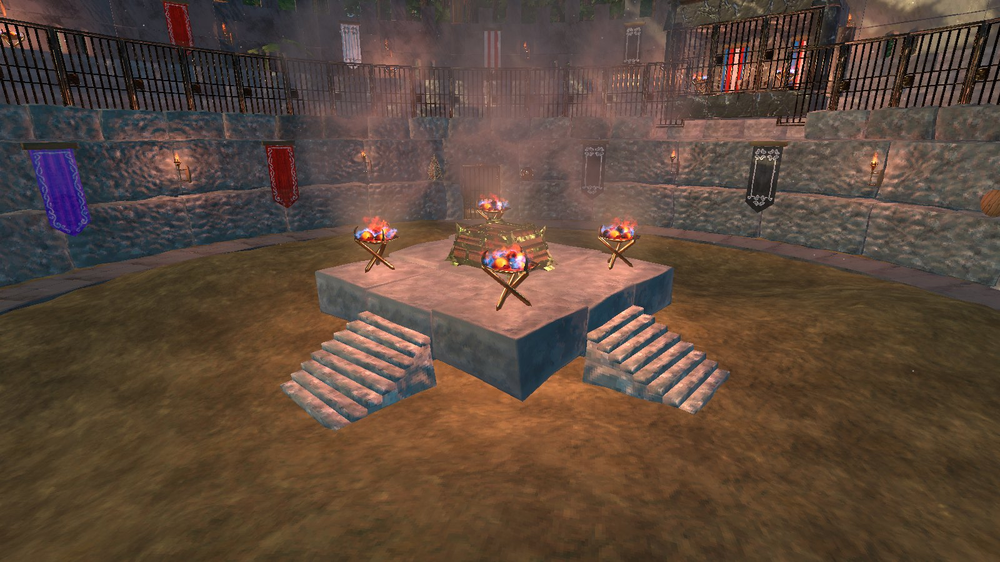
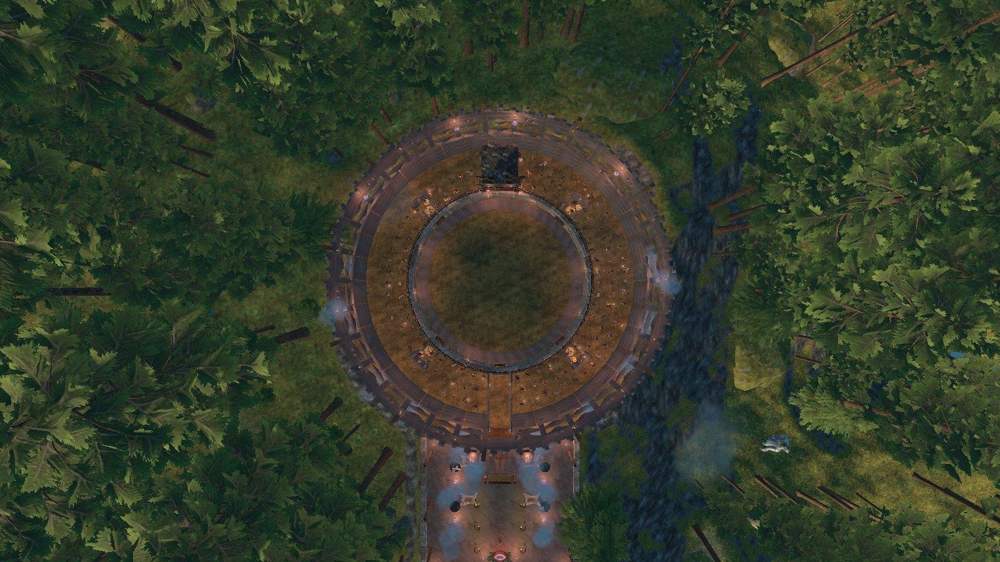

<!-- This page is made by tools/modpages/make_pages.py from the mod's thunderstore.toml, DESCRIPTION.txt, CHANGELOG.txt,
     settings and the repo's README. Change those, or the HAND-WRITTEN parts, not the rest of this page. -->

# 🏟️ Quad's Arena

**The Arena: a great stone colosseum that stands in your world, where you fight for the crowd, for gold and for glory, like the arena in the first Fable.**

    

<!-- GITHUB-ONLY -->[Thunderstore](https://thunderstore.io/c/valheim/p/Quads_Lab/Quads_Arena/)  ·  <!-- END GITHUB-ONLY -->[Source code](https://github.com/HardHeadHackerHead/valheim-mods/tree/main/mods/Arena)  ·  [Report a bug](https://github.com/HardHeadHackerHead/valheim-mods/issues/new?template=bug.yml&title=%5BQuad%27s%20Arena%5D%20)  ·  [Discord](https://discord.gg/EwTjQxEZPy)

<!-- GITHUB-ONLY -->**Install:** with [r2modman](https://thunderstore.io/c/valheim/p/ebkr/r2modman/) or Thunderstore Mod Manager from [Thunderstore](https://thunderstore.io/c/valheim/p/Quads_Lab/Quads_Arena/), or press **F7** in the game with our [mod manager](https://github.com/HardHeadHackerHead/valheim-mod-manager).<!-- END GITHUB-ONLY -->

## ✨ Features

### What is in it

- The Arena builds itself: the first time the world runs with the mod, it finds flat ground near the middle of the world, clear of everyone's buildings, levels it, clears the trees and puts up a colosseum made of the game's own stone. It is marked on the map, and it is the same for everyone. It cannot be broken, and nothing of it is saved but the levelled ground.
- Arena Waystones (hammer, Misc) take you to its forecourt and back. There stands the Hall of Fame: a stone statue of the champion of each contest (the best run of the Long Road, the Champion Bout, the Endless Horde and Today's Trial in the world), with their names. The Arena Master takes your name at his desk.
- The Long Road: from the Meadows to the Ashlands, three rounds in each land with its champion in the third, as far as you can get. The Arena Master holds everything you carry while you fight. You start in the plainest Meadows gear from a chest that rises in the ring, with whatever weapon the armourer hands you (a knife, an axe, a club, a spear or a bow), and keep it, building it up piece by piece: between lands a reward chest holds a free upgrade and the Armourer stands in the ring, selling upgrades as far as your coin goes (or another kind of weapon), fresh food and meads in the game's own trader window; the crowd throws you gear too. Fighting is hungry work: food burns faster in the ring, and the kitchen's meals are leftovers. The fighters drop coins (no loot): spend them, or walk out with them. Champions drop their trophy and the land's metal. You get your own things back when you come out, or when you rise again if you fall (then what you picked up is lost).
- Today's Trial: one land picked for the day, with its weapon and rules, in the arena's gear; worth half as much again the first time you win it.
- With your own gear: a Champion Bout (one champion, a head taller, as strong as its land allows) or the Endless Horde (wave after wave until you fall or take your purse), against a land your world has reached.
- Each contest costs an entry fee (your first fight is free). The arena's fighters never drop loot.
- You walk in through the main gate and the tunnel; the grate rises, then shuts behind you. The creatures come out of pens behind the grates round the ring. The floor has mounds and dips, and each land brings its own cover: ruins, pillars or stakes. Between lands a platform rises in the middle, with the reward chest on it.
- The crowd fills the stands, turns to watch you, cheers, boos, waves flags and sends a wave round the stands; the announcer calls every round, combo and champion. Their favour grows with kills, quick kills, parries, flawless rounds and close calls, and raises the prize.
- Play to the crowd: the arena's meals are leftovers (they start part spent), so the crowd's gifts matter. Excited, they throw you fresh food and small meads; roaring, the land's best food, bigger meads, arrows and bombs; ecstatic, strong meads, and now and then an upgrade for the gear you wear. Emotes in the ring please them (more with a foe close by, or just after a kill) and they answer in kind; cower and they laugh. Now and then they chant for something (a flex, a roar, a kill now, a perfect parry, not a scratch): answer in time and they go wild.
- Rules make it harder and worth more: bare fists, no food or potions, hard, and against the clock. Stake coins on yourself in a Champion Bout or a trial and a win pays them double.
- Every round you clear adds to your purse; between rounds you can take it and leave. Win and it is paid with a bonus, plus the champion's trophy. Give up mid-round, run out of time or leave the ring and you get half.
- Win a whole contest and it is a show: the crowd on its feet, fireworks over the stands, your name called, a prize chest rising in the ring, and the gate opening for you to walk out.
- Death is real: fall and the purse and stake are lost. You rise again in the forecourt; with your own gear, your tombstone waits for you there.
- Watch: other players climb the stairs in the arches beside the main gate to the stands (or take the waystone up), see the fight and hear the announcer. The main gate opens only for a fighter, and the Arena Master's guards show anyone else off the fighting floor.
- Duels: challenge another player at the Arena Master's desk, both put up a wager and walk into the ring, each taken to their own end of it; after a countdown PvP comes on for the fight (and goes back as it was after). The first to drop to a fifth of their health loses (nobody dies in a duel); the winner takes the pot less a tenth.
- Your titles (Pit Rat to Legend of the Arena), wins and records are kept on your character.

Everyone in the world needs it installed (the waystone is a building piece, and everyone needs the arena to see it). Restart after installing.

Crowd sounds from OpenGameArt: "Free Crowd Cheering Sounds" by Gregor Quendel (CC-BY 4.0) and "Crowd Shouting" by StarNinjas (CC0).

## 📸 Screenshots

<!-- HAND-WRITTEN: screenshots -->
**The ring: banners, torches and a full house behind the bars**

**The Hall of Fame: a champion in stone on their plinth**

**The forecourt and the Arena Master's desk**

**Between lands: the platform, its braziers and the reward chest**

**From above: the colosseum, its forecourt and gateway**

<!-- END HAND-WRITTEN: screenshots -->

## 🎮 How to use

| Key | What it does |
|---|---|
| **E** at the Arena Master | Pick a contest (the Long Road, a Champion Bout, the Endless Horde, today's trial), duel a player, see the champions |
| **Backspace** twice | In a contest: take your purse and leave between rounds (in a round you give up for half of it) |

<!-- HAND-WRITTEN: how-to-use -->

<!-- END HAND-WRITTEN: how-to-use -->

## 🧩 Other mods

<!-- HAND-WRITTEN: other-mods -->
**Known clashes:** none known.
<!-- END HAND-WRITTEN: other-mods -->

Found a clash with another mod? [Tell us](https://github.com/HardHeadHackerHead/valheim-mods/issues/new?template=bug.yml&title=%5BQuad%27s%20Arena%5D%20) which one and what happened.

## 👥 Multiplayer

**Who needs it:** Everyone, and **the host above all**: a game without the mod deletes the pieces when their area loads. Restart after installing or updating them.

<!-- HAND-WRITTEN: multiplayer -->
The host's game picks where the Arena stands and saves it with the world: **on a dedicated server, the server needs the mod** or no Arena is ever placed. Each game draws the colosseum itself, so players without the mod see no Arena. A fight is shared with the players nearby (announcer, crowd, gates), so watchers see the same fight. Duels need the mod on both players' games.

**The host decides:** rewards, entry fee, whether death is real, respawning at the Arena, tiers, gifts, leftover meals and hunger in the ring. While you play on their world their values replace yours (your file isn't changed); a host without the mod leaves everyone their own.
<!-- END HAND-WRITTEN: multiplayer -->

## ⚙️ Settings

In `BepInEx/config/com.quad.arena.cfg`, made the first time the game runs with the mod. r2modman and Thunderstore Mod Manager edit it under **Config editor**.<!-- GITHUB-ONLY --> With our mod manager: **F7**, then **Mod settings**.<!-- END GITHUB-ONLY -->

**Arena**

| Setting | Default | What it does |
|---|---|---|
| `RewardPercent` | `100` | How big the prizes are (percent). In multiplayer the server's value applies. |
| `DeathIsReal` | `true` | You can die in a contest. Your tombstone is carried just outside the ring for you to collect, and the purse and stake are lost. Off: beaten, you are carried out at a third of your health with half your purse. (Duels never kill.) In multiplayer the server's value applies. |
| `EntryFeePercent` | `100` | How much it costs to enter a contest (percent of the usual: 150 coins for the Long Road; today's trial 60, a Champion Bout 50 and the Endless Horde 40 in the Meadows, more in each land after). The first fight of a character is free. In multiplayer the server's value applies. |
| `RespawnAtArena` | `true` | Fall in a contest and you rise again in the arena's forecourt (not at your bed). In multiplayer the server's value applies. |
| `MapPin` | `true` | The Arena is marked on your map. |
| `AllTiers` | `false` | Every land's fighters can be chosen in a Champion Bout or the Endless Horde at once (normally each opens as you beat the boss before it). For trying them out: the arena still pays metals and trophies only from lands your world has reached, today's trial stays among them, and what the crowd throws from a land your world has not reached is only lent (it goes back after the fight). In multiplayer the server's value applies. |
| `YieldKey` | `Backspace` | Press twice to give up a contest (you keep what you have earned so far, at a lower rate). |

**Crowd**

| Setting | Default | What it does |
|---|---|---|
| `Gifts` | `true` | When the crowd likes you it throws you things now and then: food and meads, then arrows, bombs and strong meads, and (on the arena's steel) the next land's weapon, more often and better the more they love you. In multiplayer the server's value applies. |
| `LeftoverMeals` | `50` | On the arena's steel: how much of its time one of the kitchen's meals (yesterday's leftovers) has left once eaten, percent. 100 is a fresh meal. In multiplayer the server's value applies. |
| `RingHunger` | `2.5` | On the arena's steel: how many times faster food burns (fighting is hungry work), so a fresh meal lasts about a land and the crowd's gifts matter. 1 is as outside. In multiplayer the server's value applies. |
| `Spectators` | `true` | A crowd fills the stands during a fight. |
| `FullHouse` | `30` | How full the stands are during a fight (percent of the seats). Fewer is lighter on the frame rate. |
| `Announcer` | `true` | The announcer's calls across the top of the screen. |
| `Volume` | `0.5` | How loud the crowd is. |

## 🤖 Made with AI

Made with the help of Claude (Anthropic), with Claude Code: designed, written and checked together, and tried in the game.

## 🧪 About Quads Lab

Quads Lab is where **Quad H** ([HardHeadHackerHead](https://github.com/HardHeadHackerHead)) builds software with AI, of every kind:
these Valheim mods are one of its projects. Each mod is designed by a player, written with [Claude Code](https://claude.com/claude-code)
and tested in our own world, with **bobisme** as our tester.

- 🌐 [quadslab.io](https://quadslab.io)
- 🧰 [All Quads Lab mods on Thunderstore](https://thunderstore.io/c/valheim/p/Quads_Lab/)
- 💻 [Source code on GitHub](https://github.com/HardHeadHackerHead/valheim-mods)
- 💬 [Discord](https://discord.gg/EwTjQxEZPy)
- 🐞 Found a bug? [Open an issue on GitHub](https://github.com/HardHeadHackerHead/valheim-mods/issues/new/choose)

## 📜 Recent changes

- **0.3.3** A clearer page: what it does, who needs it in multiplayer, how it gets on with other mods, and where to report a bug. The game itself is unchanged.
- **0.3.2** Its test command for Claude Tools (arena ...) follows the game's cheat rule: anything that changes a contest (favour, clear, start, tp, crowd, gifts...) works only in single player, for the host or with devcommands; status and the checks still work for everyone. New: arena crowd fills the stands and has them cheer (crowd off sends them home), for trying the crowd out.
- **0.3.1** A new id, com.quad.arena (it was com.dhack.arena): your settings move over by themselves the first time it starts, and the old settings file is kept as a backup. Restart the game after this update. If an old copy is still installed beside it, this one stands down and says which file to delete, so the two never both run. The DLL now says it was made with AI, as Thunderstore asks.

<!-- GITHUB-ONLY -->[Every change](CHANGELOG.txt)<!-- END GITHUB-ONLY --><!-- THUNDERSTORE-ONLY: Every change is on the Changelog tab. -->
