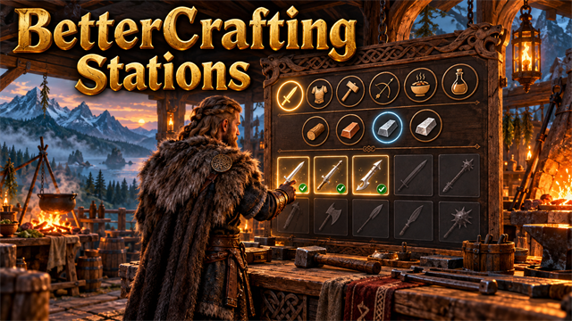
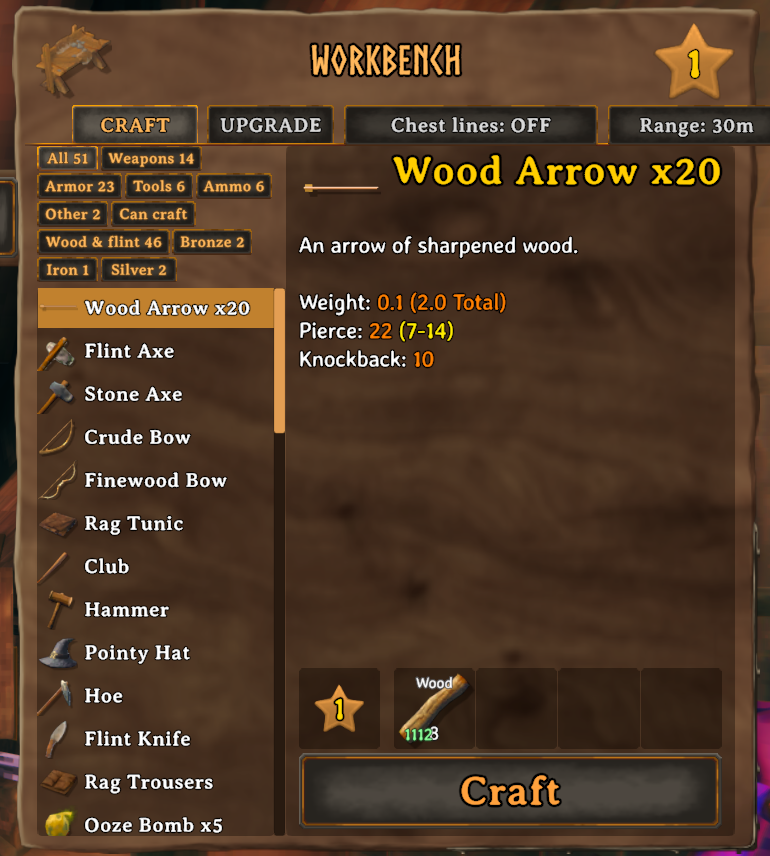
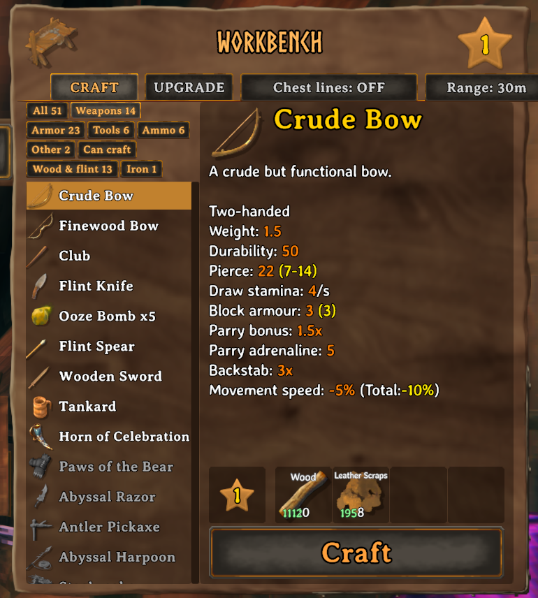

<!-- This page is made by tools/modpages/make_pages.py from the mod's thunderstore.toml, DESCRIPTION.txt, CHANGELOG.txt,
     settings and the repo's README. Change those, or the HAND-WRITTEN parts, not the rest of this page. -->

# 🔧 Quad's Crafting Filters

**Recipe filters for every crafting station: chips above the crafting list narrow it by type (weapons, armor, tools, ammo, food, potions), by tier (bronze, iron, silver, black metal) or to what you can craft now. Workbench, forge, cauldron and more.**

    

<!-- GITHUB-ONLY -->[Thunderstore](https://thunderstore.io/c/valheim/p/Quads_Lab/Quads_Crafting_Filters/)  ·  <!-- END GITHUB-ONLY -->[Source code](https://github.com/HardHeadHackerHead/valheim-mods/tree/main/mods/BetterCraftingStations)  ·  [Report a bug](https://github.com/HardHeadHackerHead/valheim-mods/issues/new?template=bug.yml&title=%5BQuad%27s%20Crafting%20Filters%5D%20)  ·  [Discord](https://discord.gg/EwTjQxEZPy)

  

<!-- GITHUB-ONLY -->**Install:** with [r2modman](https://thunderstore.io/c/valheim/p/ebkr/r2modman/) or Thunderstore Mod Manager from [Thunderstore](https://thunderstore.io/c/valheim/p/Quads_Lab/Quads_Crafting_Filters/), or press **F7** in the game with our [mod manager](https://github.com/HardHeadHackerHead/valheim-mod-manager).<!-- END GITHUB-ONLY -->

## ✨ Features

Recipe filter chips above the crafting list: pick a type, a tier or what you can make now, at every crafting station.

### What is in it

- At the workbench, forge, cauldron and the other stations, two rows of chips sit above the recipe list. The first row is the type of thing (weapons, armor, tools, ammo, food, potions), with All and Can craft; the second is how far into the game it is (wood and flint, bronze, iron, silver, black metal, Mistlands, Ashlands).
- Each chip shows how many recipes it has, given what the other row has chosen. Click a chip to pick it, click it again to clear it. All clears everything.
- Only what that station makes shows, and each station remembers its own choice while the game runs.
- The list below is the game's own, narrowed: crafting, upgrading and the Upgrade tab are unchanged.

The only setting is Enabled.

## 📸 Screenshots

<!-- HAND-WRITTEN: screenshots -->
**Chips above the workbench's list: each kind and tier, with how many recipes are in it**

**One click narrows the list: here, only weapons (the tiers count what is left)**

<!-- END HAND-WRITTEN: screenshots -->

<!-- HAND-WRITTEN: how-to-use -->

<!-- END HAND-WRITTEN: how-to-use -->

## 🤝 Goes well with

|  |  |  |  |
|:-:|:-:|:-:|:-:|
| [Craft From Chests](https://thunderstore.io/c/valheim/p/Quads_Lab/Quads_Craft_From_Chests/) | [Recycler](https://thunderstore.io/c/valheim/p/Quads_Lab/Quads_Recycler/) | [Quality of Life](https://thunderstore.io/c/valheim/p/Quads_Lab/Quads_Quality_Of_Life/) | [Gear Slots](https://thunderstore.io/c/valheim/p/Quads_Lab/Quads_Gear_Slots/) |

## 🧩 Other mods

<!-- HAND-WRITTEN: other-mods -->
**Known clashes:** none known.

It narrows the game's own recipe list in place (it never swaps the list for another), so other mods that change the list see the same one.
<!-- END HAND-WRITTEN: other-mods -->

Found a clash with another mod? [Tell us](https://github.com/HardHeadHackerHead/valheim-mods/issues/new?template=bug.yml&title=%5BQuad%27s%20Crafting%20Filters%5D%20) which one and what happened.

## 👥 Multiplayer

**Who needs it:** Only the players who want it.

<!-- HAND-WRITTEN: multiplayer -->
Nothing is shared: it only changes your own screen.
<!-- END HAND-WRITTEN: multiplayer -->

## 🌍 Languages

**English, Русский (Russian), Deutsch (German), 简体中文 (Chinese), Português do Brasil (Portuguese), Español (Spanish), Français (French), Polski (Polish), Türkçe (Turkish).** It follows the game's own language setting.

The translations were made with AI, so a few words may be off. To correct one, or to add your language, put a file in `BepInEx/config/translations/com.quad.bettercraftingstations/` named after the game's name for the language (`German.json`, `Italian.json`, `Japanese.json`...) with only the lines you change, copied from [English.json](https://github.com/HardHeadHackerHead/valheim-mods/blob/main/mods/BetterCraftingStations/translations/English.json) (it wins over the built-in one). Or [tell us](https://github.com/HardHeadHackerHead/valheim-mods/issues/new?template=bug.yml&title=%5BQuad%27s%20Crafting%20Filters%5D%20Translation%3A%20) the better words and we'll put them in for everyone.

## ⚙️ Settings

In `BepInEx/config/com.quad.bettercraftingstations.cfg`, made the first time the game runs with the mod. r2modman and Thunderstore Mod Manager edit it under **Config editor**.<!-- GITHUB-ONLY --> With our mod manager: **F7**, then **Mod settings**.<!-- END GITHUB-ONLY -->

**General**

| Setting | Default | What it does |
|---|---|---|
| `Enabled` | `true` | Show the filter chips above the crafting list. Off, the list is the game's own. |

## 🤖 Made with AI

Made with the help of Claude (Anthropic), with Claude Code: designed, written and checked together, and tried in the game.

## 💬 Join us on Discord

Come hang out with the people who make and play these mods. In the **Quads Lab Discord** you can:

- 🛠️ **Get help** and report bugs straight to us
- 👀 **See new mods first**, and help test them before they're released
- 🗳️ **Suggest ideas** and vote on what we make next
- 🏰 **Share your builds**, bases and arena runs
- 🤖 **Talk AI coding and vibe coding** with people building things with AI, the way these mods are made

**[Join the Quads Lab Discord →](https://discord.gg/EwTjQxEZPy)**

## 🧪 About Quads Lab

Quads Lab is where **Quad H** ([HardHeadHackerHead](https://github.com/HardHeadHackerHead)) builds software with AI, of every kind:
these Valheim mods are one of its projects. Each mod is designed by a player, written with [Claude Code](https://claude.com/claude-code)
and tested in our own world, with **bobisme** as our tester.

- 🌐 [quadslab.io](https://quadslab.io)
- 🧰 [All Quads Lab mods on Thunderstore](https://thunderstore.io/c/valheim/p/Quads_Lab/)
- 💻 [Source code on GitHub](https://github.com/HardHeadHackerHead/valheim-mods)
- 💬 [Discord](https://discord.gg/EwTjQxEZPy)
- ☕ [Buy me a coffee](https://buymeacoffee.com/quadh)
- 🐞 Found a bug? [Open an issue on GitHub](https://github.com/HardHeadHackerHead/valheim-mods/issues/new/choose)

## ☕ Support my mods

Every Quads Lab mod is free, and it stays that way. If one of them made your game better and you'd like to say thanks, a coffee
helps me make new mods and keep improving the ones you already play. It's 100% optional, and always appreciated!

**[☕ Buy me a coffee →](https://buymeacoffee.com/quadh)**

## 📜 Recent changes

- **0.2.1** Fixed: the filter chips didn't show when you opened a crafting station, only after switching between Craft and Upgrade. Each chip is now as wide as its words, so none is cut short ("Ammo", and the longer words of other languages).
- **0.2.0** Now in your language: English, Russian, German, Chinese (Simplified), Portuguese (Brazil), Spanish, French, Polish and Turkish, following the game's own Language setting. The game's own names are used for its things (items, creatures, lands, stations). The translations were made with AI: to correct a line, or add a language, put a file in BepInEx/config/translations/com.quad.bettercraftingstations/ named after the game's name for the language (German.json...) with only the lines you change, copied from translations/English.json on GitHub. The filter chips use the game's own names for the tiers (Bronze, Iron, Black metal...).
- **0.1.3** A clearer page: what it does, who needs it in multiplayer, how it gets on with other mods, and where to report a bug. The game itself is unchanged.

<!-- GITHUB-ONLY -->[Every change](CHANGELOG.txt)<!-- END GITHUB-ONLY --><!-- THUNDERSTORE-ONLY: Every change is on the Changelog tab. -->
