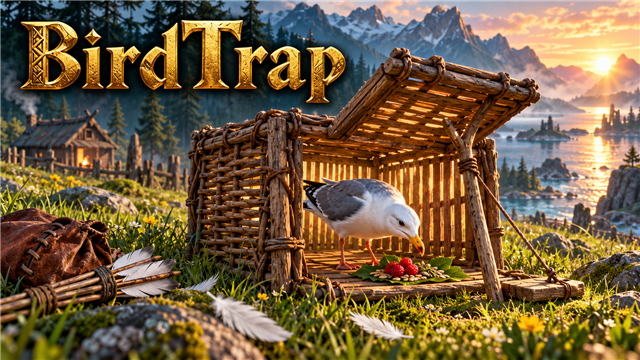
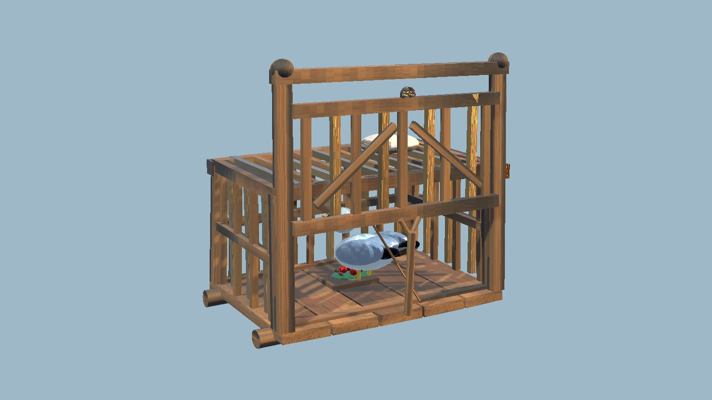
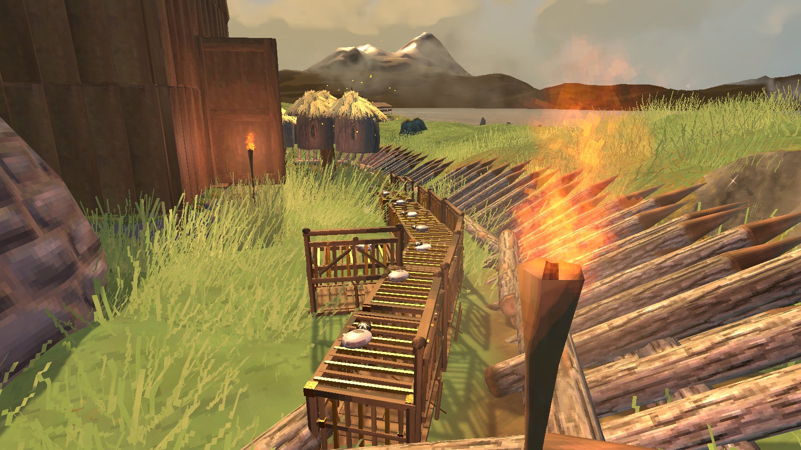

<!-- This page is made by tools/modpages/make_pages.py from the mod's thunderstore.toml, DESCRIPTION.txt, CHANGELOG.txt,
     settings and the repo's README. Change those, or the HAND-WRITTEN parts, not the rest of this page. -->

# 🪤 Quad's Bird Trap

**A buildable bird trap: bait it with berries or seeds, leave it under the open sky, and come back to a gull to pluck for feathers.**

    

<!-- GITHUB-ONLY -->[Thunderstore](https://thunderstore.io/c/valheim/p/Quads_Lab/Quads_Bird_Trap/)  ·  <!-- END GITHUB-ONLY -->[Source code](https://github.com/HardHeadHackerHead/valheim-mods/tree/main/mods/BirdTrap)  ·  [Report a bug](https://github.com/HardHeadHackerHead/valheim-mods/issues/new?template=bug.yml&title=%5BQuad%27s%20Bird%20Trap%5D%20)  ·  [Discord](https://discord.gg/EwTjQxEZPy)

<!-- GITHUB-ONLY -->**Install:** with [r2modman](https://thunderstore.io/c/valheim/p/ebkr/r2modman/) or Thunderstore Mod Manager from [Thunderstore](https://thunderstore.io/c/valheim/p/Quads_Lab/Quads_Bird_Trap/), or press **F7** in the game with our [mod manager](https://github.com/HardHeadHackerHead/valheim-mod-manager).<!-- END GITHUB-ONLY -->

## ✨ Features

- Build it with the hammer at a workbench (8 Wood, 2 Leather Scraps). It is a slatted box with a drop-door propped up by a stick tied to the bait pedal.
- Use it to put bait in: raspberries, blueberries, cloudberries, barley, or beech, birch, carrot, turnip or onion seeds. Hold the alternate-place key (Shift) and use it to fill it at once. It holds five.
- Baited and with open sky above it, a bird comes in 8 to 14 minutes (game time, so it keeps going while you are away). It eats one bait, the prop falls and the door drops.
- Birds roost at night, and come at first light: sleep through the night and every trap you baited the day before has its bird in the morning. Under a roof none come, and the trap tells you why.
- Use it again to pluck the gull (2 or 3 feathers) and let it go. The door goes back up, and with bait left the next bird is on its way.
- Look at it to see how much bait is left and about how long until a bird. Build a few for a steady supply of feathers for arrows.
- It has its own hand-made look: wicker slats, a drop-door on a forked prop stick, berries on a leaf, and a grey-and-white gull that hops about and pecks once it's caught.

## 📸 Screenshots

<!-- HAND-WRITTEN: screenshots -->
**The Bird Trap**

**A row of traps along the fence**

<!-- END HAND-WRITTEN: screenshots -->

## 🎮 How to use

| Key | What it does |
|---|---|
| **E** / Shift + **E** at a bird trap | Add bait (or pluck the bird) / fill it with bait |

<!-- HAND-WRITTEN: how-to-use -->

<!-- END HAND-WRITTEN: how-to-use -->

## 🧩 Other mods

<!-- HAND-WRITTEN: other-mods -->
**Known clashes:** none known.
<!-- END HAND-WRITTEN: other-mods -->

Found a clash with another mod? [Tell us](https://github.com/HardHeadHackerHead/valheim-mods/issues/new?template=bug.yml&title=%5BQuad%27s%20Bird%20Trap%5D%20) which one and what happened.

## 👥 Multiplayer

**Who needs it:** Everyone, and **the host above all**: a game without the mod deletes the pieces when their area loads. Restart after installing or updating them.

<!-- HAND-WRITTEN: multiplayer -->
A trap's bait, bird and timer are saved on the trap, so everyone sees the same trap, and two players can't both take one bird.

**The host decides:** catch times, bait, open sky, roosting at night and feathers per bird. While you play on their world their values replace yours (your file isn't changed); a host without the mod leaves everyone their own.
<!-- END HAND-WRITTEN: multiplayer -->

## 🌍 Languages

**English, Русский (Russian), Deutsch (German), 简体中文 (Chinese), Português do Brasil (Portuguese), Español (Spanish), Français (French), Polski (Polish), Türkçe (Turkish).** It follows the game's own language setting.

The translations were made with AI, so a few words may be off. To correct one, or to add your language, put a file in `BepInEx/config/translations/com.quad.birdtrap/` named after the game's name for the language (`German.json`, `Italian.json`, `Japanese.json`...) with only the lines you change, copied from [English.json](https://github.com/HardHeadHackerHead/valheim-mods/blob/main/mods/BirdTrap/translations/English.json) (it wins over the built-in one). Or [tell us](https://github.com/HardHeadHackerHead/valheim-mods/issues/new?template=bug.yml&title=%5BQuad%27s%20Bird%20Trap%5D%20Translation%3A%20) the better words and we'll put them in for everyone.

## ⚙️ Settings

In `BepInEx/config/com.quad.birdtrap.cfg`, made the first time the game runs with the mod. r2modman and Thunderstore Mod Manager edit it under **Config editor**.<!-- GITHUB-ONLY --> With our mod manager: **F7**, then **Mod settings**.<!-- END GITHUB-ONLY -->

**Catching**

| Setting | Default | What it does |
|---|---|---|
| `MinutesMin` | `8` | Shortest wait (real minutes, in game time) from baiting to a bird. In multiplayer the server's value applies. |
| `MinutesMax` | `14` | Longest wait (real minutes, in game time) from baiting to a bird. In multiplayer the server's value applies. |
| `BaitHeld` | `5` | How many pieces of bait a trap holds (each bird eats one). In multiplayer the server's value applies. |
| `NeedsOpenSky` | `true` | Birds only come to a trap with open sky above it (not under a roof). In multiplayer the server's value applies. |
| `BirdsRoostAtNight` | `true` | No birds come at night: one due then comes in the morning. In multiplayer the server's value applies. |

**Plucking**

| Setting | Default | What it does |
|---|---|---|
| `FeathersMin` | `2` | Fewest feathers a bird gives. In multiplayer the server's value applies. |
| `FeathersMax` | `3` | Most feathers a bird gives. In multiplayer the server's value applies. |

## 🤖 Made with AI

Made with the help of Claude (Anthropic), with Claude Code: designed, written and checked together, and tried in the game.

## 💬 Join us on Discord

Come hang out with the people who make and play these mods. In the **Quads Lab Discord** you can:

- 🛠️ **Get help** and report bugs straight to us
- 👀 **See new mods first**, and help test them before they're released
- 🗳️ **Suggest ideas** and vote on what we make next
- 🏰 **Share your builds**, bases and arena runs
- 🤖 **Talk AI coding and vibe coding** with people building things with AI, the way these mods are made

**[Join the Quads Lab Discord →](https://discord.gg/EwTjQxEZPy)**

## 🧪 About Quads Lab

Quads Lab is where **Quad H** ([HardHeadHackerHead](https://github.com/HardHeadHackerHead)) builds software with AI, of every kind:
these Valheim mods are one of its projects. Each mod is designed by a player, written with [Claude Code](https://claude.com/claude-code)
and tested in our own world, with **bobisme** as our tester.

- 🌐 [quadslab.io](https://quadslab.io)
- 🧰 [All Quads Lab mods on Thunderstore](https://thunderstore.io/c/valheim/p/Quads_Lab/)
- 💻 [Source code on GitHub](https://github.com/HardHeadHackerHead/valheim-mods)
- 💬 [Discord](https://discord.gg/EwTjQxEZPy)
- 🐞 Found a bug? [Open an issue on GitHub](https://github.com/HardHeadHackerHead/valheim-mods/issues/new/choose)

## 📜 Recent changes

- **1.2.2** Fix: after reloading the mod at the main menu (the mod manager's reload, or F6), its old build piece stayed in the hammer's list after it was gone, and every change to your bag threw an error half-way: crafting gave the item without taking the cost, and picking things up could go wrong, until the game was restarted. Its piece now comes off the list it was put on, and destroyed pieces left there by any mod are cleared when it registers.
- **1.2.1** Fix: bait you put in a trap whose owner didn't answer (they left, or the trap went out of range) was lost: it now comes back to your bag after a few seconds. Fix: the bait still in a trap that is broken or removed now drops beside it, as a smelter's ore does (bait put in before this version isn't known by kind and doesn't drop).
- **1.2.0** Now in your language: English, Russian, German, Chinese (Simplified), Portuguese (Brazil), Spanish, French, Polish and Turkish, following the game's own Language setting. The game's own names are used for its things (items, creatures, lands, stations). The translations were made with AI: to correct a line, or add a language, put a file in BepInEx/config/translations/com.quad.birdtrap/ named after the game's name for the language (German.json...) with only the lines you change, copied from translations/English.json on GitHub. The bait's name keeps its capital letters (German nouns need them).

<!-- GITHUB-ONLY -->[Every change](CHANGELOG.txt)<!-- END GITHUB-ONLY --><!-- THUNDERSTORE-ONLY: Every change is on the Changelog tab. -->
