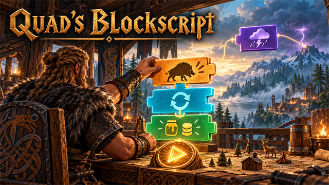
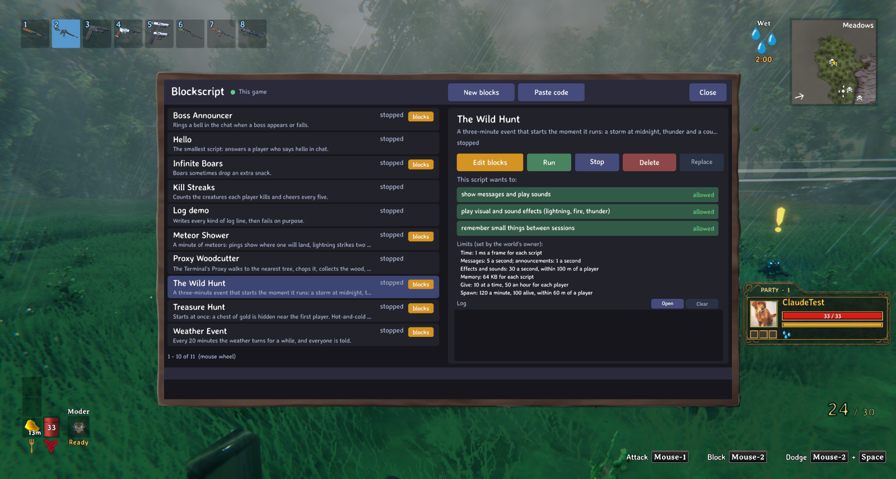
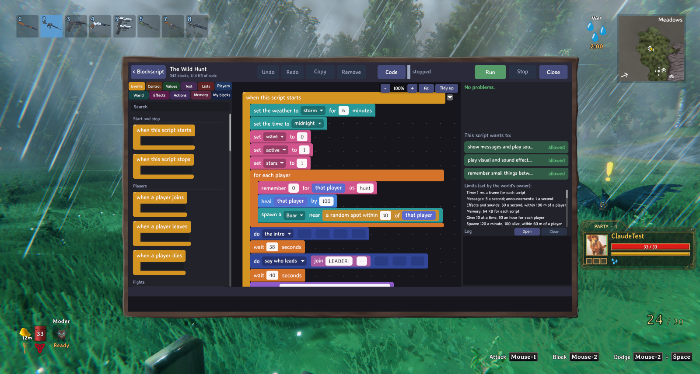
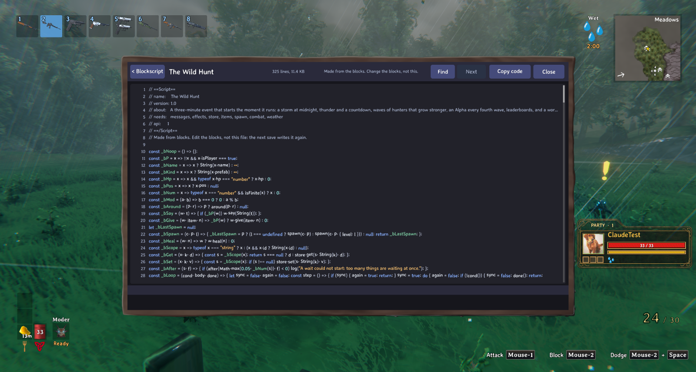
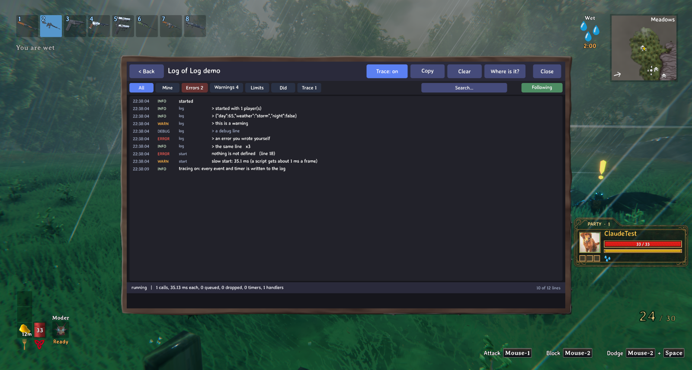
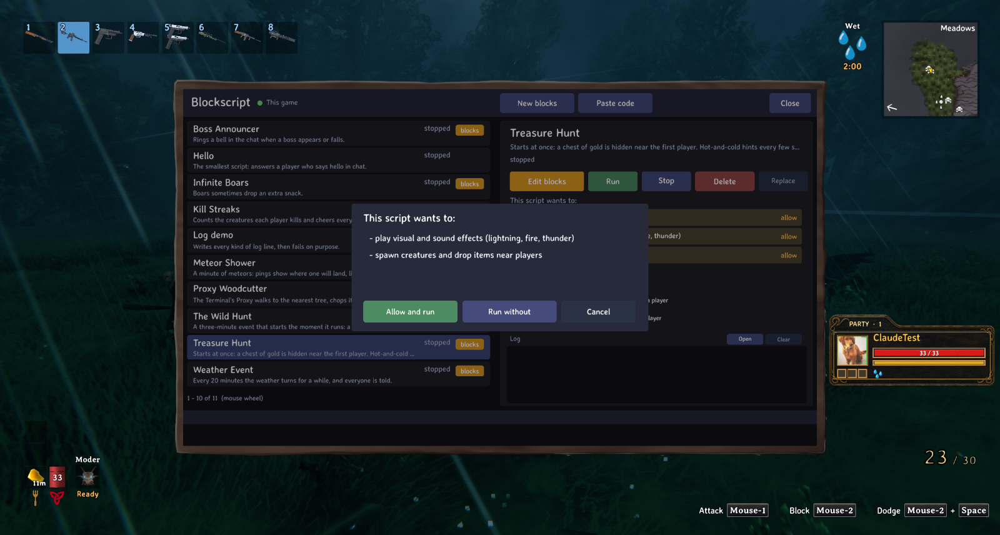

<!-- This page is made by tools/modpages/make_pages.py from the mod's thunderstore.toml, DESCRIPTION.txt, CHANGELOG.txt,
     settings and the repo's README. Change those, or the HAND-WRITTEN parts, not the rest of this page. -->

# 🧱 Quad's Blockscript



**Scratch-style visual scripting (block coding): snap blocks into events, quests, minigames and server rules. No-code automation and admin tools, or write JavaScript. Safe sandbox with limits, live co-editing, runs on the server.**

    

<!-- GITHUB-ONLY -->[Thunderstore](https://thunderstore.io/c/valheim/p/Quads_Lab/Quads_Blockscript/)  ·  <!-- END GITHUB-ONLY -->[Source code](https://github.com/HardHeadHackerHead/valheim-mods/tree/main/mods/Blockscript)  ·  [Report a bug](https://github.com/HardHeadHackerHead/valheim-mods/issues/new?template=bug.yml&title=%5BQuad%27s%20Blockscript%5D%20)  ·  [Discord](https://discord.gg/EwTjQxEZPy)

[](https://discord.gg/EwTjQxEZPy)  [](https://buymeacoffee.com/quadh)

<!-- GITHUB-ONLY -->**Install:** with [r2modman](https://thunderstore.io/c/valheim/p/ebkr/r2modman/) or Thunderstore Mod Manager from [Thunderstore](https://thunderstore.io/c/valheim/p/Quads_Lab/Quads_Blockscript/), or press **F7** in the game with our [mod manager](https://github.com/HardHeadHackerHead/valheim-mod-manager).<!-- END GITHUB-ONLY -->

## ✨ Features

Press Home and make your own game rules out of blocks, or type JavaScript if you prefer: "when a boar dies, maybe give honey", "every 20 minutes turn the weather", a three-minute monster hunt with a leaderboard. Scripts are plain files, they run on the server, and they start the moment you press Run, with no restart.

### The editor

- A palette of 221 blocks in 11 tabs (events, control, values, text, lists, players, world, effects, actions, memory, my blocks) with a search box. Drag blocks onto a stack, change a number or pick an item from a list, and press Run.
- Waits, signals, lists, loops, your own blocks with inputs, math and text, all compiled to the same JavaScript you could type. Open the Code page to see it.
- Zoom, tidy up, collapse a stack, undo and redo, copy a block, and red blocks that point at what is wrong.
- Click a "when" block and the top of the palette shows what that event gives you (the player, what was said, the place...), ready to drag. A number too big or too small for its block turns red and says what it will run as.
- A log page for whoever writes the script: levels, the script's own lines, errors with their line (and the block they came from), a trace switch, filters and a copy button. A limits panel shows what the world's owner allows.

### What a script can do

- React to kills, deaths, joins, chat, bosses, day and night, picking things up, eating, building, hits, raids and weather, trees falling and logs breaking, or to a timer.
- Say things, show banners and speech bubbles, ping the map, give and take small amounts of items, spawn creatures and decorations, change the weather, wind and time, play lightning, fire and sounds, shake the screen, heal and hurt, start a raid.
- Remember things between sessions, per player or for the world.

### Safe for strangers

- Scripts never touch the game directly: no files, no other mods, no new prefabs, no killing a player, no boss items. Every power is asked for in plain words and allowed one by one; the risky ones are marked red.
- Time, spawns, items, effects and messages all have limits the owner can change in the settings. A script that goes over is told no and the log says which limit, and the player sees a note on screen. A script that loops forever or breaks five times in a minute is paused.

### Together

- Scripts run on the server (single player, the host, or a dedicated server) and know every player wherever they are in the world, not only those near the host. Players who have the mod get items, healing and effects on their own game, with their own switches for the risky ones; players without it still see the messages, the weather and the creatures.
- Admins edit the server's scripts from their own game, and several admins can edit one script live: you see each other's blocks, pointers and names, and blocks someone is moving are held for them.
- Works with Quad's Terminal: a Blockscript program on the computer, and scripts that steer its Proxy character.

Nine example scripts come with it, all made of blocks: The Wild Hunt, Meteor Shower, Treasure Hunt, Lucky Boars, Fine Wood from logs, Welcome Wagon, Boss Announcer, Weather Event and Kill Streaks.

## 📸 Screenshots

<!-- HAND-WRITTEN: screenshots -->
**The script list: The Wild Hunt picked, its powers and the world's limits**



**The block editor on The Wild Hunt: palette tabs, search, zoom, My blocks and waits**



**The generated JavaScript on the code page**



**The log page: levels, your own lines, an error with its line, filters and the trace switch**



**The permission box: what a script asks for, the risky ones in red**


<!-- END HAND-WRITTEN: screenshots -->

## 🎮 How to use

| Key | What it does |
|---|---|
| **Home** (a setting) | Open or close the Blockscript editor (also the console command `blockscript`) |

<!-- HAND-WRITTEN: how-to-use -->
### Getting started in 2 minutes

1. **Install it** (see above) and **restart the game**. Load a world: it works in single player, as the host, and on a dedicated server.
2. Press **Home**. The script list opens, with the example scripts already in it.
3. Pick **The Wild Hunt** and press **Run**. A box says what it wants to do (show messages, play effects, give items, spawn creatures, change health, change the weather). Press **Allow and run**. A storm rolls in, it turns to midnight, and the first hunters come. It ends at dawn on its own (three minutes); **Stop** ends it early (the weather stays as it was, so set it right yourself).
4. Press **New blocks**, name your script, and **Edit blocks**. It starts with a small "when someone says hello" script. Drag blocks from the palette on the left into the middle: a yellow **when** block starts a stack, and the blocks under it run in order when that happens. Round blocks are values and fit into the sockets of other blocks. Pick items and creatures from the lists, type numbers and words into the white boxes.
5. Press **Run** (top right). Say `hello` in chat to try the starter script. Changes you make while it runs are saved and the script restarts by itself.

Your scripts are plain files in `BepInEx/config/Blockscript/`: `NAME.blocks.json` is what the editor edits and `NAME.js` is the code made from it (the host runs the `.js`). Each script's log is written to `BepInEx/config/Blockscript/logs/NAME.log`. The examples are written there the first time the mod runs and are never written over a script you have changed.

### The editor, page by page

**The script list** (the first page). Each script shows its name, what it does, whether it runs, and a "limit hit" tag if it was refused something. Pick one to see what it wants to do (click a power to allow or deny it), the world's limits for those powers, and its log. Buttons: **New blocks**, **Paste code** (a JavaScript script from the clipboard), **Edit blocks** (or **View code** for a typed script), **Run**, **Stop**, **Delete** (press twice).

**The block page.**

- **Palette tabs** on the left: Events (the yellow "when" blocks), Control (if, repeat, for each, after), Values, Text, Lists, Players, World, Effects, Actions, Memory and My blocks. The **Search** box finds a block in any tab by its words. Dragging a block back onto the palette deletes it.
- **Workspace** in the middle: drag blocks onto a stack and they snap in. **-** and **+** zoom (50% to 150%), **Fit** shows everything, **Tidy up** puts the stacks in columns. The arrow beside a "when" block collapses the stack to one line. A **note** block is a sticky comment.
- **Toolbar:** Undo, Redo, Copy (duplicates the selected block), Remove, **Code** (the generated JavaScript, with line numbers and colours, Find and Copy code), **Run**, **Stop**. The header shows how many blocks and how much code the script has (at most 1500 blocks and 120 KB).
- **What an event gives you:** click a "when" block (or any block under it) and the top of the palette shows "This event gives you": the player, what was said, the place, the kind of tree and so on, ready to drag into a socket. When nothing is selected, the palette says where to look.
- **Numbers out of range:** every number box has a smallest and a largest value (give and drop take 1 to 1000, for example). A number outside it turns red, the block says what it will run as ("At most 1000 here: it runs as 1000."), and it shows in the problems list as a warning.
- **Names...** (in the Memory, Lists and My blocks tabs) lists your variables, lists and my-blocks with how often each is used, and renames or deletes them.
- **Side panel:** the **problems** list (click one to jump to the red block), the **powers** the script wants, the world's **limits** for those powers, and the **log**.

**The log page** (press **Open** by the log). Filters with counts: All, Mine (lines the script wrote itself with `log`), Errors, Warnings, Limits, Did (what it actually did: gave this, spawned that), and Trace. **Search**, **Following** (stay at the newest line) or paused, scrolling through all 500 lines, a click opens a line to show its stack, and when the line came from a block there is a **Go to the block** button. **Copy** puts what you see on the clipboard, **Clear** empties it, **Where is it?** shows the log file, and **Trace** records every event and timer the script is given.

A **LIMIT HIT** chip also shows in the toolbar when a script was refused something, and a note appears at the top left of your screen in the world. A refusal is not an error: the script keeps running, the call just did less (or nothing).

### Example scripts

They are written to your scripts folder the first time. Every one is a block program, so you can open it and see how it is built. A typed-code example that steers the Terminal's Proxy (needs Quad's Terminal) is in [docs/examples/proxy-woodcutter.js](https://github.com/HardHeadHackerHead/valheim-mods/blob/main/docs/examples/proxy-woodcutter.js).

| Script | What it does | Powers it asks for |
|---|---|---|
| **The Wild Hunt** | Starts the moment you run it: a storm at midnight with thunder and a countdown, a wave of hunters every 12 seconds that grows and gains stars, an Alpha with its pack every fifth wave with a taunt and a map ping, kills counted per player, a leaderboard, and at dawn the winner, a world record and rewards (coins at 5 kills, honey at 10). Three minutes. About 340 blocks. | messages, effects, store, items, spawn, combat, weather |
| **Meteor Shower** | A minute of meteors: a ping shows where one will land, lightning strikes two seconds later, and anyone close is flung away and scratched. Dodge eight to win coins. | messages, effects, store, items, combat, weather |
| **Treasure Hunt** | Starts at once: a chest of gold is hidden near the first player. Hot-and-cold hints with a compass every few seconds, a map ping after a minute, lightning and a pile of coins when it is found. | messages, effects, store, spawn |
| **Lucky Boars** | Boars sometimes drop an extra snack (10% for two honey). The smallest script that does something to a player. | items, messages |
| **Fine Wood from logs** | Ordinary logs (beech and fir, the ones that give Wood) drop two Fine Wood as well when they break into wood. Change the kind or the amount to make your own. The default limit is 50 items an hour: raise **Items given per hour per script** if you chop a lot. | spawn |
| **Welcome Wagon** | Greets players by name when they join and says what day it is and what the weather is. | messages |
| **Boss Announcer** | Rings a bell in the chat when a boss appears or falls. | messages |
| **Weather Event** | Every 20 minutes the weather turns to rain, mist or storm for a while, and everyone is told. | weather, messages |
| **Kill Streaks** | Counts the creatures each player kills and cheers every five. | store, messages |

### Powers and limits

A script lists what it needs, and you allow each power once (the box that opens when you press Run, or by clicking a power on the script list). Anything the script does without being allowed is refused.

| Power | In plain words | Asked? |
|---|---|---|
| messages | show messages and play sounds | allowed |
| effects | play visual and sound effects (lightning, fire, thunder) | allowed, capped |
| store | remember small things between sessions | allowed |
| items | give players small amounts of items | asked |
| takeItems | take items from players | asked, marked red |
| spawn | spawn creatures and drop items near players | asked |
| combat | change health and damage (a script cannot kill a player) | asked |
| weather | change the weather and the time of day | asked |
| world | place decorations (it can only remove its own) | asked, marked red |
| teleport | move players (they land on the ground) | asked, marked red |
| proxy | drive the Terminal's Proxy | asked |
| net | send a short message to a web address the owner listed | off, marked red |

What no script can do: read or write files, use the network except `net`, start programs, call other mods, make new items or pieces, remove a piece it did not place, change terrain, edit saves, give boss items, trophies or keys, or kill a player. Items given come from a list of ordinary materials and food (wood, stone, flint, resin, coal, honey, berries, mushrooms, vegetables, coins, some cooked food), at most 10 at a time and 50 an hour for each player (both are settings); taking is 20 an hour. Creatures spawned are limited to those up to Black Forest strength (boar, neck, greyling, deer, greydwarf, skeleton and a few more), never bosses, within 60 m of a player. The weather changes at most once a minute and the time of day once every 20 seconds (three at once). Every script gets about 1 ms of each frame, and a script that is over budget three frames in a row, or has five errors in a minute, is paused. The numbers the owner can change are in the settings below.

### Typing code

You do not have to use blocks. A script is a JavaScript file (modern JavaScript without `eval`, `import`, `Date` or `Math.random`) with a comment block at the top that says what it needs. Put it in `BepInEx/config/Blockscript/` (or press **Paste code**). A running script restarts when its file changes.

```js
// ==Script==
// name:  Boar Honey
// about: Boars sometimes drop honey.
// needs: items, messages
// api:   1
// ==/Script==

on("kill", e => {
  if (!e.killer || !e.killer.isPlayer || e.victim.prefab !== "Boar") return;
  if (!chance(0.10)) return;
  const n = e.killer.give("Honey", 2);            // how many it really gave (the bag may be full)
  log("gave", n, "honey to", e.killer.name);      // shows in the log page, as a line of yours
  e.killer.say("Lucky boar!");
});
```

`log(anything)` prints text, numbers and objects (as JSON); `log.info`, `log.warn`, `log.error`, `log.debug`, `print` and `assert(condition, text)` also write to the log. Events are `on("kill" | "chat" | "playerJoin" | ...)`, timers are `every(seconds, fn)` and `after(seconds, fn)`; nothing can sleep, so use a timer or the `wait` block. The full reference (every event, action, type, power, cap and failure) is [docs/scripting-api.md](https://github.com/HardHeadHackerHead/valheim-mods/blob/main/docs/scripting-api.md).

### Claude Tools

If you also have [Claude Tools](https://github.com/HardHeadHackerHead/valheim-claude-tools), it gains a `blockscript` command: `blockscript list`, `run NAME`, `stop NAME`, `log NAME [error|limit|warn|did|mine] [grep=text]`, `trace NAME on|off`, `stats NAME`, `panel page library|blocks|code|log NAME`, `server`, `collab`. Nothing in the mod needs it.

### Status and known limits

This is an early release, tested in single player (with a real restart) and by two players on a listen server; see Multiplayer for what was checked there.

- **Some effect names:** every listed visual effect (46), sound (24), status effect (14) and decoration (27) was tried in the game and works. Rested, Resting, Shelter, Warm, Cold and Freezing work on players only and are refused on creatures.
- **Not built:** a gallery of shared scripts, a world backup before a script's first run, a safe mode after a crash, an editable text editor inside the game (type in any editor and use **Paste code**, or save the file), and turning code back into blocks. `wait` is compiled to timers, so a handler that waits cannot be used for `hit` or `stop`.
- **Far from the host:** a player far from the host counts for everything (chat, events, gifts, banners, healing, effects), but spawning creatures or placing decorations next to them is refused while the host is far away, because that ground is not loaded on the host's game. The log says so.
- **Web messages (`net.send`)** are off unless the world's owner lists web addresses in the settings; a script can only send short text to those, nothing else leaves the game.

### Troubleshooting

- **Something did less than it should (two boars became one).** Open the log page and look at the orange **LIMIT** lines: they name the limit and the setting that changes it. The script was told no, not broken. Raise the limit in `com.quad.blockscript.cfg`, or have the script do less.
- **It gave 10 when I asked for 100.** One gift or drop is at most 10 of an item by default (less for some: 5 cooked meat). Raise **Most items in one gift or drop** in the settings (up to 1000), and **Items given per hour per script** if it gives often. The log says how many it got and which setting to change.
- **A red number.** It is outside what that block takes; the block says what it runs as. Type a number in range.
- **A red block.** Click it in the problems list on the right: it says what is wrong (an empty socket, a value of the wrong kind, a block used outside the "when" it belongs to).
- **An error in the log.** Errors name the event it happened in and the line of the generated code; open the line for the stack and use **Go to the block**. Five errors in a minute pauses the script (it says so); fix it and press **Run**.
- **Nothing happens when I press Home.** You must be in a world, not at the menu; check the hotkey in the settings; try the console command `blockscript`. If the window ever fails it closes itself and the game's log (`BepInEx/LogOutput.log`) says why.
- **Stuck on a black screen or a respawn that never finishes** (versions before 0.1.4 and 0.1.2): update. 0.1.4 also removes the leftover effect records older versions left in a world, when the world loads.
- **There is no undo for what a script did** (items it gave, creatures it spawned). Try new scripts in a test world first.
<!-- END HAND-WRITTEN: how-to-use -->

## 🧩 Other mods

**Goes well with**

| <a href="https://thunderstore.io/c/valheim/p/Quads_Lab/Quads_Arena/"></a> | <a href="https://thunderstore.io/c/valheim/p/Quads_Lab/Quads_Bounty_Board/"></a> | <a href="https://thunderstore.io/c/valheim/p/Quads_Lab/Quads_Companion/"></a> | <a href="https://thunderstore.io/c/valheim/p/Quads_Lab/Quads_Parkour/"></a> |
|:-:|:-:|:-:|:-:|
| [Arena](https://thunderstore.io/c/valheim/p/Quads_Lab/Quads_Arena/) | [Bounty Board](https://thunderstore.io/c/valheim/p/Quads_Lab/Quads_Bounty_Board/) | [Companion](https://thunderstore.io/c/valheim/p/Quads_Lab/Quads_Companion/) | [Parkour](https://thunderstore.io/c/valheim/p/Quads_Lab/Quads_Parkour/) |

<!-- HAND-WRITTEN: other-mods -->
**Known clashes:** none known. The hotkey (**Home** by default) is yours to change in the settings (Blockscript: `Editor`, `Open the Blockscript window`); Blockscript only reads the game's events and changes things through the game's own calls, and it does not patch crafting, building, inventories or the player's controls. Not tried yet next to other scripting or "event" mods; tell us if one of them misbehaves.

**With Quad's Terminal** (source only, not released yet): the Terminal gets a Blockscript program, so you can edit scripts on a computer in your base, and scripts can steer the Terminal's Proxy character with the `proxy` power. Neither needs the other.

**Installing:** it works with BepInEx and ScriptEngine (the F7 manager). It carries its scripting engine (Jint, a JavaScript interpreter) inside its own DLL, so `Blockscript.dll` alone is enough. See [THIRD_PARTY_NOTICES.md](https://github.com/HardHeadHackerHead/valheim-mods/blob/main/mods/Blockscript/THIRD_PARTY_NOTICES.md).
<!-- END HAND-WRITTEN: other-mods -->

Found a clash with another mod? [Tell us](https://github.com/HardHeadHackerHead/valheim-mods/issues/new?template=bug.yml&title=%5BQuad%27s%20Blockscript%5D%20) which one and what happened.

## 👥 Multiplayer

**Who needs it:** The server: the host, or the dedicated server. Players who also have it get items, healing and effects from scripts on their own game and can see (admins: edit) the server's scripts; players without it still see messages, weather and creatures.

It carries its scripting engine inside its own DLL and loads it when the game starts, and the game cannot swap that out while it runs. Restart the game after installing it or updating it (a reload in the mod manager is not enough the first time).

<!-- HAND-WRITTEN: multiplayer -->
**Status (0.1.5): tested with two players on a listen server** (the host and one other player, both with the mod). What was checked in the game: scripts acting on the other player through their game (reading their health, bag and gear; a banner, a speech bubble, giving an item, a status effect; taking an item and a shove refused by their settings), every event their game reports (picking up, building, hits, kills, eating, chat), kills reaching scripts one after another, an admin editing the server's scripts from their own game, and two people editing one block script live. The first two-player session found and fixed eight problems (0.1.1 to 0.1.5, see Recent changes). **Players far from the host (0.1.7):** before 0.1.7 the scripts only knew players within about a hundred metres of the host (chat, events and `players()` missed anyone further away). They now know every player by their connection, wherever they are. Both players were listed with their place and health in the game; a far-away player's chat and gifts are built but not yet tried at a distance. **Not tested yet:** a dedicated server, a player who is not an admin (the read-only view), the stale-save check on plain code, and a long session with many players.

**Where scripts run.** On the game that runs the world: single player, the host of a listen server, or a dedicated server. Other players' games do not run scripts; they are asked to do things.

**What works for other players.**

- *With the mod on their game:* the server asks their game to give items, take items, heal, hurt, restore stamina, apply status effects, shove, teleport and show banners, and their game checks the request again against the same lists and limits before it obeys, so a server you do not trust cannot hand you more than the mod allows. Weather, wind, effects, sounds and camera shake are played on their game too. Kills, deaths, pickups, eating, skill-ups, building and taming that only their game sees are reported to the server so scripts can react to them.
- *Without the mod:* they still see what is ordinary Valheim: spawned creatures, the time of day, chat messages. Anything that needs their own game (items, health, teleport) is refused for them, and the script's log says so by name. Nobody is ever kicked for not having the mod.

**Your switches.** In your own settings, section `My character on other servers`: `Servers may give me items` (on), `Servers may heal and hurt me` (on), `Servers may give me status effects` (on), `Servers may change what I see` (on), and three that start **off**: `Servers may take items from me`, `Servers may teleport me`, `Servers may shove me`. A server's script that asks for something you switched off is refused, and the owner's log says so.

**Editing.** An admin (the host, or anyone on the server's admin list) opens **Home** on their own game and edits the server's scripts there: the list, the block editor, the code and the logs are the server's, and saving writes to the server. Everyone else who has the mod sees a read-only list of what the server runs, with what each script can do, and the server's limits. Several admins can open the same block script and **edit it together live**: each person's selected block is outlined in their colour with their name, their pointers show, blocks someone is moving are dimmed and held for them, and undo only undoes your own changes. Two people changing different stacks merge cleanly; if two change the same box at once, the later one wins. If a script you were editing was changed by someone else in a way that cannot be merged, you are told and your change is dropped, with the reason. Plain-code scripts have a stale-save check instead: pasting over a script that changed since you opened it is refused with "Ann changed this script 2 minutes ago", and you can reload it first.

**Dedicated servers.** There is no screen on a dedicated server to press Run on, so list the scripts to start in the server's `com.quad.blockscript.cfg`, `Server` section, `Scripts to start when the world starts` (names, comma separated); they start about ten seconds after the world is ready. Put the scripts in the server's `BepInEx/config/Blockscript/` and allow their powers once (the `approvals.txt` next to them is what holds the allowed powers; copy it from a game where you allowed them).

**Good to know.** An action on another player (give, take, heal, teleport...) is answered by their game a moment later: the value a script gets back at once is what was asked for, and if their game says no (their settings, a full bag) the script's log gets a LIMIT line naming them. Speech bubbles, camera shake and creature names are sent to every game with the mod; the map ping is the game's own and everyone sees it. A player far from the host is known by their connection: their place and health come from the world, and gifts, messages, healing and effects go to their own game. Spawning creatures or placing things next to a player far from the host is refused (that ground is not loaded there).

**Not done in multiplayer:** the Terminal's Proxy over a network, and the in-world "refused" note on a dedicated server (the server's log still has it).
<!-- END HAND-WRITTEN: multiplayer -->

## 🌍 Languages

**English, Русский (Russian), Deutsch (German), 简体中文 (Chinese), Português do Brasil (Portuguese), Español (Spanish), Français (French), Polski (Polish), Türkçe (Turkish).** It follows the game's own language setting.

The translations were made with AI, so a few words may be off. To correct one, or to add your language, put a file in `BepInEx/config/translations/com.quad.blockscript/` named after the game's name for the language (`German.json`, `Italian.json`, `Japanese.json`...) with only the lines you change, copied from [English.json](https://github.com/HardHeadHackerHead/valheim-mods/blob/main/mods/Blockscript/translations/English.json) (it wins over the built-in one). Or [tell us](https://github.com/HardHeadHackerHead/valheim-mods/issues/new?template=bug.yml&title=%5BQuad%27s%20Blockscript%5D%20Translation%3A%20) the better words and we'll put them in for everyone.

## ⚙️ Settings

In `BepInEx/config/com.quad.blockscript.cfg`, made the first time the game runs with the mod. r2modman and Thunderstore Mod Manager edit it under **Config editor**.<!-- GITHUB-ONLY --> With our mod manager: **F7**, then **Mod settings**.<!-- END GITHUB-ONLY -->

**Allowed**

| Setting | Default | What it does |
|---|---|---|
| `Random events a script may start` | `army_eikthyr,army_theelder,foresttrolls` | The game's random event names (raids) that world.startEvent may start, comma separated. Keep to the ones your players can survive. |
| `Web addresses scripts may send to` | `` | Names for web addresses, like discord=https://example.com/hook;stats=https://example.com/in . Scripts use the name (net.send("discord", text)); only https; nothing is read back. |

**Editor**

| Setting | Default | What it does |
|---|---|---|
| `Open the Blockscript window` | `Home` | Opens and closes the Blockscript window (blocks, code, powers, log). The console command blockscript does the same. |

**Limits**

| Setting | Default | What it does |
|---|---|---|
| `Spawns per minute per script` | `5` | How many creatures one script may spawn in a minute (it can use that many at once, then gets one back every 60/N seconds). Raise it for your own world; every script on a server shares the owner's choice. |
| `Creatures alive per script` | `20` | How many creatures spawned by one script may be alive at once. |
| `Effects and sounds per second per script` | `10` | How many visual or sound effects one script may play in a second. |
| `Pieces placed per minute per script` | `20` | How many decorations one script may place in a minute. |
| `Pieces alive per script` | `200` | How many decorations placed by one script may stand at once. |
| `Status effects per minute per script` | `20` | How many status effects (rested, wet, burning...) one script may hand out in a minute. |
| `Items given per hour per script` | `50` | How many items one script may give each player in an hour, and drop on the ground in an hour (for everyone together). Raise it for scripts that reward work, like extra wood for every log. |
| `Most items in one gift or drop` | `10` | The most of one item a script may give or drop at once. 10 keeps each item's own amount (10 wood, 5 cooked meat); higher lets every item go up to this number. |

**My character on other servers**

| Setting | Default | What it does |
|---|---|---|
| `Servers may give me items` | `true` | A server's scripts may put small amounts of ordinary items in your bag (never boss items or trophies, only what fits). |
| `Servers may heal and hurt me` | `true` | A server's scripts may heal you, restore stamina, or hurt you (never to the last point of health, never more than 50 at once). |
| `Servers may give me status effects` | `true` | A server's scripts may put on you effects like Rested or Wet, for a short time. |
| `Servers may change what I see` | `true` | A server's scripts may force the weather and wind on your screen, play effects and sounds, shake the camera, show banners and speech bubbles. |
| `Servers may take items from me` | `false` | Off by default: a server's scripts may take small amounts of ordinary items from your bag (never tools or keys). |
| `Servers may teleport me` | `false` | Off by default: a server's scripts may move you to a place on the ground. |
| `Servers may shove me` | `false` | Off by default: a server's scripts may push you (a short shove, never more than 15 metres a second). |

**Server**

| Setting | Default | What it does |
|---|---|---|
| `Scripts to start when the world starts` | `` | Names (comma separated, as in the scripts folder) of scripts this game starts by itself about ten seconds after its world is ready, when it runs the world (single player, a host, or a dedicated server, which has no window to press Run in). The powers they need must already be allowed (approvals.txt next to the scripts). |

## 🤖 Made with AI

Made with the help of Claude (Anthropic), with Claude Code: designed, written and checked together, and tried in the game.

## 💬 Join us on Discord

<a href="https://discord.gg/EwTjQxEZPy"></a>

Come hang out with the people who make and play these mods. In the **Quads Lab Discord** you can:

- 🛠️ **Get help** and report bugs straight to us
- 👀 **See new mods first**, and help test them before they're released
- 🗳️ **Suggest ideas** and vote on what we make next
- 🏰 **Share your builds**, bases and arena runs
- 🤖 **Talk AI coding and vibe coding** with people building things with AI, the way these mods are made

**[Join the Quads Lab Discord →](https://discord.gg/EwTjQxEZPy)**

## 🧪 About Quads Lab

Quads Lab is where **Quad H** ([HardHeadHackerHead](https://github.com/HardHeadHackerHead)) builds software with AI, of every kind:
these Valheim mods are one of its projects. Each mod is designed by a player, written with [Claude Code](https://claude.com/claude-code)
and tested in our own world, with **bobisme** as our tester.

- 🌐 [quadslab.io](https://quadslab.io)
- 🧰 [All Quads Lab mods on Thunderstore](https://thunderstore.io/c/valheim/p/Quads_Lab/)
- 💻 [Source code on GitHub](https://github.com/HardHeadHackerHead/valheim-mods)
- 💬 [Discord](https://discord.gg/EwTjQxEZPy)
- ☕ [Buy me a coffee](https://buymeacoffee.com/quadh)
- 🐞 Found a bug? [Open an issue on GitHub](https://github.com/HardHeadHackerHead/valheim-mods/issues/new/choose)

## ☕ Support my mods

<a href="https://buymeacoffee.com/quadh"></a>

Every Quads Lab mod is free, and it stays that way. If one of them made your game better and you'd like to say thanks, a coffee
helps me make new mods and keep improving the ones you already play. It's 100% optional, and always appreciated!

**[☕ Buy me a coffee →](https://buymeacoffee.com/quadh)**

## 📜 Recent changes

- **0.1.7** Players far from the host now count. The scripts only knew players whose character was loaded on the host's game (within about a hundred metres of the host, and nobody at all on a dedicated server): a player further away was missing from players(), their chat never reached the scripts, their pickups, building and other events were dropped, effects near them were not shown to them, and walking away fired playerLeave (and coming back playerJoin). Players are now known by their connection: their place, health and name come from the world, and items, messages, banners, healing and effects go to their own game wherever they are. Spawning creatures or placing decorations next to a player far from the host is still refused (that ground is not loaded on the host), and says so. New setting: Most items in one gift or drop (10 keeps each item's own amount; higher lets a give or drop hand out up to that many at once); when a script asks for more, the log says how many it got and which setting to change. The give and drop blocks take up to 1000. The editor warns about a number outside a block's range (the number turns red and the block says what it runs as) instead of quietly using a smaller one. Click a "when" block (or any block under it) and the top of the block list shows what that event gives you: the player, what was said, the place and so on, ready to drag. 0.1.6: New events for trees: treeFelled (a tree comes down) and logBroken (a fallen log breaks), with the kind of tree (beech, birch, fir, oak, pine, ancient, yggdrasil), the wood it gives, whether the log split into smaller logs, where, and who did it; blocks "when a tree falls" and "when a log breaks" with what they tell. They work for every player: a player's game reports the trees it owns. New example: Fine Wood from logs (ordinary logs drop two Fine Wood as well when they break into wood). New setting: Items given per hour per script (it was always 50). The heal and hurt blocks no longer stop a script when given something that is not a player or creature. 0.1.5: pieceBuilt for pieces other players build (their message arrives before the piece does: the server now waits up to five seconds for it). playerLeave says who left (the name was always empty). Checked with two players: pickups, building, hits, kills, eating and chat from another player's game all reach the scripts. 0.1.4: Important fix. Some effects (lightning, the mead effects and others) were made as world objects, and each left an empty world record behind when it ended; the game then waits for those objects forever, so a respawn or a teleport near one never finishes. Effects are now made on each screen with no world record, and the server removes any such leftovers when a world loads and every ten minutes (the log says how many). Claude Tools: blockscript sweep. 0.1.3: Players' games now report what only they see (picking things up, building, hits, eating, skill-ups, taming): the hooks for these were only switched on on the server, so a player's game had nothing to forward. The server's log says once when it turns down an event a player's game sent, and why. 0.1.2: Fixes from the first two-player test. A script's teleport could leave the player under the game's black teleport screen for good (the game's short teleport waits for a floor it may never find): short moves now place the player on the ground directly, long ones end after 25 seconds whatever happens, and landing never counts as a fall. Actions on other players (give, heal, effects...) were refused as if their game lacked the mod, because the connection was recorded before the game knew the player's id: it is now kept up to date. After the server's mod reloads it asks players' games to greet it again. Rested and other player-only effects are refused on creatures instead of failing inside the game. 0.1.1: Fix: only the first kill in a minute reached the scripts (every creature's id was lost by the time its death was handled, so the next kills looked like repeats of the first). Kill events (Infinite Boars, The Wild Hunt's counting, Kill Streaks) fire for every kill again. New Claude Tools commands for the server's owner: blockscript players and blockscript admin NAME [on|off]. The time of day can now be set three times at once, then once every 20 seconds (Meteor Shower's morning was refused). The window's default key is Home. 0.1.0: First release. A block editor for scripts (Home, or the console command blockscript): 215 blocks in 11 tabs with search, zoom, tidy up, collapse, undo, a code page and a log page, plus typed JavaScript for people who prefer it. Waits, signals, lists, loops, your own blocks, math and text. Events for kills, deaths, joins, chat, bosses, day and night, pickups, eating, building, hits, raids, weather, respawns, chat commands and taming; actions for messages, banners, speech bubbles, map pings, items, spawning, decorations, weather, wind, time, lightning and other effects, status effects, healing and hurting, raids and web hooks. Every power is asked for in plain words, with limits the world's owner sets in the settings; a script is refused (and the log and the screen say which limit) rather than crashing. Eight example scripts, including The Wild Hunt, Meteor Shower and Treasure Hunt. Runs on the server; players who have the mod get items, healing and effects on their own game, admins edit the server's scripts from their own game and can edit one script together, live. A Blockscript program on Quad's Terminal. Not yet tried between two real games (multiplayer and live co-editing are built and tested without the game), and English only for now.

<!-- GITHUB-ONLY -->[Every change](CHANGELOG.txt)<!-- END GITHUB-ONLY --><!-- THUNDERSTORE-ONLY: Every change is on the Changelog tab. -->
