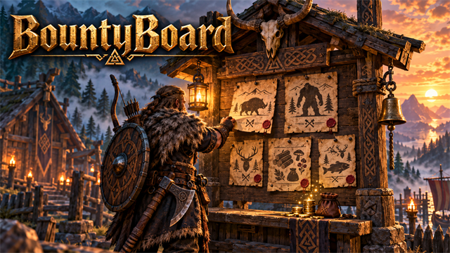
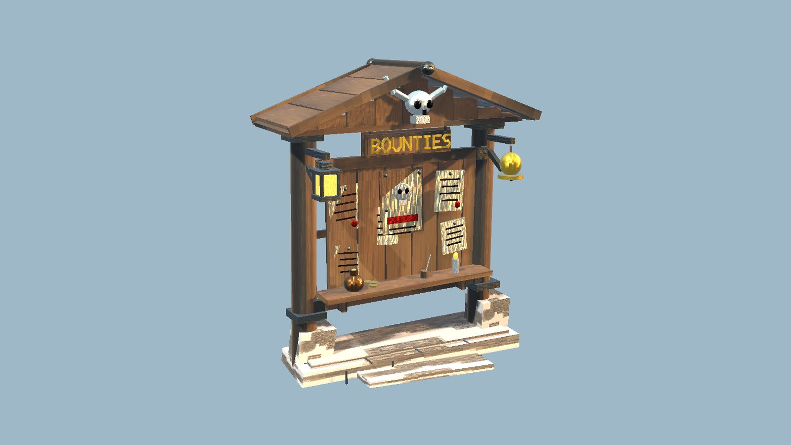
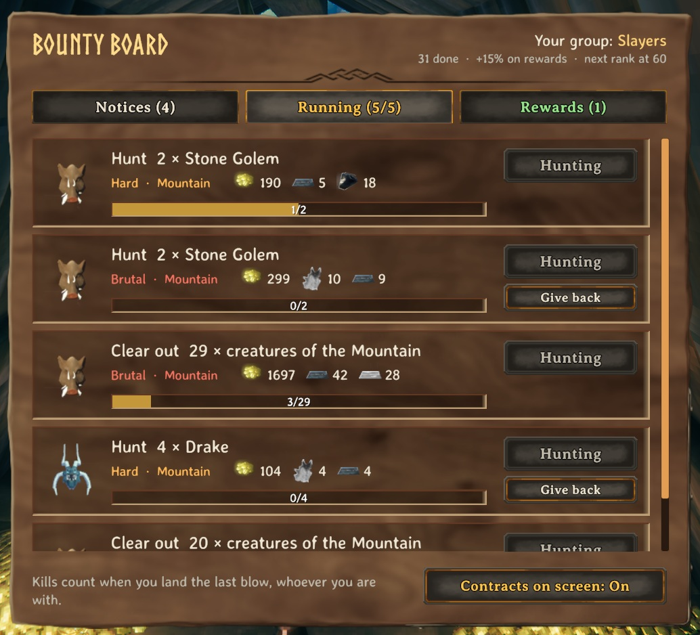

<!-- This page is made by tools/modpages/make_pages.py from the mod's thunderstore.toml, DESCRIPTION.txt, CHANGELOG.txt,
     settings and the repo's README. Change those, or the HAND-WRITTEN parts, not the rest of this page. -->

# 📜 Quad's Bounty Board

**A buildable notice board with bounties for the whole group: quests and hunting contracts, paid in coins and the materials of the stage you have reached.**

    

<!-- GITHUB-ONLY -->[Thunderstore](https://thunderstore.io/c/valheim/p/Quads_Lab/Quads_Bounty_Board/)  ·  <!-- END GITHUB-ONLY -->[Source code](https://github.com/HardHeadHackerHead/valheim-mods/tree/main/mods/BountyBoard)  ·  [Report a bug](https://github.com/HardHeadHackerHead/valheim-mods/issues/new?template=bug.yml&title=%5BQuad%27s%20Bounty%20Board%5D%20)  ·  [Discord](https://discord.gg/EwTjQxEZPy)

  

<!-- GITHUB-ONLY -->**Install:** with [r2modman](https://thunderstore.io/c/valheim/p/ebkr/r2modman/) or Thunderstore Mod Manager from [Thunderstore](https://thunderstore.io/c/valheim/p/Quads_Lab/Quads_Bounty_Board/), or press **F7** in the game with our [mod manager](https://github.com/HardHeadHackerHead/valheim-mod-manager).<!-- END GITHUB-ONLY -->

## ✨ Features

- Build it with the hammer at a workbench (Wood, Leather Scraps and Flint) and press E on it. Every board shows the same notices.
- Five notices are posted each in-game day: hunt a number of one creature, clear out a region's creatures, slay starred ones, or bring in loot.
- The whole server shares the contracts. The group can run three at a time, and a new one can only be taken when one is finished. Everyone's kills count towards them, and loot is handed in by whoever has it.
- When a contract is finished, every player collects their own reward at a board.
- The further you get, the harder it gets: each boss you beat opens the next region's creatures, and Hard and Brutal contracts (more to kill, better pay) show up more often.
- Rewards are materials you will actually use, matched to progress: resin and flint early, then copper, tin and bronze after Eikthyr, iron after the Elder, silver after Bonemass, black metal after Moder, and on up to Ashlands metals. Coins come too.
- Finished contracts raise the group's rank (Newcomers up to Legends), which adds a bonus to every reward.
- A switch in the board's menu shows the running contracts and their progress on your screen, so you can hunt with them in mind.
- It has its own hand-made look: a gabled roof, a horned skull, a hanging rune sign, pinned notices, a lantern and a bell.

The contracts are kept by the host's game, so BountyBoard has to be installed on the host too.

## 📸 Screenshots

<!-- HAND-WRITTEN: screenshots -->
**The Bounty Board**

**The group's running contracts: what each asks, its reward and how far along you are**

<!-- END HAND-WRITTEN: screenshots -->

## 🎮 How to use

| Key | What it does |
|---|---|
| **E** at a Bounty Board | Read the day's notices, take a contract, hand one in |

<!-- HAND-WRITTEN: how-to-use -->

<!-- END HAND-WRITTEN: how-to-use -->

## 🧩 Other mods

**Goes well with**

|  |  |  |  |
|:-:|:-:|:-:|:-:|
| [Party HUD](https://thunderstore.io/c/valheim/p/Quads_Lab/Quads_Party_HUD/) | [Map Share](https://thunderstore.io/c/valheim/p/Quads_Lab/Quads_Map_Share/) | [Arena](https://thunderstore.io/c/valheim/p/Quads_Lab/Quads_Arena/) | [Companion](https://thunderstore.io/c/valheim/p/Quads_Lab/Quads_Companion/) |

<!-- HAND-WRITTEN: other-mods -->
**Known clashes:** none known.
<!-- END HAND-WRITTEN: other-mods -->

Found a clash with another mod? [Tell us](https://github.com/HardHeadHackerHead/valheim-mods/issues/new?template=bug.yml&title=%5BQuad%27s%20Bounty%20Board%5D%20) which one and what happened.

## 👥 Multiplayer

**Who needs it:** Everyone, and **the host above all**: a game without the mod deletes the pieces when their area loads. Restart after installing or updating them.

<!-- HAND-WRITTEN: multiplayer -->
The host runs the group's contracts and keeps them in a file next to its settings; each player's progress is credited to whoever really played it. A kill counts when the game running that creature has the mod (in a group, usually the nearest player's).

**The host decides:** days between new notices, notices per board, most contracts at once and rewards. While you play on their world their values replace yours (your file isn't changed); a host without the mod leaves everyone their own.
<!-- END HAND-WRITTEN: multiplayer -->

## 🌍 Languages

**English, Русский (Russian), Deutsch (German), 简体中文 (Chinese), Português do Brasil (Portuguese), Español (Spanish), Français (French), Polski (Polish), Türkçe (Turkish).** It follows the game's own language setting.

The translations were made with AI, so a few words may be off. To correct one, or to add your language, put a file in `BepInEx/config/translations/com.quad.bountyboard/` named after the game's name for the language (`German.json`, `Italian.json`, `Japanese.json`...) with only the lines you change, copied from [English.json](https://github.com/HardHeadHackerHead/valheim-mods/blob/main/mods/BountyBoard/translations/English.json) (it wins over the built-in one). Or [tell us](https://github.com/HardHeadHackerHead/valheim-mods/issues/new?template=bug.yml&title=%5BQuad%27s%20Bounty%20Board%5D%20Translation%3A%20) the better words and we'll put them in for everyone.

## ⚙️ Settings

In `BepInEx/config/com.quad.bountyboard.cfg`, made the first time the game runs with the mod. r2modman and Thunderstore Mod Manager edit it under **Config editor**.<!-- GITHUB-ONLY --> With our mod manager: **F7**, then **Mod settings**.<!-- END GITHUB-ONLY -->

**Building**

| Setting | Default | What it does |
|---|---|---|
| `Cost` | `Wood:20, LeatherScraps:6, Flint:4` | What a bounty board costs to build with the hammer (at a workbench). Item prefab names and amounts, separated by commas, like FineWood:12, BronzeNails:30 (Claude Tools' `prefabs <text>` shows exact names). A cost with a mistake in it keeps the last good one. [Synced with Server] |

**Contracts**

| Setting | Default | What it does |
|---|---|---|
| `MostAtOnce` | `3` | How many contracts the group can have going at once. A new one can only be taken when one is finished. In multiplayer the server's value applies. |
| `RewardPercent` | `100` | Pay as a percentage of the standard rate (50 = half, 200 = double). In multiplayer the server's value applies. |

**Notices**

| Setting | Default | What it does |
|---|---|---|
| `DaysBetweenNewNotices` | `1` | How many in-game days before the board posts new notices. In multiplayer the server's value applies. |
| `NoticesPerBoard` | `5` | How many notices are posted. In multiplayer the server's value applies. |

**Tracker**

| Setting | Default | What it does |
|---|---|---|
| `ShowOnScreen` | `false` | Show the group's contracts and their progress on your screen (also a switch in the board's menu). |
| `X` | `14` | Distance from the left edge of the screen (UI pixels). |
| `Y` | `330` | Distance from the top of the screen (UI pixels). |
| `Scale` | `1` | Size of the tracker. |

## 🤖 Made with AI

Made with the help of Claude (Anthropic), with Claude Code: designed, written and checked together, and tried in the game.

## 💬 Join us on Discord

Come hang out with the people who make and play these mods. In the **Quads Lab Discord** you can:

- 🛠️ **Get help** and report bugs straight to us
- 👀 **See new mods first**, and help test them before they're released
- 🗳️ **Suggest ideas** and vote on what we make next
- 🏰 **Share your builds**, bases and arena runs
- 🤖 **Talk AI coding and vibe coding** with people building things with AI, the way these mods are made

**[Join the Quads Lab Discord →](https://discord.gg/EwTjQxEZPy)**

## 🧪 About Quads Lab

Quads Lab is where **Quad H** ([HardHeadHackerHead](https://github.com/HardHeadHackerHead)) builds software with AI, of every kind:
these Valheim mods are one of its projects. Each mod is designed by a player, written with [Claude Code](https://claude.com/claude-code)
and tested in our own world, with **bobisme** as our tester.

- 🌐 [quadslab.io](https://quadslab.io)
- 🧰 [All Quads Lab mods on Thunderstore](https://thunderstore.io/c/valheim/p/Quads_Lab/)
- 💻 [Source code on GitHub](https://github.com/HardHeadHackerHead/valheim-mods)
- 💬 [Discord](https://discord.gg/EwTjQxEZPy)
- ☕ [Buy me a coffee](https://buymeacoffee.com/quadh)
- 🐞 Found a bug? [Open an issue on GitHub](https://github.com/HardHeadHackerHead/valheim-mods/issues/new/choose)

## ☕ Support my mods

Every Quads Lab mod is free, and it stays that way. If one of them made your game better and you'd like to say thanks, a coffee
helps me make new mods and keep improving the ones you already play. It's 100% optional, and always appreciated!

**[☕ Buy me a coffee →](https://buymeacoffee.com/quadh)**

## 📜 Recent changes

- **1.4.4** On a server without Bounty Board, the bounty board is gone from the hammer, and a message says why: the server would delete a board built there. Server owners can change what a bounty board costs ("Building", Cost; today's cost, 20 wood, 6 leather scraps and 4 flint, is the default); in multiplayer the server's cost applies, and a cost with a mistake in it keeps the last good one. Settings: edits to the config file now apply while the game runs (a server owner no longer has to restart), and a server's admins can change the server's settings from their own game with Configuration Manager, where other players see them greyed out. Your config file always keeps your own values while you play on a server (saving it there could write the server's in). Players on an older version still get the server's settings. It's no longer counted as storage in the game's own building records (it was copied from a chest). It snaps by the corners of its base now (to floor corners, wall ends and other boards); hold the alt-place key (Shift) to place it freely.
- **1.4.3** Its windows no longer fill the log with "The LiberationSans SDF Font Asset was not found": each text is given the game's font before it starts (it looked for TextMeshPro's default font, which the game doesn't have, every time a text was made). Nothing changes on screen.
- **1.4.2** Its build piece now also clears destroyed pieces left in the hammer's list by other mods when it registers: after a mod is reloaded at the main menu, a leftover one made every change to your bag throw an error half-way (crafting gave the item without taking the cost) until the game was restarted.

<!-- GITHUB-ONLY -->[Every change](CHANGELOG.txt)<!-- END GITHUB-ONLY --><!-- THUNDERSTORE-ONLY: Every change is on the Changelog tab. -->
