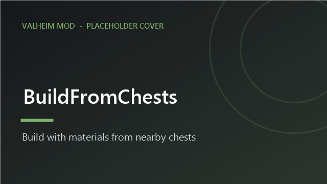
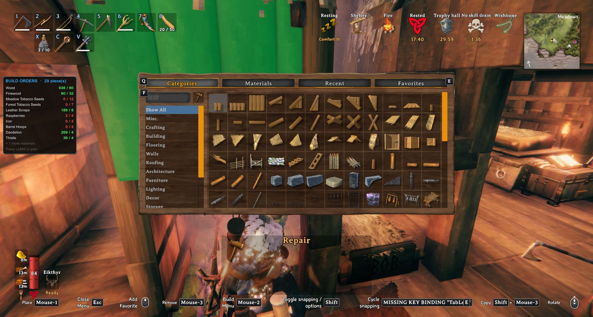

<!-- This page is made by tools/modpages/make_pages.py from the mod's thunderstore.toml, DESCRIPTION.txt, CHANGELOG.txt,
     settings and the repo's README. Change those, or the HAND-WRITTEN parts, not the rest of this page. -->

# 🔨 Quad's Build From Chests

**Building with the hammer uses materials from chests near you, not just your inventory.**

    

<!-- GITHUB-ONLY -->[Thunderstore](https://thunderstore.io/c/valheim/p/Quads_Lab/Quads_Build_From_Chests/)  ·  <!-- END GITHUB-ONLY -->[Source code](https://github.com/HardHeadHackerHead/valheim-mods/tree/main/mods/BuildFromChests)  ·  [Report a bug](https://github.com/HardHeadHackerHead/valheim-mods/issues/new?template=bug.yml&title=%5BQuad%27s%20Build%20From%20Chests%5D%20)  ·  [Discord](https://discord.gg/EwTjQxEZPy)

<!-- GITHUB-ONLY -->**Install:** with [r2modman](https://thunderstore.io/c/valheim/p/ebkr/r2modman/) or Thunderstore Mod Manager from [Thunderstore](https://thunderstore.io/c/valheim/p/Quads_Lab/Quads_Build_From_Chests/), or press **F7** in the game with our [mod manager](https://github.com/HardHeadHackerHead/valheim-mod-manager).<!-- END GITHUB-ONLY -->

## ✨ Features

- Pieces you place take materials from your inventory first, then from chests within range (default 20 m).
- The build menu shows how many of each material you have in total, so you can see what is possible before you place anything.
- Works together with CraftFromChests; each can be turned off on its own.

## 📸 Screenshots

<!-- HAND-WRITTEN: screenshots -->
**Building with the hammer: what each piece needs counts what is in the chests around you**

<!-- END HAND-WRITTEN: screenshots -->

<!-- HAND-WRITTEN: how-to-use -->

<!-- END HAND-WRITTEN: how-to-use -->

## 🧩 Other mods

<!-- HAND-WRITTEN: other-mods -->
**Known clashes**

- **Adventure Backpacks** ("Craft From Backpack"): handled. The backpack pays its part first and the chests pay only what is still missing. The backpack is never used as a chest.
- **Other craft-from-chests mods** (AzuCraftyBoxes, CraftFromContainers (aedenthorn, and its forks), Craft From Chests (Toxo), CraftFromChestsPlus, Teflon Ted's Craft From Chests, StoreAndCraft, SmartCraft-Storage, and ValheimPlus while its `CraftFromChest` section is on): they also take from chests, and two such mods count every chest twice. When one is installed this mod stands down and leaves it to them; the log says so once.
- **Any mod that refuses a payment or already paid**: respected. It runs after other mods and does nothing if they cancelled.

**Works with our mods**

- [Quad's Craft From Chests](https://thunderstore.io/c/valheim/p/Quads_Lab/Quads_Craft_From_Chests/) and [Quad's Feed From Chests](https://thunderstore.io/c/valheim/p/Quads_Lab/Quads_Feed_From_Chests/): fine together. Each works only in its own moment and pays only what the others left.
- [Quad's Build Orders](https://thunderstore.io/c/valheim/p/Quads_Lab/Quads_Build_Orders/): building planned ghosts with E is paid from nearby chests, and its fetch key takes one piece's worth out of them. Your Radius applies there too.
- [Quad's Recycler](https://thunderstore.io/c/valheim/p/Quads_Lab/Quads_Recycler/) and companions' chests ([Quad's Companion](https://thunderstore.io/c/valheim/p/Quads_Lab/Quads_Companion/)) are never used.
<!-- END HAND-WRITTEN: other-mods -->

Found a clash with another mod? [Tell us](https://github.com/HardHeadHackerHead/valheim-mods/issues/new?template=bug.yml&title=%5BQuad%27s%20Build%20From%20Chests%5D%20) which one and what happened.

## 👥 Multiplayer

**Who needs it:** Only the players who want it.

<!-- HAND-WRITTEN: multiplayer -->
It only takes from chests you could open yourself: never one someone else has open, one behind a ward that keeps you out, or a private chest.

**The host decides:** how far it reaches (Radius). While you play on their world their values replace yours (your file isn't changed); a host without the mod leaves everyone their own.
<!-- END HAND-WRITTEN: multiplayer -->

## ⚙️ Settings

In `BepInEx/config/com.quad.buildfromchests.cfg`, made the first time the game runs with the mod. r2modman and Thunderstore Mod Manager edit it under **Config editor**.<!-- GITHUB-ONLY --> With our mod manager: **F7**, then **Mod settings**.<!-- END GITHUB-ONLY -->

**Display**

| Setting | Default | What it does |
|---|---|---|
| `ShowHaveCounts` | `true` | In the build menu, show how many of each material you HAVE (inventory + chests) next to how many you need. |

**General**

| Setting | Default | What it does |
|---|---|---|
| `Enabled` | `true` | Turn the mod on or off. |
| `Radius` | `20` | How far (in meters) from YOU a chest can be and still be used while building (also for BuildOrders: building its ghosts, hold E to build all, and its fetch key). Raise it to build far from your storehouse: 60 reaches across a big base. Chests only count while their area is loaded around you (about 100 m and more). Takes effect at once. In multiplayer the server's value applies. |

## 🤖 Made with AI

Made with the help of Claude (Anthropic), with Claude Code: designed, written and checked together, and tried in the game.

## 🧪 About Quads Lab

Quads Lab is where **Quad H** ([HardHeadHackerHead](https://github.com/HardHeadHackerHead)) builds software with AI, of every kind:
these Valheim mods are one of its projects. Each mod is designed by a player, written with [Claude Code](https://claude.com/claude-code)
and tested in our own world, with **bobisme** as our tester.

- 🌐 [quadslab.io](https://quadslab.io)
- 🧰 [All Quads Lab mods on Thunderstore](https://thunderstore.io/c/valheim/p/Quads_Lab/)
- 💻 [Source code on GitHub](https://github.com/HardHeadHackerHead/valheim-mods)
- 💬 [Discord](https://discord.gg/EwTjQxEZPy)
- 🐞 Found a bug? [Open an issue on GitHub](https://github.com/HardHeadHackerHead/valheim-mods/issues/new/choose)

## 📜 Recent changes

- **1.4.2** A clearer page: what it does, who needs it in multiplayer, how it gets on with other mods, and where to report a bug. The game itself is unchanged.
- **1.4.1** A new id, com.quad.buildfromchests (it was com.dhack.buildfromchests): your settings move over by themselves the first time it starts, and the old settings file is kept as a backup. Restart the game after this update. If an old copy is still installed beside it, this one stands down and says which file to delete, so the two never both run. The DLL now says it was made with AI, as Thunderstore asks. It also stands down next to Toxo's Craft From Chests, CraftFromChestsPlus, Teflon Ted's Craft From Chests, StoreAndCraft and SmartCraft-Storage, as it already did next to AzuCraftyBoxes and CraftFromContainers: two such mods count every chest twice.
- Fix: next to Adventure Backpacks, building could cost up to twice as much (the backpack and the chests both paid). Now the backpack pays its part and the chests only what is still missing. Fix: a piece the chests can no longer pay for (someone took the materials since the menu counted them) is no longer placed for less: you get a message instead. Graves, carts, ships, a companion's bag and chest and a backpack are no longer used as storage. With AzuCraftyBoxes, CraftFromContainers or ValheimPlus' craft-from-chest installed, this mod stands down (two would count every chest twice). In multiplayer the server's Radius applies.

<!-- GITHUB-ONLY -->[Every change](CHANGELOG.txt)<!-- END GITHUB-ONLY --><!-- THUNDERSTORE-ONLY: Every change is on the Changelog tab. -->
