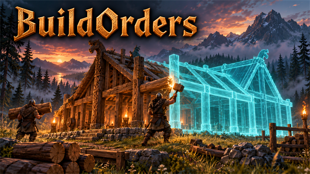
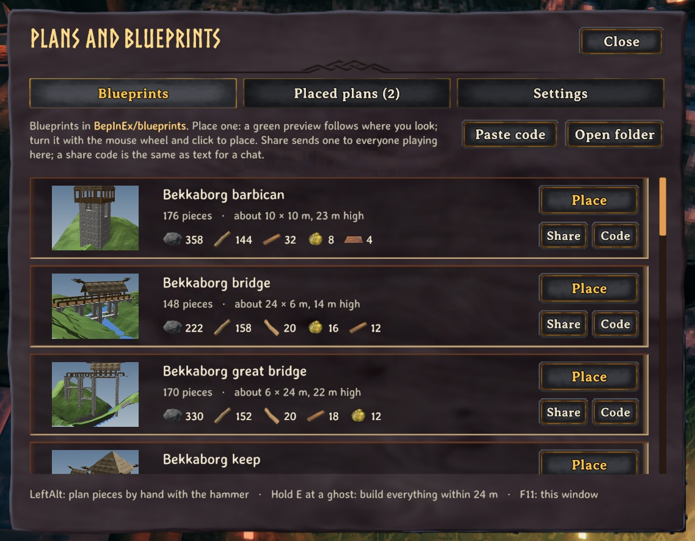

<!-- This page is made by tools/modpages/make_pages.py from the mod's thunderstore.toml, DESCRIPTION.txt, CHANGELOG.txt,
     settings and the repo's README. Change those, or the HAND-WRITTEN parts, not the rest of this page. -->

# 👻 Quad's Build Orders

**Shared ghost build orders and blueprints, a build planner for your party: plan pieces (or import a blueprint) for everyone, then build them by walking up and pressing E.**

    

<!-- GITHUB-ONLY -->[Thunderstore](https://thunderstore.io/c/valheim/p/Quads_Lab/Quads_Build_Orders/)  ·  <!-- END GITHUB-ONLY -->[Source code](https://github.com/HardHeadHackerHead/valheim-mods/tree/main/mods/BuildOrders)  ·  [Report a bug](https://github.com/HardHeadHackerHead/valheim-mods/issues/new?template=bug.yml&title=%5BQuad%27s%20Build%20Orders%5D%20)  ·  [Discord](https://discord.gg/EwTjQxEZPy)

<!-- GITHUB-ONLY -->**Install:** with [r2modman](https://thunderstore.io/c/valheim/p/ebkr/r2modman/) or Thunderstore Mod Manager from [Thunderstore](https://thunderstore.io/c/valheim/p/Quads_Lab/Quads_Build_Orders/), or press **F7** in the game with our [mod manager](https://github.com/HardHeadHackerHead/valheim-mod-manager).<!-- END GITHUB-ONLY -->

## ✨ Features

- With the hammer out, press Left Alt to turn plan mode on (press it again, or put the hammer away, to turn it off). In plan mode, placing a piece plans it instead of building it. It shows as a see-through ghost that other players see too. (A setting lets you hold the key instead.)
- Walk up to a ghost and tap E to build it: no hammer needed, on land or in the water. It builds even if nothing supports it yet (so you can build the structure around it afterwards). It costs the normal materials, from your inventory and then nearby chests (with BuildFromChests), and needs the piece to be unlocked and the spot not to be protected.
- Hold E at a ghost to build every ghost within 24 m (changeable in the F11 window) that you can afford, lowest first. Short of materials? It builds the part you can pay for, and only pieces that will stand on what is built (so nothing falls and nothing is wasted); come back with more and hold E again to carry on.
- Aiming at a ghost shows what that piece costs, what the whole plan still needs against what you have, and how many pieces holding E would build right now.
- Stability: while planning, ghosts are coloured by how well they would be supported (blue solid, green to red weaker, red would fall), worked out from the same rules the game uses. F10 shows or hides the colours any time, and the prompt says how well the ghost you are looking at would hold. It is an estimate; the game does the real check once a piece is built.
- In plan mode, ghosts act like real pieces: you can aim at them and your next piece snaps onto their snap points, so you can lay out a whole structure with the normal snapping and build it later, piece by piece.
- When you build for real, your placement snaps onto a ghost of the same piece, and the ghost disappears once the real piece is built.
- U selects the piece you are looking at to build more like it, and Delete removes a ghost. F9 shows or hides all ghosts.
- A panel totals the materials your orders still need.

Swimming: your hammer stays out in the water (setting BuildWhileSwimming), so you can plan and build from it. Equip the hammer before you jump in, because the game does not let you equip things while swimming.

Fetching materials: with the hammer out and a piece selected, a hint appears when your inventory is short of materials that the chests nearby have. Press Y (FetchKey) to take one stack of each of those materials out of the chests and into your inventory. It uses BuildFromChests for the chest access, so that mod has to be installed.

### Bridge builder

- Pick Bridge in the hammer's build menu (Misc tab). Click where the bridge starts and walk or swim across (a ghost of it stretches after you, with its length and cost), then click where it ends.
- A Bridge panel opens beside the ghost: width (2, 4 or 6 m), material (wood; core wood, stronger and reaching deeper water; darkwood; stone, with a pillar under every slab and a stonecutter needed), sides (handrails, half walls or none), open or covered (a pitched roof on tall posts), supports down to the riverbed (auto, every 2 m, every 4 m), straight or gently arched, ends (a deck sloping from bank to bank, or a level deck with steps down at the lower end, stopping at the waterline), and torches every 8 m. The ghost changes as you choose and the panel shows what it takes against what you have. Confirm places it; Change end lets you aim the end again; Cancel or Esc drops it. Your choices are kept for next time.
- The deck slopes evenly from end to end (kept above the water, so a pier works too). Build it with E or hold E like any plan; Remove and take-down work as usual. The ground is not levelled, and a bridge is not moved (its posts are cut to the riverbed where it stands). It warns when it is very steep, the water is too deep for the posts, or there is no workbench within reach of an end.

### Plans window (F11)

- Blueprints: your library from BepInEx/blueprints, with each one's size, piece count and materials. Place one and a green preview of the whole structure follows where you look: mouse wheel turns it (Shift for fine steps), R turns it 90°, PgUp/PgDn raise or lower it, Home resets the height, click places it, right-click or Esc cancels. Nothing is built for free.
- Level ground, always: when you place a plan, the ground under all of it is set to its floor height, with a gentle 3 m slope back to the natural ground around it, and painted as dirt (a brown pad shows where in the preview). The ghosts appear once it is done, about a second later. The game moves ground at most 8 m, and warded ground is left alone. It pauses if you walk more than 60 m away. Removing or moving the plan puts the ground back exactly as it was (unless some of it is already built; finishing a build never resets anything). Placed plans also have a Level ground button to level again.
- Placed plans: every plan with its pieces left, how far away and which way, and the materials you have against what it needs. Build nearby builds every ghost within the build-all radius; Move picks the plan up into the preview again so you can put it somewhere better or turn it; Remove takes it away (click twice); if part of it is built, choose Remove ghosts only, or Also take down what is built: those pieces come down as with the hammer and their materials go straight into your inventory (the same materials the game gives back). You can also remove every ghost within a radius you choose, up to 150 m.
- Pictures: every blueprint gets a picture in the Plans window, made in the game from the blueprint itself (or put your own image next to the file, same name, .png or .jpg).
- Sharing: Share on a blueprint sends it (and its picture) to everyone playing with you; it shows up in their Plans window under "Shared with you" (Place, Save to library, Dismiss). Not playing together? Code copies it as a short text code to paste in a chat, and Paste code adds a code to your library. A shared blueprint is only a list of pieces: it never places itself, and you place it where you look.
- Settings: build-all radius (up to 64 m), reach for E, ghost view distance, opacity, how many ghosts show at once, and switches for the main features. Changes save straight away.
- Ask an AI assistant to design a build for you: BuildOrders writes a design guide (CLAUDE.md), every piece's size, snap points, cost and rules, and helper scripts (placing, a stability check, previews) into BepInEx/blueprints. Start Claude Code in that folder, ask for a fort or a house, then place it from the F11 window.
- With the Claude Tools mod installed, an AI assistant can also see your game and place, check, photograph, build and take down blueprints for you through its request mailbox (BepInEx/claude). BuildOrders adds those commands to it by itself; without Claude Tools nothing changes.

## 📸 Screenshots

<!-- HAND-WRITTEN: screenshots -->
**The Plans window (F11): blueprints to place, with their size and cost**

**Building a plan: what it still needs, in the corner**

<!-- END HAND-WRITTEN: screenshots -->

## 🎮 How to use

| Key | What it does |
|---|---|
| **Left Alt** / **E** | Toggle plan mode (placing then plans a ghost) / build the ghost you walk up to |
| **G** / **Delete** / **F9** / **F10** | Select a ghost piece / remove a ghost / show or hide ghosts / show or hide the stability colours |
| Hold **E** at a ghost | Build everything buildable within 24 m (adjustable), lowest first |
| **F11** | Plans window: place blueprints with a preview, move or remove placed plans, build settings |
| Hammer → **Bridge** | Click where a bridge starts, walk across, click where it ends: a wooden bridge to build, posts down to the riverbed |
| Wheel / **R** / **PgUp** **PgDn** / click | While placing a blueprint: turn it / turn 90° / raise or lower it / place it (right-click or Esc cancels); the ground under it is levelled when placed |

<!-- HAND-WRITTEN: how-to-use -->

<!-- END HAND-WRITTEN: how-to-use -->

## 🧩 Other mods

<!-- HAND-WRITTEN: other-mods -->
**Known clashes**

- **Adventure Backpacks** and other backpack mods: building ghosts with E or *Build all* pays from your inventory and nearby chests (with [Quad's Build From Chests](https://thunderstore.io/c/valheim/p/Quads_Lab/Quads_Build_From_Chests/)), not from a backpack.

**Works with our mods**

- [Quad's Build From Chests](https://thunderstore.io/c/valheim/p/Quads_Lab/Quads_Build_From_Chests/): ghosts are paid from nearby chests, and the fetch key takes one piece's worth out of them.
- [Quad's Companion](https://thunderstore.io/c/valheim/p/Quads_Lab/Quads_Companion/): a companion can build your plans near its home.
- [Claude Tools](https://github.com/HardHeadHackerHead/valheim-claude-tools): an AI assistant can design blueprints, place them, photograph and check them.
- Other mods can add to it through its planning API ([docs/buildorders-api.md](../../docs/buildorders-api.md)).
<!-- END HAND-WRITTEN: other-mods -->

Found a clash with another mod? [Tell us](https://github.com/HardHeadHackerHead/valheim-mods/issues/new?template=bug.yml&title=%5BQuad%27s%20Build%20Orders%5D%20) which one and what happened.

## 👥 Multiplayer

**Who needs it:** Only the players who want it.

<!-- HAND-WRITTEN: multiplayer -->
Ghosts are drawn on each player's own game, not built into the world: players with the mod swap the plans, players without it see nothing. A shared blueprint lands in the receiver's *Shared with you* list. The Bridge entry in the hammer menu works without the host having the mod.

**The host decides:** the Build all radius and reach. While you play on their world their values replace yours (your file isn't changed); a host without the mod leaves everyone their own.
<!-- END HAND-WRITTEN: multiplayer -->

## 🌍 Languages

**English, Русский (Russian), Deutsch (German), 简体中文 (Chinese), Português do Brasil (Portuguese), Español (Spanish), Français (French), Polski (Polish), Türkçe (Turkish).** It follows the game's own language setting.

The translations were made with AI, so a few words may be off. To correct one, or to add your language, put a file in `BepInEx/config/translations/com.quad.buildorders/` named after the game's name for the language (`German.json`, `Italian.json`, `Japanese.json`...) with only the lines you change, copied from [English.json](https://github.com/HardHeadHackerHead/valheim-mods/blob/main/mods/BuildOrders/translations/English.json) (it wins over the built-in one). Or [tell us](https://github.com/HardHeadHackerHead/valheim-mods/issues/new?template=bug.yml&title=%5BQuad%27s%20Build%20Orders%5D%20Translation%3A%20) the better words and we'll put them in for everyone.

## ⚙️ Settings

In `BepInEx/config/com.quad.buildorders.cfg`, made the first time the game runs with the mod. r2modman and Thunderstore Mod Manager edit it under **Config editor**.<!-- GITHUB-ONLY --> With our mod manager: **F7**, then **Mod settings**.<!-- END GITHUB-ONLY -->

**Blueprints**

| Setting | Default | What it does |
|---|---|---|
| `ImportKey` | `F11` | Opens the Plans window: place blueprints from BepInEx/blueprints with a preview, see and remove placed plans, change build settings. |

**Bridge**

| Setting | Default | What it does |
|---|---|---|
| `Width` | `2` | Deck width in metres (2, 4 or 6). The last bridge's choices are kept. |
| `Material` | `Wood` | Wood; CoreWood (round logs from pines: stronger, reaches deeper water); Darkwood (needs tar); Stone (stone floors on stone pillars, needs a stonecutter). |
| `Sides` | `Rails` | Rails (posts and a handrail), HalfWalls (a low wall along each side) or None (cheapest). |
| `Roof` | `false` | A roof over the deck on tall posts (a covered bridge). |
| `Supports` | `Auto` | Posts down to the riverbed: Auto (every 2 m in deep water, else 4 m), Every2m (strongest) or Every4m (cheapest). Stone always has a pillar under every slab. |
| `Shape` | `Straight` | Straight from end to end, or Arched (the middle raised in a gentle curve). |
| `Ends` | `Sloped` | Sloped (the deck slopes from one bank's height to the other's) or Steps (a level deck, with steps down at the lower end). |
| `Torches` | `false` | Standing torches along the deck every 8 m (wood and resin). |

**General**

| Setting | Default | What it does |
|---|---|---|
| `Enabled` | `true` | Turn the mod on or off. |
| `ShowGhosts` | `true` | Show the glowing ghosts of planned pieces. |
| `BuildByPressingUse` | `true` | Walk up to a ghost and press E to build it, no hammer needed. It costs the normal materials (from your inventory, then nearby chests if BuildFromChests is installed). |
| `BuildWhileSwimming` | `true` | Keep your hammer in your hand while swimming so you can plan and build from the water (equip it before you jump in: the game does not let you equip things while swimming). |
| `BuildAllRadius` | `24` | Holding E at a ghost (or Build nearby in the Plans window) builds every ghost within this many metres, lowest first, as far as your materials go. In multiplayer the server's value applies. |
| `StabilityInPlanMode` | `true` | Show the stability colours automatically while plan mode is on. |
| `UseReach` | `6` | How close (in metres) you must be to a ghost to build it by pressing E. In multiplayer the server's value applies. |
| `ViewDistance` | `80` | Ghosts further than this many metres away are hidden (saves performance). |
| `MaxGhosts` | `600` | Most ghosts shown at once (the nearest first). Big plans need more; very high numbers can cost frame rate. |
| `SnapDistance` | `1.5` | When you're placing the same piece as a nearby order, your placement ghost snaps onto the order if it's within this many metres. |

**Keys**

| Setting | Default | What it does |
|---|---|---|
| `FetchKey` | `Y` | With the hammer out and a piece selected: press this to take exactly what it needs out of the chests around you (topping you up to one piece's worth, or another piece's worth when you have enough) and put it in your inventory (needs BuildFromChests). |
| `StabilityKey` | `F10` | Show or hide the estimated stability colours on the ghosts (blue = solid, green to red = weaker, red = would fall). |
| `PlanKey` | `LeftAlt` | With the hammer out, press this to turn plan mode on or off (or hold it, see PlanIsToggle). In plan mode, placing a piece records a build order instead of building it. Costs nothing. |
| `PlanIsToggle` | `true` | On: press the plan key once to turn plan mode on, again to turn it off (it also ends when you put the hammer away). Off: plan mode only while the key is held. |
| `SelectKey` | `U` | Aim at a build order and press this to select that piece in your hammer. (Pick a key the game doesn't use: G, the old default, also opens the game's radial menu.) |
| `RemoveKey` | `Delete` | Aim at a build order and press this to remove it. Hold Shift to remove every order within 8 m of it. |
| `ToggleGhostsKey` | `F9` | Show or hide all the ghosts. |

**Look**

| Setting | Default | What it does |
|---|---|---|
| `GhostOpacity` | `0.18` | How solid the ghosts are: 0.05 = barely there, 0.3 = clearly visible, 1 = solid. (Aimed-at ghosts are shown more solid.) |
| `GhostShader` | `` | Advanced: force a particular shader name for the ghosts. Leave blank to pick the best transparent one automatically (the choice is written to the BepInEx log). |

**Panel**

| Setting | Default | What it does |
|---|---|---|
| `AlwaysShow` | `false` | Show the materials panel all the time. Off = only while you're building (hammer equipped). |
| `OffsetX` | `10` | Gap from the left edge of the screen (UI pixels). |
| `OffsetY` | `260` | Gap from the top of the screen (UI pixels). |

## 🤖 Made with AI

Made with the help of Claude (Anthropic), with Claude Code: designed, written and checked together, and tried in the game.

## 💬 Join us on Discord

Come hang out with the people who make and play these mods. In the **Quads Lab Discord** you can:

- 🛠️ **Get help** and report bugs straight to us
- 👀 **See new mods first**, and help test them before they're released
- 🗳️ **Suggest ideas** and vote on what we make next
- 🏰 **Share your builds**, bases and arena runs
- 🤖 **Talk AI coding and vibe coding** with people building things with AI, the way these mods are made

**[Join the Quads Lab Discord →](https://discord.gg/EwTjQxEZPy)**

## 🧪 About Quads Lab

Quads Lab is where **Quad H** ([HardHeadHackerHead](https://github.com/HardHeadHackerHead)) builds software with AI, of every kind:
these Valheim mods are one of its projects. Each mod is designed by a player, written with [Claude Code](https://claude.com/claude-code)
and tested in our own world, with **bobisme** as our tester.

- 🌐 [quadslab.io](https://quadslab.io)
- 🧰 [All Quads Lab mods on Thunderstore](https://thunderstore.io/c/valheim/p/Quads_Lab/)
- 💻 [Source code on GitHub](https://github.com/HardHeadHackerHead/valheim-mods)
- 💬 [Discord](https://discord.gg/EwTjQxEZPy)
- 🐞 Found a bug? [Open an issue on GitHub](https://github.com/HardHeadHackerHead/valheim-mods/issues/new/choose)

## 📜 Recent changes

- **1.14.1** Smoother multiplayer. Placing or removing a big plan sent the other players one message per piece, all at the same moment (a 1000-piece blueprint: 1000 messages at once, a lag spike for everyone). The pieces now go many to a message, a few at a time over the next frames, in the order they happened. Older versions on the same server read the new messages as before.
- **1.14.0** Now in your language: English, Russian, German, Chinese (Simplified), Portuguese (Brazil), Spanish, French, Polish and Turkish, following the game's own Language setting. The game's own names are used for its things (items, creatures, lands, stations). The translations were made with AI: to correct a line, or add a language, put a file in BepInEx/config/translations/com.quad.buildorders/ named after the game's name for the language (German.json...) with only the lines you change, copied from translations/English.json on GitHub. Blueprint and plan names are kept as they are; only what is shown is translated, so old plans load as before. The Bridge piece's name is translated too, so the game may tell you about it once as a new piece. Fixed: the hold-E text on the build prompt spilled past its bar.
- **1.13.0** The Plans window (F11), the bridge options and all the help on screen are now built from the game's own interface: the crafting panel's wood, tabs and buttons, the game's slider for settings, the inventory's item cells and tooltips for materials, and the game's fonts. The help (materials, banners, the build prompt with its hold-E bar, the fetch hint) is part of the HUD now, so it hides with it and follows your interface scale; the bridge options sit at the side so the bridge stays in view.

<!-- GITHUB-ONLY -->[Every change](CHANGELOG.txt)<!-- END GITHUB-ONLY --><!-- THUNDERSTORE-ONLY: Every change is on the Changelog tab. -->
