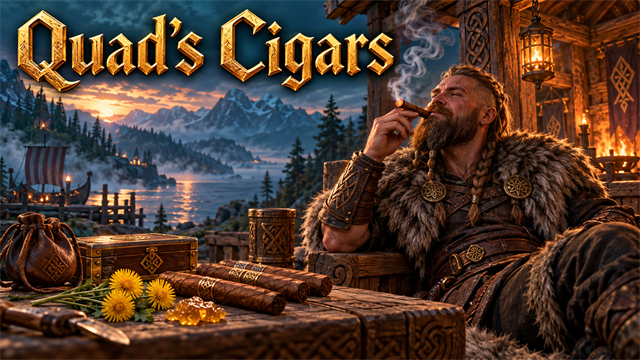
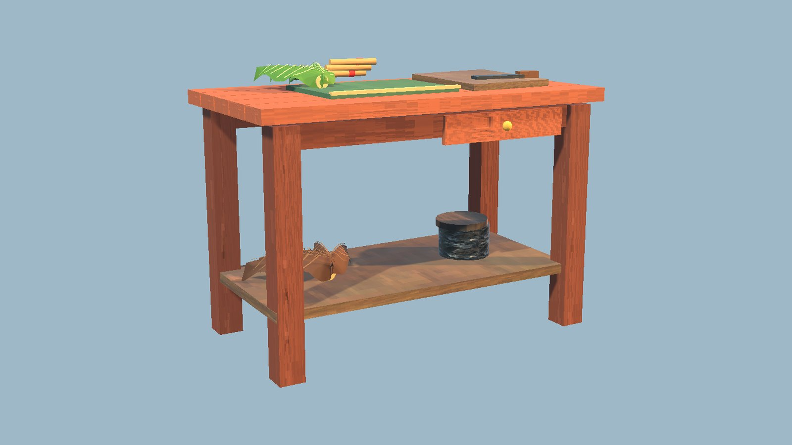
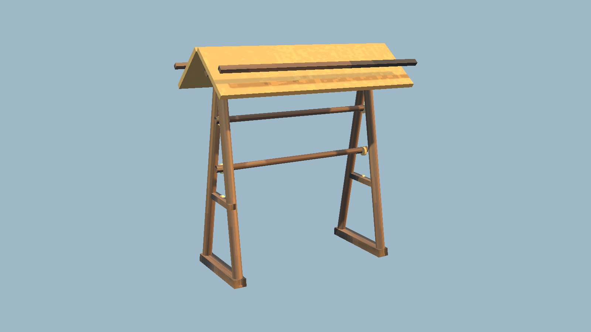
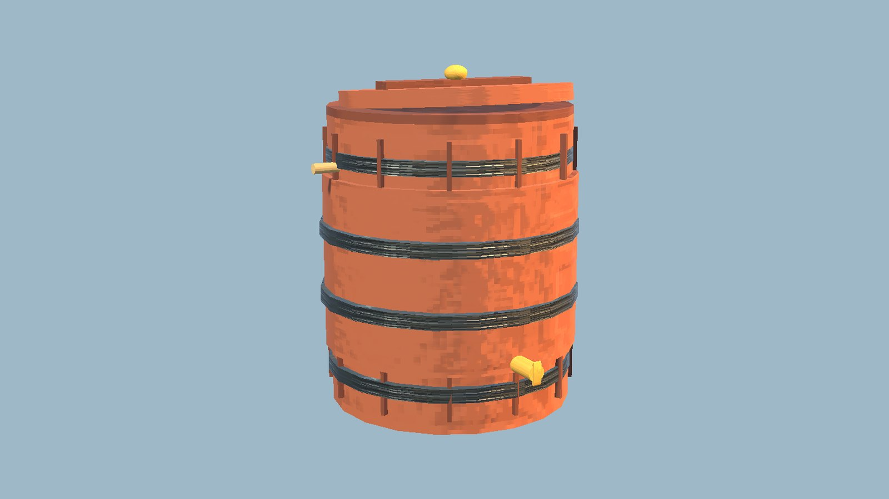
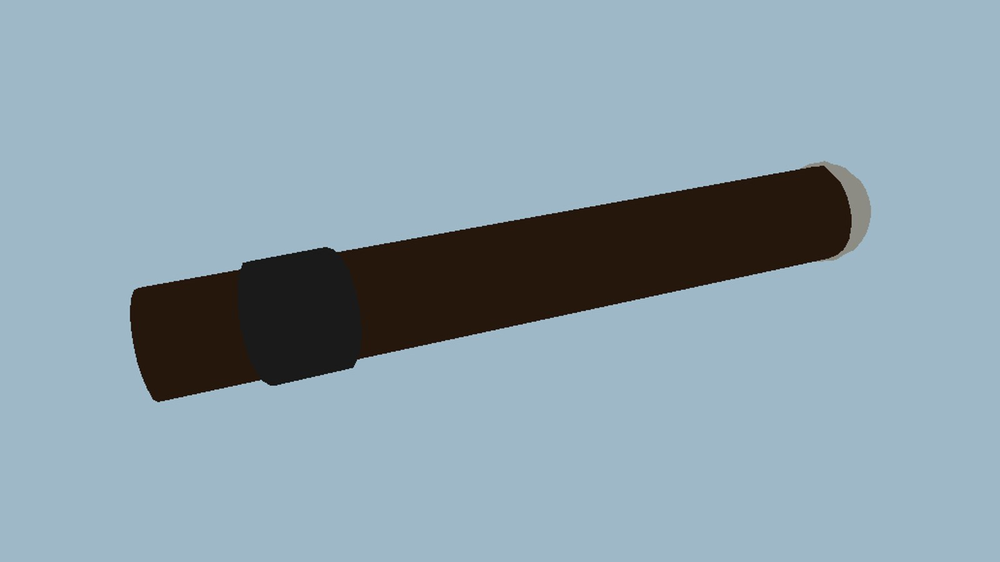
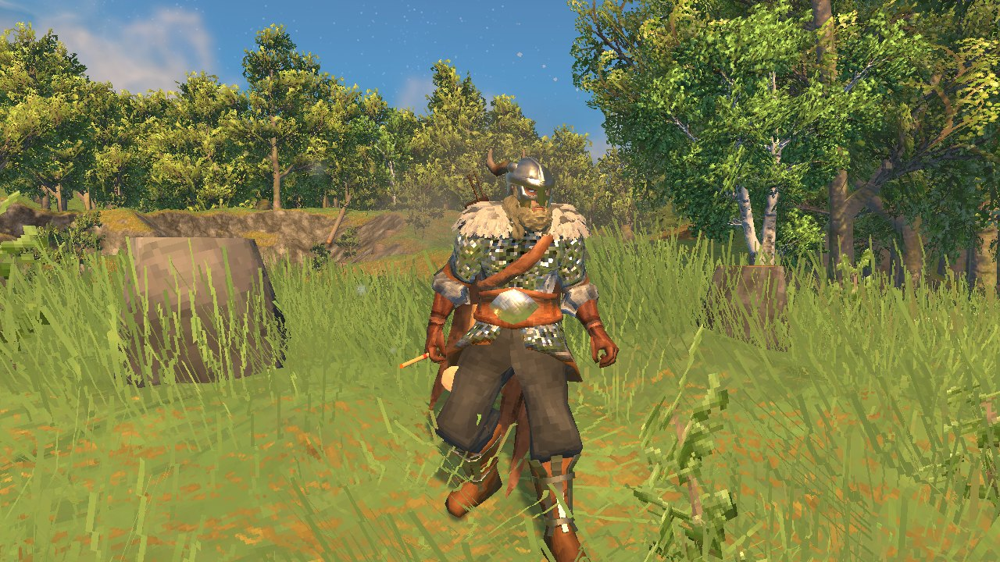

<!-- This page is made by tools/modpages/make_pages.py from the mod's thunderstore.toml, DESCRIPTION.txt, CHANGELOG.txt,
     settings and the repo's README. Change those, or the HAND-WRITTEN parts, not the rest of this page. -->

# 🚬 Quad's Cigars

**Grow tobacco, cure it, roll your own cigars and smoke them for buffs: farm wild tobacco plants, dry and age the leaves, build a rolling table and a humidor, and light up. Smoking as a real part of the game, with smoke others see.**

    

<!-- GITHUB-ONLY -->[Thunderstore](https://thunderstore.io/c/valheim/p/Quads_Lab/Quads_Cigars/)  ·  <!-- END GITHUB-ONLY -->[Source code](https://github.com/HardHeadHackerHead/valheim-mods/tree/main/mods/CigarSmoking)  ·  [Report a bug](https://github.com/HardHeadHackerHead/valheim-mods/issues/new?template=bug.yml&title=%5BQuad%27s%20Cigars%5D%20)  ·  [Discord](https://discord.gg/EwTjQxEZPy)

  

<!-- GITHUB-ONLY -->**Install:** with [r2modman](https://thunderstore.io/c/valheim/p/ebkr/r2modman/) or Thunderstore Mod Manager from [Thunderstore](https://thunderstore.io/c/valheim/p/Quads_Lab/Quads_Cigars/), or press **F7** in the game with our [mod manager](https://github.com/HardHeadHackerHead/valheim-mod-manager).<!-- END GITHUB-ONLY -->

## ✨ Features

Grow tobacco, cure it, roll your own cigars and smoke them: smoking as a real part of the game, from the wild plant to the cigar in your mouth.

### How it works

- Find wild tobacco growing in the Meadows, the Black Forest and the Plains. Each biome has its own strain, a little different in leaf and flower. Picking a plant gives leaves and seeds.
- Sow seeds with the cultivator in cultivated soil. A plant grows tall in about 25 minutes and gives leaves and more seeds. Every strain can be farmed in the Meadows, the Black Forest and the Plains.
- Build a Tobacco Drying Rack: hang fresh leaves on it and take them back dried. Then pack the dried leaves into a Tobacco Curing Barrel to age them.
- Build a Cigar Rolling Table (near a workbench) and roll cigars in the game's own crafting menu. Build a Humidor beside the table to roll the finer cigars.
- Light a cigar from your inventory or hotbar. You smoke for 5 minutes with a cigar in your hand or mouth, an ember and drifting smoke; with a weapon in your right hand it stays in your mouth. Other players with the mod see it too.

The cigars (one at a time; lighting another starts it fresh):
- Connecticut (Dried Meadow Leaf, Resin): Relaxed, stamina regenerates 15% faster.
- Maduro (Aged Forest Leaf, Honey, Resin; needs a Humidor): Smooth, health regenerates 40% faster.
- Corojo (Aged Forest Leaf, Thistle, Resin; needs a Humidor): Shadow, you make less noise and are harder to spot.
- Habano (Aged Plains Leaf, Cloudberries, Resin; needs a Humidor): Fired Up, attacks and sprinting cost less stamina.

Wild tobacco only appears in parts of the world you have not visited yet. It adds new items, pieces and plants. Restart the game after installing or updating it.

## 📸 Screenshots

<!-- HAND-WRITTEN: screenshots -->
**The Cigar Rolling Table**

**The tobacco Drying Rack**

**The Curing Barrel**

**A Maduro cigar**

**Out in the Meadows with a cigar**

<!-- END HAND-WRITTEN: screenshots -->

<!-- HAND-WRITTEN: how-to-use -->

<!-- END HAND-WRITTEN: how-to-use -->

## 🤝 Goes well with

|  |  |  |  |
|:-:|:-:|:-:|:-:|
| [Skal Tavern](https://thunderstore.io/c/valheim/p/Quads_Lab/Quads_Skal_Tavern/) | [Slot Machine](https://thunderstore.io/c/valheim/p/Quads_Lab/Quads_Slot_Machine/) | [Rainbows](https://thunderstore.io/c/valheim/p/Quads_Lab/Quads_Rainbows/) | [Bird Trap](https://thunderstore.io/c/valheim/p/Quads_Lab/Quads_Bird_Trap/) |

## 🧩 Other mods

<!-- HAND-WRITTEN: other-mods -->
**Known clashes:** none known.

Add-ons (such as a pipes mod) can hook their smoke into it so only one smoke runs at a time: see [docs/cigars-api.md](../../docs/cigars-api.md).
<!-- END HAND-WRITTEN: other-mods -->

Found a clash with another mod? [Tell us](https://github.com/HardHeadHackerHead/valheim-mods/issues/new?template=bug.yml&title=%5BQuad%27s%20Cigars%5D%20) which one and what happened.

## 👥 Multiplayer

**Who needs it:** Everyone, and **the host above all**: a game without the mod deletes the pieces when their area loads. Restart after installing or updating them.

<!-- HAND-WRITTEN: multiplayer -->
A lit cigar is saved on the player, so friends with the mod see it and its smoke. The rack and barrel hand out each batch once, whoever takes it. Wild tobacco grows only in areas first visited after installing the mod.

**The host decides:** how long a cigar lasts, its strength, and growing, drying and curing times. While you play on their world their values replace yours (your file isn't changed); a host without the mod leaves everyone their own.
<!-- END HAND-WRITTEN: multiplayer -->

## 🌍 Languages

**English, Русский (Russian), Deutsch (German), 简体中文 (Chinese), Português do Brasil (Portuguese), Español (Spanish), Français (French), Polski (Polish), Türkçe (Turkish).** It follows the game's own language setting.

The translations were made with AI, so a few words may be off. To correct one, or to add your language, put a file in `BepInEx/config/translations/com.quad.cigarsmoking/` named after the game's name for the language (`German.json`, `Italian.json`, `Japanese.json`...) with only the lines you change, copied from [English.json](https://github.com/HardHeadHackerHead/valheim-mods/blob/main/mods/CigarSmoking/translations/English.json) (it wins over the built-in one). Or [tell us](https://github.com/HardHeadHackerHead/valheim-mods/issues/new?template=bug.yml&title=%5BQuad%27s%20Cigars%5D%20Translation%3A%20) the better words and we'll put them in for everyone.

## ⚙️ Settings

In `BepInEx/config/com.quad.cigarsmoking.cfg`, made the first time the game runs with the mod. r2modman and Thunderstore Mod Manager edit it under **Config editor**.<!-- GITHUB-ONLY --> With our mod manager: **F7**, then **Mod settings**.<!-- END GITHUB-ONLY -->

**Building**

| Setting | Default | What it does |
|---|---|---|
| `RollingTableCost` | `Wood:10, Resin:4, LeatherScraps:4` | What a Cigar Rolling Table costs to build with the hammer (at a workbench). Item prefab names and amounts, separated by commas, like FineWood:12, BronzeNails:30 (Claude Tools' `prefabs <text>` shows exact names). A cost with a mistake in it keeps the last good one. [Synced with Server] |
| `HumidorCost` | `FineWood:10, LeatherScraps:3, Resin:3` | What a Humidor costs to build with the hammer (near a Cigar Rolling Table). Item prefab names and amounts, separated by commas, like FineWood:12, BronzeNails:30 (Claude Tools' `prefabs <text>` shows exact names). A cost with a mistake in it keeps the last good one. [Synced with Server] |
| `DryingRackCost` | `Wood:8, Resin:2` | What a Drying Rack costs to build with the hammer (at a workbench). Item prefab names and amounts, separated by commas, like FineWood:12, BronzeNails:30 (Claude Tools' `prefabs <text>` shows exact names). A cost with a mistake in it keeps the last good one. [Synced with Server] |
| `CuringBarrelCost` | `Wood:12, Resin:4, LeatherScraps:2` | What a Curing Barrel costs to build with the hammer (at a workbench). Item prefab names and amounts, separated by commas, like FineWood:12, BronzeNails:30 (Claude Tools' `prefabs <text>` shows exact names). A cost with a mistake in it keeps the last good one. [Synced with Server] |

**Crafting**

| Setting | Default | What it does |
|---|---|---|
| `ConnecticutCigarCost` | `dh_dried_meadow:3, Resin:1` | What rolling a batch of connecticut cigars takes at the Cigar Rolling Table. Item prefab names and amounts, separated by commas, like FineWood:12, BronzeNails:30 (Claude Tools' `prefabs <text>` shows exact names). A cost with a mistake in it keeps the last good one. [Synced with Server] |
| `MaduroCigarCost` | `dh_aged_forest:3, Honey:1, Resin:1` | What rolling a batch of maduro cigars takes at the Cigar Rolling Table. Item prefab names and amounts, separated by commas, like FineWood:12, BronzeNails:30 (Claude Tools' `prefabs <text>` shows exact names). A cost with a mistake in it keeps the last good one. [Synced with Server] |
| `HabanoCigarCost` | `dh_aged_plains:3, Cloudberry:2, Resin:1` | What rolling a batch of habano cigars takes at the Cigar Rolling Table. Item prefab names and amounts, separated by commas, like FineWood:12, BronzeNails:30 (Claude Tools' `prefabs <text>` shows exact names). A cost with a mistake in it keeps the last good one. [Synced with Server] |
| `CorojoCigarCost` | `dh_aged_forest:3, Thistle:2, Resin:1` | What rolling a batch of corojo cigars takes at the Cigar Rolling Table. Item prefab names and amounts, separated by commas, like FineWood:12, BronzeNails:30 (Claude Tools' `prefabs <text>` shows exact names). A cost with a mistake in it keeps the last good one. [Synced with Server] |

**Growing**

| Setting | Default | What it does |
|---|---|---|
| `TobaccoGrowMinutes` | `25` | How long a tobacco plant takes to grow (minutes). Applies to plants as they load. In multiplayer the server's value applies. |
| `DryingMinutes` | `2` | How long a batch of leaves takes to dry on the rack (minutes). Applies to batches put in after a change. In multiplayer the server's value applies. |
| `CuringMinutes` | `6` | How long a batch of leaves takes to age in the barrel (minutes). Applies to batches put in after a change. In multiplayer the server's value applies. |

**Look**

| Setting | Default | What it does |
|---|---|---|
| `DrawSmoke` | `true` | Draw the smoke curling up from smoking players. |
| `DrawGlow` | `true` | Give the ember a small flickering light (nice at night). |

**Smoking**

| Setting | Default | What it does |
|---|---|---|
| `Minutes` | `5` | How long one cigar lasts (minutes). In multiplayer the server's value applies. |
| `EffectStrength` | `100` | How strong the cigars' bonuses are (percent of the default). 0 for none. In multiplayer the server's value applies. |

## 🤖 Made with AI

Made with the help of Claude (Anthropic), with Claude Code: designed, written and checked together, and tried in the game.

## 💬 Join us on Discord

Come hang out with the people who make and play these mods. In the **Quads Lab Discord** you can:

- 🛠️ **Get help** and report bugs straight to us
- 👀 **See new mods first**, and help test them before they're released
- 🗳️ **Suggest ideas** and vote on what we make next
- 🏰 **Share your builds**, bases and arena runs
- 🤖 **Talk AI coding and vibe coding** with people building things with AI, the way these mods are made

**[Join the Quads Lab Discord →](https://discord.gg/EwTjQxEZPy)**

## 🧪 About Quads Lab

Quads Lab is where **Quad H** ([HardHeadHackerHead](https://github.com/HardHeadHackerHead)) builds software with AI, of every kind:
these Valheim mods are one of its projects. Each mod is designed by a player, written with [Claude Code](https://claude.com/claude-code)
and tested in our own world, with **bobisme** as our tester.

- 🌐 [quadslab.io](https://quadslab.io)
- 🧰 [All Quads Lab mods on Thunderstore](https://thunderstore.io/c/valheim/p/Quads_Lab/)
- 💻 [Source code on GitHub](https://github.com/HardHeadHackerHead/valheim-mods)
- 💬 [Discord](https://discord.gg/EwTjQxEZPy)
- ☕ [Buy me a coffee](https://buymeacoffee.com/quadh)
- 🐞 Found a bug? [Open an issue on GitHub](https://github.com/HardHeadHackerHead/valheim-mods/issues/new/choose)

## ☕ Support my mods

Every Quads Lab mod is free, and it stays that way. If one of them made your game better and you'd like to say thanks, a coffee
helps me make new mods and keep improving the ones you already play. It's 100% optional, and always appreciated!

**[☕ Buy me a coffee →](https://buymeacoffee.com/quadh)**

## 📜 Recent changes

- **0.4.3** On a server without Quad's Cigars, its tables, rack, barrel, saplings and cigar recipes are gone from the menus, and a message says why: the server would delete what was built there, and the cigars would be lost. Server owners can change what each piece and each cigar costs ("Building" and "Crafting"; the defaults are today's costs); in multiplayer the server's costs apply, and a cost with a mistake in it keeps the last good one. Settings: edits to the config file now apply while the game runs (a server owner no longer has to restart), and a server's admins can change the server's settings from their own game with Configuration Manager, where other players see them greyed out. Your config file always keeps your own values while you play on a server (saving it there could write the server's in). Players on an older version still get the server's settings. The drying rack and curing barrel are no longer counted as storage in the game's own building records (they were copied from a chest).
- **0.4.2** Fix: after reloading the mod at the main menu (the mod manager's reload, or F6), its old pieces stayed in the hammer's and the cultivator's lists after it was gone, and every change to your bag threw an error half-way: crafting gave the item without taking the cost, and picking things up could go wrong, until the game was restarted. They now come off the lists they were put on, and destroyed pieces left there by any mod are cleared when it registers.
- **0.4.1** Fix: the trader no longer buys tobacco seeds, leaves or cigars. They were worth coins, and a field of tobacco could be grown into as many coins as you liked.

<!-- GITHUB-ONLY -->[Every change](CHANGELOG.txt)<!-- END GITHUB-ONLY --><!-- THUNDERSTORE-ONLY: Every change is on the Changelog tab. -->
