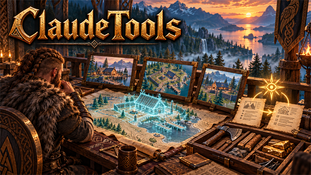

<!-- This page is made by tools/modpages/make_pages.py from the mod's thunderstore.toml, DESCRIPTION.txt, CHANGELOG.txt,
     settings and the repo's README. Change those, or the HAND-WRITTEN parts, not the rest of this page. -->

# 🤖 Quad's AI Mod Toolkit

**For Claude Code and other AI assistants: see your game and make mods that work with other mods: pictures, the game's real code, a pre-release check, clash reports and safe reloading. Works through files on your PC; no network port.**

    

[Source code](https://github.com/HardHeadHackerHead/valheim-mods/tree/main/mods/ClaudeTools)  ·  [Report a bug](https://github.com/HardHeadHackerHead/valheim-mods/issues/new?template=bug.yml&title=%5BQuad%27s%20AI%20Mod%20Toolkit%5D%20)  ·  [Discord](https://discord.gg/EwTjQxEZPy)

**Install:** press **F7** in the game with our [mod manager](https://github.com/HardHeadHackerHead/valheim-mod-manager), or take `ClaudeTools.dll` from [dist/](https://github.com/HardHeadHackerHead/valheim-mods/tree/main/dist). It isn't on Thunderstore.

## ✨ Features

Lets an AI assistant like Claude Code see your game and help you, through files on your computer: no network port, and it only moves your character or presses keys for you (the shoot command, for screenshots) where the game allows cheats.

### How it works

- The assistant writes a request (a text file of commands) into BepInEx/claude/requests. While you are in a world, the game carries it out and writes the answer next to it. Pictures go to BepInEx/claude/shots.
- It can take pictures (your view, a separate camera anywhere, all round a place, straight down), survey the ground, and find out your status, inventory, what is nearby, what you are looking at, which mods are running, their settings and the log. It can show you a message and put a pin on your map.
- Other mods add their own commands. With BuildOrders, the assistant can design blueprints, place them, photograph and check them.
- F12 saves a screenshot for the assistant; Ctrl+F12 surveys the ground where you look.
- For mod makers: modcheck <mod> before a release (mistakes that lose players' things or break other mods), who and clashes (which popular mods change the same things as yours), game (the game's real code instead of guesses) and gameupdate (what a game update broke). Skills for Claude Code and modkit (the same commands with the game closed) are written to BepInEx/claude. What the top 100 Thunderstore mods patch is built in; DownloadMods keeps it fresh and keeps their code to read on your computer (never loaded, never shared). A dev loader reloads the mod you are making (in BepInEx/scripts) without a restart, when that's safe; templates/ has code to copy. Type claude <command> in the game's console (F5, once "Enable console" is on in Settings → Gameplay) to run any command yourself.
- The assistant's guide is written to BepInEx/claude/CLAUDE.md: start Claude Code in that folder (or in BepInEx/blueprints to design builds).

Requests are off until you switch AllowRequests on (BepInEx/config/com.quad.claudetools.cfg). Changing mods' settings by request needs AllowConfigChanges as well. Only switch requests on while you work with an assistant.

## 📸 Screenshots

<!-- HAND-WRITTEN: screenshots -->
**A picture the assistant took with its own camera, over your base**

**Straight down over a place (the top command)**

<!-- END HAND-WRITTEN: screenshots -->

## 🎮 How to use

| Key | What it does |
|---|---|
| **F12** / **Ctrl+F12** | Save a screenshot / survey the ground around where you look, for the AI assistant |

<!-- HAND-WRITTEN: how-to-use -->

<!-- END HAND-WRITTEN: how-to-use -->

## 🧩 Other mods

<!-- HAND-WRITTEN: other-mods -->
**Known clashes**

- **ScriptEngine**: if it's installed, it loads the mods in `BepInEx/scripts`, and `reload` still reloads one at a time.
- Mods made with Jotunn or blaxxun's managers are never reloaded while the game runs (they need a restart).

**Works with our mods**

- Commands from [Quad's Companion](https://thunderstore.io/c/valheim/p/Quads_Lab/Quads_Companion/), [Quad's Build Orders](https://thunderstore.io/c/valheim/p/Quads_Lab/Quads_Build_Orders/), [Quad's Ledger Chest](https://thunderstore.io/c/valheim/p/Quads_Lab/Quads_Ledger_Chest/), Bird Trap, Arena, Rainbows, Skal Tavern and Ziplines.
- [Quad's Quality of Life](https://thunderstore.io/c/valheim/p/Quads_Lab/Quads_Quality_Of_Life/): `chests` and `chestrule` read and set chest assignments.
<!-- END HAND-WRITTEN: other-mods -->

Found a clash with another mod? [Tell us](https://github.com/HardHeadHackerHead/valheim-mods/issues/new?template=bug.yml&title=%5BQuad%27s%20AI%20Mod%20Toolkit%5D%20) which one and what happened.

## 👥 Multiplayer

**Who needs it:** Only the players who want it.

<!-- HAND-WRITTEN: multiplayer -->
Nothing is shared. Commands that change the world (give, grow, remove, teleport) work only in single player, for the host, or with devcommands on.
<!-- END HAND-WRITTEN: multiplayer -->

## ⚙️ Settings

In `BepInEx/config/com.quad.claudetools.cfg`, made the first time the game runs with the mod. r2modman and Thunderstore Mod Manager edit it under **Config editor**.<!-- GITHUB-ONLY --> With our mod manager: **F7**, then **Mod settings**.<!-- END GITHUB-ONLY -->

**Dev**

| Setting | Default | What it does |
|---|---|---|
| `LoadScripts` | `true` | Load the mods in BepInEx/scripts when the game starts (mods you are making), so they can be reloaded one at a time with `claude reload <mod>`. Ignored when ScriptEngine is installed: it loads them instead. |
| `AutoReload` | `false` | Reload a mod in BepInEx/scripts as soon as it is rebuilt, when that is safe now (mods that add pieces or items: only at the main menu). |

**Keys**

| Setting | Default | What it does |
|---|---|---|
| `ScreenshotKey` | `F12` | Save a screenshot (and where you stand and look) into BepInEx/claude/shots for the assistant. |
| `SurveyKey` | `F12 + LeftControl` | Write the ground heights, water and buildings around where you look into BepInEx/claude/_survey.json. |
| `SurveyRadius` | `24` | How far a survey reaches (metres). |

**Library**

| Setting | Default | What it does |
|---|---|---|
| `DownloadMods` | `false` | Keep a library of the most-downloaded Valheim mods on Thunderstore in BepInEx/claude/library: what each one patches in the game, and a code-only copy of its DLL (never loaded or run). For seeing which mods change the same things as yours. Downloads only the DLLs. |
| `TopMods` | `10` | How many of the most-downloaded mods to keep (mod managers, BepInEx and modpacks don't count). |
| `RefreshDays` | `7` | Check for new versions and a new top list after this many days. |
| `AlsoKeep` | `` | More mods to keep whatever their rank, as Namespace-Name separated by commas (e.g. Azumatt-AzuCraftyBoxes, Vapok-AdventureBackpacks). |
| `Skip` | `ebkr-r2modman, denikson-BepInExPack_Valheim, Kesomannen-GaleModManager` | Packages that are not mods, left out of the top list (Namespace-Name, separated by commas). |

**Requests**

| Setting | Default | What it does |
|---|---|---|
| `AllowRequests` | `false` | Carry out request files an AI assistant drops into BepInEx/claude/requests (pictures, surveys, what you carry and see, and commands other mods add, such as placing blueprint ghosts). Only files on this computer can do this; nothing moves your character or presses keys. Turn it on while you work with an assistant. |
| `AllowConfigChanges` | `false` | Also let requests change mods' settings (config set). Reading settings is always allowed. |

## 🤖 Made with AI

Made with the help of Claude (Anthropic), with Claude Code: designed, written and checked together, and tried in the game.

## 🧪 About Quads Lab

Quads Lab is where **Quad H** ([HardHeadHackerHead](https://github.com/HardHeadHackerHead)) builds software with AI, of every kind:
these Valheim mods are one of its projects. Each mod is designed by a player, written with [Claude Code](https://claude.com/claude-code)
and tested in our own world, with **bobisme** as our tester.

- 🌐 [quadslab.io](https://quadslab.io)
- 🧰 [All Quads Lab mods on Thunderstore](https://thunderstore.io/c/valheim/p/Quads_Lab/)
- 💻 [Source code on GitHub](https://github.com/HardHeadHackerHead/valheim-mods)
- 💬 [Discord](https://discord.gg/EwTjQxEZPy)
- 🐞 Found a bug? [Open an issue on GitHub](https://github.com/HardHeadHackerHead/valheim-mods/issues/new/choose)

## 📜 Recent changes

- **1.2.5** New: screen, for testing a mod's windows as a player: screen list (every button, item cell, text box and slider on screen, where it is), screen overlaps (what covers what, texts by their letters), screen click <words>, screen type, screen slider, screen use <name> (E on it, as the game does, within reach) and screen key <tab|escape|...> (a key for one frame); acting only where cheats are allowed. New: shoot near <name> stands the player beside something on real floor, in clear view; shoot pose <name> sets up a picture of a placed piece for a mod's page (the player beside it facing the camera, the camera in front looking down, a fitted zoom); shoot tp refuses a spot with no floor. templates/GameUi.cs grew from converting seven more of our mods' windows: on/off switches, number steppers, the game's slider, the game's own text box (InputField, with Typing), one-line labels that never vanish, live bars, pictures, tags, windows laid over the game's own panels, and two more input patches (Tab no longer opens the inventory under a window; chat, the map key and other mods' keys stay quiet). The look skill has everything those conversions taught (numbers that update in place instead of rebuilding, sliders, text boxes, long lists, parts added to the game's own screens, the big map, HUD panels). templates/ContainerAccess.cs leaves the game's Obliterator and other mods' special chests alone. shoot close also closes FeedFromChests', BuildOrders' and PortalHub's windows. Fixed: a shot with a width smaller than the screen came out washed out, as if through a haze (its colours were converted twice); it now keeps the screen's colours and shrinks in halves, so it stays sharp.
- **1.2.4** New template, templates/GameUi.cs: windows in the game's own look, cloned from the inventory screen (wood panel, sunken boxes, buttons, the braided title line, the inventory's own item cells with tooltips and clicks, a scrolling list, the game's fonts and colours, a canvas that follows the interface scale) with the input patches every window needs; the Recycler's and the Bounty Board's windows are built with it; it has the crafting screen's tabs, compact item chips with tooltips, progress bars, a scrolling list with the game's scrollbar and scroll speed, and a place on the HUD. New template, templates/PieceReload.cs: a mod with build pieces reloads while you play, with nothing deleted and the pieces standing given the new code; such a mod declares AssemblyMetadata("ClaudeTools.Reload", "world") and modcheck lets it reload in a world (pieces only, never items). The look skill points to both and covers item cells, tabs, on/off settings, missing symbols in the game's fonts, scrolling, progress bars, HUD panels, text that wraps, E closing a window, and pieces that keep the old copy's code after a hot reload. The mod-start skill has best practices for sharing code (compiled into each mod by default, a Shared folder for several mods in one repo, a separate library mod only for something big), from what the 100 most-downloaded Valheim mods do. modkit package reports a package Thunderstore's moderators rejected, drops GITHUB-ONLY lines from the Thunderstore README and shows THUNDERSTORE-ONLY ones; the Thunderstore skill says how to be found (search reads only the name and description; the client-side, server-side and game-update categories). Fixed: after a hot reload, shoot open and shoot close looked for the old copy of a mod's window.
- **1.2.3** modcheck warns when a mod's commands (Claude Tools' or the game console's) can give items, teleport, hurt, remove things or raise skills with no check of the game's cheat rule (it found four of our own mods). The skills say so too.

<!-- GITHUB-ONLY -->[Every change](CHANGELOG.txt)<!-- END GITHUB-ONLY --><!-- THUNDERSTORE-ONLY: Every change is on the Changelog tab. -->
