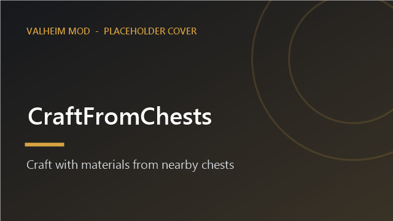
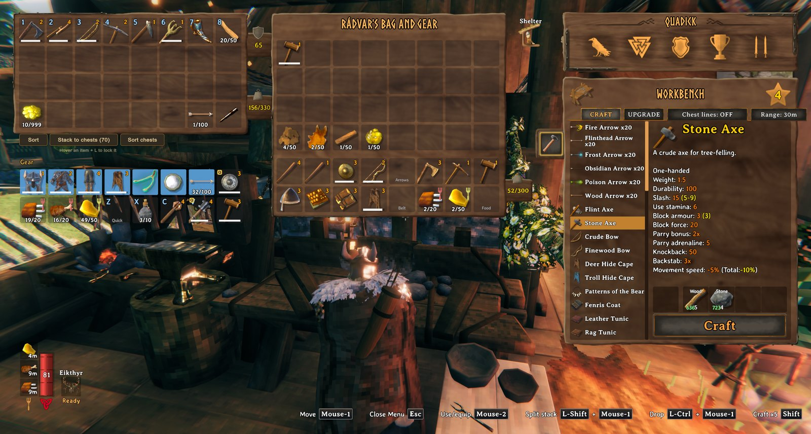
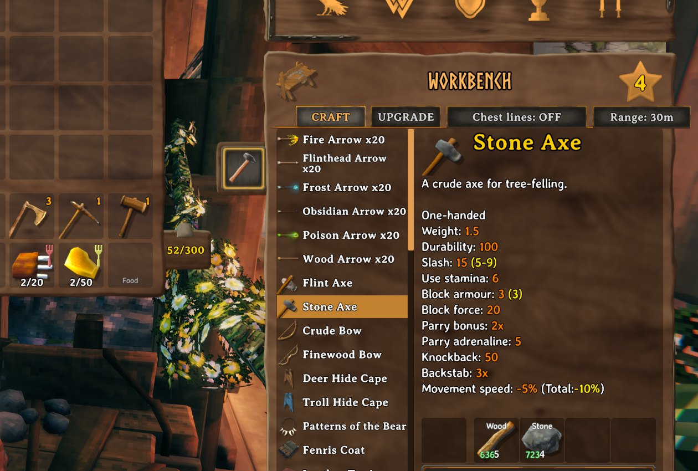

<!-- This page is made by tools/modpages/make_pages.py from the mod's thunderstore.toml, DESCRIPTION.txt, CHANGELOG.txt,
     settings and the repo's README. Change those, or the HAND-WRITTEN parts, not the rest of this page. -->

# 📦 Quad's Craft From Chests

**Craft from chests: crafting stations, and hand-crafting from your inventory, use materials from nearby chests and containers.**

    

<!-- GITHUB-ONLY -->[Thunderstore](https://thunderstore.io/c/valheim/p/Quads_Lab/Quads_Craft_From_Chests/)  ·  <!-- END GITHUB-ONLY -->[Source code](https://github.com/HardHeadHackerHead/valheim-mods/tree/main/mods/CraftFromChests)  ·  [Report a bug](https://github.com/HardHeadHackerHead/valheim-mods/issues/new?template=bug.yml&title=%5BQuad%27s%20Craft%20From%20Chests%5D%20)  ·  [Discord](https://discord.gg/EwTjQxEZPy)

<!-- GITHUB-ONLY -->**Install:** with [r2modman](https://thunderstore.io/c/valheim/p/ebkr/r2modman/) or Thunderstore Mod Manager from [Thunderstore](https://thunderstore.io/c/valheim/p/Quads_Lab/Quads_Craft_From_Chests/), or press **F7** in the game with our [mod manager](https://github.com/HardHeadHackerHead/valheim-mod-manager).<!-- END GITHUB-ONLY -->

## ✨ Features

- Anything you can reach within the range counts toward a recipe. The game takes the materials from your inventory first, then from the chests.
- The crafting menu shows how many of each material you have in total.
- A Chest lines button beside the crafting tabs draws lines from the station to every chest in use; a Range button cycles the distance (5 to 30 m).

## 📸 Screenshots

<!-- HAND-WRITTEN: screenshots -->
**The workbench: Chest lines and Range beside the tabs, and the materials counted from the chests**

**Close up: the buttons and the counts**

<!-- END HAND-WRITTEN: screenshots -->

<!-- HAND-WRITTEN: how-to-use -->

<!-- END HAND-WRITTEN: how-to-use -->

## 🧩 Other mods

<!-- HAND-WRITTEN: other-mods -->
**Known clashes**

- **Adventure Backpacks** ("Craft From Backpack"): handled. The backpack pays its part first and the chests pay only what is still missing. The backpack is never used as a chest.
- **Other craft-from-chests mods** (AzuCraftyBoxes, CraftFromContainers (aedenthorn, and its forks), Craft From Chests (Toxo), CraftFromChestsPlus, Teflon Ted's Craft From Chests, StoreAndCraft, SmartCraft-Storage, and ValheimPlus while its `CraftFromChest` section is on): they also take from chests, and two such mods count every chest twice. When one is installed this mod stands down and leaves it to them; the log says so once.
- **Any mod that refuses a payment or already paid**: respected. It runs after other mods and does nothing if they cancelled.

**Works with our mods**

- [Quad's Build From Chests](https://thunderstore.io/c/valheim/p/Quads_Lab/Quads_Build_From_Chests/) and [Quad's Feed From Chests](https://thunderstore.io/c/valheim/p/Quads_Lab/Quads_Feed_From_Chests/): fine together. Each works only in its own moment and pays only what the others left.
- [Quad's Recycler](https://thunderstore.io/c/valheim/p/Quads_Lab/Quads_Recycler/) and companions' chests ([Quad's Companion](https://thunderstore.io/c/valheim/p/Quads_Lab/Quads_Companion/)) are never used.
<!-- END HAND-WRITTEN: other-mods -->

Found a clash with another mod? [Tell us](https://github.com/HardHeadHackerHead/valheim-mods/issues/new?template=bug.yml&title=%5BQuad%27s%20Craft%20From%20Chests%5D%20) which one and what happened.

## 👥 Multiplayer

**Who needs it:** Only the players who want it.

<!-- HAND-WRITTEN: multiplayer -->
It only takes from chests you could open yourself: never one someone else has open, one behind a ward that keeps you out, or a private chest.

**The host decides:** how far it reaches (Radius). While you play on their world their values replace yours (your file isn't changed); a host without the mod leaves everyone their own.
<!-- END HAND-WRITTEN: multiplayer -->

## 🌍 Languages

**English, Русский (Russian), Deutsch (German), 简体中文 (Chinese), Português do Brasil (Portuguese), Español (Spanish), Français (French), Polski (Polish), Türkçe (Turkish).** It follows the game's own language setting.

The translations were made with AI, so a few words may be off. To correct one, or to add your language, put a file in `BepInEx/config/translations/com.quad.craftfromchests/` named after the game's name for the language (`German.json`, `Italian.json`, `Japanese.json`...) with only the lines you change, copied from [English.json](https://github.com/HardHeadHackerHead/valheim-mods/blob/main/mods/CraftFromChests/translations/English.json) (it wins over the built-in one). Or [tell us](https://github.com/HardHeadHackerHead/valheim-mods/issues/new?template=bug.yml&title=%5BQuad%27s%20Craft%20From%20Chests%5D%20Translation%3A%20) the better words and we'll put them in for everyone.

## ⚙️ Settings

In `BepInEx/config/com.quad.craftfromchests.cfg`, made the first time the game runs with the mod. r2modman and Thunderstore Mod Manager edit it under **Config editor**.<!-- GITHUB-ONLY --> With our mod manager: **F7**, then **Mod settings**.<!-- END GITHUB-ONLY -->

**Display**

| Setting | Default | What it does |
|---|---|---|
| `ShowHaveCounts` | `true` | In the crafting window, show how many of each material you HAVE (inventory + chests) next to how many you need. |
| `ShowLines` | `false` | Draw lines from the crafting station to every chest it can use. |
| `ToggleOffsetX` | `0` | Move the 'Chest lines' button horizontally from its default spot beside the Upgrade tab (UI pixels). |
| `ToggleOffsetY` | `0` | Move the 'Chest lines' button vertically (UI pixels). Negative = down. |
| `ToggleScale` | `1` | Size multiplier for the 'Chest lines' button. |
| `ToggleWidth` | `2` | 'Chest lines' button width as a multiple of the Upgrade tab's width. |
| `RangeButtonWidth` | `1.4` | 'Range' button width as a multiple of the Upgrade tab's width. |

**General**

| Setting | Default | What it does |
|---|---|---|
| `Enabled` | `true` | Turn the mod on or off. |
| `Radius` | `20` | How far (in meters) from the crafting station a chest can be and still be used. In multiplayer the server's value applies. |

## 🤖 Made with AI

Made with the help of Claude (Anthropic), with Claude Code: designed, written and checked together, and tried in the game.

## 💬 Join us on Discord

Come hang out with the people who make and play these mods. In the **Quads Lab Discord** you can:

- 🛠️ **Get help** and report bugs straight to us
- 👀 **See new mods first**, and help test them before they're released
- 🗳️ **Suggest ideas** and vote on what we make next
- 🏰 **Share your builds**, bases and arena runs
- 🤖 **Talk AI coding and vibe coding** with people building things with AI, the way these mods are made

**[Join the Quads Lab Discord →](https://discord.gg/EwTjQxEZPy)**

## 🧪 About Quads Lab

Quads Lab is where **Quad H** ([HardHeadHackerHead](https://github.com/HardHeadHackerHead)) builds software with AI, of every kind:
these Valheim mods are one of its projects. Each mod is designed by a player, written with [Claude Code](https://claude.com/claude-code)
and tested in our own world, with **bobisme** as our tester.

- 🌐 [quadslab.io](https://quadslab.io)
- 🧰 [All Quads Lab mods on Thunderstore](https://thunderstore.io/c/valheim/p/Quads_Lab/)
- 💻 [Source code on GitHub](https://github.com/HardHeadHackerHead/valheim-mods)
- 💬 [Discord](https://discord.gg/EwTjQxEZPy)
- 🐞 Found a bug? [Open an issue on GitHub](https://github.com/HardHeadHackerHead/valheim-mods/issues/new/choose)

## 📜 Recent changes

- **1.5.1** Fixed in multiplayer: two players crafting from the same chest at the same moment could both be paid for with the same materials (a free craft). A chest another player's game was looking after is now taken over when the crafting window opens and counts a moment later, and a craft is only paid from chests that are yours by then, so what the window shows is what will be paid.
- **1.5.0** Now in your language: English, Russian, German, Chinese (Simplified), Portuguese (Brazil), Spanish, French, Polish and Turkish, following the game's own Language setting. The game's own names are used for its things (items, creatures, lands, stations). The translations were made with AI: to correct a line, or add a language, put a file in BepInEx/config/translations/com.quad.craftfromchests/ named after the game's name for the language (German.json...) with only the lines you change, copied from translations/English.json on GitHub.
- **1.4.3** Fixed: it never takes from or puts into the game's Obliterator (what is in it burns when the lever is pulled), a Ledger Chest or the Arena's chests; only ordinary storage chests count.

<!-- GITHUB-ONLY -->[Every change](CHANGELOG.txt)<!-- END GITHUB-ONLY --><!-- THUNDERSTORE-ONLY: Every change is on the Changelog tab. -->
