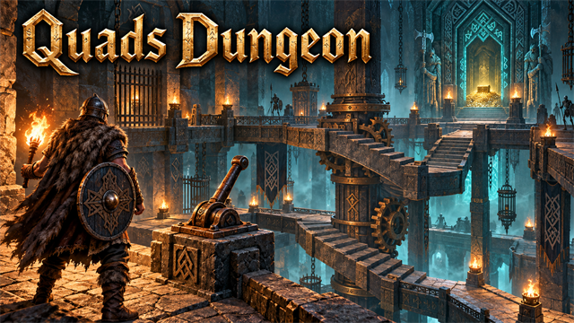
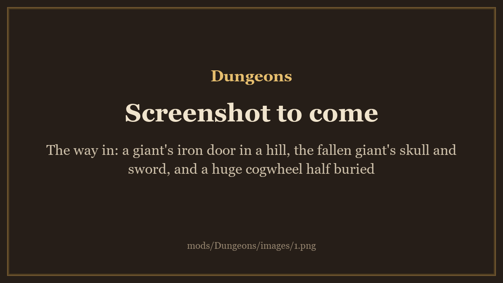
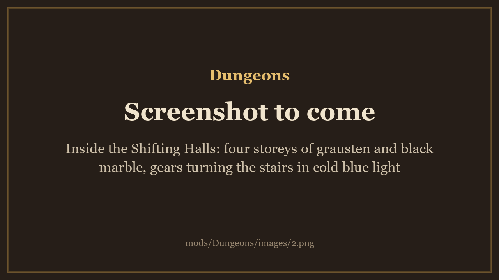
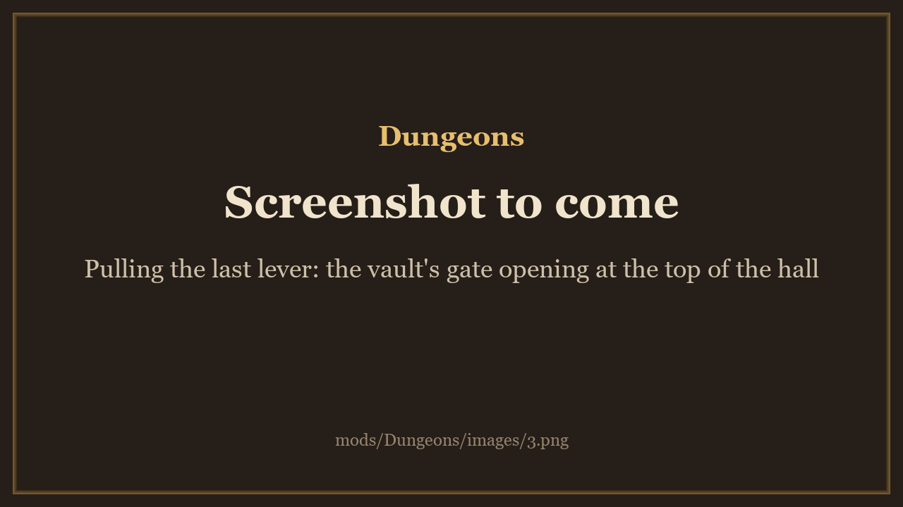

<!-- This page is made by tools/modpages/make_pages.py from the mod's thunderstore.toml, DESCRIPTION.txt, CHANGELOG.txt,
     settings and the repo's README. Change those, or the HAND-WRITTEN parts, not the rest of this page. -->

# Quad's Dungeons

**Dungeons made from a seed: go in through a giant's iron door, turn the stairs and pull the levers to reach the vault, and fight enemies that fit the land outside. Each dungeon comes back new a few days later.**

    

<!-- GITHUB-ONLY -->[Thunderstore](https://thunderstore.io/c/valheim/p/Quads_Lab/Quads_Dungeons/)  ·  <!-- END GITHUB-ONLY -->[Source code](https://github.com/HardHeadHackerHead/valheim-mods/tree/main/mods/Dungeons)  ·  [Report a bug](https://github.com/HardHeadHackerHead/valheim-mods/issues/new?template=bug.yml&title=%5BQuad%27s%20Dungeons%5D%20)  ·  [Discord](https://discord.gg/EwTjQxEZPy)

<!-- GITHUB-ONLY -->**Install:** with [r2modman](https://thunderstore.io/c/valheim/p/ebkr/r2modman/) or Thunderstore Mod Manager from [Thunderstore](https://thunderstore.io/c/valheim/p/Quads_Lab/Quads_Dungeons/), or press **F7** in the game with our [mod manager](https://github.com/HardHeadHackerHead/valheim-mod-manager).<!-- END GITHUB-ONLY -->

## ✨ Features

Each dungeon has an entrance in the world. Behind it, every player's game builds the same rooms from the dungeon's kind and its seed, high above the entrance, the way the game builds its own crypts. Only the entrance is saved: which dungeon it is, its seed, and how far players got.

Dungeons don't appear in the world by themselves yet. For now, an admin or a tester puts an entrance down with a test command (see the commands below).

### Going in and out

- Press E on the entrance to go in. If the dungeon is still forming, you go in as soon as it's ready.
- Press E on the way out, the door in the first room, to come back out in front of the entrance.
- Once someone has been in, the entrance shows the day the dungeon comes back new.

### The dungeons

- Shifting Halls: a Giants' clockwork vault. Ancient Jotunn machinery in grausten and black marble, bronze and iron gears, chains, and cold blue light. A hall four storeys high with turning staircases driven by gears, levers, a round drum room that turns every 12 seconds, and a vault at the top behind a gate. Every room in it is new, made for this mod.
- On the way: fight rooms that lock until their waves are beaten, secret rooms behind walls a pickaxe or a club can break, a shortcut back to the entrance once you've come far enough, and the Clockwork Warden, a boss with its own health bar.
- Its entrance is a giant iron door in a hill. Beside it lie the bones of a fallen giant: a skull, a sword and a huge cogwheel.
- Test Crypt: the game's own Black Forest crypt rooms, joined in new ways. Made to test the dungeon system.
- Test Mechanisms: a small dungeon with one of each moving part: a lever, a pressure plate, a turning stair, a lift and a gate.
- Test Blocks: a small dungeon with the other building blocks: a pedestal for a key, braziers to light, a block to push, a trap, teleporters, a locked gate and a checkpoint.
- The same seed always gives the same dungeon. A dungeon's puzzle is checked when it's laid out, so it can always be solved.

### Moving parts and puzzles

- Levers: press E to pull one. A lever can turn a staircase, open a gate or start a machine.
- Pressure plates: stand on one to press it.
- Turning staircases turn a quarter at a time and join a different pair of landings. Lifts carry you up and down. Some rooms turn by themselves, on a timer.
- Some machinery just turns: gears that spin while their mechanism moves, and backwards when it goes back.
- Anything that moves carries whoever stands on it, up, down and round.
- Every player sees every moving part in the same place at the same time.
- In the Shifting Halls, set the stairs in the right order to reach the vault. It takes about 12 to 17 uses of the levers and plates.

### Enemies and loot that fit the land

- Enemies fit the land the entrance stands in. A dungeon in the Mountains has Mountain enemies (and some from the Swamp), and nothing from a land further on. A creature that doesn't fit is swapped for one of the same kind (a fighter, an archer or a flyer) that does.
- None of the game's bosses (the Clockwork Warden is the land's toughest enemy, made stronger). Enemies have up to 1 star in the Meadows and the Black Forest, and up to 2 stars from the Swamp on.
- Loot fits the land too. Chests are filled with things from that land (or an earlier one), and the vault's chests hold more. Nothing inside gives anything from a land further on: plants to pick, pots, rocks and the pieces you can break keep only what fits.
- A room's enemies appear once, the first time someone comes in.

### Coming back new

- Some in-game days after a dungeon was first entered (3, set by the server), it comes back new: its enemies, its loot and its puzzle.
- It never happens while anyone is inside.
- Anything you left in one of its chests is put on the ground in front of the entrance, so you don't lose it. Creatures still alive and items on the floor stay.

### Safe inside

- You can't fall out of a dungeon. If you get there before it has formed (after a teleport, or a lag spike), you are held still until it has.
- Log out inside and you log back in at the entrance, even if the mod was removed in between.
- Die inside and your gravestone stays inside, where you died, as in the game's own crypts.

### Commands for admins and testers

- With our Claude Tools mod, type them in the game's console (F5) after "claude". For example, claude dungeon spawn shiftinghalls puts a Shifting Halls entrance in front of you (the others: testcrypt, testmechs).
- dungeon list shows the dungeons in the world, dungeon map a dungeon's layout floor by floor, dungeon solve its puzzle's solution, dungeon reset makes it new again now, and dungeon remove takes it away for good.
- Commands that change the world follow the game's cheat rule: they work in single player, for the host, or with devcommands on.

### Your own dungeons

- A kind of dungeon is a pack: one file of data with its rooms, moving parts, enemies, loot and entrance. New kinds need no code.
- Put packs in BepInEx/config/Dungeons/packs (and entrance looks in packs/looks in it). They are read when a world starts.
- On a server, only the server's packs count. It sends them to each player as they join, so players install nothing.

### Coming

- Dungeons placed in the world for you to find as you explore, with entrances that fit the land.

Everyone needs it, and the host above all: each dungeon's entrance is saved in the world, with the dungeon's state, and a game without the mod deletes the entrances when their area loads. The server and every player need the same version of the mod: a player with another version, or without it, can't join.

## 📸 Screenshots

<!-- HAND-WRITTEN: screenshots -->
**The way in: a giant's iron door in a hill, the fallen giant's skull and sword, and a huge cogwheel half buried**

**Inside the Shifting Halls: four storeys of grausten and black marble, gears turning the stairs in cold blue light**

**Pulling the last lever: the vault's gate opening at the top of the hall**

<!-- END HAND-WRITTEN: screenshots -->

<!-- HAND-WRITTEN: how-to-use -->

<!-- END HAND-WRITTEN: how-to-use -->

## 🧩 Other mods

<!-- HAND-WRITTEN: other-mods -->
**Known clashes:** none known.
<!-- END HAND-WRITTEN: other-mods -->

Found a clash with another mod? [Tell us](https://github.com/HardHeadHackerHead/valheim-mods/issues/new?template=bug.yml&title=%5BQuad%27s%20Dungeons%5D%20) which one and what happened.

## 👥 Multiplayer

**Who needs it:** Only the players who want it.

It adds dungeon entrances (objects the world saves). Restart the game after installing or updating it so they register cleanly: an entrance whose area loads while it is not registered is deleted by the host. The host and every player need the same version.

<!-- HAND-WRITTEN: multiplayer -->
**On a dedicated server, the server needs the mod too**, or it deletes the entrances. The rooms themselves are built on each player's own game, from the dungeon's seed, so they are the same for everyone. Moving parts follow the server's clock: every player sees a staircase turn at the same moment.

**The host decides** how many in-game days pass before a dungeon comes back new. While you play on their world their value replaces yours (your file isn't changed).
<!-- END HAND-WRITTEN: multiplayer -->

## 🌍 Languages

**English, Русский (Russian), Deutsch (German), 简体中文 (Chinese), Português do Brasil (Portuguese), Español (Spanish), Français (French), Polski (Polish), Türkçe (Turkish).** It follows the game's own language setting.

The translations were made with AI, so a few words may be off. To correct one, or to add your language, put a file in `BepInEx/config/translations/com.quad.dungeons/` named after the game's name for the language (`German.json`, `Italian.json`, `Japanese.json`...) with only the lines you change, copied from [English.json](https://github.com/HardHeadHackerHead/valheim-mods/blob/main/mods/Dungeons/translations/English.json) (it wins over the built-in one). Or [tell us](https://github.com/HardHeadHackerHead/valheim-mods/issues/new?template=bug.yml&title=%5BQuad%27s%20Dungeons%5D%20Translation%3A%20) the better words and we'll put them in for everyone.

## ⚙️ Settings

In `BepInEx/config/com.quad.dungeons.cfg`, made the first time the game runs with the mod. r2modman and Thunderstore Mod Manager edit it under **Config editor**.<!-- GITHUB-ONLY --> With our mod manager: **F7**, then **Mod settings**.<!-- END GITHUB-ONLY -->

**1 - Dungeons**

| Setting | Default | What it does |
|---|---|---|
| `ResetDays` | `3` | In-game days after a dungeon is first entered before it comes back new: its enemies, loot and puzzle (only once nobody is inside). 0: never. [Synced with Server] |

**2 - Pack making**

| Setting | Default | What it does |
|---|---|---|
| `ReloadPacksOnSave` | `false` | Reload BepInEx/config/Dungeons/packs a second after a file there is saved (as `dungeon reload`), in single player or as the host. Dungeons of a changed pack are remade, unless someone is inside. For people making packs; off for play. |

## 🤖 Made with AI

Made with the help of Claude (Anthropic), with Claude Code: designed, written and checked together, and tried in the game.

## 💬 Join us on Discord

Come hang out with the people who make and play these mods. In the **Quads Lab Discord** you can:

- 🛠️ **Get help** and report bugs straight to us
- 👀 **See new mods first**, and help test them before they're released
- 🗳️ **Suggest ideas** and vote on what we make next
- 🏰 **Share your builds**, bases and arena runs
- 🤖 **Talk AI coding and vibe coding** with people building things with AI, the way these mods are made

**[Join the Quads Lab Discord →](https://discord.gg/EwTjQxEZPy)**

## 🧪 About Quads Lab

Quads Lab is where **Quad H** ([HardHeadHackerHead](https://github.com/HardHeadHackerHead)) builds software with AI, of every kind:
these Valheim mods are one of its projects. Each mod is designed by a player, written with [Claude Code](https://claude.com/claude-code)
and tested in our own world, with **bobisme** as our tester.

- 🌐 [quadslab.io](https://quadslab.io)
- 🧰 [All Quads Lab mods on Thunderstore](https://thunderstore.io/c/valheim/p/Quads_Lab/)
- 💻 [Source code on GitHub](https://github.com/HardHeadHackerHead/valheim-mods)
- 💬 [Discord](https://discord.gg/EwTjQxEZPy)
- 🐞 Found a bug? [Open an issue on GitHub](https://github.com/HardHeadHackerHead/valheim-mods/issues/new/choose)

## 📜 Recent changes

- **0.2.4** Players on different versions of the mod in one game (one updated while playing): a lever pull the dungeon's owner doesn't understand is no longer lost. Your game takes the dungeon over and does it ("your game runs it now"), or tells you to try again, never silence. After an update while playing, the host is told which players need to update Quad's Dungeons and rejoin; nobody is kicked.
- **0.2.3** Levers, plates, fights and secret walls deep inside a big dungeon could do nothing: when every player was far from the entrance, the game kept taking the dungeon's owner away, and what players did in between was lost (a fight that wouldn't start, gates that stayed shut after it was won). Now the owner is kept while players are inside, an unowned dungeon is taken at once, and every action is answered or sent again, never lost and never done twice. Only the item layer is made solid in our rooms now (smoke and effects stay walk-through). New test commands for pack makers: dungeon test <pack> (checks a pack in the game) and dungeon tour (pictures of every room, camera only). Test Blocks: the key's plinth no longer stands in the way out.
- **0.2.2** Dungeons can be reloaded inside a world (for testing and quick fixes): the old copy hands its built dungeons over as they stand and the new one builds them again while anyone inside is held still, so nothing falls, no wave spawns twice and nothing resets; the dungeon items (giant cogs, the trophy, keys) stay registered and the ones in bags and chests keep working. Things moved out of a dungeon (gravestones, chest contents, items, tames) now land on the ground in front of its door, never on top of the entrance's hill. The log says why a fight's next wave came (the last one dead, or the wave timed out).

<!-- GITHUB-ONLY -->[Every change](CHANGELOG.txt)<!-- END GITHUB-ONLY --><!-- THUNDERSTORE-ONLY: Every change is on the Changelog tab. -->
