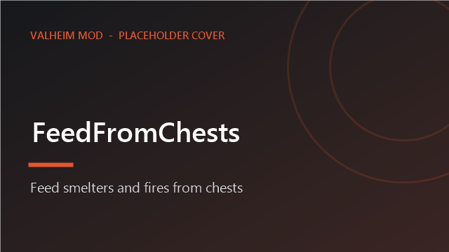
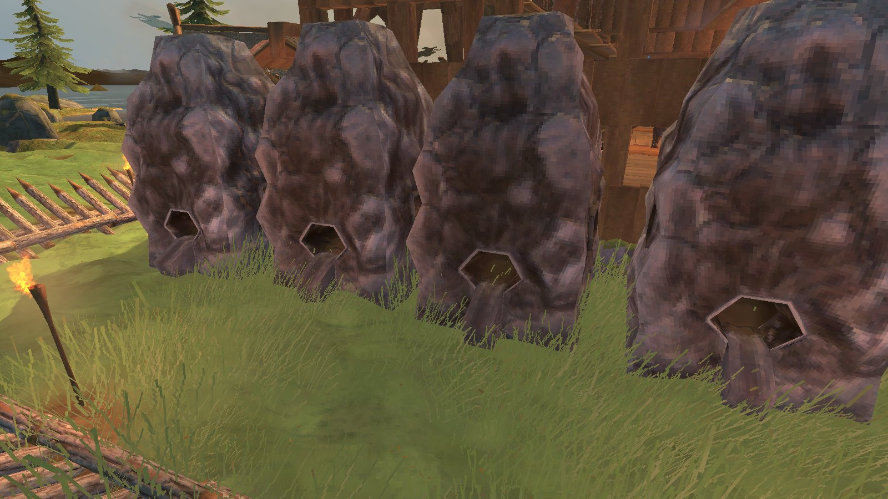
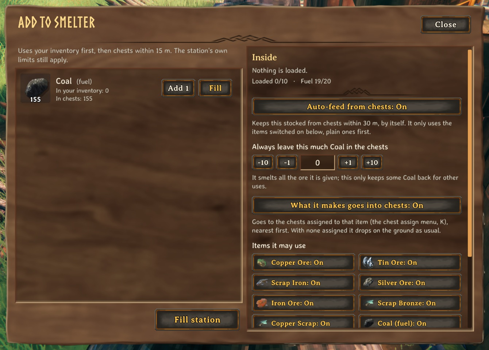

<!-- This page is made by tools/modpages/make_pages.py from the mod's thunderstore.toml, DESCRIPTION.txt, CHANGELOG.txt,
     settings and the repo's README. Change those, or the HAND-WRITTEN parts, not the rest of this page. -->

# 🔥 Quad's Feed From Chests

**Smelters, kilns, cooking racks, fires and fermenters refuel and fill themselves from nearby chests (auto fuel and ore), and smelters and kilns can run themselves.**

    

<!-- GITHUB-ONLY -->[Thunderstore](https://thunderstore.io/c/valheim/p/Quads_Lab/Quads_Feed_From_Chests/)  ·  <!-- END GITHUB-ONLY -->[Source code](https://github.com/HardHeadHackerHead/valheim-mods/tree/main/mods/FeedFromChests)  ·  [Report a bug](https://github.com/HardHeadHackerHead/valheim-mods/issues/new?template=bug.yml&title=%5BQuad%27s%20Feed%20From%20Chests%5D%20)  ·  [Discord](https://discord.gg/EwTjQxEZPy)

  

<!-- GITHUB-ONLY -->**Install:** with [r2modman](https://thunderstore.io/c/valheim/p/ebkr/r2modman/) or Thunderstore Mod Manager from [Thunderstore](https://thunderstore.io/c/valheim/p/Quads_Lab/Quads_Feed_From_Chests/), or press **F7** in the game with our [mod manager](https://github.com/HardHeadHackerHead/valheim-mod-manager).<!-- END GITHUB-ONLY -->

## ✨ Features

- Press E at a smelter, kiln or furnace to open its menu, whatever you are carrying. Add 1 and Fill put items in by hand; the Auto-feed panel at the top sets the station up to feed itself.
- The menu also shows what is loaded inside: the ore waiting in the queue, the fuel, and anything ready to collect. The same line appears when you look at the smelter.
- Auto-feed: turn it on, tick which items it may use (for a kiln, just plain wood to start with, and tick fine wood, core wood and so on if you want them used), and it keeps itself stocked from the chests nearby. Coal comes first, then the lowest-tier item you ticked.
- Limits that fit the station: a kiln makes coal until the chests hold 100 (or what you set); a smelter always leaves some coal; a windmill always leaves 20 barley for planting; ovens, spits and fermenters stop once you have enough of each food or mead. The menu says why each item is or is not being fed.
- Output to chests: what the station makes goes into the chests assigned to that item (the chest assign menu from QualityOfLife, K), nearest first. With none assigned it drops on the ground as usual.
- Cooking stations (spit, iron spit, oven): food that is done comes off by itself, so it never burns: into a chest assigned to it or to Food, else it slides off the side of the spit towards you. E takes everything that is done into your inventory, or opens the menu (what is cooking, Add 1 / Fill, auto-feed with the raw food you tick). Alternate-place key + E puts food on by hand.
- Torches, sconces and braziers keep themselves lit: when one has room for more resin or coal, it takes one from a chest near it. One setting for all of them (on); campfires and hearths can do the same with wood (off unless you turn it on). They always leave 10 of the fuel in the chests.
- Fermenters load themselves with the mead bases you tick (from chests, only when they have their roof), tap themselves when ready, and put the mead into a chest assigned to it or to Potions, or one that already holds it. E on an empty one opens its menu.
- Beehives empty themselves into a chest (assigned to honey or to Food, or one that already has honey), so they never stop full; their tooltip says when the next honey comes, or why none is coming (biome, too much cover).
- Other stations: press E when you carry nothing it takes and a chest has some, and one is added for you (a menu opens if there is a choice). Turn on AlwaysOpenMenu in the config to always get the menu.
- Nothing is created from nothing: every item comes out of a chest or your inventory, and a station that is full is left alone.

- Shield generators keep their fuel, ballistas reload themselves, and sap extractors empty into a chest, all from nearby chests.

## 📸 Screenshots

<!-- HAND-WRITTEN: screenshots -->
**A row of smelters that feed themselves from the chests round them**

**The menu at a smelter: add by hand on the left, its auto-feed settings on the right**

<!-- END HAND-WRITTEN: screenshots -->

## 🎮 How to use

| Key | What it does |
|---|---|
| **E** | Open a smelter or kiln menu (auto-feed settings, Add, Fill); add items to other stations |

<!-- HAND-WRITTEN: how-to-use -->

<!-- END HAND-WRITTEN: how-to-use -->

## 🤝 Goes well with

   

- **[Quad's Craft From Chests](https://thunderstore.io/c/valheim/p/Quads_Lab/Quads_Craft_From_Chests/)**: Craft with materials from nearby chests
- **[Quad's Build From Chests](https://thunderstore.io/c/valheim/p/Quads_Lab/Quads_Build_From_Chests/)**: Build with materials from nearby chests
- **[Quad's Ledger Chest](https://thunderstore.io/c/valheim/p/Quads_Lab/Quads_Ledger_Chest/)**: See and search every chest around you
- **[Quad's Quality of Life](https://thunderstore.io/c/valheim/p/Quads_Lab/Quads_Quality_Of_Life/)**: Sorting, stacking and small conveniences

## 🧩 Other mods

<!-- HAND-WRITTEN: other-mods -->
**Known clashes**

- **ValheimPlus** (`autoDeposit`) and other mods that deliver a station's output: what they already delivered isn't delivered again.
- **Any mod that already paid** for fuel or ore: it runs after them and does nothing if they did.

**Works with our mods**

- [Quad's Quality of Life](https://thunderstore.io/c/valheim/p/Quads_Lab/Quads_Quality_Of_Life/): output from smelters, kilns, fermenters, cooking stations, beehives and sap goes to the chests you assigned with K. Without it, only honey and sap go to a chest already holding them; the rest drops as in the game.
- [Quad's Craft From Chests](https://thunderstore.io/c/valheim/p/Quads_Lab/Quads_Craft_From_Chests/) and [Quad's Build From Chests](https://thunderstore.io/c/valheim/p/Quads_Lab/Quads_Build_From_Chests/): fine together.
- [Quad's Recycler](https://thunderstore.io/c/valheim/p/Quads_Lab/Quads_Recycler/) and companions' chests ([Quad's Companion](https://thunderstore.io/c/valheim/p/Quads_Lab/Quads_Companion/)) are never used.
<!-- END HAND-WRITTEN: other-mods -->

Found a clash with another mod? [Tell us](https://github.com/HardHeadHackerHead/valheim-mods/issues/new?template=bug.yml&title=%5BQuad%27s%20Feed%20From%20Chests%5D%20) which one and what happened.

## 👥 Multiplayer

**Who needs it:** Only the players who want it.

<!-- HAND-WRITTEN: multiplayer -->
A station's auto-feed settings are saved on the station, so everyone sees the same ones. Feeding and output run on the game of the player the station belongs to at the moment (usually the nearest): if that player doesn't have the mod, nothing happens there.

**The host decides:** how far it reaches for feeding and output, and player range. While you play on their world their values replace yours (your file isn't changed); a host without the mod leaves everyone their own.
<!-- END HAND-WRITTEN: multiplayer -->

## 🌍 Languages

**English, Русский (Russian), Deutsch (German), 简体中文 (Chinese), Português do Brasil (Portuguese), Español (Spanish), Français (French), Polski (Polish), Türkçe (Turkish).** It follows the game's own language setting.

The translations were made with AI, so a few words may be off. To correct one, or to add your language, put a file in `BepInEx/config/translations/com.quad.feedfromchests/` named after the game's name for the language (`German.json`, `Italian.json`, `Japanese.json`...) with only the lines you change, copied from [English.json](https://github.com/HardHeadHackerHead/valheim-mods/blob/main/mods/FeedFromChests/translations/English.json) (it wins over the built-in one). Or [tell us](https://github.com/HardHeadHackerHead/valheim-mods/issues/new?template=bug.yml&title=%5BQuad%27s%20Feed%20From%20Chests%5D%20Translation%3A%20) the better words and we'll put them in for everyone.

## ⚙️ Settings

In `BepInEx/config/com.quad.feedfromchests.cfg`, made the first time the game runs with the mod. r2modman and Thunderstore Mod Manager edit it under **Config editor**.<!-- GITHUB-ONLY --> With our mod manager: **F7**, then **Mod settings**.<!-- END GITHUB-ONLY -->

**AutoFeed**

| Setting | Default | What it does |
|---|---|---|
| `Enabled` | `true` | Allow smelters, kilns and furnaces to be set to keep themselves stocked from nearby chests (set up in the station's menu). |
| `FeedRadius` | `30` | How far (in metres) from a smelter or kiln a chest can be and still be used to keep it stocked automatically. In multiplayer the server's value applies. |
| `OutputRadius` | `30` | How far (in metres) from a smelter or kiln a chest can be and still receive what it makes (only chests assigned to it, with the chest assign menu, K). In multiplayer the server's value applies. |
| `Interval` | `1` | Seconds between automatic top-ups of each station. |
| `PlayerRange` | `40` | Automatic feeding only runs while you are within this many metres of the station (the game only loads chests near players). In multiplayer the server's value applies. |

**Beehives**

| Setting | Default | What it does |
|---|---|---|
| `CollectHoney` | `true` | Beehives near you put their honey into a chest (one assigned to honey or to Food with K, else one that already has honey), so they never sit full: a full hive stops making honey. With no such chest within OutputRadius the honey stays in the hive. |

**Cooking**

| Setting | Default | What it does |
|---|---|---|
| `TakeOffCooked` | `true` | Food on a cooking station comes off by itself the moment it is done, so it never burns: into a chest assigned to it or to Food (the chest assign menu, K), else it slides off the side of the spit. Each station can also be switched off in its menu (E). |

**Defenses**

| Setting | Default | What it does |
|---|---|---|
| `FuelShieldGenerators` | `true` | Shield generators near you take their fuel (bones and the like) from chests within FeedRadius as they have room, so the shield never runs dry. All of them at once. |
| `ReloadBallistas` | `true` | Ballistas near you are reloaded from chests within FeedRadius: with the ammo they hold, or when empty the first ammo they take that the chests have. |
| `CollectSap` | `true` | Sap extractors near you empty themselves into a chest assigned to sap or Materials (K), else one that already holds sap, so they never sit full. |

**Fires**

| Setting | Default | What it does |
|---|---|---|
| `RefuelTorches` | `true` | Every torch, sconce and brazier keeps itself lit: when it has room for more fuel (resin, coal...), one is taken from a chest within FeedRadius of it. For all of them at once, no setup per torch. Runs while you are within PlayerRange; never uses your inventory. |
| `RefuelCampfires` | `false` | The same for fires that burn wood (campfires, hearths, bonfires): keep them topped up with wood from nearby chests. |
| `KeepFuel` | `10` | Torches and fires never take the last of a fuel: this many of it (resin, coal, wood...) always stay in the chests, for crafting. |

**General**

| Setting | Default | What it does |
|---|---|---|
| `Enabled` | `true` | Turn the mod on or off. |
| `Radius` | `15` | How far (in metres) from the station a chest can be and still be used. In multiplayer the server's value applies. |
| `AutoFeedOnUse` | `true` | Pressing E at a station when you carry nothing it takes, but a nearby chest has some: add it for you (or open the menu if there's a choice). |
| `AlwaysOpenMenu` | `false` | Pressing E at a station when you rely on chests: off = add one automatically if there's only one kind to add (menu only for a choice); on = always open the menu (so Fill is always at hand). |
| `FillLimit` | `100` | Safety limit: the most of one item the menu's Fill button will put in at once. (Fill stops sooner when the station is full or you run out.) |

## 🤖 Made with AI

Made with the help of Claude (Anthropic), with Claude Code: designed, written and checked together, and tried in the game.

## 💬 Join us on Discord

Come hang out with the people who make and play these mods. In the **Quads Lab Discord** you can:

- 🛠️ **Get help** and report bugs straight to us
- 👀 **See new mods first**, and help test them before they're released
- 🗳️ **Suggest ideas** and vote on what we make next
- 🏰 **Share your builds**, bases and arena runs
- 🤖 **Talk AI coding and vibe coding** with people building things with AI, the way these mods are made

**[Join the Quads Lab Discord →](https://discord.gg/EwTjQxEZPy)**

## 🧪 About Quads Lab

Quads Lab is where **Quad H** ([HardHeadHackerHead](https://github.com/HardHeadHackerHead)) builds software with AI, of every kind:
these Valheim mods are one of its projects. Each mod is designed by a player, written with [Claude Code](https://claude.com/claude-code)
and tested in our own world, with **bobisme** as our tester.

- 🌐 [quadslab.io](https://quadslab.io)
- 🧰 [All Quads Lab mods on Thunderstore](https://thunderstore.io/c/valheim/p/Quads_Lab/)
- 💻 [Source code on GitHub](https://github.com/HardHeadHackerHead/valheim-mods)
- 💬 [Discord](https://discord.gg/EwTjQxEZPy)
- ☕ [Buy me a coffee](https://buymeacoffee.com/quadh)
- 🐞 Found a bug? [Open an issue on GitHub](https://github.com/HardHeadHackerHead/valheim-mods/issues/new/choose)

## ☕ Support my mods

Every Quads Lab mod is free, and it stays that way. If one of them made your game better and you'd like to say thanks, a coffee
helps me make new mods and keep improving the ones you already play. It's 100% optional, and always appreciated!

**[☕ Buy me a coffee →](https://buymeacoffee.com/quadh)**

## 📜 Recent changes

- **1.8.4** Settings: edits to the config file now apply while the game runs (a server owner no longer has to restart), and a server's admins can change the server's settings from their own game with Configuration Manager, where other players see them greyed out. Your config file always keeps your own values while you play on a server (saving it there could write the server's in). Players on an older version still get the server's settings.
- **1.8.3** Its windows no longer fill the log with "The LiberationSans SDF Font Asset was not found": each text is given the game's font before it starts (it looked for TextMeshPro's default font, which the game doesn't have, every time a text was made). Nothing changes on screen.
- **1.8.2** Fix: after leaving a world for the main menu and joining one again, the chests claimed just before could no longer be looked up, and feeding from chests could stop working until a restart (the game renumbers its object ids on each join).

<!-- GITHUB-ONLY -->[Every change](CHANGELOG.txt)<!-- END GITHUB-ONLY --><!-- THUNDERSTORE-ONLY: Every change is on the Changelog tab. -->
