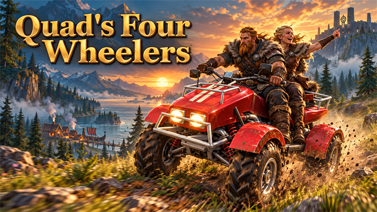
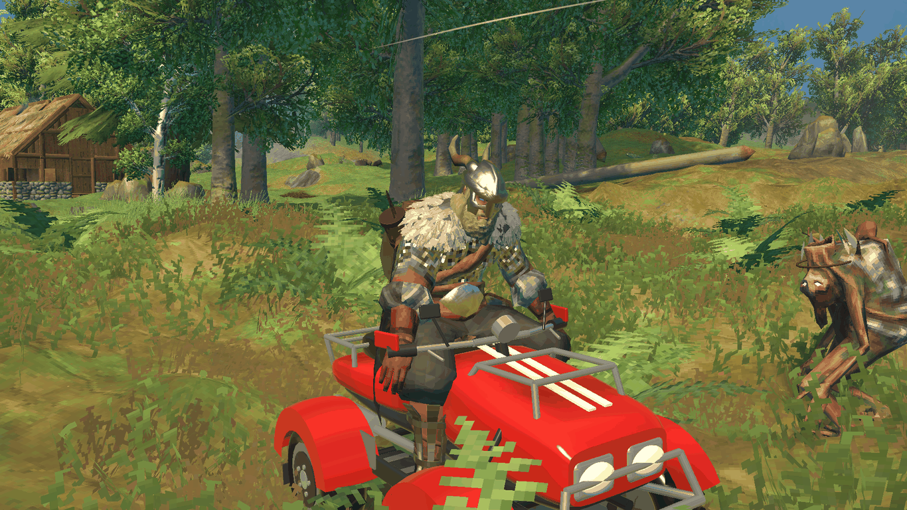
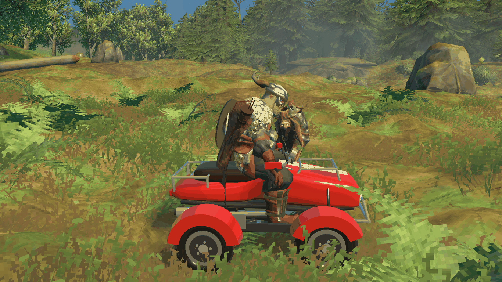
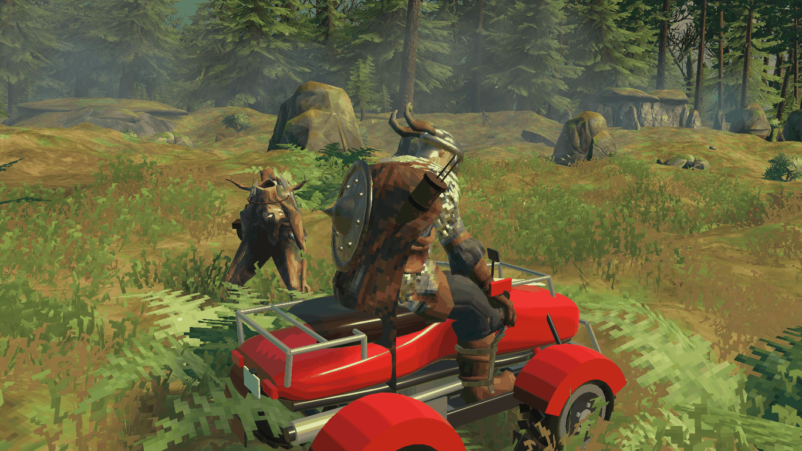

<!-- This page is made by tools/modpages/make_pages.py from the mod's thunderstore.toml, DESCRIPTION.txt, CHANGELOG.txt,
     settings and the repo's README. Change those, or the HAND-WRITTEN parts, not the rest of this page. -->

# 🏍️ Quad's Four Wheelers

**Four wheeler (ATV, quad bike) for a rider and a passenger: a fast all-terrain vehicle driven by a surtling core. Springs, headlights, tail lights, rack storage, paint colours, engine sound and dust. Built with the hammer.**

    

[Source code](https://github.com/HardHeadHackerHead/valheim-mods/tree/main/mods/FourWheelers)  ·  [Report a bug](https://github.com/HardHeadHackerHead/valheim-mods/issues/new?template=bug.yml&title=%5BQuad%27s%20Four%20Wheelers%5D%20)  ·  [Discord](https://discord.gg/EwTjQxEZPy)

  

**Install:** press **F7** in the game with our [mod manager](https://github.com/HardHeadHackerHead/valheim-mod-manager), or take `FourWheelers.dll` from [dist/](https://github.com/HardHeadHackerHead/valheim-mods/tree/main/dist). It isn't on Thunderstore.

## ✨ Features

A four wheeler for Valheim: a rugged all-terrain quad for you and a friend, driven by a surtling core's fire. Fast over meadows and hills, with headlights for the night, a rack for your gear and colours to choose from.

### Riding it

- Build it with the hammer on dry land, near a workbench: 10 Fine Wood, 10 Iron, 2 Surtling Cores and 8 Leather Scraps.
- Press E on its seat and you climb on and take the handlebars.
- Hold W to go, Shift+W for full speed, S to brake (and back up once stopped); let go and it coasts to a stop. A and D steer.
- It steers like a car: a tight circle at a crawl, a wide one at speed, and it holds its line in a turn instead of sliding.
- Its springs soak up bumps and it stays on the ground over rough country. Deep water stalls it and it floats.
- Jump or E gets you off. Leave it on a slope and it stays where you left it. If it ends up on its side, E on it stands it back on its wheels.
- Run into an enemy at speed and it takes blunt damage (more the faster you go: 90 at 12 m/s, 250 at full speed) and is knocked away, and you lose a little speed. Players and tamed animals are never hurt.
- A gauge at the bottom right shows your speed and what you are asking for, as on the Jet Ski.
- The hammer takes it apart again (not while someone is on it).

### Room for two, and their things

- A passenger seat behind the rider (E on the back of the seat).
- A rack at the back holds 8 stacks: E on it. If the four wheeler breaks, what is in it drops in a cargo crate.

### The look and the sound

- Sculpted red bodywork with cream rally stripes and curved fenders, a chrome tube bumper and racks front and back, A-arm suspension with coil-over shocks, a finned engine and chrome exhaust, floorboards, a long leather seat, mirrors and handlebars that turn as you steer, and fat chevron-tread tyres on silver rims.
- Two headlights and two tail lights: they come on at night (and in caves) while someone rides it, and the tail lights glow brighter when you brake.
- Paint it: E on the hood gives the next colour (red, blue, green, yellow, black, cream, orange). Everyone sees it.
- A one-cylinder engine that climbs through four gears as you speed up, tyre squeal in hard corners, a thump and a burst of dust when you land a jump, the sound of tyres on the ground, and dust kicked up from each wheel, coloured to the ground you are on: brown earth, pale sand on the plains, white snow in the mountains, grey ash.

Everyone in the world needs it installed.

## 📸 Screenshots

<!-- HAND-WRITTEN: screenshots -->
**Riding it: boots on the floorboards, hands on the grips, leaning over the bars, with the rally stripes and twin headlights**

**From the side: the sculpted red body, curved fenders and chevron-tread tyres on a meadow trail**

**From behind: the long seat, the rear rack, the number plate, the tail lights and the chrome exhaust**

<!-- END HAND-WRITTEN: screenshots -->

## 🎮 How to use

| Key | What it does |
|---|---|
| **E** on a four wheeler | Climb on and take the handlebars (**E** on its rear seat: ride as a passenger; **E** on its hood: paint it the next colour; **E** on one lying on its side: stand it up) |
| **W** / **Shift**+**W** / **S** | Go / full speed / brake, then back up (let go to coast); **A** / **D** steer, **Jump** or **E** gets off |

<!-- HAND-WRITTEN: how-to-use -->

<!-- END HAND-WRITTEN: how-to-use -->

## 🧩 Other mods

**Goes well with**

|  |  |  |  |
|:-:|:-:|:-:|:-:|
| [Jet Skis](https://thunderstore.io/c/valheim/p/Quads_Lab/Quads_Jet_Skis/) | [Mountain Bikes](https://thunderstore.io/c/valheim/p/Quads_Lab/Quads_Mountain_Bikes/) | [Ziplines](https://thunderstore.io/c/valheim/p/Quads_Lab/Quads_Ziplines/) | [Parkour](https://thunderstore.io/c/valheim/p/Quads_Lab/Quads_Parkour/) |

<!-- HAND-WRITTEN: other-mods -->
**Known clashes:** none known.
<!-- END HAND-WRITTEN: other-mods -->

Found a clash with another mod? [Tell us](https://github.com/HardHeadHackerHead/valheim-mods/issues/new?template=bug.yml&title=%5BQuad%27s%20Four%20Wheelers%5D%20) which one and what happened.

## 👥 Multiplayer

**Who needs it:** Everyone, and **the host above all**: a game without the mod deletes the pieces when their area loads. Restart after installing or updating them.

<!-- HAND-WRITTEN: multiplayer -->

<!-- END HAND-WRITTEN: multiplayer -->

## 🌍 Languages

**English, Русский (Russian), Deutsch (German), 简体中文 (Chinese), Português do Brasil (Portuguese), Español (Spanish), Français (French), Polski (Polish), Türkçe (Turkish).** It follows the game's own language setting.

The translations were made with AI, so a few words may be off. To correct one, or to add your language, put a file in `BepInEx/config/translations/com.quad.fourwheelers/` named after the game's name for the language (`German.json`, `Italian.json`, `Japanese.json`...) with only the lines you change, copied from [English.json](https://github.com/HardHeadHackerHead/valheim-mods/blob/main/mods/FourWheelers/translations/English.json) (it wins over the built-in one). Or [tell us](https://github.com/HardHeadHackerHead/valheim-mods/issues/new?template=bug.yml&title=%5BQuad%27s%20Four%20Wheelers%5D%20Translation%3A%20) the better words and we'll put them in for everyone.

## ⚙️ Settings

In `BepInEx/config/com.quad.fourwheelers.cfg`, made the first time the game runs with the mod. r2modman and Thunderstore Mod Manager edit it under **Config editor**.<!-- GITHUB-ONLY --> With our mod manager: **F7**, then **Mod settings**.<!-- END GITHUB-ONLY -->

**1 - Driving**

| Setting | Default | What it does |
|---|---|---|
| `CruiseSpeed` | `17` | How fast it goes holding W (metres per second; a walking player does about 5). [Synced with Server] |
| `FullSpeed` | `28` | How fast it goes holding Shift+W (metres per second). [Synced with Server] |
| `ReverseSpeed` | `5` | How fast it backs up holding S once stopped (metres per second). [Synced with Server] |
| `Acceleration` | `9` | How quickly it picks up speed (metres per second, each second). Braking is stronger. [Synced with Server] |
| `Coasting` | `3` | How quickly it slows down with nothing held (metres per second, each second). [Synced with Server] |
| `TurnRate` | `110` | The fastest it can turn (degrees per second), at low speed. Faster, it turns on a wider circle. [Synced with Server] |
| `Grip` | `6` | How much it holds its line in a turn instead of sliding sideways (higher grips more). [Synced with Server] |

**2 - Look**

| Setting | Default | What it does |
|---|---|---|
| `EngineVolume` | `1` | How loud the engine is (0 is silent, 1 as made; the game's own volume settings apply on top). |
| `ShowControls` | `true` | Show the controls the first time you get on in a session. |

**3 - Building**

| Setting | Default | What it does |
|---|---|---|
| `Cost` | `FineWood:10, Iron:10, SurtlingCore:2, LeatherScraps:8` | What a four wheeler costs to build with the hammer (at a workbench). Item prefab names and amounts, separated by commas, like FineWood:12, BronzeNails:30 (Claude Tools' `prefabs <text>` shows exact names). A cost with a mistake in it keeps the last good one. [Synced with Server] |

**4 - Combat**

| Setting | Default | What it does |
|---|---|---|
| `RamDamage` | `10` | Blunt damage to an enemy you run over, for each metre per second over 3 (so 12 m/s does 90, full speed 250). Players and tamed animals are never hurt; 0 turns it off. [Synced with Server] |

## 🤖 Made with AI

Made with the help of Claude (Anthropic), with Claude Code: designed, written and checked together, and tried in the game.

## 💬 Join us on Discord

Come hang out with the people who make and play these mods. In the **Quads Lab Discord** you can:

- 🛠️ **Get help** and report bugs straight to us
- 👀 **See new mods first**, and help test them before they're released
- 🗳️ **Suggest ideas** and vote on what we make next
- 🏰 **Share your builds**, bases and arena runs
- 🤖 **Talk AI coding and vibe coding** with people building things with AI, the way these mods are made

**[Join the Quads Lab Discord →](https://discord.gg/EwTjQxEZPy)**

## 🧪 About Quads Lab

Quads Lab is where **Quad H** ([HardHeadHackerHead](https://github.com/HardHeadHackerHead)) builds software with AI, of every kind:
these Valheim mods are one of its projects. Each mod is designed by a player, written with [Claude Code](https://claude.com/claude-code)
and tested in our own world, with **bobisme** as our tester.

- 🌐 [quadslab.io](https://quadslab.io)
- 🧰 [All Quads Lab mods on Thunderstore](https://thunderstore.io/c/valheim/p/Quads_Lab/)
- 💻 [Source code on GitHub](https://github.com/HardHeadHackerHead/valheim-mods)
- 💬 [Discord](https://discord.gg/EwTjQxEZPy)
- ☕ [Buy me a coffee](https://buymeacoffee.com/quadh)
- 🐞 Found a bug? [Open an issue on GitHub](https://github.com/HardHeadHackerHead/valheim-mods/issues/new/choose)

## ☕ Support my mods

Every Quads Lab mod is free, and it stays that way. If one of them made your game better and you'd like to say thanks, a coffee
helps me make new mods and keep improving the ones you already play. It's 100% optional, and always appreciated!

**[☕ Buy me a coffee →](https://buymeacoffee.com/quadh)**

## 📜 Recent changes

- **0.1.1** You ride it properly now: leaning over the bars with both hands on the grips (they follow the bars as they turn) and your boots on the floorboards, your head turning where you steer and bobbing over rough ground; a passenger behind holds on round your waist (or rests their hands on the seat when you are alone). Everyone sees it. Plus: the front wheel can no longer get swallowed by a steep slope (the wheels' ground check starts above the suspension and rolls over a rise), a stuck rider gets a small hop free, E on one on its side stands it up, an engine that climbs through four gears, tyre squeal in hard corners and a thump and dust burst on landing, a sculpted new model, and a smaller test-command surface (atv).
- **0.1.0** First release: a four wheeler built with the hammer on dry land. W go, Shift+W full speed, S brake and reverse, A and D steer, E on the seat to climb on, Jump or E to get off. Springs on each wheel, a turning circle that opens up with speed (it holds its line, it doesn't slide), a passenger seat, a rack that holds 8 stacks, headlights and tail lights at night, a gauge at the bottom right, an engine sound, tyre sound and dust coloured to the ground, paint (E on the hood), and E on a flipped one stands it back on its wheels. In your language: Russian, German, Chinese, Portuguese, Spanish, French, Polish and Turkish (translated by AI; corrections welcome).

<!-- GITHUB-ONLY -->[Every change](CHANGELOG.txt)<!-- END GITHUB-ONLY --><!-- THUNDERSTORE-ONLY: Every change is on the Changelog tab. -->
