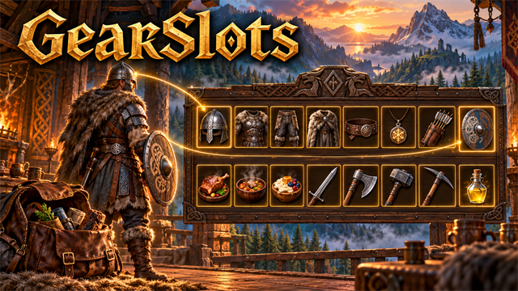
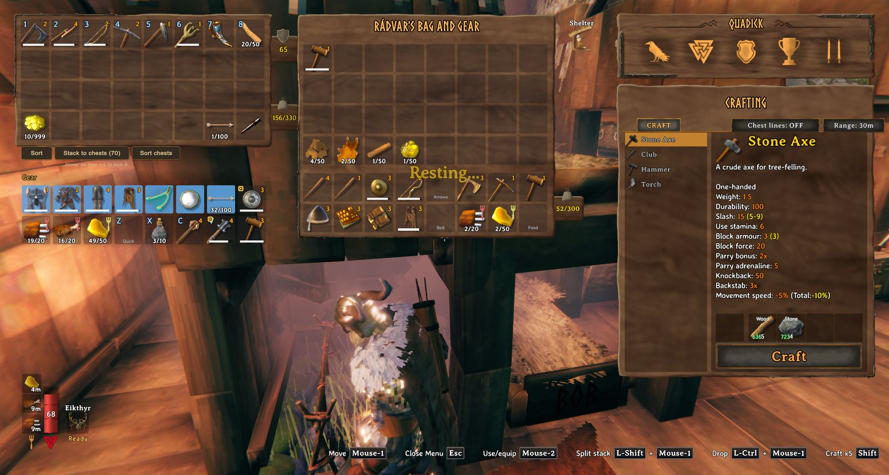

<!-- This page is made by tools/modpages/make_pages.py from the mod's thunderstore.toml, DESCRIPTION.txt, CHANGELOG.txt,
     settings and the repo's README. Change those, or the HAND-WRITTEN parts, not the rest of this page. -->

# 🛡️ Quad's Gear Slots

**Equipment slots and quick slots: extra inventory slots for what you wear, eat and use (armor, cape, ammo, shield, food, quickslots), in a Gear panel next to your inventory.**

    

<!-- GITHUB-ONLY -->[Thunderstore](https://thunderstore.io/c/valheim/p/Quads_Lab/Quads_Gear_Slots/)  ·  <!-- END GITHUB-ONLY -->[Source code](https://github.com/HardHeadHackerHead/valheim-mods/tree/main/mods/GearSlots)  ·  [Report a bug](https://github.com/HardHeadHackerHead/valheim-mods/issues/new?template=bug.yml&title=%5BQuad%27s%20Gear%20Slots%5D%20)  ·  [Discord](https://discord.gg/EwTjQxEZPy)

  

<!-- GITHUB-ONLY -->**Install:** with [r2modman](https://thunderstore.io/c/valheim/p/ebkr/r2modman/) or Thunderstore Mod Manager from [Thunderstore](https://thunderstore.io/c/valheim/p/Quads_Lab/Quads_Gear_Slots/), or press **F7** in the game with our [mod manager](https://github.com/HardHeadHackerHead/valheim-mod-manager).<!-- END GITHUB-ONLY -->

## ✨ Features

### What is in it

- Head, Chest, Legs, Cape, Belt, Trinket, Ammo and Shield slots: drop a matching piece in and you put it on. Armor and arrows no longer take room in your bag, and gear you are already wearing moves into its slot by itself.
- The shield follows your weapon: switch to a one-handed weapon and the shield from the Shield slot comes out with it (two-handed weapons and bows put it away).
- Three Food slots: keep your best meals in their own place (right-click to eat). Optional auto-eat is in the settings.
- Five Quick slots (Z, X, C, V by default; the fifth is unbound) for a weapon, tool, potion or anything else: press the key to equip or use it. With the inventory closed they show in a row under your hotbar, with their keys.
- Slots only accept the right kind of item, and Sort and Stack to Chests (QualityOfLife) leave them alone.
- Nothing is stored in a new place: the slots are extra rows of your real inventory, so saving, weight, crafting and dragging work as normal. Before removing the mod, move your gear-slot items into your bag: without it the game drops anything in those rows at your feet the next time you spawn.

Every key and option is in the settings (the manager's Mod settings tab).

## 📸 Screenshots

<!-- HAND-WRITTEN: screenshots -->
**The Gear panel beside your inventory: armour, cape, belt, trinket, ammo and shield slots**

<!-- END HAND-WRITTEN: screenshots -->

## 🎮 How to use

| Key | What it does |
|---|---|
| **Z** / **X** / **C** / **V** | Use what is in Quick slot 1 to 4 (equip a weapon or tool, drink a potion); the fifth slot has no key until you set one |

<!-- HAND-WRITTEN: how-to-use -->

<!-- END HAND-WRITTEN: how-to-use -->

## 🤝 Goes well with

| | |
|:-:|:--|
|  | **[Quad's Quiver](https://thunderstore.io/c/valheim/p/Quads_Lab/Quads_Quiver/)** Pick your arrows back up |
|  | **[Quad's Quality of Life](https://thunderstore.io/c/valheim/p/Quads_Lab/Quads_Quality_Of_Life/)** Sorting, stacking and small conveniences |
|  | **[Quad's Companion](https://thunderstore.io/c/valheim/p/Quads_Lab/Quads_Companion/)** A viking companion who plays like a player |
|  | **[Quad's Party HUD](https://thunderstore.io/c/valheim/p/Quads_Lab/Quads_Party_HUD/)** Health and stamina frames for your party |

## 🧩 Other mods

<!-- HAND-WRITTEN: other-mods -->
**Known clashes**

- **ValheimPlus** (extra inventory rows): works. You keep all of its rows and the gear rows sit below them.
- **ExtraSlots, Equipment and Quick Slots, AzuExtendedPlayerInventory, Extended Player Inventory, ComfyQuickSlots**: they keep their own slots in the same inventory cells, so the gear slots switch off while one is installed. What was in them moves into your bag, and you're told in chat.
- **BetterArchery**: the gear slots switch off while its quiver is on.

**Works with our mods**

- [Quad's Quality of Life](https://thunderstore.io/c/valheim/p/Quads_Lab/Quads_Quality_Of_Life/): Sort and Stack to chests leave the gear slots alone.
- [Quad's Ledger Chest](https://thunderstore.io/c/valheim/p/Quads_Lab/Quads_Ledger_Chest/): items you take go into your ordinary rows.
- [Quad's Companion](https://thunderstore.io/c/valheim/p/Quads_Lab/Quads_Companion/): what's in your gear slots isn't offered to your companion.

**Removing it:** take everything out of the gear slots first, or the game drops it at your feet the next time you spawn.
<!-- END HAND-WRITTEN: other-mods -->

Found a clash with another mod? [Tell us](https://github.com/HardHeadHackerHead/valheim-mods/issues/new?template=bug.yml&title=%5BQuad%27s%20Gear%20Slots%5D%20) which one and what happened.

## 👥 Multiplayer

**Who needs it:** Only the players who want it.

<!-- HAND-WRITTEN: multiplayer -->
Nothing is shared: the slots are rows of your own inventory.
<!-- END HAND-WRITTEN: multiplayer -->

## 🌍 Languages

**English, Русский (Russian), Deutsch (German), 简体中文 (Chinese), Português do Brasil (Portuguese), Español (Spanish), Français (French), Polski (Polish), Türkçe (Turkish).** It follows the game's own language setting.

The translations were made with AI, so a few words may be off. To correct one, or to add your language, put a file in `BepInEx/config/translations/com.quad.gearslots/` named after the game's name for the language (`German.json`, `Italian.json`, `Japanese.json`...) with only the lines you change, copied from [English.json](https://github.com/HardHeadHackerHead/valheim-mods/blob/main/mods/GearSlots/translations/English.json) (it wins over the built-in one). Or [tell us](https://github.com/HardHeadHackerHead/valheim-mods/issues/new?template=bug.yml&title=%5BQuad%27s%20Gear%20Slots%5D%20Translation%3A%20) the better words and we'll put them in for everyone.

## ⚙️ Settings

In `BepInEx/config/com.quad.gearslots.cfg`, made the first time the game runs with the mod. r2modman and Thunderstore Mod Manager edit it under **Config editor**.<!-- GITHUB-ONLY --> With our mod manager: **F7**, then **Mod settings**.<!-- END GITHUB-ONLY -->

**Food**

| Setting | Default | What it does |
|---|---|---|
| `AutoEat` | `false` | Eat from your Food slots by yourself: when a food you have in a slot is not active (and you have a free food slot), or its effect has dropped below half. Off by default. |
| `EatBelowPercent` | `20` | Auto-eat a food you are already under only once its time left drops below this percent (the game allows it from 50). Lower saves food: a meal then lasts 80% of its time instead of 50%, and its effect weakens a little towards the end. |

**General**

| Setting | Default | What it does |
|---|---|---|
| `ShowPanel` | `true` | Show the Gear panel next to your inventory. (Turn off and your gear slots hide; the items stay where they are.) |
| `ShowMessages` | `true` | Short messages when something happens (auto-eat, a quick slot is empty). |
| `ShieldFollowsWeapon` | `true` | When you switch to a one-handed weapon, put on the shield from your Shield slot too. (Two-handed weapons and bows take the shield off, as in the game.) |
| `AutoFill` | `true` | When you put on a piece of gear (or the game loads with it on), move it into its matching gear slot if that slot is empty. |

**Layout**

| Setting | Default | What it does |
|---|---|---|
| `Gap` | `6` | Space between the Gear panel and the inventory (UI pixels). |
| `OffsetX` | `0` | Move the Gear panel right (negative = left). |
| `OffsetY` | `0` | Move the Gear panel up (negative = down). |

**Quick slots**

| Setting | Default | What it does |
|---|---|---|
| `ShowUnderHotbar` | `true` | Show what is in your Quick slots, with their keys, in a row under the hotbar (the 1-8 on screen) while the inventory is closed. |
| `Key1` | `Z` | Press to use what is in quick slot 1: equips or unequips a weapon, tool or shield, or drinks a potion. Set to None to turn it off. If the game uses the same key for something (V: auto-pickup, X: sit, C: walk), the game's key is unbound once, so only this one works; bind it again in the game's Settings, Controls. |
| `Key2` | `X` | Press to use what is in quick slot 2: equips or unequips a weapon, tool or shield, or drinks a potion. Set to None to turn it off. If the game uses the same key for something (V: auto-pickup, X: sit, C: walk), the game's key is unbound once, so only this one works; bind it again in the game's Settings, Controls. |
| `Key3` | `C` | Press to use what is in quick slot 3: equips or unequips a weapon, tool or shield, or drinks a potion. Set to None to turn it off. If the game uses the same key for something (V: auto-pickup, X: sit, C: walk), the game's key is unbound once, so only this one works; bind it again in the game's Settings, Controls. |
| `Key4` | `V` | Press to use what is in quick slot 4: equips or unequips a weapon, tool or shield, or drinks a potion. Set to None to turn it off. If the game uses the same key for something (V: auto-pickup, X: sit, C: walk), the game's key is unbound once, so only this one works; bind it again in the game's Settings, Controls. |
| `Key5` | `None` | Press to use what is in quick slot 5: equips or unequips a weapon, tool or shield, or drinks a potion. Set to None to turn it off. If the game uses the same key for something (V: auto-pickup, X: sit, C: walk), the game's key is unbound once, so only this one works; bind it again in the game's Settings, Controls. |

## 🤖 Made with AI

Made with the help of Claude (Anthropic), with Claude Code: designed, written and checked together, and tried in the game.

## 💬 Join us on Discord

Come hang out with the people who make and play these mods. In the **Quads Lab Discord** you can:

- 🛠️ **Get help** and report bugs straight to us
- 👀 **See new mods first**, and help test them before they're released
- 🗳️ **Suggest ideas** and vote on what we make next
- 🏰 **Share your builds**, bases and arena runs
- 🤖 **Talk AI coding and vibe coding** with people building things with AI, the way these mods are made

**[Join the Quads Lab Discord →](https://discord.gg/EwTjQxEZPy)**

## 🧪 About Quads Lab

Quads Lab is where **Quad H** ([HardHeadHackerHead](https://github.com/HardHeadHackerHead)) builds software with AI, of every kind:
these Valheim mods are one of its projects. Each mod is designed by a player, written with [Claude Code](https://claude.com/claude-code)
and tested in our own world, with **bobisme** as our tester.

- 🌐 [quadslab.io](https://quadslab.io)
- 🧰 [All Quads Lab mods on Thunderstore](https://thunderstore.io/c/valheim/p/Quads_Lab/)
- 💻 [Source code on GitHub](https://github.com/HardHeadHackerHead/valheim-mods)
- 💬 [Discord](https://discord.gg/EwTjQxEZPy)
- ☕ [Buy me a coffee](https://buymeacoffee.com/quadh)
- 🐞 Found a bug? [Open an issue on GitHub](https://github.com/HardHeadHackerHead/valheim-mods/issues/new/choose)

## ☕ Support my mods

Every Quads Lab mod is free, and it stays that way. If one of them made your game better and you'd like to say thanks, a coffee
helps me make new mods and keep improving the ones you already play. It's 100% optional, and always appreciated!

**[☕ Buy me a coffee →](https://buymeacoffee.com/quadh)**

## 📜 Recent changes

- **1.3.1** Its windows no longer fill the log with "The LiberationSans SDF Font Asset was not found": each text is given the game's font before it starts (it looked for TextMeshPro's default font, which the game doesn't have, every time a text was made). Nothing changes on screen.
- **1.3.0** Now in your language: English, Russian, German, Chinese (Simplified), Portuguese (Brazil), Spanish, French, Polish and Turkish, following the game's own Language setting. The game's own names are used for its things (items, creatures, lands, stations). The translations were made with AI: to correct a line, or add a language, put a file in BepInEx/config/translations/com.quad.gearslots/ named after the game's name for the language (German.json...) with only the lines you change, copied from translations/English.json on GitHub. Its notes about the game's keys name them as the game's Controls settings do.
- **1.2.2** A clearer page: what it does, who needs it in multiplayer, how it gets on with other mods, and where to report a bug. The game itself is unchanged.

<!-- GITHUB-ONLY -->[Every change](CHANGELOG.txt)<!-- END GITHUB-ONLY --><!-- THUNDERSTORE-ONLY: Every change is on the Changelog tab. -->
