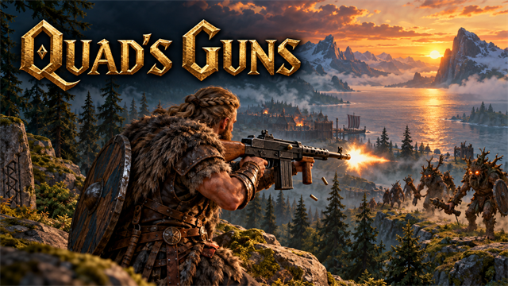
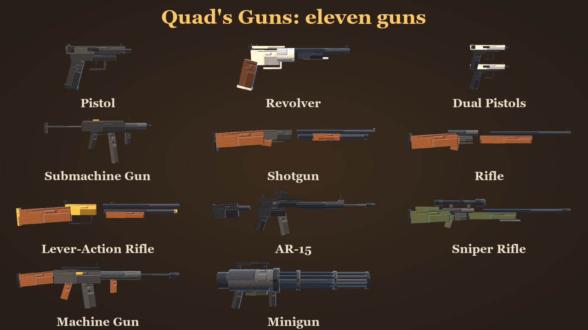
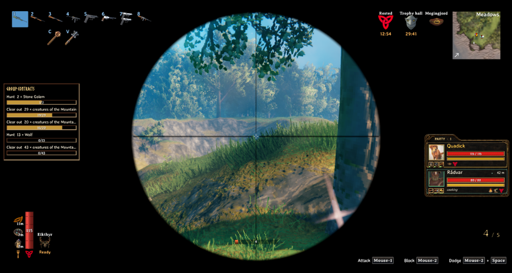
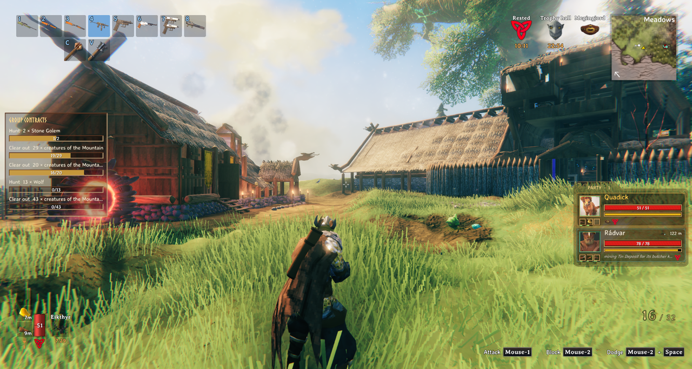

<!-- This page is made by tools/modpages/make_pages.py from the mod's thunderstore.toml, DESCRIPTION.txt, CHANGELOG.txt,
     settings and the repo's README. Change those, or the HAND-WRITTEN parts, not the rest of this page. -->

# 🔫 Quad's Guns

**Firearms and guns: pistol, revolver, dual pistols, SMG, shotgun, rifle, lever action, AR-15, sniper, machine gun and minigun, with reloading, aiming down the sights, recoil, real gun sounds and diving while you shoot. Made at the forge.**

    

<!-- GITHUB-ONLY -->[Thunderstore](https://thunderstore.io/c/valheim/p/Quads_Lab/Quads_Guns/)  ·  <!-- END GITHUB-ONLY -->[Source code](https://github.com/HardHeadHackerHead/valheim-mods/tree/main/mods/Guns)  ·  [Report a bug](https://github.com/HardHeadHackerHead/valheim-mods/issues/new?template=bug.yml&title=%5BQuad%27s%20Guns%5D%20)  ·  [Discord](https://discord.gg/EwTjQxEZPy)

  

<!-- GITHUB-ONLY -->**Install:** with [r2modman](https://thunderstore.io/c/valheim/p/ebkr/r2modman/) or Thunderstore Mod Manager from [Thunderstore](https://thunderstore.io/c/valheim/p/Quads_Lab/Quads_Guns/), or press **F7** in the game with our [mod manager](https://github.com/HardHeadHackerHead/valheim-mod-manager).<!-- END GITHUB-ONLY -->

## ✨ Features

Firearms for Valheim: pistol, revolver, dual pistols, SMG, shotgun, rifle, lever action, AR-15, sniper, machine gun and minigun, with reloading, aiming down the sights, recoil, real gun sounds and diving while you shoot. Made at the forge.

### The guns

- Pistol: a light semi-automatic, 12 rounds, one for each pull of the trigger. Quick to reload.
- Revolver: six heavy rounds and a kick like a mule. Slow to fire, hits hard.
- Dual Pistols: a pistol in each hand, firing left, right, left, right, with both arms out in front of you.
- Submachine Gun: a small automatic with 32 rounds; the barrel climbs the longer you hold the trigger.
- Shotgun: pump-action, nine pellets a shot, six shells loaded one at a time (and you can fire in between).
- Rifle: a bolt-action hunting rifle, five rounds, accurate when you aim.
- Lever-Action Rifle: ten rounds in the tube, the lever swings between shots.
- AR-15: semi-automatic, 30 rounds, a red-dot sight, quick and steady.
- Sniper Rifle: a heavy bolt-action with a scope: hold the aim button to look through it. One round hits for a great deal from very far away.
- Machine Gun: 75 rounds of sustained fire; the real sound of a long burst.
- Minigun: six rotating barrels and 400 rounds. It spools up with a rising whine, then never stops. Heavy: it slows you down.

### How they handle

- Hold the attack button to fire (an automatic gun keeps firing; the others fire once for each pull). The spread grows the longer you keep firing and settles when you stop.
- Right mouse (the block button) aims: the camera zooms in, the spread tightens, a rifle comes up to your shoulder and a pistol goes out at arm's length. Shots fly to the spot under the crosshair, with a little lift for drop.
- Reload with the middle mouse button, or just pull the trigger on an empty gun. Each gun has its own magazine, kept on the gun itself, and its own reload: a magazine out and in, a slide racked, a bolt worked, a shell at a time. Put the gun away and the reload stops without losing anything. The rounds left show at the bottom right, with a bar while you reload.
- Dive: block + jump with a light gun throws you into a dive instead of a roll: forward, to a side or backward, the way you are moving. You keep your gun up and can fire the whole way through. (The sniper rifle, machine gun and minigun are too heavy to dive with.)
- Your hands hold the guns: the right on the grip, the left on the foregrip, cupped under a pistol, or down at the magazine when you reload. Sprinting drops the gun to a low ready, and it kicks back with every shot.
- It sounds real: the gunshots, reloads, clicks and brass bouncing on the floor are recordings of real guns and mechanisms, a machine gun and a minigun play a real burst, and a round makes its own sound where it lands, different from the shot.
- Muzzle flash, brass flying out of the ejection port, a tracer behind every round, a scope picture for the sniper rifle, and an inventory picture drawn from each gun's model.

### What they cost

- Every gun is made at the forge: a pistol from iron, wood and leather scraps at level 1; revolvers, shotguns, rifles and the lever action at level 2; the AR-15, sniper rifle and machine gun from black metal at level 3; the minigun at level 4 from black metal, iron, chains and silver.
- There is no ammunition to craft yet: reloading is free. Real bullets are planned.
- Rounds use the Crossbows skill, which rises as you shoot.

## 📸 Screenshots

<!-- HAND-WRITTEN: screenshots -->
**All eleven guns**

**Looking through the sniper rifle's scope**

**Every gun in the hotbar, and the rounds left in the magazine at the bottom right**

<!-- END HAND-WRITTEN: screenshots -->

## 🎮 How to use

| Key | What it does |
|---|---|
| **Attack** (hold for an automatic gun) | Fire |
| **Block** (right mouse) | Aim: the camera zooms, the spread tightens; the sniper rifle shows its scope |
| **Secondary attack** (middle mouse), or the trigger on an empty gun | Reload |
| **Block** + **Jump** | A dive (forward, sideways or backward) you can shoot through, with the lighter guns |

<!-- HAND-WRITTEN: how-to-use -->
Reloading is free for now (no ammunition item yet), and the magazine is kept on the gun, so it is saved with it and travels with it: put a half-empty gun in a chest and it is half empty when you take it out. A shotgun or a lever action can be fired between rounds while it reloads. The block + jump dive uses stamina only if the server sets `DiveStamina`.

**Sound credits.** The gunshots, reloads, clicks and brass are real recordings that their authors released into the public domain (**CC0 1.0**: free to use, change and ship with no credit and no fee; they are credited here anyway). They are built into the mod's DLL as small WAV files (trimmed, mixed to mono, a few pitched up or down, some laid together by `tools/gunsounds/build.py` in the source). Everything else is made in code.

| What | From | By | Licence |
|---|---|---|---|
| Gunshots (1911, Walther PPQ, Bersa, Smith & Wesson 642, Carl Gustav M45, PPSh, Winchester Model 12, Charles Daly, Tikka T3, Marlin 336, Winchester 1894, AR-15, Springfield 1917, Arisaka, AK-47) and the machine gun and minigun bursts | [The Free Firearm Sound Library](https://opengameart.org/content/the-free-firearm-sound-library) | Ben Jaszczak, Brian Nelson, Kevin Heras, Matthew Nanney | CC0 |
| A pistol reload, a rifle reload, the shotgun pump | [Gun Reload Sounds](https://opengameart.org/content/gun-reload-sounds) | SpringySpringo | CC0 |
| A round and a magazine going in | [Gun Reload Sound Effects](https://opengameart.org/content/gun-reload-sound-effects) | BMacZero (Brian MacIntosh) | CC0 |
| Brass hitting the ground, a round landing | [Metal Impact Sounds](https://opengameart.org/content/metal-impact-sounds) | BMacZero (Brian MacIntosh) | CC0 |
| The empty click, slide, bolt, lever, magazine release and draw | [Equipment Clicks III](https://opengameart.org/content/equipment-clicks-iii) | LFA | CC0 |

Licence text: [creativecommons.org/publicdomain/zero/1.0](https://creativecommons.org/publicdomain/zero/1.0/). The list with the file names is in [sounds/LICENSES.txt](https://github.com/HardHeadHackerHead/valheim-mods/blob/main/mods/Guns/sounds/LICENSES.txt).
<!-- END HAND-WRITTEN: how-to-use -->

## 🧩 Other mods

**Goes well with**

|  |  |  |  |
|:-:|:-:|:-:|:-:|
| [Parkour](https://thunderstore.io/c/valheim/p/Quads_Lab/Quads_Parkour/) | [Arena](https://thunderstore.io/c/valheim/p/Quads_Lab/Quads_Arena/) | [Quiver](https://thunderstore.io/c/valheim/p/Quads_Lab/Quads_Quiver/) | [Gear Slots](https://thunderstore.io/c/valheim/p/Quads_Lab/Quads_Gear_Slots/) |

<!-- HAND-WRITTEN: other-mods -->
**Known clashes:** none known. The guns take over attacking, the block button, jumping and your arms only while one of them is in your hand, so mods that change attacks (Epic Loot, Meadow Golf, BuildOrders), your controls (Parkour, Odin Horse) or the animation's speeds (Smooth Climbing, which the dive holds at nothing while it lasts) work as before the rest of the time. Not tried yet next to a mod that gives crossbows their own animation, a first-person or VR mod, or a dual-wield mod: tell us if one of them misbehaves.
<!-- END HAND-WRITTEN: other-mods -->

Found a clash with another mod? [Tell us](https://github.com/HardHeadHackerHead/valheim-mods/issues/new?template=bug.yml&title=%5BQuad%27s%20Guns%5D%20) which one and what happened.

## 👥 Multiplayer

**Who needs it:** Everyone, and **the host above all**: a game without the mod deletes the pieces when their area loads. Restart after installing or updating them.

<!-- HAND-WRITTEN: multiplayer -->
**What others see.** Your rounds are real projectiles: other players see them fly and hit. The gun shows in your hand. For now the rest is on your own screen only: the shot's sound and flash, the brass, your arms holding the gun, the dive and the reload sounds. A server that doesn't have the mod can't make the guns, and a player without the mod on a server that has it simply doesn't see them.

**Settings the server decides:** every gun's damage, magazine, reload, rate of fire and cost, the spread of all guns and the cost of a dive. A player's own: aiming zoom, recoil, volume and whether the mod bends their arms.
<!-- END HAND-WRITTEN: multiplayer -->

## 🌍 Languages

**English, Русский (Russian), Deutsch (German), 简体中文 (Chinese), Português do Brasil (Portuguese), Español (Spanish), Français (French), Polski (Polish), Türkçe (Turkish).** It follows the game's own language setting.

The translations were made with AI, so a few words may be off. To correct one, or to add your language, put a file in `BepInEx/config/translations/com.quad.guns/` named after the game's name for the language (`German.json`, `Italian.json`, `Japanese.json`...) with only the lines you change, copied from [English.json](https://github.com/HardHeadHackerHead/valheim-mods/blob/main/mods/Guns/translations/English.json) (it wins over the built-in one). Or [tell us](https://github.com/HardHeadHackerHead/valheim-mods/issues/new?template=bug.yml&title=%5BQuad%27s%20Guns%5D%20Translation%3A%20) the better words and we'll put them in for everyone.

## ⚙️ Settings

In `BepInEx/config/com.quad.guns.cfg`, made the first time the game runs with the mod. r2modman and Thunderstore Mod Manager edit it under **Config editor**.<!-- GITHUB-ONLY --> With our mod manager: **F7**, then **Mod settings**.<!-- END GITHUB-ONLY -->

**0 - All guns**

| Setting | Default | What it does |
|---|---|---|
| `SpreadScale` | `1` | Multiplies every gun's spread: 0 for perfectly accurate guns, 2 for twice as wild. In multiplayer the server's value applies. |
| `StaminaPerShot` | `0` | Stamina each round costs. 0 for none (the default while the guns are being tested). In multiplayer the server's value applies. |
| `DiveStamina` | `0` | Stamina a dive costs (block + jump with a light gun). 0 for none (the default while the dive is being tried out). In multiplayer the server's value applies. |

**1 - Your own**

| Setting | Default | What it does |
|---|---|---|
| `AimZoomScale` | `1` | Multiplies how far the camera zooms in while you aim (hold the block button: right mouse). 1 for each gun's own zoom. Your own setting. |
| `ArmPosing` | `true` | The mod bends your arms to hold each gun with both hands (shouldered when you aim, low when you sprint). Switch off to use the game's own crossbow carry. Your own setting. |
| `Recoil` | `1` | How much each shot kicks your view up. 0 for none, 1 is the default. Your own setting. |
| `ShotVolume` | `1` | How loud the guns are (on top of the game's sound-effects volume). Your own setting. |

**AR-15**

| Setting | Default | What it does |
|---|---|---|
| `Damage` | `26` | Piercing damage of one round, before skill. In multiplayer the server's value applies. |
| `MagazineSize` | `30` | How many rounds a full magazine holds. In multiplayer the server's value applies. |
| `ReloadSeconds` | `2.2` | Seconds a reload takes. In multiplayer the server's value applies. |
| `RoundsPerSecond` | `8` | The most rounds it fires each second, one for each pull of the trigger. In multiplayer the server's value applies. |

**Dual Pistols**

| Setting | Default | What it does |
|---|---|---|
| `Damage` | `22` | Piercing damage of one round, before skill. In multiplayer the server's value applies. |
| `MagazineSize` | `24` | How many rounds a full magazine holds. In multiplayer the server's value applies. |
| `ReloadSeconds` | `2.4` | Seconds a reload takes. In multiplayer the server's value applies. |
| `RoundsPerSecond` | `9` | The most rounds it fires each second, one for each pull of the trigger. In multiplayer the server's value applies. |

**Lever-Action Rifle**

| Setting | Default | What it does |
|---|---|---|
| `Damage` | `55` | Piercing damage of one round, before skill. In multiplayer the server's value applies. |
| `MagazineSize` | `10` | How many rounds a full magazine holds. In multiplayer the server's value applies. |
| `SecondsPerRound` | `0.45` | Seconds to load each round. In multiplayer the server's value applies. |

**Machine Gun**

| Setting | Default | What it does |
|---|---|---|
| `Damage` | `14` | Piercing damage of one round, before skill. In multiplayer the server's value applies. |
| `MagazineSize` | `75` | How many rounds a full magazine holds. In multiplayer the server's value applies. |
| `ReloadSeconds` | `4.2` | Seconds a reload takes. In multiplayer the server's value applies. |
| `RoundsPerSecond` | `10` | How many rounds it fires each second while the attack button is held. In multiplayer the server's value applies. |

**Minigun**

| Setting | Default | What it does |
|---|---|---|
| `Damage` | `10` | Piercing damage of one round, before skill. In multiplayer the server's value applies. |
| `MagazineSize` | `400` | How many rounds a full magazine holds. In multiplayer the server's value applies. |
| `ReloadSeconds` | `7` | Seconds a reload takes. In multiplayer the server's value applies. |
| `RoundsPerSecond` | `25` | How many rounds it fires each second while the attack button is held. In multiplayer the server's value applies. |

**Pistol**

| Setting | Default | What it does |
|---|---|---|
| `Damage` | `28` | Piercing damage of one round, before skill. In multiplayer the server's value applies. |
| `MagazineSize` | `12` | How many rounds a full magazine holds. In multiplayer the server's value applies. |
| `ReloadSeconds` | `1.6` | Seconds a reload takes. In multiplayer the server's value applies. |
| `RoundsPerSecond` | `6` | The most rounds it fires each second, one for each pull of the trigger. In multiplayer the server's value applies. |

**Revolver**

| Setting | Default | What it does |
|---|---|---|
| `Damage` | `70` | Piercing damage of one round, before skill. In multiplayer the server's value applies. |
| `MagazineSize` | `6` | How many rounds a full magazine holds. In multiplayer the server's value applies. |
| `ReloadSeconds` | `2.6` | Seconds a reload takes. In multiplayer the server's value applies. |
| `RoundsPerSecond` | `2.5` | The most rounds it fires each second, one for each pull of the trigger. In multiplayer the server's value applies. |

**Rifle**

| Setting | Default | What it does |
|---|---|---|
| `Damage` | `90` | Piercing damage of one round, before skill. In multiplayer the server's value applies. |
| `MagazineSize` | `5` | How many rounds a full magazine holds. In multiplayer the server's value applies. |
| `ReloadSeconds` | `3` | Seconds a reload takes. In multiplayer the server's value applies. |

**Shotgun**

| Setting | Default | What it does |
|---|---|---|
| `Damage` | `9` | Piercing damage of one pellet, before skill. In multiplayer the server's value applies. |
| `MagazineSize` | `6` | How many rounds a full magazine holds. In multiplayer the server's value applies. |
| `SecondsPerRound` | `0.55` | Seconds to load each round. In multiplayer the server's value applies. |

**Sniper Rifle**

| Setting | Default | What it does |
|---|---|---|
| `Damage` | `240` | Piercing damage of one round, before skill. In multiplayer the server's value applies. |
| `MagazineSize` | `5` | How many rounds a full magazine holds. In multiplayer the server's value applies. |
| `ReloadSeconds` | `3.4` | Seconds a reload takes. In multiplayer the server's value applies. |

**Submachine Gun**

| Setting | Default | What it does |
|---|---|---|
| `Damage` | `11` | Piercing damage of one round, before skill. In multiplayer the server's value applies. |
| `MagazineSize` | `32` | How many rounds a full magazine holds. In multiplayer the server's value applies. |
| `ReloadSeconds` | `1.8` | Seconds a reload takes. In multiplayer the server's value applies. |
| `RoundsPerSecond` | `14` | How many rounds it fires each second while the attack button is held. In multiplayer the server's value applies. |

## 🤖 Made with AI

Made with the help of Claude (Anthropic), with Claude Code: designed, written and checked together, and tried in the game.

## 💬 Join us on Discord

Come hang out with the people who make and play these mods. In the **Quads Lab Discord** you can:

- 🛠️ **Get help** and report bugs straight to us
- 👀 **See new mods first**, and help test them before they're released
- 🗳️ **Suggest ideas** and vote on what we make next
- 🏰 **Share your builds**, bases and arena runs
- 🤖 **Talk AI coding and vibe coding** with people building things with AI, the way these mods are made

**[Join the Quads Lab Discord →](https://discord.gg/EwTjQxEZPy)**

## 🧪 About Quads Lab

Quads Lab is where **Quad H** ([HardHeadHackerHead](https://github.com/HardHeadHackerHead)) builds software with AI, of every kind:
these Valheim mods are one of its projects. Each mod is designed by a player, written with [Claude Code](https://claude.com/claude-code)
and tested in our own world, with **bobisme** as our tester.

- 🌐 [quadslab.io](https://quadslab.io)
- 🧰 [All Quads Lab mods on Thunderstore](https://thunderstore.io/c/valheim/p/Quads_Lab/)
- 💻 [Source code on GitHub](https://github.com/HardHeadHackerHead/valheim-mods)
- 💬 [Discord](https://discord.gg/EwTjQxEZPy)
- ☕ [Buy me a coffee](https://buymeacoffee.com/quadh)
- 🐞 Found a bug? [Open an issue on GitHub](https://github.com/HardHeadHackerHead/valheim-mods/issues/new/choose)

## ☕ Support my mods

Every Quads Lab mod is free, and it stays that way. If one of them made your game better and you'd like to say thanks, a coffee
helps me make new mods and keep improving the ones you already play. It's 100% optional, and always appreciated!

**[☕ Buy me a coffee →](https://buymeacoffee.com/quadh)**

## 📜 Recent changes

- **0.2.0** First release. Eleven guns, made at the forge: Pistol, Revolver, Dual Pistols, Submachine Gun, Shotgun, Rifle, Lever-Action Rifle, AR-15, Sniper Rifle, Machine Gun and Minigun. Magazines kept on the gun and reloading (middle mouse, or pull the trigger on an empty gun; reloading is free, no ammunition item yet), with the rounds left shown on screen. Aiming with right mouse (a rifle comes up to the shoulder, a pistol goes out at arm's length, the sniper rifle shows a scope), recoil, brass, muzzle flash and tracers. Your hands hold each gun (both arms bent to reach it, low when you sprint, the left hand down at the magazine when you reload); the dual pistols fire left then right. Block + jump with a light gun is a dive you can shoot through (forward, sideways or backward) instead of a roll. Real recorded gunshots, reloads and clicks (CC0, credited on the page), a real burst for the machine gun and the minigun with its spool-up, and a round makes its own sound where it lands. Heavy guns (minigun) slow you down. Settings for every gun's damage, magazine, reload, rate and cost (the server's in multiplayer). Not yet: the shot sound, flash, arm poses and dive on other players' screens, and bullets as items. In your language: English, Russian, German, Chinese (Simplified), Portuguese (Brazil), Spanish, French, Polish and Turkish (made with AI).

<!-- GITHUB-ONLY -->[Every change](CHANGELOG.txt)<!-- END GITHUB-ONLY --><!-- THUNDERSTORE-ONLY: Every change is on the Changelog tab. -->
