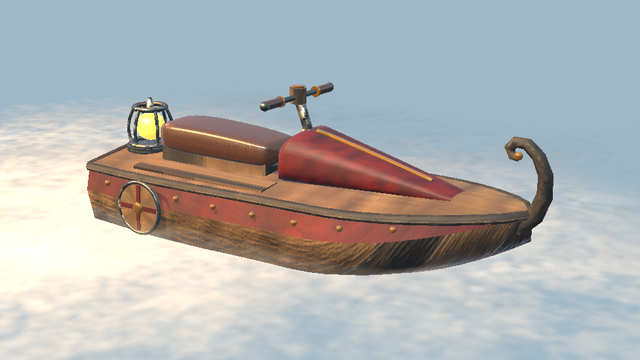
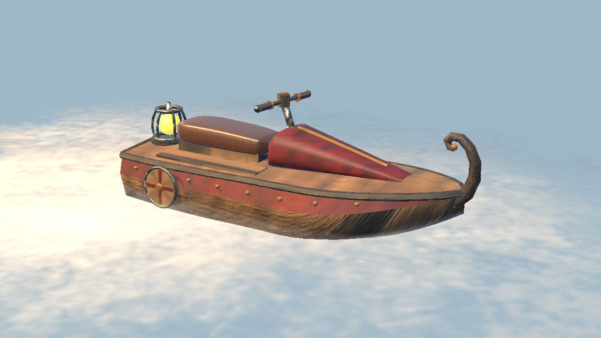
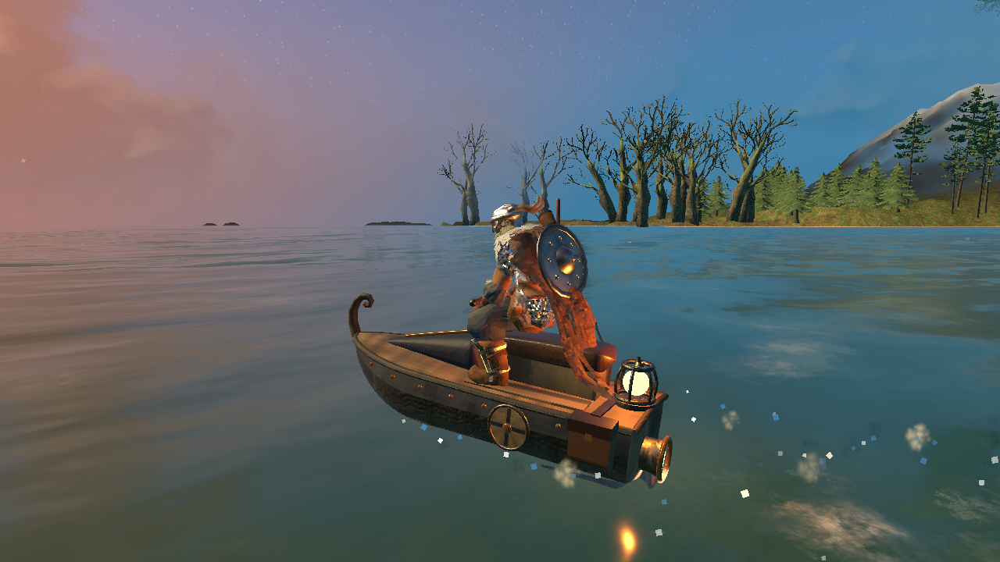
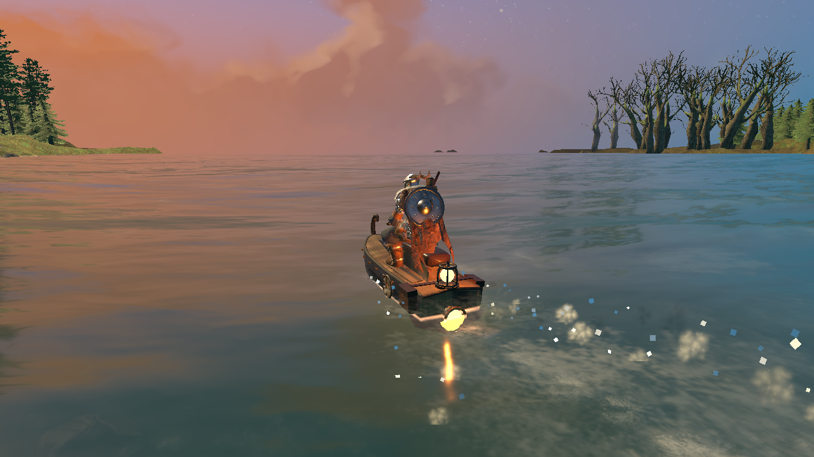
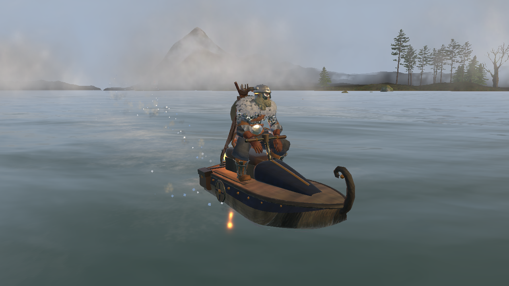

<!-- This page is made by tools/modpages/make_pages.py from the mod's thunderstore.toml, DESCRIPTION.txt, CHANGELOG.txt,
     settings and the repo's README. Change those, or the HAND-WRITTEN parts, not the rest of this page. -->

# 🌊 Quad's Jet Skis

**Jet ski (jetski) for a rider and a passenger: a fast motorboat pushed by a surtling core, not the wind. Steer it like a speedboat with WASD; saddlebag storage, paint colours, engine sound and spray. Built with the hammer, like the raft.**

    

<!-- GITHUB-ONLY -->[Thunderstore](https://thunderstore.io/c/valheim/p/Quads_Lab/Quads_Jet_Skis/)  ·  <!-- END GITHUB-ONLY -->[Source code](https://github.com/HardHeadHackerHead/valheim-mods/tree/main/mods/JetSkis)  ·  [Report a bug](https://github.com/HardHeadHackerHead/valheim-mods/issues/new?template=bug.yml&title=%5BQuad%27s%20Jet%20Skis%5D%20)  ·  [Discord](https://discord.gg/EwTjQxEZPy)

  

<!-- GITHUB-ONLY -->**Install:** with [r2modman](https://thunderstore.io/c/valheim/p/ebkr/r2modman/) or Thunderstore Mod Manager from [Thunderstore](https://thunderstore.io/c/valheim/p/Quads_Lab/Quads_Jet_Skis/), or press **F7** in the game with our [mod manager](https://github.com/HardHeadHackerHead/valheim-mod-manager).<!-- END GITHUB-ONLY -->

## ✨ Features

A jet ski for Valheim: a fast little boat for one (and a friend), pushed along by a surtling core's fire instead of the wind.

### Riding it

- Build it with the hammer on the water, near a workbench, like the raft: 12 Fine Wood, 30 Bronze Nails, 2 Surtling Cores and 4 Deer Hide.
- Press E on its handlebars from the water or the shore and you climb onto the saddle and take them.
- Hold W to go, Shift+W for full speed, S to back up; let go and it coasts to a stop. The wind doesn't matter.
- A and D steer: the handlebars turn and come back to the middle by themselves. It turns slower when barely moving, and stays level in a hard turn.
- Jump to get off.
- Leave it at the shore: with nobody aboard it stays where you left it, and the waves don't wear it down.
- You ride it like a jet ski: leaning over the bars, hands on the grips, feet on the pads, your head turning where you steer, bobbing over the waves. Everyone sees it.
- A gauge at the bottom right shows your speed and throttle, in place of the boat's wheel in the middle of the screen.
- Running into a friend at speed doesn't hurt them, and hopping waves barely scratches the hull.

### Room for two, and their things

- A passenger seat behind the rider (E on the back of the saddle): the passenger holds on round the rider's waist.
- Saddlebags on the back corners hold 8 stacks: E on them, or Tab while riding. If the jet ski breaks, what's in them floats away in a cargo crate, as from a Karve.

### The look and the sound

- A dark wooden hull with a band of red-stained wood and bronze rivets, a rub rail, a round shield on each side, a curled prow like a longship's, a leather saddle, a cowl up to iron handlebars, and a surtling core in an iron cage feeding the jet nozzle.
- Paint it: E on the cowl in front of the handlebars gives the next colour (red, blue, green, teal, purple, black, bare wood). Everyone sees it.
- An engine that burbles at idle and screams at full speed, spray thrown up behind it and off the side in hard turns, and a core that glows brighter (and lights the water further) as you open the throttle.
- It is the game's raft underneath, so it floats, wears, breaks, saves and changes hands in multiplayer as the game's boats do.

Everyone in the world needs it installed.

## 📸 Screenshots

<!-- HAND-WRITTEN: screenshots -->
**Full speed along the shore: hands on the grips, spray off the nozzle**

**From the side at dusk: the painted band's bronze rivets, a round shield, the saddle and the caged surtling core**

**From behind: the core glowing in its cage and the jet's spray on the water**

**Stopped on a misty morning: the curled prow, the painted cowl and the iron handlebars**

<!-- END HAND-WRITTEN: screenshots -->

## 🎮 How to use

| Key | What it does |
|---|---|
| **E** on a jet ski | Climb on (from the water or the shore) and take the handlebars |
| **W** / **Shift**+**W** / **S** | Go / full speed / back up (let go to coast); **A** / **D** steer, **Jump** gets off |
| **E** on a jet ski's cowl / saddlebags | Paint it the next colour / open the saddlebags (**Tab** while riding opens them too) |

<!-- HAND-WRITTEN: how-to-use -->

<!-- END HAND-WRITTEN: how-to-use -->

## 🧩 Other mods

<!-- HAND-WRITTEN: other-mods -->
**Known clashes:** none known.
<!-- END HAND-WRITTEN: other-mods -->

Found a clash with another mod? [Tell us](https://github.com/HardHeadHackerHead/valheim-mods/issues/new?template=bug.yml&title=%5BQuad%27s%20Jet%20Skis%5D%20) which one and what happened.

## 👥 Multiplayer

**Who needs it:** Everyone, and **the host above all**: a game without the mod deletes the pieces when their area loads. Restart after installing or updating them.

<!-- HAND-WRITTEN: multiplayer -->

<!-- END HAND-WRITTEN: multiplayer -->

## 🌍 Languages

**English, Русский (Russian), Deutsch (German), 简体中文 (Chinese), Português do Brasil (Portuguese), Español (Spanish), Français (French), Polski (Polish), Türkçe (Turkish).** It follows the game's own language setting.

The translations were made with AI, so a few words may be off. To correct one, or to add your language, put a file in `BepInEx/config/translations/com.quad.jetskis/` named after the game's name for the language (`German.json`, `Italian.json`, `Japanese.json`...) with only the lines you change, copied from [English.json](https://github.com/HardHeadHackerHead/valheim-mods/blob/main/mods/JetSkis/translations/English.json) (it wins over the built-in one). Or [tell us](https://github.com/HardHeadHackerHead/valheim-mods/issues/new?template=bug.yml&title=%5BQuad%27s%20Jet%20Skis%5D%20Translation%3A%20) the better words and we'll put them in for everyone.

## ⚙️ Settings

In `BepInEx/config/com.quad.jetskis.cfg`, made the first time the game runs with the mod. r2modman and Thunderstore Mod Manager edit it under **Config editor**.<!-- GITHUB-ONLY --> With our mod manager: **F7**, then **Mod settings**.<!-- END GITHUB-ONLY -->

**1 - Driving**

| Setting | Default | What it does |
|---|---|---|
| `CruiseSpeed` | `11` | How fast it goes holding W (metres per second; a longship under full sail does about 10). [Synced with Server] |
| `FullSpeed` | `17` | How fast it goes holding Shift+W (metres per second). [Synced with Server] |
| `ReverseSpeed` | `4` | How fast it backs up holding S (metres per second). [Synced with Server] |
| `Acceleration` | `5` | How quickly it picks up speed (metres per second, each second). Braking is a little stronger. [Synced with Server] |
| `Coasting` | `2.5` | How quickly it slows down with nothing held (metres per second, each second). [Synced with Server] |
| `TurnRate` | `95` | How fast it turns at full lock (degrees per second). It turns slower when barely moving. [Synced with Server] |
| `Grip` | `3` | How much it holds its line in a turn instead of sliding sideways (higher grips more). [Synced with Server] |

**2 - Look**

| Setting | Default | What it does |
|---|---|---|
| `LeanIntoTurns` | `true` | The jet ski (and you on it) leans into turns and lifts its nose at speed, your head turns where you steer and you bob over the waves. |
| `ShowControls` | `true` | Show the controls the first time you get on in a session. |
| `EngineVolume` | `1` | How loud the engine is (0 is silent, 1 as made; the game's own volume settings apply on top). |

**3 - Building**

| Setting | Default | What it does |
|---|---|---|
| `Cost` | `FineWood:12, BronzeNails:30, SurtlingCore:2, DeerHide:4` | What a jet ski costs to build with the hammer (at a workbench). Item prefab names and amounts, separated by commas, like FineWood:12, BronzeNails:30 (Claude Tools' `prefabs <text>` shows exact names). A cost with a mistake in it keeps the last good one. [Synced with Server] |

## 🤖 Made with AI

Made with the help of Claude (Anthropic), with Claude Code: designed, written and checked together, and tried in the game.

## 💬 Join us on Discord

Come hang out with the people who make and play these mods. In the **Quads Lab Discord** you can:

- 🛠️ **Get help** and report bugs straight to us
- 👀 **See new mods first**, and help test them before they're released
- 🗳️ **Suggest ideas** and vote on what we make next
- 🏰 **Share your builds**, bases and arena runs
- 🤖 **Talk AI coding and vibe coding** with people building things with AI, the way these mods are made

**[Join the Quads Lab Discord →](https://discord.gg/EwTjQxEZPy)**

## 🧪 About Quads Lab

Quads Lab is where **Quad H** ([HardHeadHackerHead](https://github.com/HardHeadHackerHead)) builds software with AI, of every kind:
these Valheim mods are one of its projects. Each mod is designed by a player, written with [Claude Code](https://claude.com/claude-code)
and tested in our own world, with **bobisme** as our tester.

- 🌐 [quadslab.io](https://quadslab.io)
- 🧰 [All Quads Lab mods on Thunderstore](https://thunderstore.io/c/valheim/p/Quads_Lab/)
- 💻 [Source code on GitHub](https://github.com/HardHeadHackerHead/valheim-mods)
- 💬 [Discord](https://discord.gg/EwTjQxEZPy)
- ☕ [Buy me a coffee](https://buymeacoffee.com/quadh)
- 🐞 Found a bug? [Open an issue on GitHub](https://github.com/HardHeadHackerHead/valheim-mods/issues/new/choose)

## ☕ Support my mods

Every Quads Lab mod is free, and it stays that way. If one of them made your game better and you'd like to say thanks, a coffee
helps me make new mods and keep improving the ones you already play. It's 100% optional, and always appreciated!

**[☕ Buy me a coffee →](https://buymeacoffee.com/quadh)**

## 📜 Recent changes

- **0.3.1** On a server without Jet Skis, the jet ski is gone from the hammer, and a message says why: the server would delete a jet ski built there, with whatever was in its saddlebags. Server owners can change what a jet ski costs ("3 - Building", Cost); in multiplayer the server's cost applies, and a cost with a mistake in it keeps the last good one. Settings: edits to the config file now apply while the game runs (a server owner no longer has to restart), and a server's admins can change the server's settings from their own game with Configuration Manager, where other players see them greyed out. Your config file always keeps your own values while you play on a server (saving it there could write the server's in). Players on an older version still get the server's settings.
- **0.3.0** In your language: Russian, German, Chinese, Portuguese, Spanish, French, Polish and Turkish (translated by AI; corrections welcome). A jet ski left alone stays where you left it: it no longer drifts ashore on the waves, and knocks against the beach no longer wear it down (jet skis left near the shore broke after a while). A crash while you ride still hurts it.
- **0.2.2** Spray you can see: a rooster tail of water arcing out of the nozzle that grows with your speed, a curl off each side of the bow, a sheet thrown off the outside of a hard turn, and a trail of foam left on the water behind you. It's made of the game's own splash, white mist and droplets (the old spray was flat patches of foam that didn't show in the air).

<!-- GITHUB-ONLY -->[Every change](CHANGELOG.txt)<!-- END GITHUB-ONLY --><!-- THUNDERSTORE-ONLY: Every change is on the Changelog tab. -->
