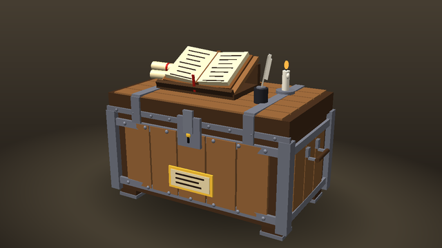
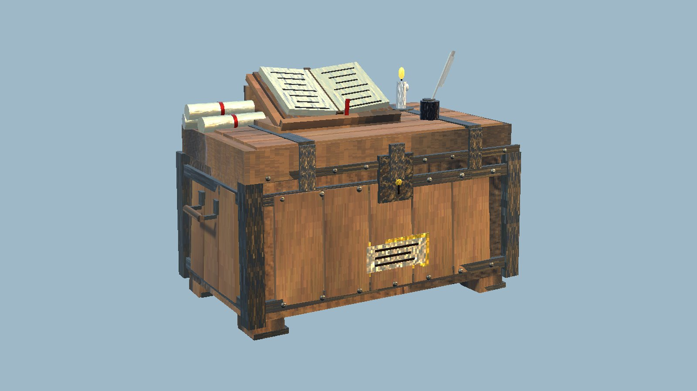
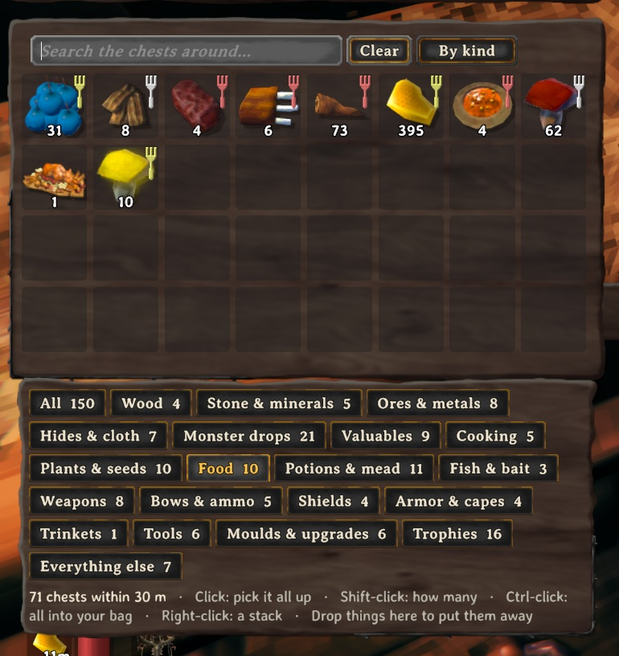

<!-- This page is made by tools/modpages/make_pages.py from the mod's thunderstore.toml, DESCRIPTION.txt, CHANGELOG.txt,
     settings and the repo's README. Change those, or the HAND-WRITTEN parts, not the rest of this page. -->

# 📒 Quad's Ledger Chest

**A chest you build that shows everything in every chest around it, with a search: search all your chests and storage, and take anything from wherever it is.**

    

<!-- GITHUB-ONLY -->[Thunderstore](https://thunderstore.io/c/valheim/p/Quads_Lab/Quads_Ledger_Chest/)  ·  <!-- END GITHUB-ONLY -->[Source code](https://github.com/HardHeadHackerHead/valheim-mods/tree/main/mods/LedgerChest)  ·  [Report a bug](https://github.com/HardHeadHackerHead/valheim-mods/issues/new?template=bug.yml&title=%5BQuad%27s%20Ledger%20Chest%5D%20)  ·  [Discord](https://discord.gg/EwTjQxEZPy)

<!-- GITHUB-ONLY -->**Install:** with [r2modman](https://thunderstore.io/c/valheim/p/ebkr/r2modman/) or Thunderstore Mod Manager from [Thunderstore](https://thunderstore.io/c/valheim/p/Quads_Lab/Quads_Ledger_Chest/), or press **F7** in the game with our [mod manager](https://github.com/HardHeadHackerHead/valheim-mod-manager).<!-- END GITHUB-ONLY -->

## ✨ Features

- Build the Ledger Chest with the hammer at a workbench (10 Wood, 4 Fine Wood, 4 Leather Scraps, 2 Resin). It keeps nothing itself: it is the counter of your storehouse.
- Open it (E): in place of a chest's slots, the ledger shows every kind of item in the chests within 30 m, one slot each with how many there are in all. It is the game's own chest window, with its tooltips.
- A search in its title bar narrows it down (several words: all must match); list by kind, A to Z or most first.
- Category buttons under it (Wood, Stone & minerals, Ores & metals, Hides & cloth, Cooking, Food, Weapons, Armor, Trophies and more), each with how many things it holds: press one to see only those. Under them: which chests hold what is under your mouse.
- Click an item to pick all of it up, and put it down on a slot of your inventory: as much as fits comes out of the nearest chests that have it, into that slot first and then wherever there's room. Shift-click to choose how many (the game's own split slider). Ctrl-click: all that fits, straight into your inventory. Right-click: a stack, straight in. Put it back on the ledger (or outside the windows, or right-click) and nothing moves.
- Drop things onto it (or Ctrl-click them in your inventory) to put them away: each goes straight on to a chest around it. A chest assigned that item first (QualityOfLife's K), then one assigned its category, then a chest with nothing assigned (one already holding it first). When no chest has room it comes back to you.
- Hover a line to see which chests hold it and how far away they are.
- Items come out exactly as they went in (upgrades, wear). Chests someone else has open are left alone, and so are carts, ships, tombstones and companions' own chests.
- It has its own hand-made look: an iron-bound strongbox with the ledger open on a reading stand, a quill in its inkpot, scrolls and a candle.

## 📸 Screenshots

<!-- HAND-WRITTEN: screenshots -->
**The Ledger Chest**

**Everything in the chests around it, in one searchable list**

<!-- END HAND-WRITTEN: screenshots -->

## 🎮 How to use

| Key | What it does |
|---|---|
| **E** at a Ledger Chest | See and search everything in the chests around it; click to take, Shift-click to choose how many |

<!-- HAND-WRITTEN: how-to-use -->

<!-- END HAND-WRITTEN: how-to-use -->

## 🧩 Other mods

<!-- HAND-WRITTEN: other-mods -->
**Known clashes:** none known.

It moves items with the game's own moves, and never lists graves, carts, ships or companions' chests.

**Works with our mods**

- [Quad's Quality of Life](https://thunderstore.io/c/valheim/p/Quads_Lab/Quads_Quality_Of_Life/): what you put in the Ledger Chest goes on to the chest assigned that item or kind (it works without Quality of Life too).
- [Quad's Gear Slots](https://thunderstore.io/c/valheim/p/Quads_Lab/Quads_Gear_Slots/): items you take go into your ordinary rows.
<!-- END HAND-WRITTEN: other-mods -->

Found a clash with another mod? [Tell us](https://github.com/HardHeadHackerHead/valheim-mods/issues/new?template=bug.yml&title=%5BQuad%27s%20Ledger%20Chest%5D%20) which one and what happened.

## 👥 Multiplayer

**Who needs it:** Everyone, and **the host above all**: a game without the mod deletes the pieces when their area loads. Restart after installing or updating them.

<!-- HAND-WRITTEN: multiplayer -->
**The Ledger Chest is a real chest:** a game without the mod deletes it **with what is in it** when its area loads (on a dedicated server above all). It skips chests others have open and chests a ward keeps you out of.
<!-- END HAND-WRITTEN: multiplayer -->

## 🌍 Languages

**English, Русский (Russian), Deutsch (German), 简体中文 (Chinese), Português do Brasil (Portuguese), Español (Spanish), Français (French), Polski (Polish), Türkçe (Turkish).** It follows the game's own language setting.

The translations were made with AI, so a few words may be off. To correct one, or to add your language, put a file in `BepInEx/config/translations/com.quad.ledgerchest/` named after the game's name for the language (`German.json`, `Italian.json`, `Japanese.json`...) with only the lines you change, copied from [English.json](https://github.com/HardHeadHackerHead/valheim-mods/blob/main/mods/LedgerChest/translations/English.json) (it wins over the built-in one). Or [tell us](https://github.com/HardHeadHackerHead/valheim-mods/issues/new?template=bug.yml&title=%5BQuad%27s%20Ledger%20Chest%5D%20Translation%3A%20) the better words and we'll put them in for everyone.

## ⚙️ Settings

In `BepInEx/config/com.quad.ledgerchest.cfg`, made the first time the game runs with the mod. r2modman and Thunderstore Mod Manager edit it under **Config editor**.<!-- GITHUB-ONLY --> With our mod manager: **F7**, then **Mod settings**.<!-- END GITHUB-ONLY -->

**Ledger**

| Setting | Default | What it does |
|---|---|---|
| `Radius` | `30` | How far from the Ledger Chest (metres) the chests it lists can be. |
| `Scale` | `1` | Size of the category buttons and notes under the ledger. |

## 🤖 Made with AI

Made with the help of Claude (Anthropic), with Claude Code: designed, written and checked together, and tried in the game.

## 💬 Join us on Discord

Come hang out with the people who make and play these mods. In the **Quads Lab Discord** you can:

- 🛠️ **Get help** and report bugs straight to us
- 👀 **See new mods first**, and help test them before they're released
- 🗳️ **Suggest ideas** and vote on what we make next
- 🏰 **Share your builds**, bases and arena runs
- 🤖 **Talk AI coding and vibe coding** with people building things with AI, the way these mods are made

**[Join the Quads Lab Discord →](https://discord.gg/EwTjQxEZPy)**

## 🧪 About Quads Lab

Quads Lab is where **Quad H** ([HardHeadHackerHead](https://github.com/HardHeadHackerHead)) builds software with AI, of every kind:
these Valheim mods are one of its projects. Each mod is designed by a player, written with [Claude Code](https://claude.com/claude-code)
and tested in our own world, with **bobisme** as our tester.

- 🌐 [quadslab.io](https://quadslab.io)
- 🧰 [All Quads Lab mods on Thunderstore](https://thunderstore.io/c/valheim/p/Quads_Lab/)
- 💻 [Source code on GitHub](https://github.com/HardHeadHackerHead/valheim-mods)
- 💬 [Discord](https://discord.gg/EwTjQxEZPy)
- 🐞 Found a bug? [Open an issue on GitHub](https://github.com/HardHeadHackerHead/valheim-mods/issues/new/choose)

## 📜 Recent changes

- **1.2.2** Its windows no longer fill the log with "The LiberationSans SDF Font Asset was not found": each text is given the game's font before it starts (it looked for TextMeshPro's default font, which the game doesn't have, every time a text was made). Nothing changes on screen.
- **1.2.1** Its build piece now also clears destroyed pieces left in the hammer's list by other mods when it registers: after a mod is reloaded at the main menu, a leftover one made every change to your bag throw an error half-way (crafting gave the item without taking the cost) until the game was restarted.
- **1.2.0** Now in your language: English, Russian, German, Chinese (Simplified), Portuguese (Brazil), Spanish, French, Polish and Turkish, following the game's own Language setting. The game's own names are used for its things (items, creatures, lands, stations). The translations were made with AI: to correct a line, or add a language, put a file in BepInEx/config/translations/com.quad.ledgerchest/ named after the game's name for the language (German.json...) with only the lines you change, copied from translations/English.json on GitHub. Search finds items by their names in your language.

<!-- GITHUB-ONLY -->[Every change](CHANGELOG.txt)<!-- END GITHUB-ONLY --><!-- THUNDERSTORE-ONLY: Every change is on the Changelog tab. -->
