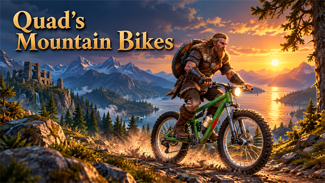
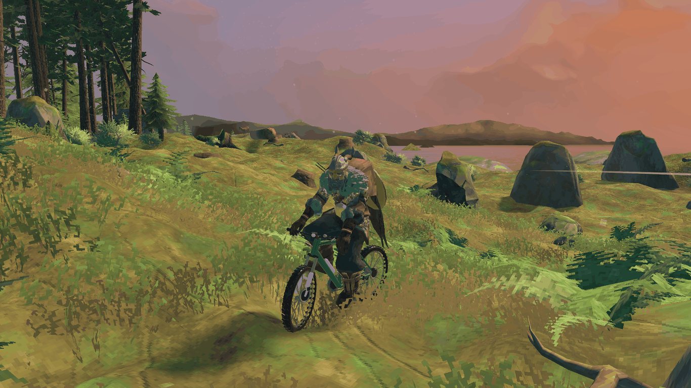
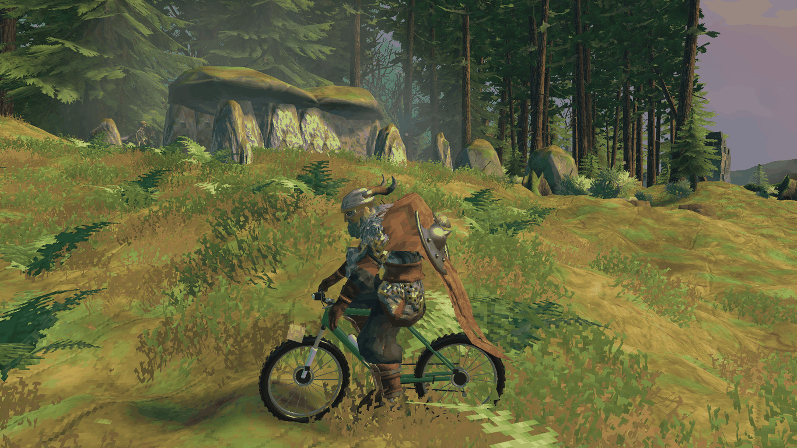
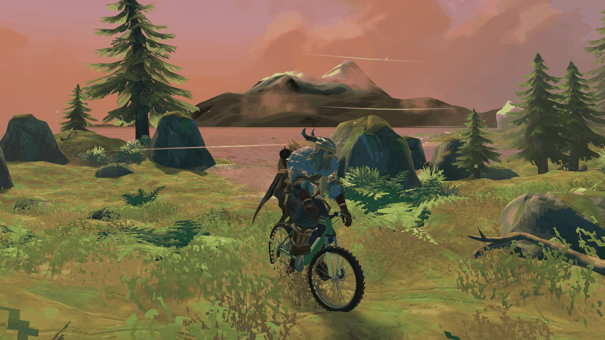

<!-- This page is made by tools/modpages/make_pages.py from the mod's thunderstore.toml, DESCRIPTION.txt, CHANGELOG.txt,
     settings and the repo's README. Change those, or the HAND-WRITTEN parts, not the rest of this page. -->

# 🚵 Quad's Mountain Bikes

**Mountain bike (bicycle, bike) you pedal yourself: it costs stamina, needs no fuel and goes where a walker would crawl. Leans into corners, headlamp, tail light, paint colours, tyre sound and dust. Built with the hammer.**

    

[Source code](https://github.com/HardHeadHackerHead/valheim-mods/tree/main/mods/MountainBikes)  ·  [Report a bug](https://github.com/HardHeadHackerHead/valheim-mods/issues/new?template=bug.yml&title=%5BQuad%27s%20Mountain%20Bikes%5D%20)  ·  [Discord](https://discord.gg/EwTjQxEZPy)

  

**Install:** press **F7** in the game with our [mod manager](https://github.com/HardHeadHackerHead/valheim-mod-manager), or take `MountainBikes.dll` from [dist/](https://github.com/HardHeadHackerHead/valheim-mods/tree/main/dist). It isn't on Thunderstore.

## ✨ Features

A mountain bike for Valheim: a sturdy trail bike that you pedal yourself. It tires you out like running does, needs no fuel and goes where a walker would crawl, with a headlamp for the night and colours to choose from.

### Riding it

- Build it with the hammer on dry land, near a workbench: 6 Fine Wood, 4 Bronze, 4 Leather Scraps and 6 Resin.
- Press E on its saddle and you climb on.
- Hold W to pedal, Shift+W to sprint (it costs stamina, three times as much as pedalling); out of breath you drop to a walking pace. Coasting and braking are free, so downhill is a rest. S brakes (and backs up once stopped). A and D steer.
- It leans into corners and holds its line: sharp at a crawl, a wide arc at speed, no sliding through the turns.
- It stands up by itself when you leave it, and if it ends up on its side, E on it stands it back on its wheels.
- Jump or E gets you off. Ride into an enemy and it takes a little damage and is knocked away. The hammer takes it apart again (not while someone is on it). A gauge at the bottom right shows your speed and whether you are pedalling, sprinting or braking.

### The look and the sound

- A trail bike with a green sloping-top-tube frame, a suspension fork with chrome stanchions and white lowers, disc brakes, spoked wheels with knobbly tyres, a slim saddle, chain ring, chain, cassette and derailleur, a bottle and a kickstand that tucks up when you ride. The handlebars turn as you steer and the pedals go round as you pedal.
- A small headlamp and a red tail reflector: the lamp comes on at night (and in caves) while someone rides it, and the tail light glows brighter when you brake.
- Paint it: E on the frame in front of the saddle gives the next colour (green, red, blue, orange, black, cream, purple). Everyone sees it.
- Hard cornering squeals the tyres, a landing after a jump thumps and kicks up dust, plus the sound of the tyres on the ground and a puff of dust off each wheel, coloured to the ground you are on: brown earth, pale sand on the plains, white snow in the mountains, grey ash.

Everyone in the world needs it installed.

## 📸 Screenshots

<!-- HAND-WRITTEN: screenshots -->
**Down a meadow trail: leaning over the bars with both hands on the grips and boots on the pedals**

**From the side: the green frame, suspension fork with white lowers, spoked wheels and knobbly tyres**

**From the front at sunset: the headlamp, bars and fork, with the rider's head turned where they steer**

<!-- END HAND-WRITTEN: screenshots -->

## 🎮 How to use

| Key | What it does |
|---|---|
| **E** on a mountain bike | Climb on (**E** on its frame in front of the saddle: paint it the next colour; **E** on one lying on its side: stand it up) |
| **W** / **Shift**+**W** / **S** | Pedal / sprint (both cost stamina; coasting and braking are free) / brake, then back up; **A** / **D** steer, **Jump** or **E** gets off |

<!-- HAND-WRITTEN: how-to-use -->

<!-- END HAND-WRITTEN: how-to-use -->

## 🧩 Other mods

**Goes well with**

|  |  |  |  |
|:-:|:-:|:-:|:-:|
| [Four Wheelers](https://thunderstore.io/c/valheim/p/Quads_Lab/Quads_Four_Wheelers/) | [Jet Skis](https://thunderstore.io/c/valheim/p/Quads_Lab/Quads_Jet_Skis/) | [Parkour](https://thunderstore.io/c/valheim/p/Quads_Lab/Quads_Parkour/) | [Ziplines](https://thunderstore.io/c/valheim/p/Quads_Lab/Quads_Ziplines/) |

<!-- HAND-WRITTEN: other-mods -->
**Known clashes:** none known.
<!-- END HAND-WRITTEN: other-mods -->

Found a clash with another mod? [Tell us](https://github.com/HardHeadHackerHead/valheim-mods/issues/new?template=bug.yml&title=%5BQuad%27s%20Mountain%20Bikes%5D%20) which one and what happened.

## 👥 Multiplayer

**Who needs it:** Everyone, and **the host above all**: a game without the mod deletes the pieces when their area loads. Restart after installing or updating them.

<!-- HAND-WRITTEN: multiplayer -->

<!-- END HAND-WRITTEN: multiplayer -->

## 🌍 Languages

**English, Русский (Russian), Deutsch (German), 简体中文 (Chinese), Português do Brasil (Portuguese), Español (Spanish), Français (French), Polski (Polish), Türkçe (Turkish).** It follows the game's own language setting.

The translations were made with AI, so a few words may be off. To correct one, or to add your language, put a file in `BepInEx/config/translations/com.quad.mountainbikes/` named after the game's name for the language (`German.json`, `Italian.json`, `Japanese.json`...) with only the lines you change, copied from [English.json](https://github.com/HardHeadHackerHead/valheim-mods/blob/main/mods/MountainBikes/translations/English.json) (it wins over the built-in one). Or [tell us](https://github.com/HardHeadHackerHead/valheim-mods/issues/new?template=bug.yml&title=%5BQuad%27s%20Mountain%20Bikes%5D%20Translation%3A%20) the better words and we'll put them in for everyone.

## ⚙️ Settings

In `BepInEx/config/com.quad.mountainbikes.cfg`, made the first time the game runs with the mod. r2modman and Thunderstore Mod Manager edit it under **Config editor**.<!-- GITHUB-ONLY --> With our mod manager: **F7**, then **Mod settings**.<!-- END GITHUB-ONLY -->

**1 - Driving**

| Setting | Default | What it does |
|---|---|---|
| `CruiseSpeed` | `9.5` | How fast it goes pedalling with W (metres per second; a walking player does about 5, running about 7). [Synced with Server] |
| `FullSpeed` | `15` | How fast it goes sprinting with Shift+W, which tires you out faster (metres per second). [Synced with Server] |
| `ReverseSpeed` | `2` | How fast it backs up holding S once stopped (metres per second). [Synced with Server] |
| `Acceleration` | `4.5` | How quickly it picks up speed (metres per second, each second). Braking is stronger. [Synced with Server] |
| `Coasting` | `0.8` | How quickly it slows down with nothing held (metres per second, each second). [Synced with Server] |
| `TurnRate` | `120` | The fastest it can turn (degrees per second), at low speed. Faster, it turns on a wider circle. [Synced with Server] |
| `Grip` | `10` | How much it holds its line in a turn instead of sliding sideways (higher grips more). [Synced with Server] |
| `PedalStamina` | `3` | How much stamina pedalling costs each second (sprinting costs three times that). Coasting and braking are free. At 0 it never tires you. [Synced with Server] |

**2 - Look**

| Setting | Default | What it does |
|---|---|---|
| `ShowControls` | `true` | Show the controls the first time you get on in a session. |

**3 - Building**

| Setting | Default | What it does |
|---|---|---|
| `Cost` | `FineWood:6, Bronze:4, LeatherScraps:4, Resin:6` | What a mountain bike costs to build with the hammer (at a workbench). Item prefab names and amounts, separated by commas, like FineWood:12, BronzeNails:30 (Claude Tools' `prefabs <text>` shows exact names). A cost with a mistake in it keeps the last good one. [Synced with Server] |

**4 - Combat**

| Setting | Default | What it does |
|---|---|---|
| `RamDamage` | `3` | Blunt damage to an enemy you ride into, for each metre per second over 3. Players and tamed animals are never hurt; 0 turns it off. [Synced with Server] |

## 🤖 Made with AI

Made with the help of Claude (Anthropic), with Claude Code: designed, written and checked together, and tried in the game.

## 💬 Join us on Discord

Come hang out with the people who make and play these mods. In the **Quads Lab Discord** you can:

- 🛠️ **Get help** and report bugs straight to us
- 👀 **See new mods first**, and help test them before they're released
- 🗳️ **Suggest ideas** and vote on what we make next
- 🏰 **Share your builds**, bases and arena runs
- 🤖 **Talk AI coding and vibe coding** with people building things with AI, the way these mods are made

**[Join the Quads Lab Discord →](https://discord.gg/EwTjQxEZPy)**

## 🧪 About Quads Lab

Quads Lab is where **Quad H** ([HardHeadHackerHead](https://github.com/HardHeadHackerHead)) builds software with AI, of every kind:
these Valheim mods are one of its projects. Each mod is designed by a player, written with [Claude Code](https://claude.com/claude-code)
and tested in our own world, with **bobisme** as our tester.

- 🌐 [quadslab.io](https://quadslab.io)
- 🧰 [All Quads Lab mods on Thunderstore](https://thunderstore.io/c/valheim/p/Quads_Lab/)
- 💻 [Source code on GitHub](https://github.com/HardHeadHackerHead/valheim-mods)
- 💬 [Discord](https://discord.gg/EwTjQxEZPy)
- ☕ [Buy me a coffee](https://buymeacoffee.com/quadh)
- 🐞 Found a bug? [Open an issue on GitHub](https://github.com/HardHeadHackerHead/valheim-mods/issues/new/choose)

## ☕ Support my mods

Every Quads Lab mod is free, and it stays that way. If one of them made your game better and you'd like to say thanks, a coffee
helps me make new mods and keep improving the ones you already play. It's 100% optional, and always appreciated!

**[☕ Buy me a coffee →](https://buymeacoffee.com/quadh)**

## 📜 Recent changes

- **0.1.1** You ride it properly now: leaning forward over the bars with both hands on the grips (they follow the bars as they turn) and your boots on the pedals, so your legs pedal round with the cranks; your head turns where you steer. Everyone sees it. Plus: the front wheel can no longer get stuck going up a steep hill (the wheels' ground check starts above the suspension and rolls over a rise), a stuck rider gets a small hop free, a new model built after a real hardtail (tapered welded-looking frame, suspension fork, disc brakes, derailleur and kickstand, which tucks up when you ride), tyre squeal in hard corners and a thump and dust burst on landing.
- **0.1.0** First release: a mountain bike built with the hammer on dry land. W pedal, Shift+W sprint (both cost stamina; coasting and braking are free), S brake and back up, A and D steer, E on the saddle to climb on, Jump or E to get off. It leans into corners, holds its line (no sliding), stands up by itself when parked, and E on a flipped one stands it back on its wheels. Handlebars that turn and pedals that go round, a headlamp and tail light at night, a gauge at the bottom right, tyre sound, dust coloured to the ground, and paint (E on the frame). In your language: Russian, German, Chinese, Portuguese, Spanish, French, Polish and Turkish (translated by AI; corrections welcome).

<!-- GITHUB-ONLY -->[Every change](CHANGELOG.txt)<!-- END GITHUB-ONLY --><!-- THUNDERSTORE-ONLY: Every change is on the Changelog tab. -->
