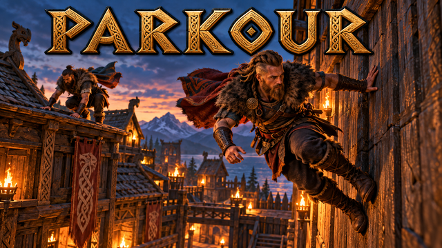
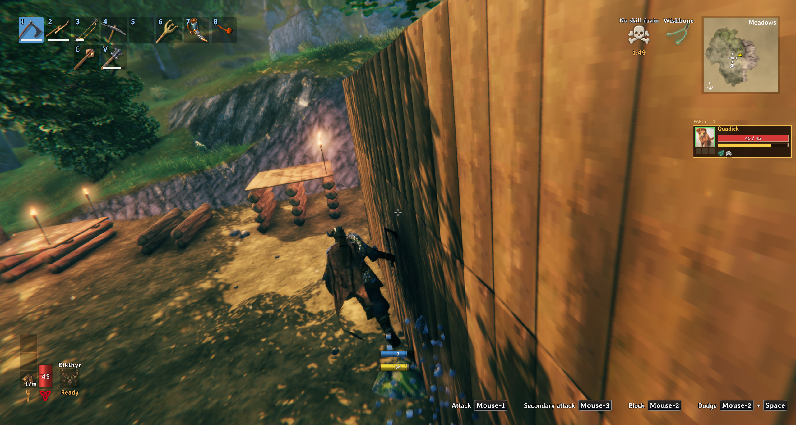
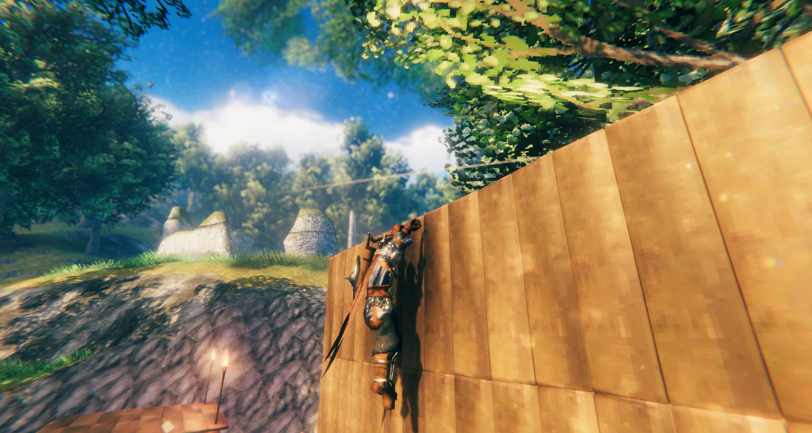
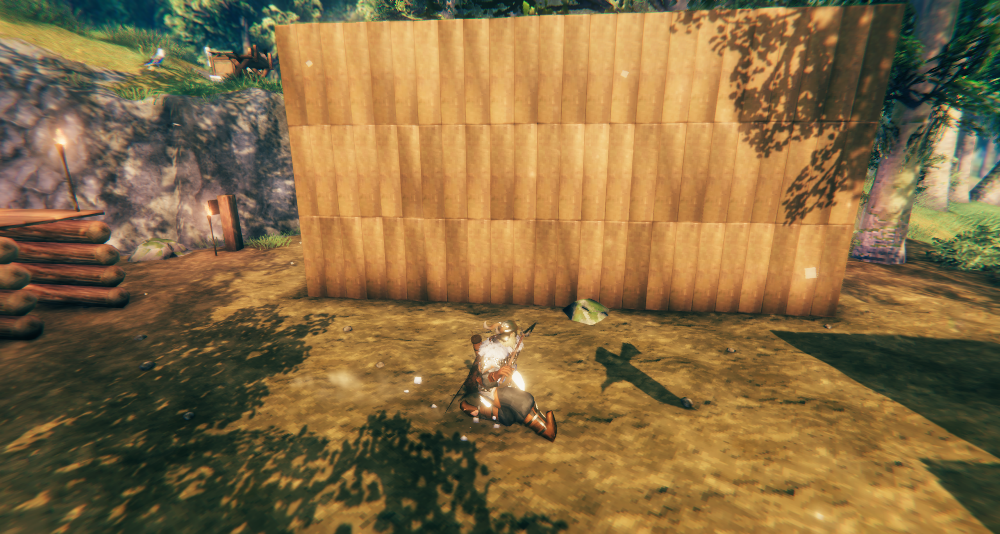

<!-- This page is made by tools/modpages/make_pages.py from the mod's thunderstore.toml, DESCRIPTION.txt, CHANGELOG.txt,
     settings and the repo's README. Change those, or the HAND-WRITTEN parts, not the rest of this page. -->

# 🤸 Quad's Parkour

**Parkour and free running: wall run, wall jump, climb walls, grab and hang from ledges, shimmy, vault, slide and roll, with a Parkour skill and a blue parkour bar instead of stamina.**

    

<!-- GITHUB-ONLY -->[Thunderstore](https://thunderstore.io/c/valheim/p/Quads_Lab/Quads_Parkour/)  ·  <!-- END GITHUB-ONLY -->[Source code](https://github.com/HardHeadHackerHead/valheim-mods/tree/main/mods/Parkour)  ·  [Report a bug](https://github.com/HardHeadHackerHead/valheim-mods/issues/new?template=bug.yml&title=%5BQuad%27s%20Parkour%5D%20)  ·  [Discord](https://discord.gg/EwTjQxEZPy)

  

<!-- GITHUB-ONLY -->**Install:** with [r2modman](https://thunderstore.io/c/valheim/p/ebkr/r2modman/) or Thunderstore Mod Manager from [Thunderstore](https://thunderstore.io/c/valheim/p/Quads_Lab/Quads_Parkour/), or press **F7** in the game with our [mod manager](https://github.com/HardHeadHackerHead/valheim-mod-manager).<!-- END GITHUB-ONLY -->

## ✨ Features

### The moves

- Wall run: sprint and jump at a wall at an angle, and you run along it, leaning into it, sinking slowly: 2 seconds at first, up to 4 seconds and 15% faster with the skill (about 10 to 22 metres). It costs no stamina: the blue parkour bar above your stamina bar shows how long you have left. It ends at the wall's end, or when you let go of sprint or turn away.
- Wall jump: jump while on a wall, or just after touching one, to kick off it, up and away toward where you are looking (never back into the wall). Chain kicks between two walls to climb a gap between buildings: 2 in a row before you must touch the ground, one more every 20 levels of the skill, up to 6. The same wall can't be kicked twice in a row.
- Wall climb: sprint straight at a wall and jump near it to run up it, 2 metres at first and up to 4 with the skill, then grab the top if it's in reach or drop back off.
- Ledge grab: in the air (a jump, a climb, a wall run), hold forward and you catch an edge in front of you, between your waist and above your head. You hang there (the blue bar, full again with every grab, shows for how long); let go of forward and press it again, or jump, to pull yourself up onto it, crouch or backward lets go. Left or right moves you along the edge while you hang (it stops at the end of the edge, at a corner or at anything in the way). Only where you fit on top. On a lone wall or a fence, with nothing to stand on behind the top, you vault over it and drop down the far side. Look away from the wall and jump to kick off it toward where you look. Edges with no wall under them (a floor on posts, an overhang) can be grabbed too.
- Slide: sprinting, press crouch and you drop into a slide, a quarter faster than your sprint, easing off, faster down slopes and slower uphill, for up to 1 second (1.5 with the skill), as long as you hold crouch. Jump out of it to leap with its speed plus 40% more, and 30% higher than a normal jump. Crouch just before landing from a low jump (up to 4 metres) while running forward and you land straight in a slide, keeping your speed. A slide doesn't take you under anything lower than you stand: the game keeps your full height when you crouch.
- Landing roll: press crouch just before you land from higher up (0.3 seconds, up to 0.5 with the skill) and you land in the game's dodge roll. No fall damage up to 8 metres (10 with the skill), half of the rest above that. From Parkour level 50 a hard landing while moving forward rolls by itself (a message says when you get there).
- A blue bar just above the stamina bar shows what is left of a move: a wall run's time, a climb's height, a hang's or a slide's time, and between wall jumps how many are left.
- It sounds and feels like the game: your feet on the wall and the hands on a ledge (and moving along it) and a slide's scrape make the game's own footsteps for what they touch (wood, stone, metal, rock), and others hear them; the camera leans a little toward the wall as you run along it, and the view widens for a moment as you kick off or pull up.
- They work on anything solid: buildings, rocks, cliffs, trees. Not on ships and carts, which move.

### What it costs

- Every move costs stamina, like sprinting and jumping do: more in armour that slows you, less with gear and effects that save jump or run stamina. A wall jump costs a jump, a roll a dodge. No stamina comes back while you are on a wall.
- Not while over-encumbered, swimming, riding, attacking, blocking or dodging. Wet, your wall runs are a third shorter.
- Falls are fair: a fall is measured from where you left the wall, not from the top of the jump before it. Falling off a wall high up still hurts, and a move only catches a fall a roll would take without damage (8 metres, 10 with the skill): from higher you can't grab a ledge or kick off a wall to save yourself.
- The Parkour skill rises with every move: longer and faster wall runs, more wall jumps in a row, higher climbs, a longer roll window and a higher safe fall, up to a third less stamina at 100, and the auto-roll from 50.

Only the players who want it need it: movement is each player's own, the mod isn't needed on the server, and the others see you run, lean, climb and roll whether they have it or not.

## 📸 Screenshots

<!-- HAND-WRITTEN: screenshots -->
**Running along a wall, the blue parkour bar above the stamina bar**

**Hanging from a ledge, about to pull up**

**A slide, the leading leg out in front**

<!-- END HAND-WRITTEN: screenshots -->

## 🎮 How to use

| Key | What it does |
|---|---|
| Sprint + **Jump** at a wall | At an angle: run along it / straight on: run up it (and grab the top) |
| **Jump** on a wall or a ledge | Kick off it toward where you look (looking at a ledge: pull up) |
| **A** / **D** on a ledge | Shimmy along the edge; let go of **W** and press it again (or **Jump**) to pull up; **Crouch** to drop |
| **Crouch** just before landing | From high up: roll (less fall damage) / from low, running: land in a slide |
| Sprint + hold **Crouch** | Slide; **Jump** out of it for a boosted leap |

<!-- HAND-WRITTEN: how-to-use -->

<!-- END HAND-WRITTEN: how-to-use -->

## 🤝 Goes well with

   

- **[Quad's Ziplines](https://thunderstore.io/c/valheim/p/Quads_Lab/Quads_Ziplines/)**: Zip lines between posts, even kilometres apart
- **[Quad's Jet Skis](https://thunderstore.io/c/valheim/p/Quads_Lab/Quads_Jet_Skis/)**: A fast jet ski for two
- **[Quad's Quiver](https://thunderstore.io/c/valheim/p/Quads_Lab/Quads_Quiver/)**: Pick your arrows back up
- **[Quad's Dungeons](https://github.com/HardHeadHackerHead/valheim-mods/tree/main/mods/Dungeons)**: Seeded dungeons with puzzles and bosses

## 🧩 Other mods

<!-- HAND-WRITTEN: other-mods -->
**Known clashes:** none known.
<!-- END HAND-WRITTEN: other-mods -->

Found a clash with another mod? [Tell us](https://github.com/HardHeadHackerHead/valheim-mods/issues/new?template=bug.yml&title=%5BQuad%27s%20Parkour%5D%20) which one and what happened.

## 👥 Multiplayer

**Who needs it:** Only the players who want it.

<!-- HAND-WRITTEN: multiplayer -->

<!-- END HAND-WRITTEN: multiplayer -->

## 🌍 Languages

**English, Русский (Russian), Deutsch (German), 简体中文 (Chinese), Português do Brasil (Portuguese), Español (Spanish), Français (French), Polski (Polish), Türkçe (Turkish).** It follows the game's own language setting.

The translations were made with AI, so a few words may be off. To correct one, or to add your language, put a file in `BepInEx/config/translations/com.quad.parkour/` named after the game's name for the language (`German.json`, `Italian.json`, `Japanese.json`...) with only the lines you change, copied from [English.json](https://github.com/HardHeadHackerHead/valheim-mods/blob/main/mods/Parkour/translations/English.json) (it wins over the built-in one). Or [tell us](https://github.com/HardHeadHackerHead/valheim-mods/issues/new?template=bug.yml&title=%5BQuad%27s%20Parkour%5D%20Translation%3A%20) the better words and we'll put them in for everyone.

## ⚙️ Settings

In `BepInEx/config/com.quad.parkour.cfg`, made the first time the game runs with the mod. r2modman and Thunderstore Mod Manager edit it under **Config editor**.<!-- GITHUB-ONLY --> With our mod manager: **F7**, then **Mod settings**.<!-- END GITHUB-ONLY -->

**1 - Moves**

| Setting | Default | What it does |
|---|---|---|
| `Enabled` | `true` | Parkour on or off (all the moves). |
| `WallRun` | `true` | Wall run: sprint, and jump at a wall at an angle to run along it. |
| `WallJump` | `true` | Wall jump: jump while on a wall, or just after touching one, to kick off it. |
| `WallClimb` | `true` | Wall climb: sprint straight at a wall and jump near it to run up it. |
| `LedgeGrab` | `true` | Ledge grab: hold forward in the air to catch an edge in front of you, then forward or jump to pull up, crouch or back to let go. |
| `PullUp` | `true` | Pull up onto a ledge you hang from (forward or jump). Off: jump kicks off instead (handy with Just Vault, whose key vaults up from the ledge). |
| `Shimmy` | `true` | Hanging from a ledge, left or right moves you along it. |
| `Slide` | `true` | Sprinting, press crouch to slide, and hold it to keep sliding; jump to leap out of the slide with its speed. |
| `LandingRoll` | `true` | Landing roll: press crouch just before you land to roll (the game's dodge roll) and take less fall damage. |
| `AutoRoll` | `true` | From the Parkour level the server sets (50), roll by yourself when you land moving forward from a fall that would hurt. |
| `ParkourBar` | `true` | A blue bar over the stamina bar during a move: wall run time left, wall jumps left. |
| `Hints` | `true` | A short hint the first time you do each move in a session. |

**2 - Strengths**

| Setting | Default | What it does |
|---|---|---|
| `WallRunSeconds` | `2` | How long a wall run lasts at Parkour skill 0 (seconds): the blue bar. [Synced with Server] |
| `WallRunSecondsAtSkill100` | `4` | How long a wall run lasts at Parkour skill 100 (seconds): the blue bar. [Synced with Server] |
| `WallRunSpeedPercentAtSkill100` | `15` | How much faster a wall run is at Parkour skill 100 (percent; less in between). [Synced with Server] |
| `WallJumpsInARow` | `2` | How many wall jumps in a row before you must touch the ground, at Parkour skill 0. [Synced with Server] |
| `OneMoreWallJumpEveryLevels` | `20` | One more wall jump in a row every this many Parkour levels. [Synced with Server] |
| `WallJumpsInARowMax` | `6` | The most wall jumps in a row, however high the skill. [Synced with Server] |
| `ClimbHeight` | `2` | How high you run up a wall at Parkour skill 0 (metres). [Synced with Server] |
| `ClimbHeightAtSkill100` | `4` | How high you run up a wall at Parkour skill 100 (metres). [Synced with Server] |
| `HangSeconds` | `3` | How long you can hang from a ledge at Parkour skill 0 (seconds): the blue bar, full again with every grab. [Synced with Server] |
| `HangSecondsAtSkill100` | `6` | How long you can hang from a ledge at Parkour skill 100 (seconds). [Synced with Server] |
| `ShimmySpeed` | `1.5` | How fast you move along a ledge at Parkour skill 0 (metres per second). [Synced with Server] |
| `ShimmySpeedAtSkill100` | `2` | The same at Parkour skill 100. [Synced with Server] |
| `SlideSeconds` | `1` | How long a slide can last at Parkour skill 0 (seconds; the blue bar). [Synced with Server] |
| `SlideSecondsAtSkill100` | `1.5` | The same at Parkour skill 100. [Synced with Server] |
| `SlideBoostPercent` | `25` | How much faster than your sprint a slide starts (percent). [Synced with Server] |
| `LandingSlideMaxHeight` | `4` | Crouch just before landing from at most this high (metres), moving forward, and you land in a slide; from higher, in a roll. [Synced with Server] |
| `SlideJumpBoostPercent` | `40` | A jump out of a slide carries the slide's speed and this much more forward (percent). [Synced with Server] |
| `SlideJumpExtraHeight` | `30` | A jump out of a slide goes this much higher than a normal jump (percent). [Synced with Server] |
| `WetShorterPercent` | `30` | How much shorter wall runs are while you are Wet (percent). [Synced with Server] |
| `RollWindowSeconds` | `0.3` | How long before landing a crouch press still rolls, at Parkour skill 0 (seconds). [Synced with Server] |
| `RollWindowSecondsAtSkill100` | `0.5` | The same at Parkour skill 100 (seconds). [Synced with Server] |
| `RollSafeHeight` | `8` | A roll takes no fall damage up to this height, at Parkour skill 0 (metres; the game's falls hurt from 4). [Synced with Server] |
| `RollSafeHeightAtSkill100` | `10` | The same at Parkour skill 100 (metres). [Synced with Server] |
| `RollDamagePercent` | `50` | Of the fall damage from above the safe height, how much a roll still takes (percent). [Synced with Server] |
| `AutoRollLevel` | `50` | The Parkour level from which hard landings roll by themselves (101: never). [Synced with Server] |
| `SkillGain` | `1` | How fast the Parkour skill rises (1 = like the game's Jump skill). [Synced with Server] |

**3 - Stamina**

| Setting | Default | What it does |
|---|---|---|
| `WallRun` | `0` | Stamina to start a wall run. 0: a wall run uses only the blue parkour bar, and sprinting costs nothing while on the wall. [Synced with Server] |
| `WallRunPerSecond` | `0` | Stamina per second on a wall run (0: only the blue parkour bar runs down). [Synced with Server] |
| `WallClimb` | `0` | Stamina to run up a wall (0: only the blue parkour bar, the height left, runs down). [Synced with Server] |
| `HangPerSecond` | `0` | Stamina per second hanging from a ledge (0: only the blue parkour bar runs down). [Synced with Server] |
| `PullUp` | `0` | Stamina to pull yourself up onto a ledge (0: free, like the other moves on the blue parkour bar). [Synced with Server] |
| `SkillCutPercent` | `33` | How much less the moves above cost at Parkour skill 100 (percent; less in between). A wall jump costs the game's own jump stamina, a landing roll its dodge stamina. [Synced with Server] |

**4 - Feel**

| Setting | Default | What it does |
|---|---|---|
| `Sounds` | `true` | The game's own footsteps on walls and ledges (for the surface: wood, stone, metal, ground), and an effort as you pull up. Others hear them too. |
| `CameraTilt` | `true` | The camera leans a few degrees toward the wall while you wall run. Turn it off if camera motion makes you feel sick. |
| `FovKick` | `true` | The view widens a little for a moment as you kick off a wall or pull up. Turn it off if camera motion makes you feel sick. |

## 🤖 Made with AI

Made with the help of Claude (Anthropic), with Claude Code: designed, written and checked together, and tried in the game.

## 💬 Join us on Discord

Come hang out with the people who make and play these mods. In the **Quads Lab Discord** you can:

- 🛠️ **Get help** and report bugs straight to us
- 👀 **See new mods first**, and help test them before they're released
- 🗳️ **Suggest ideas** and vote on what we make next
- 🏰 **Share your builds**, bases and arena runs
- 🤖 **Talk AI coding and vibe coding** with people building things with AI, the way these mods are made

**[Join the Quads Lab Discord →](https://discord.gg/EwTjQxEZPy)**

## 🧪 About Quads Lab

Quads Lab is where **Quad H** ([HardHeadHackerHead](https://github.com/HardHeadHackerHead)) builds software with AI, of every kind:
these Valheim mods are one of its projects. Each mod is designed by a player, written with [Claude Code](https://claude.com/claude-code)
and tested in our own world, with **bobisme** as our tester.

- 🌐 [quadslab.io](https://quadslab.io)
- 🧰 [All Quads Lab mods on Thunderstore](https://thunderstore.io/c/valheim/p/Quads_Lab/)
- 💻 [Source code on GitHub](https://github.com/HardHeadHackerHead/valheim-mods)
- 💬 [Discord](https://discord.gg/EwTjQxEZPy)
- ☕ [Buy me a coffee](https://buymeacoffee.com/quadh)
- 🐞 Found a bug? [Open an issue on GitHub](https://github.com/HardHeadHackerHead/valheim-mods/issues/new/choose)

## ☕ Support my mods

Every Quads Lab mod is free, and it stays that way. If one of them made your game better and you'd like to say thanks, a coffee
helps me make new mods and keep improving the ones you already play. It's 100% optional, and always appreciated!

**[☕ Buy me a coffee →](https://buymeacoffee.com/quadh)**

## 📜 Recent changes

- **0.1.2** Your Parkour skill now survives a session without the mod (a second mod manager profile, or the mod switched off for a while): it comes back the next time you play with it, and the console's raiseskill and resetskill work for it (raiseskill Parkour 10). Settings: edits to the config file now apply while the game runs (a server owner no longer has to restart), and a server's admins can change the server's settings from their own game with Configuration Manager, where other players see them greyed out. Your config file always keeps your own values while you play on a server (saving it there could write the server's in). Players on an older version still get the server's settings. The Parkour skill's description in the skills window now gives the numbers at skill 0 and 100 (how long a wall run lasts, wall jumps in a row, how high you run up a wall, the fall a landing roll takes without damage), from the settings: the server's on a server.
- **0.1.1** Fixes. Other players no longer see you stuck in your last slide or pull-up after the move ends (the end of a move now reaches every game). Killed while hanging from a ledge, your weapon and shield go back in your hands before the grave is made, so a Hard death penalty no longer deletes them and keep-equipment worlds keep them. A big fall can no longer be cancelled by catching a ledge, starting a wall run or kicking off a wall just above the ground: a move catches a fall only as high as a roll takes without damage (8 metres, 10 with the skill); from higher you fall on and land with the fall damage. A new character, a respawn or another world starts with no move going on (it could be pulled to the last one's ledge).
- **0.1.0** First release: wall runs, wall jumps (more in a row as you train), wall climbs, ledge grabs with a pull-up and a shimmy along the edge, slides out of a sprint or a low landing (with a boosted jump out of them), and a landing roll (on crouch, and by itself from Parkour level 50) that takes the sting out of falls. A new Parkour skill makes them longer, faster, higher and cheaper; stamina costs like the game's own sprint, jump and dodge (more in heavy armour); fair fall damage; the lean shared with every player; a blue bar over the stamina bar for what is left of a move; wall jumps that go where you look; and the game's own footsteps on walls and ledges, a camera lean on wall runs and a short widening of the view on kicks and pull-ups (each can be turned off). In your language: English, Russian, German, Chinese (Simplified), Portuguese (Brazil), Spanish, French, Polish and Turkish (made with AI: correct a line with a file in BepInEx/config/translations/com.quad.parkour/). Gets out of the way of Smooth Climbing, and takes turns with Just Vault.

<!-- GITHUB-ONLY -->[Every change](CHANGELOG.txt)<!-- END GITHUB-ONLY --><!-- THUNDERSTORE-ONLY: Every change is on the Changelog tab. -->
