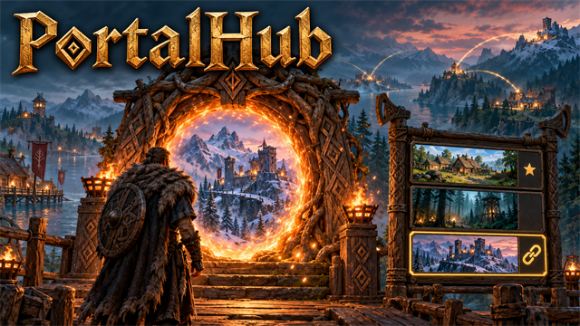
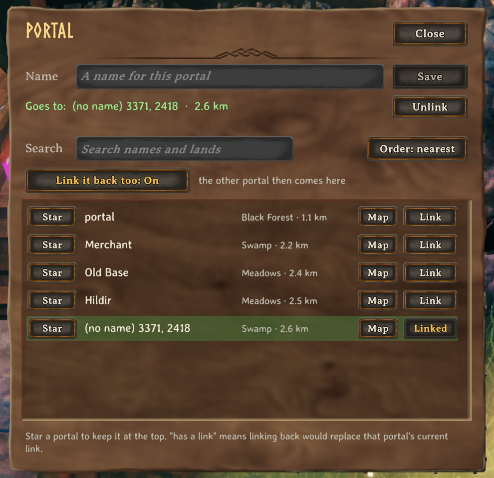

<!-- This page is made by tools/modpages/make_pages.py from the mod's thunderstore.toml, DESCRIPTION.txt, CHANGELOG.txt,
     settings and the repo's README. Change those, or the HAND-WRITTEN parts, not the rest of this page. -->

# 🌀 Quad's Portal Hub

**A portal network: press E on a portal and pick where it goes from a list, a teleport menu with search, favourites and map lines. No more matching portal names; portals you already built keep working.**

    

<!-- GITHUB-ONLY -->[Thunderstore](https://thunderstore.io/c/valheim/p/Quads_Lab/Quads_Portal_Hub/)  ·  <!-- END GITHUB-ONLY -->[Source code](https://github.com/HardHeadHackerHead/valheim-mods/tree/main/mods/PortalHub)  ·  [Report a bug](https://github.com/HardHeadHackerHead/valheim-mods/issues/new?template=bug.yml&title=%5BQuad%27s%20Portal%20Hub%5D%20)  ·  [Discord](https://discord.gg/EwTjQxEZPy)

  

<!-- GITHUB-ONLY -->**Install:** with [r2modman](https://thunderstore.io/c/valheim/p/ebkr/r2modman/) or Thunderstore Mod Manager from [Thunderstore](https://thunderstore.io/c/valheim/p/Quads_Lab/Quads_Portal_Hub/), or press **F7** in the game with our [mod manager](https://github.com/HardHeadHackerHead/valheim-mod-manager).<!-- END GITHUB-ONLY -->

## ✨ Features

A portal network: press E on a portal and pick where it goes from a list. No more matching portal names to teleport where you want.

### What is in it

- The list shows every portal in the world, nearest first, with its biome and distance. Search it, sort it by name, or star the ones you use most to keep them at the top.
- One click links this portal to the one you pick, and (by default) links that one back, so there is no more matching names on both ends.
- Every portal shows on the map with its name, and the big map draws a line from each portal to where it goes (an arrow when it only goes one way). A Map button next to each portal in the menu opens the map at that spot.
- Look at a portal and it tells you where it goes.
- Rename a portal right in the menu. Portals you never choose a destination for work the old way, by matching names, so nothing you built breaks.
- Teleport rules are unchanged: you still cannot carry ores or other blocked items through a portal.
- Needs to be installed on the host's game (and on yours to use the menu). Players without it can still walk through linked portals.

## 📸 Screenshots

<!-- HAND-WRITTEN: screenshots -->
**Pick where a portal goes from the list: names, lands, distances**

<!-- END HAND-WRITTEN: screenshots -->

## 🎮 How to use

| Key | What it does |
|---|---|
| **E** at a portal | Open the portal menu and choose where it goes |

<!-- HAND-WRITTEN: how-to-use -->
- **E on any portal opens the PortalHub menu** instead of the game's name box (press **Shift+E** for the game's own name box).
- **Protected areas:** a portal inside someone else's switched-on ward can't be relinked or renamed by you, and you can't link a portal
  into it either (a link would let anyone walk into their base). The host checks this, whatever a player's game says. With
  `HideWardedPortals` on (the host's choice), those portals also stay out of your list and map.
<!-- END HAND-WRITTEN: how-to-use -->

## 🧩 Other mods

<!-- HAND-WRITTEN: other-mods -->
**Known clashes**

- **XPortal**: PortalHub stands down while it's installed (the log says so).
<!-- END HAND-WRITTEN: other-mods -->

Found a clash with another mod? [Tell us](https://github.com/HardHeadHackerHead/valheim-mods/issues/new?template=bug.yml&title=%5BQuad%27s%20Portal%20Hub%5D%20) which one and what happened.

## 👥 Multiplayer

**Who needs it:** The host (it keeps the portal links), and everyone who wants the portal menu.

<!-- HAND-WRITTEN: multiplayer -->
The host keeps the portal list and the links, and checks wards before relinking or renaming. Players without the mod still travel through linked portals; they just don't get the menu.

**The host decides:** whether the menu is on and whether warded portals are hidden. While you play on their world their values replace yours (your file isn't changed); a host without the mod leaves everyone their own.
<!-- END HAND-WRITTEN: multiplayer -->

## 🌍 Languages

**English, Русский (Russian), Deutsch (German), 简体中文 (Chinese), Português do Brasil (Portuguese), Español (Spanish), Français (French), Polski (Polish), Türkçe (Turkish).** It follows the game's own language setting.

The translations were made with AI, so a few words may be off. To correct one, or to add your language, put a file in `BepInEx/config/translations/com.quad.portalhub/` named after the game's name for the language (`German.json`, `Italian.json`, `Japanese.json`...) with only the lines you change, copied from [English.json](https://github.com/HardHeadHackerHead/valheim-mods/blob/main/mods/PortalHub/translations/English.json) (it wins over the built-in one). Or [tell us](https://github.com/HardHeadHackerHead/valheim-mods/issues/new?template=bug.yml&title=%5BQuad%27s%20Portal%20Hub%5D%20Translation%3A%20) the better words and we'll put them in for everyone.

## ⚙️ Settings

In `BepInEx/config/com.quad.portalhub.cfg`, made the first time the game runs with the mod. r2modman and Thunderstore Mod Manager edit it under **Config editor**.<!-- GITHUB-ONLY --> With our mod manager: **F7**, then **Mod settings**.<!-- END GITHUB-ONLY -->

**General**

| Setting | Default | What it does |
|---|---|---|
| `Enabled` | `true` | Use the portal menu when you press E on a portal. (Off: portals work like in the base game.) In multiplayer the server's value applies. |
| `HideWardedPortals` | `false` | Leave portals inside someone else's protected area (a switched-on ward you are not on) out of each player's list and map. (Either way, nobody can change a portal in such an area or link a portal into one.) In multiplayer the server's value applies. |
| `ShowDestinationOnHover` | `true` | When you look at a portal, show where it goes. |

**Map**

| Setting | Default | What it does |
|---|---|---|
| `ShowPortals` | `true` | Show every portal on the map with its name. |
| `ShowLinks` | `true` | On the big map, draw a line from each portal to where it goes (an arrow if it only goes one way). |

**Menu**

| Setting | Default | What it does |
|---|---|---|
| `LinkBothWays` | `true` | Picking a destination also links that portal back to this one. |
| `Favorites` | `` | Portals you starred (managed by the menu; you do not need to edit this). |

## 🤖 Made with AI

Made with the help of Claude (Anthropic), with Claude Code: designed, written and checked together, and tried in the game.

## 💬 Join us on Discord

Come hang out with the people who make and play these mods. In the **Quads Lab Discord** you can:

- 🛠️ **Get help** and report bugs straight to us
- 👀 **See new mods first**, and help test them before they're released
- 🗳️ **Suggest ideas** and vote on what we make next
- 🏰 **Share your builds**, bases and arena runs
- 🤖 **Talk AI coding and vibe coding** with people building things with AI, the way these mods are made

**[Join the Quads Lab Discord →](https://discord.gg/EwTjQxEZPy)**

## 🧪 About Quads Lab

Quads Lab is where **Quad H** ([HardHeadHackerHead](https://github.com/HardHeadHackerHead)) builds software with AI, of every kind:
these Valheim mods are one of its projects. Each mod is designed by a player, written with [Claude Code](https://claude.com/claude-code)
and tested in our own world, with **bobisme** as our tester.

- 🌐 [quadslab.io](https://quadslab.io)
- 🧰 [All Quads Lab mods on Thunderstore](https://thunderstore.io/c/valheim/p/Quads_Lab/)
- 💻 [Source code on GitHub](https://github.com/HardHeadHackerHead/valheim-mods)
- 💬 [Discord](https://discord.gg/EwTjQxEZPy)
- ☕ [Buy me a coffee](https://buymeacoffee.com/quadh)
- 🐞 Found a bug? [Open an issue on GitHub](https://github.com/HardHeadHackerHead/valheim-mods/issues/new/choose)

## ☕ Support my mods

Every Quads Lab mod is free, and it stays that way. If one of them made your game better and you'd like to say thanks, a coffee
helps me make new mods and keep improving the ones you already play. It's 100% optional, and always appreciated!

**[☕ Buy me a coffee →](https://buymeacoffee.com/quadh)**

## 📜 Recent changes

- **1.4.3** Settings: edits to the config file now apply while the game runs (a server owner no longer has to restart), and a server's admins can change the server's settings from their own game with Configuration Manager, where other players see them greyed out. Your config file always keeps your own values while you play on a server (saving it there could write the server's in). Players on an older version still get the server's settings.
- **1.4.2** Its windows no longer fill the log with "The LiberationSans SDF Font Asset was not found": each text is given the game's font before it starts (it looked for TextMeshPro's default font, which the game doesn't have, every time a text was made). Nothing changes on screen.
- **1.4.1** Fix: a portal could be linked one way into someone else's protected area, so anyone could walk into their base through it. The host now refuses a link to a portal in a switched-on ward you are not on, whatever HideWardedPortals says (that setting now only hides those portals from the list and map). Links that already lead into a protected area their maker may not enter (a ward built or switched on since) are dropped, and the portal goes back to pairing by name. Links made with an older version didn't record who made them, so they are left as they are. Fix: a portal renamed at the moment the host saved its link or id could lose the new name: the host now asks the game that holds the portal to save them (as the game does with its own portal links), and saves them itself only when nobody else holds it, or after a few seconds for a player with an older PortalHub. The host's portal pass every 5 seconds no longer searches the whole portal list once for each linked portal.

<!-- GITHUB-ONLY -->[Every change](CHANGELOG.txt)<!-- END GITHUB-ONLY --><!-- THUNDERSTORE-ONLY: Every change is on the Changelog tab. -->
