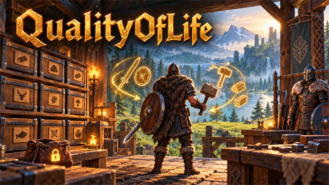
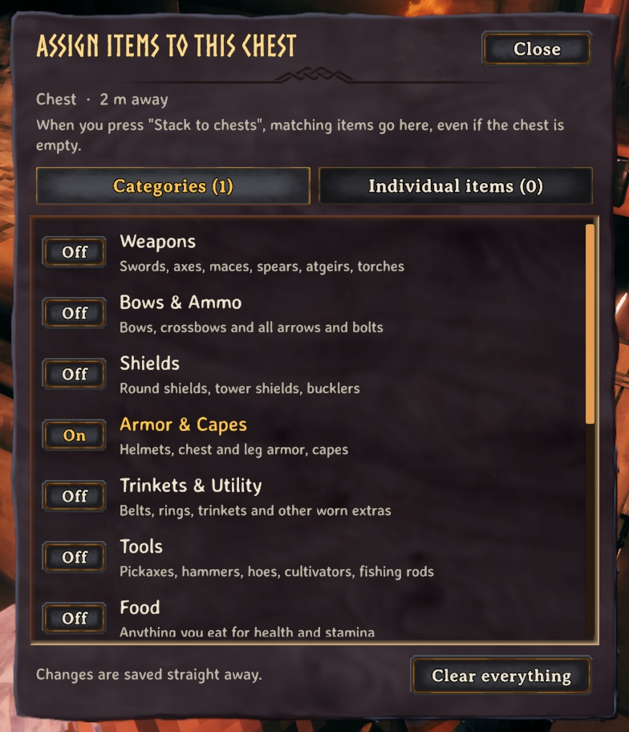
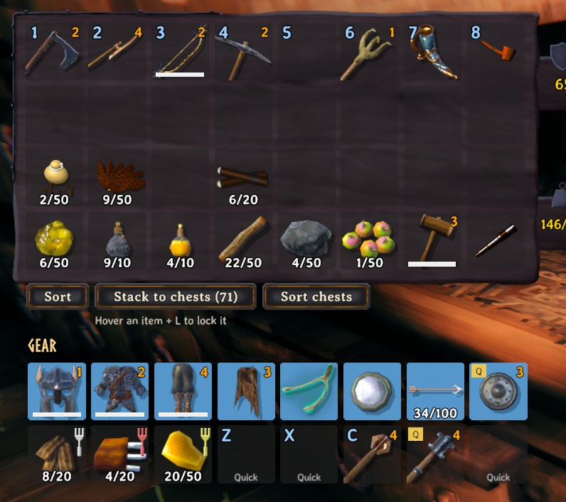

<!-- This page is made by tools/modpages/make_pages.py from the mod's thunderstore.toml, DESCRIPTION.txt, CHANGELOG.txt,
     settings and the repo's README. Change those, or the HAND-WRITTEN parts, not the rest of this page. -->

# 🎒 Quad's Quality of Life

**Small QoL controls, each with its own switch: sort and stack to chests, chests that take what you assign, item locks, quick build sets, a boat push and more.**

    

<!-- GITHUB-ONLY -->[Thunderstore](https://thunderstore.io/c/valheim/p/Quads_Lab/Quads_Quality_Of_Life/)  ·  <!-- END GITHUB-ONLY -->[Source code](https://github.com/HardHeadHackerHead/valheim-mods/tree/main/mods/QualityOfLife)  ·  [Report a bug](https://github.com/HardHeadHackerHead/valheim-mods/issues/new?template=bug.yml&title=%5BQuad%27s%20Quality%20of%20Life%5D%20)  ·  [Discord](https://discord.gg/EwTjQxEZPy)

  

<!-- GITHUB-ONLY -->**Install:** with [r2modman](https://thunderstore.io/c/valheim/p/ebkr/r2modman/) or Thunderstore Mod Manager from [Thunderstore](https://thunderstore.io/c/valheim/p/Quads_Lab/Quads_Quality_Of_Life/), or press **F7** in the game with our [mod manager](https://github.com/HardHeadHackerHead/valheim-mod-manager).<!-- END GITHUB-ONLY -->

## ✨ Features

### What is in it

- Q: build a quick set from items you hover in your inventory; outside the inventory it swaps to the set and back.
- B: jump into construction mode with your hammer, and back to what you had.
- Sort: a button under your inventory joins split stacks and puts everything in order (hotbar and gear slots stay put).
- Stack to chests: a button under your inventory moves matching items into nearby chests, with Undo and sounds.
- K opens the chest assignment menu (choose what each chest receives); L locks items so they are never stacked.
- Boat push: tap or hold P next to a boat to shove it where you look (gentle, with a speed cap).
- Far zoom: scroll the camera out to 20 m on foot and 40 m on a boat (the game stops at 6); the steps grow as you zoom out.
- Planting: you cannot plant a seed, sapling or crop where it has no room to grow up (the ghost turns red and says so), instead of finding out after it never grows.

Keys are configurable. Q and B work while you are running.

## 📸 Screenshots

<!-- HAND-WRITTEN: screenshots -->
**Choosing what a chest receives (K)**

**Sort, Stack to chests and Sort chests, under your inventory**

<!-- END HAND-WRITTEN: screenshots -->

## 🎮 How to use

| Key | What it does |
|---|---|
| **Q** | Build a quick set (inventory open) / swap to it and back |
| **B** | Jump into construction mode with your hammer, and back |
| **K** / **L** | Assign what a chest receives / lock an item |
| **P** | Tap or hold next to a boat (not in it) to push it where you look |

<!-- HAND-WRITTEN: how-to-use -->

<!-- END HAND-WRITTEN: how-to-use -->

## 🧩 Other mods

<!-- HAND-WRITTEN: other-mods -->
**Known clashes**

- **ExtraSlots, Equipment and Quick Slots, AzuExtendedPlayerInventory, Extended Player Inventory, ComfyQuickSlots, BetterArchery** (quiver on): the Sort button turns off while one is installed.
- **ValheimPlus** extra rows count as ordinary bag rows.

**Works with our mods**

- Its chest assignments (K) are used by [Quad's Feed From Chests](https://thunderstore.io/c/valheim/p/Quads_Lab/Quads_Feed_From_Chests/), [Quad's Ledger Chest](https://thunderstore.io/c/valheim/p/Quads_Lab/Quads_Ledger_Chest/) and [Quad's Companion](https://thunderstore.io/c/valheim/p/Quads_Lab/Quads_Companion/).
- [Quad's Gear Slots](https://thunderstore.io/c/valheim/p/Quads_Lab/Quads_Gear_Slots/): Sort and Stack to chests leave the gear slots alone.
- [Quad's Recycler](https://thunderstore.io/c/valheim/p/Quads_Lab/Quads_Recycler/): items locked with L can't be recycled.

**Removing it:** a game key it freed (Q, auto-run) stays unbound; set it again in the game's controls.
<!-- END HAND-WRITTEN: other-mods -->

Found a clash with another mod? [Tell us](https://github.com/HardHeadHackerHead/valheim-mods/issues/new?template=bug.yml&title=%5BQuad%27s%20Quality%20of%20Life%5D%20) which one and what happened.

## 👥 Multiplayer

**Who needs it:** Only the players who want it.

<!-- HAND-WRITTEN: multiplayer -->
Chest assignments are saved on the chest, so everyone sees them. It skips chests others have open.

**The host decides:** how far build stations reach. While you play on their world their values replace yours (your file isn't changed); a host without the mod leaves everyone their own.
<!-- END HAND-WRITTEN: multiplayer -->

## 🌍 Languages

**English, Русский (Russian), Deutsch (German), 简体中文 (Chinese), Português do Brasil (Portuguese), Español (Spanish), Français (French), Polski (Polish), Türkçe (Turkish).** It follows the game's own language setting.

The translations were made with AI, so a few words may be off. To correct one, or to add your language, put a file in `BepInEx/config/translations/com.quad.qualityoflife/` named after the game's name for the language (`German.json`, `Italian.json`, `Japanese.json`...) with only the lines you change, copied from [English.json](https://github.com/HardHeadHackerHead/valheim-mods/blob/main/mods/QualityOfLife/translations/English.json) (it wins over the built-in one). Or [tell us](https://github.com/HardHeadHackerHead/valheim-mods/issues/new?template=bug.yml&title=%5BQuad%27s%20Quality%20of%20Life%5D%20Translation%3A%20) the better words and we'll put them in for everyone.

## ⚙️ Settings

In `BepInEx/config/com.quad.qualityoflife.cfg`, made the first time the game runs with the mod. r2modman and Thunderstore Mod Manager edit it under **Config editor**.<!-- GITHUB-ONLY --> With our mod manager: **F7**, then **Mod settings**.<!-- END GITHUB-ONLY -->

**BoatPush**

| Setting | Default | What it does |
|---|---|---|
| `Enabled` | `true` | Turn boat pushing on or off. |
| `Key` | `P` | Tap (or hold) this next to a boat, not in it, to push it the way you are looking. |
| `Strength` | `3` | How hard you push (metres per second, per second). Higher gets a heavy boat moving faster. |
| `MaxSpeed` | `2.5` | The fastest your pushing can move a boat (metres per second). Walking pace is about 5. |
| `Seconds` | `3` | One tap of the key keeps pushing for this long (holding it keeps pushing as long as you hold). |
| `Range` | `3` | How close you have to be to the boat's hull (metres). |

**Camera**

| Setting | Default | What it does |
|---|---|---|
| `FarZoom` | `true` | Let the scroll wheel zoom the camera out further than the game allows. |
| `MaxDistance` | `20` | How far out the camera can go on foot (metres). The game's own limit is 6. |
| `MaxDistanceBoat` | `40` | How far out the camera can go while steering a boat (metres). |

**General**

| Setting | Default | What it does |
|---|---|---|
| `ShowMessages` | `true` | Show a short message in the top-left when something happens. |

**Hammer**

| Setting | Default | What it does |
|---|---|---|
| `Enabled` | `true` | Turn the hammer shortcut on or off. |
| `Key` | `B` | Press to equip your hammer and start building. Press again to go back to what you had equipped. |

**Map**

| Setting | Default | What it does |
|---|---|---|
| `ShowShips` | `true` | Show every ship in the world on the minimap and the map, with a longship icon, wherever it is. |
| `ShipPinType` | `Icon4` | Which of the map's pin kinds the ship pins count as (their picture is the longship either way). Hiding that kind with the map's pin filters hides them too. |

**Planting**

| Setting | Default | What it does |
|---|---|---|
| `NeedRoomToGrow` | `true` | A seed, sapling or crop can only be planted where it has the room to grow up: the same check the game makes later (a plant with another plant, a rock, a tree or a building too close never grows), made before you plant, so the ghost turns red and you are told. Takes effect at once. |

**QuickSet**

| Setting | Default | What it does |
|---|---|---|
| `Enabled` | `true` | Turn the quick-set feature on or off. |
| `Key` | `Q` | Inventory open: hover an item and press to add/remove it from your quick set. Inventory closed: press to swap to the quick set, press again to go back to what you had. |
| `ShowBadges` | `true` | Mark quick-set items in your inventory with a small gold badge. |

**QuickStack**

| Setting | Default | What it does |
|---|---|---|
| `Enabled` | `true` | Turn the quick-stack buttons and item locking on or off. |
| `Radius` | `20` | How far (in metres) from you a chest can be and still be used by Stack to chests and Sort chests. Raise it to put things away into your storehouse from across a big base: 60 reaches a long way. Chests only count while their area is loaded around you (about 100 m and more). Takes effect at once. |
| `LockKey` | `L` | Inventory open: hover an item and press this to lock it (it will never be moved by the buttons) or unlock it. |
| `StackKey` | `None` | Optional key that does 'Stack to chests' while your inventory is open (useful with a controller). None = off. |
| `ProtectHotbar` | `true` | Never move items in your top inventory row (the hotbar). |
| `ShowButtons` | `true` | Show the buttons under your inventory when a chest is in range. |
| `PlaySounds` | `true` | Play the chests' own sounds when you stack (a thunk from each chest that takes items) and when you undo. |
| `ShowChestLabels` | `true` | Show what a chest is assigned to receive: under its Assign button when it's open, and in the hover text when you look at it. |
| `AssignKey` | `K` | Look at a chest (or have one open) and press this to choose what it should receive when you stack: whole categories or individual items. |

**Sort**

| Setting | Default | What it does |
|---|---|---|
| `Enabled` | `true` | Show a Sort button under your inventory: it joins split stacks and puts items in order. (Respects ProtectHotbar in the QuickStack settings.) |

**Stations**

| Setting | Default | What it does |
|---|---|---|
| `BuildRange` | `0` | How far (in metres) from a crafting station (workbench, stonecutter, forge, ...) you can build with it, when that is more than the station's own range (20 m, more with upgrades). 0 leaves the game's ranges. 60 reaches across a big base. Takes effect at once. In multiplayer the server's value applies. |

## 🤖 Made with AI

Made with the help of Claude (Anthropic), with Claude Code: designed, written and checked together, and tried in the game.

## 💬 Join us on Discord

Come hang out with the people who make and play these mods. In the **Quads Lab Discord** you can:

- 🛠️ **Get help** and report bugs straight to us
- 👀 **See new mods first**, and help test them before they're released
- 🗳️ **Suggest ideas** and vote on what we make next
- 🏰 **Share your builds**, bases and arena runs
- 🤖 **Talk AI coding and vibe coding** with people building things with AI, the way these mods are made

**[Join the Quads Lab Discord →](https://discord.gg/EwTjQxEZPy)**

## 🧪 About Quads Lab

Quads Lab is where **Quad H** ([HardHeadHackerHead](https://github.com/HardHeadHackerHead)) builds software with AI, of every kind:
these Valheim mods are one of its projects. Each mod is designed by a player, written with [Claude Code](https://claude.com/claude-code)
and tested in our own world, with **bobisme** as our tester.

- 🌐 [quadslab.io](https://quadslab.io)
- 🧰 [All Quads Lab mods on Thunderstore](https://thunderstore.io/c/valheim/p/Quads_Lab/)
- 💻 [Source code on GitHub](https://github.com/HardHeadHackerHead/valheim-mods)
- 💬 [Discord](https://discord.gg/EwTjQxEZPy)
- ☕ [Buy me a coffee](https://buymeacoffee.com/quadh)
- 🐞 Found a bug? [Open an issue on GitHub](https://github.com/HardHeadHackerHead/valheim-mods/issues/new/choose)

## ☕ Support my mods

Every Quads Lab mod is free, and it stays that way. If one of them made your game better and you'd like to say thanks, a coffee
helps me make new mods and keep improving the ones you already play. It's 100% optional, and always appreciated!

**[☕ Buy me a coffee →](https://buymeacoffee.com/quadh)**

## 📜 Recent changes

- **1.13.3** Its windows no longer fill the log with "The LiberationSans SDF Font Asset was not found": each text is given the game's font before it starts (it looked for TextMeshPro's default font, which the game doesn't have, every time a text was made). Nothing changes on screen.
- **1.13.2** Fix: after leaving a world for the main menu and joining one again, the ships on the map threw an error every second (in the log) and the pins of ships that were gone stayed on the map: the pins were kept by the game's object ids, which it renumbers on each join.
- **1.13.1** Carts and ships can no longer be assigned things (K or the Assign button): what a chest receives is kept in its save data, and a cart's or ship's is sent again to every player nearby each time it moves, so a long list made carts and ships lag in multiplayer. Assignments older versions let you put on a cart or ship no longer count, and are taken off it when you open your inventory beside it (only on the game that already has it, and not while someone has it open). The Obliterator, the Arena's chests and a companion's bag can't be assigned either, as Stack to chests already leaves them alone. Fixed: when the host of a world changes a setting it decides for everyone (dragging a slider in a configuration manager changes it every frame), the players now get it at most twice a second, and always the final value.

<!-- GITHUB-ONLY -->[Every change](CHANGELOG.txt)<!-- END GITHUB-ONLY --><!-- THUNDERSTORE-ONLY: Every change is on the Changelog tab. -->
