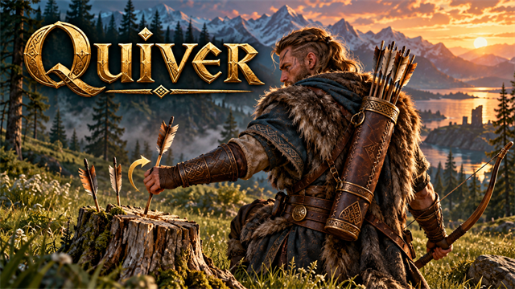
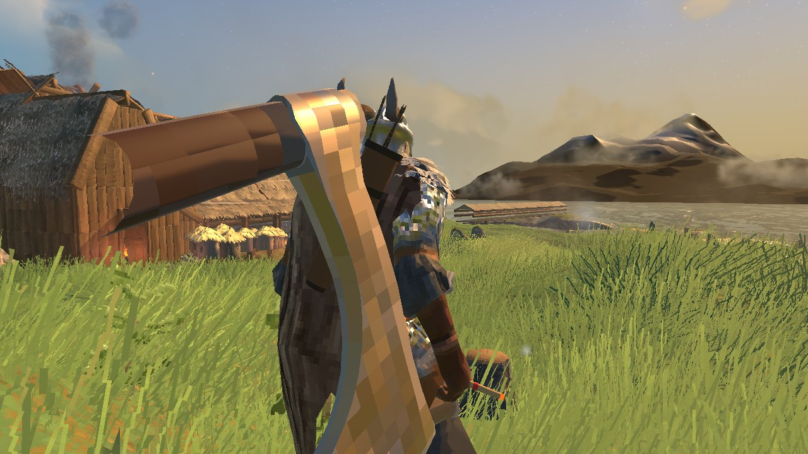

<!-- This page is made by tools/modpages/make_pages.py from the mod's thunderstore.toml, DESCRIPTION.txt, CHANGELOG.txt,
     settings and the repo's README. Change those, or the HAND-WRITTEN parts, not the rest of this page. -->

# 🏹 Quad's Quiver

**Arrow recovery: pick your shot arrows and bolts back up from the ground, trees, walls and creatures, and carry them in a quiver on your back. Archery that doesn't eat your arrows: retrieve them, save your ammo.**

    

<!-- GITHUB-ONLY -->[Thunderstore](https://thunderstore.io/c/valheim/p/Quads_Lab/Quads_Quiver/)  ·  <!-- END GITHUB-ONLY -->[Source code](https://github.com/HardHeadHackerHead/valheim-mods/tree/main/mods/Quiver)  ·  [Report a bug](https://github.com/HardHeadHackerHead/valheim-mods/issues/new?template=bug.yml&title=%5BQuad%27s%20Quiver%5D%20)  ·  [Discord](https://discord.gg/EwTjQxEZPy)

<!-- GITHUB-ONLY -->**Install:** with [r2modman](https://thunderstore.io/c/valheim/p/ebkr/r2modman/) or Thunderstore Mod Manager from [Thunderstore](https://thunderstore.io/c/valheim/p/Quads_Lab/Quads_Quiver/), or press **F7** in the game with our [mod manager](https://github.com/HardHeadHackerHead/valheim-mod-manager).<!-- END GITHUB-ONLY -->

## ✨ Features

Pick your shot arrows back up (arrow recovery), and carry them in a quiver on your back: archery that doesn't eat your arrows.

### What is in it

- Arrows (and crossbow bolts) you shoot that hit the ground, a tree, a wall or a creature come back as arrows you pick up again. Arrows that hit the ground, a tree or a wall are all kept; of those that hit a creature, three in four are kept and drop with its loot when it dies. Fire arrows are always used up. All of it is in the settings.
- A quiver hangs on your back while you have arrows or bolts equipped, with the arrows you carry sticking out of it (more of them the more you carry), made from the real model of the arrow you have equipped.
- Where the quiver hangs (back, side, height, tilt) is in the settings, and changes at once.

It works on the game that shoots, so it does not need the other players to have it.

## 📸 Screenshots

<!-- HAND-WRITTEN: screenshots -->
**The bow and quiver carried on your back**

<!-- END HAND-WRITTEN: screenshots -->

<!-- HAND-WRITTEN: how-to-use -->

<!-- END HAND-WRITTEN: how-to-use -->

## 🧩 Other mods

<!-- HAND-WRITTEN: other-mods -->
**Known clashes**

- **BetterArchery**: arrow pickup switches off while its retrievable arrows are on, and the quiver isn't drawn while its own quiver is on.
<!-- END HAND-WRITTEN: other-mods -->

Found a clash with another mod? [Tell us](https://github.com/HardHeadHackerHead/valheim-mods/issues/new?template=bug.yml&title=%5BQuad%27s%20Quiver%5D%20) which one and what happened.

## 👥 Multiplayer

**Who needs it:** Only the players who want it.

<!-- HAND-WRITTEN: multiplayer -->
Only the player who shoots needs it: their game keeps track of arrows stuck in a creature, whoever's game runs it. The quiver is drawn only on your own character.

**The host decides:** arrow pickup and its chances, bolts, and whether fire arrows burn up. While you play on their world their values replace yours (your file isn't changed); a host without the mod leaves everyone their own.
<!-- END HAND-WRITTEN: multiplayer -->

## ⚙️ Settings

In `BepInEx/config/com.quad.quiver.cfg`, made the first time the game runs with the mod. r2modman and Thunderstore Mod Manager edit it under **Config editor**.<!-- GITHUB-ONLY --> With our mod manager: **F7**, then **Mod settings**.<!-- END GITHUB-ONLY -->

**Arrows**

| Setting | Default | What it does |
|---|---|---|
| `PickUpArrows` | `true` | Arrows you shoot that hit something land on the ground as arrows you can pick up again. In multiplayer the server's value applies. |
| `ChanceOnGround` | `1` | The chance an arrow that hit the ground, a tree, a wall or the like is kept. 1 keeps every one. In multiplayer the server's value applies. |
| `ChanceOnCreature` | `0.75` | The chance an arrow that hit a creature is kept: it drops with that creature's loot when it dies. 0.75 keeps three in four. In multiplayer the server's value applies. |
| `IncludeBolts` | `true` | Crossbow bolts can be picked up too. In multiplayer the server's value applies. |
| `FireArrowsBurnUp` | `true` | Fire arrows are always used up. In multiplayer the server's value applies. |
| `LogHits` | `false` | Write what each arrow hit did (kept, broke, why not) to the BepInEx log. For finding out why an arrow did not come back. |

**Quiver**

| Setting | Default | What it does |
|---|---|---|
| `Show` | `true` | A quiver on your back while you have arrows (or bolts) equipped. |
| `Back` | `0.2` | How far behind your spine the quiver hangs (metres). |
| `Side` | `0.1` | How far to your right it hangs (negative: left). |
| `Height` | `-0.03` | How far up it hangs (negative: lower). |
| `TiltSide` | `22` | How far the top leans to your right (degrees). |
| `TiltBack` | `8` | How far the top leans backwards (degrees). |

## 🤖 Made with AI

Made with the help of Claude (Anthropic), with Claude Code: designed, written and checked together, and tried in the game.

## 💬 Join us on Discord

Come hang out with the people who make and play these mods. In the **Quads Lab Discord** you can:

- 🛠️ **Get help** and report bugs straight to us
- 👀 **See new mods first**, and help test them before they're released
- 🗳️ **Suggest ideas** and vote on what we make next
- 🏰 **Share your builds**, bases and arena runs
- 🤖 **Talk AI coding and vibe coding** with people building things with AI, the way these mods are made

**[Join the Quads Lab Discord →](https://discord.gg/EwTjQxEZPy)**

## 🧪 About Quads Lab

Quads Lab is where **Quad H** ([HardHeadHackerHead](https://github.com/HardHeadHackerHead)) builds software with AI, of every kind:
these Valheim mods are one of its projects. Each mod is designed by a player, written with [Claude Code](https://claude.com/claude-code)
and tested in our own world, with **bobisme** as our tester.

- 🌐 [quadslab.io](https://quadslab.io)
- 🧰 [All Quads Lab mods on Thunderstore](https://thunderstore.io/c/valheim/p/Quads_Lab/)
- 💻 [Source code on GitHub](https://github.com/HardHeadHackerHead/valheim-mods)
- 💬 [Discord](https://discord.gg/EwTjQxEZPy)
- 🐞 Found a bug? [Open an issue on GitHub](https://github.com/HardHeadHackerHead/valheim-mods/issues/new/choose)

## 📜 Recent changes

- **0.2.3** Fix: arrows stuck in a creature come back only when it really dies (on your game or on the game that runs it, seen by its death or its body), not when it just goes away: one that despawns, is unsummoned, leaves at daybreak or is unloaded keeps its arrows. Fix: arrows that hit a creature early in a long fight (a boss) came back only if it died within two minutes of the first hit; it now counts from the last hit.
- **0.2.2** A clearer page: what it does, who needs it in multiplayer, how it gets on with other mods, and where to report a bug. The game itself is unchanged.
- **0.2.1** A new id, com.quad.quiver (it was com.dhack.quiver): your settings move over by themselves the first time it starts, and the old settings file is kept as a backup. Restart the game after this update. If an old copy is still installed beside it, this one stands down and says which file to delete, so the two never both run. The DLL now says it was made with AI, as Thunderstore asks.

<!-- GITHUB-ONLY -->[Every change](CHANGELOG.txt)<!-- END GITHUB-ONLY --><!-- THUNDERSTORE-ONLY: Every change is on the Changelog tab. -->
