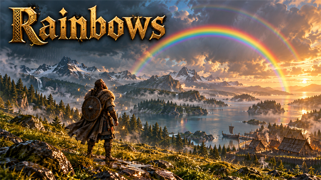
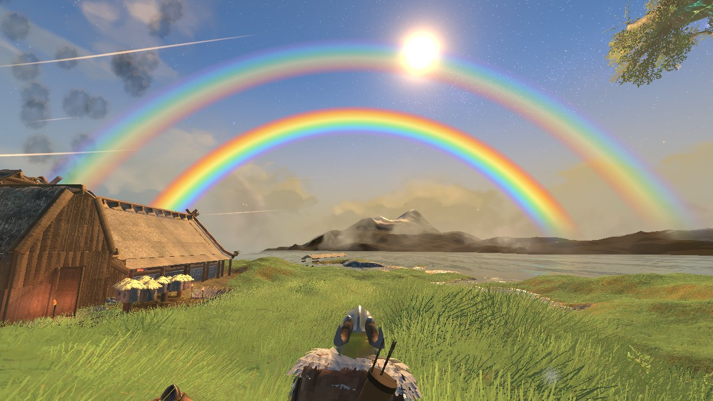
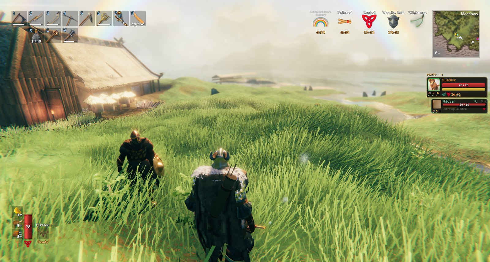

<!-- This page is made by tools/modpages/make_pages.py from the mod's thunderstore.toml, DESCRIPTION.txt, CHANGELOG.txt,
     settings and the repo's README. Change those, or the HAND-WRITTEN parts, not the rest of this page. -->

# 🌈 Quad's Rainbows

**A rainbow in the sky after the rain, and a blessing for looking up at it: the weather gives something back.**

    

<!-- GITHUB-ONLY -->[Thunderstore](https://thunderstore.io/c/valheim/p/Quads_Lab/Quads_Rainbows/)  ·  <!-- END GITHUB-ONLY -->[Source code](https://github.com/HardHeadHackerHead/valheim-mods/tree/main/mods/Rainbows)  ·  [Report a bug](https://github.com/HardHeadHackerHead/valheim-mods/issues/new?template=bug.yml&title=%5BQuad%27s%20Rainbows%5D%20)  ·  [Discord](https://discord.gg/EwTjQxEZPy)

<!-- GITHUB-ONLY -->**Install:** with [r2modman](https://thunderstore.io/c/valheim/p/ebkr/r2modman/) or Thunderstore Mod Manager from [Thunderstore](https://thunderstore.io/c/valheim/p/Quads_Lab/Quads_Rainbows/), or press **F7** in the game with our [mod manager](https://github.com/HardHeadHackerHead/valheim-mod-manager).<!-- END GITHUB-ONLY -->

## ✨ Features

### What is in it

- When a good spell of rain ends and the sun is low (morning or evening), a rainbow arcs across the sky opposite the sun. Three times in ten it is a double rainbow, with a fainter second one outside it, its colours the other way round. It fades in with a soft chime, follows the sun as it moves, fades into the horizon, and fades out after a few minutes or when the sun climbs too high. If the rain stops with the sun too high, it waits a while for the sun to come down.
- Look up at it and you get Rainbow's Blessing for five minutes: stamina comes back 30% faster, health 20% faster, and running and jumping cost 20% less stamina. A double rainbow gives the Double Rainbow's Blessing, half as strong again.

Only you need it: the sky is drawn for you from the weather the game already has, and nothing is saved in the world.

## 📸 Screenshots

<!-- HAND-WRITTEN: screenshots -->
**A double rainbow over the bay**

**Rainbow's Blessing in the corner**

<!-- END HAND-WRITTEN: screenshots -->

<!-- HAND-WRITTEN: how-to-use -->

<!-- END HAND-WRITTEN: how-to-use -->

## 🧩 Other mods

<!-- HAND-WRITTEN: other-mods -->
**Known clashes:** none known.
<!-- END HAND-WRITTEN: other-mods -->

Found a clash with another mod? [Tell us](https://github.com/HardHeadHackerHead/valheim-mods/issues/new?template=bug.yml&title=%5BQuad%27s%20Rainbows%5D%20) which one and what happened.

## 👥 Multiplayer

**Who needs it:** Only the players who want it.

<!-- HAND-WRITTEN: multiplayer -->
Nothing is saved in the world: each player's game rolls the chance itself, so two players standing together may not both see a rainbow.

**The host decides:** the chance, how long rain must last, the wait, double rainbows and the blessing's length. While you play on their world their values replace yours (your file isn't changed); a host without the mod leaves everyone their own.
<!-- END HAND-WRITTEN: multiplayer -->

## 🌍 Languages

**English, Русский (Russian), Deutsch (German), 简体中文 (Chinese), Português do Brasil (Portuguese), Español (Spanish), Français (French), Polski (Polish), Türkçe (Turkish).** It follows the game's own language setting.

The translations were made with AI, so a few words may be off. To correct one, or to add your language, put a file in `BepInEx/config/translations/com.quad.rainbows/` named after the game's name for the language (`German.json`, `Italian.json`, `Japanese.json`...) with only the lines you change, copied from [English.json](https://github.com/HardHeadHackerHead/valheim-mods/blob/main/mods/Rainbows/translations/English.json) (it wins over the built-in one). Or [tell us](https://github.com/HardHeadHackerHead/valheim-mods/issues/new?template=bug.yml&title=%5BQuad%27s%20Rainbows%5D%20Translation%3A%20) the better words and we'll put them in for everyone.

## ⚙️ Settings

In `BepInEx/config/com.quad.rainbows.cfg`, made the first time the game runs with the mod. r2modman and Thunderstore Mod Manager edit it under **Config editor**.<!-- GITHUB-ONLY --> With our mod manager: **F7**, then **Mod settings**.<!-- END GITHUB-ONLY -->

**Blessing**

| Setting | Default | What it does |
|---|---|---|
| `Enabled` | `true` | Look up at a rainbow and you get Rainbow's Blessing: stamina and health come back faster, and running and jumping cost less stamina. A double rainbow gives a stronger one. |
| `Minutes` | `5` | How long the blessing lasts (minutes). In multiplayer the server's value applies. |

**Rainbow**

| Setting | Default | What it does |
|---|---|---|
| `Enabled` | `true` | Rainbows after the rain. |
| `Chance` | `0.8` | How often a good spell of rain ends in a rainbow (0 never, 1 always), when the sun is low enough to show one. In multiplayer the server's value applies. |
| `MinRainSeconds` | `45` | How long it must have rained (seconds) for the end of it to be worth a rainbow. In multiplayer the server's value applies. |
| `WaitMinutes` | `8` | If the sun is too high or too low when the rain ends, how long (minutes) to wait for it to come into place before giving up. In multiplayer the server's value applies. |
| `ShowMinutes` | `3` | How long the rainbow stays (minutes), if the sun does not move it out of the sky first. |
| `Brightness` | `1` | How strong the colours are. |
| `DoubleChance` | `0.3` | How often a rainbow is a double one : a fainter second rainbow outside the first, its colours the other way round, and a stronger blessing. 0 never, 1 always. In multiplayer the server's value applies. |
| `Chime` | `true` | A soft chime when a rainbow comes out. |
| `ChimeVolume` | `0.35` | How loud the chime is. |

## 🤖 Made with AI

Made with the help of Claude (Anthropic), with Claude Code: designed, written and checked together, and tried in the game.

## 🧪 About Quads Lab

Quads Lab is where **Quad H** ([HardHeadHackerHead](https://github.com/HardHeadHackerHead)) builds software with AI, of every kind:
these Valheim mods are one of its projects. Each mod is designed by a player, written with [Claude Code](https://claude.com/claude-code)
and tested in our own world, with **bobisme** as our tester.

- 🌐 [quadslab.io](https://quadslab.io)
- 🧰 [All Quads Lab mods on Thunderstore](https://thunderstore.io/c/valheim/p/Quads_Lab/)
- 💻 [Source code on GitHub](https://github.com/HardHeadHackerHead/valheim-mods)
- 💬 [Discord](https://discord.gg/EwTjQxEZPy)
- 🐞 Found a bug? [Open an issue on GitHub](https://github.com/HardHeadHackerHead/valheim-mods/issues/new/choose)

## 📜 Recent changes

- **0.3.0** Now in your language: English, Russian, German, Chinese (Simplified), Portuguese (Brazil), Spanish, French, Polish and Turkish, following the game's own Language setting. The game's own names are used for its things (items, creatures, lands, stations). The translations were made with AI: to correct a line, or add a language, put a file in BepInEx/config/translations/com.quad.rainbows/ named after the game's name for the language (German.json...) with only the lines you change, copied from translations/English.json on GitHub.
- **0.2.3** A clearer page: what it does, who needs it in multiplayer, how it gets on with other mods, and where to report a bug. The game itself is unchanged.
- **0.2.2** Its test command for Claude Tools (rainbow ...) follows the game's cheat rule: a rainbow now, stopping it and giving the blessing work only in single player, for the host or with devcommands; status still works for everyone.

<!-- GITHUB-ONLY -->[Every change](CHANGELOG.txt)<!-- END GITHUB-ONLY --><!-- THUNDERSTORE-ONLY: Every change is on the Changelog tab. -->
