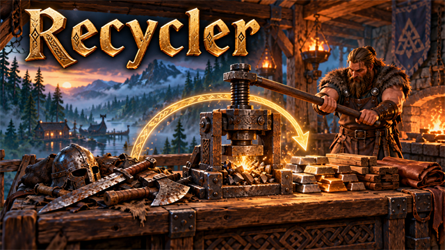
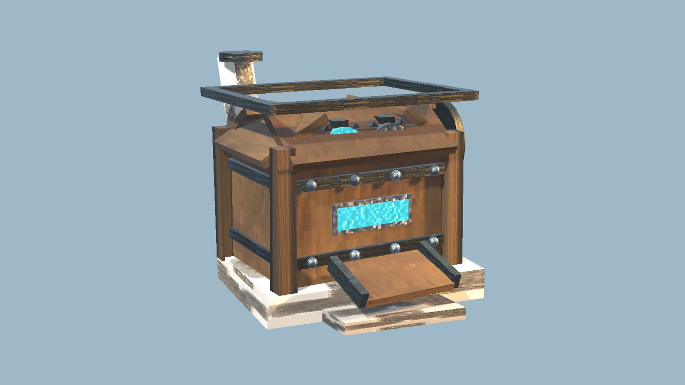

<!-- This page is made by tools/modpages/make_pages.py from the mod's thunderstore.toml, DESCRIPTION.txt, CHANGELOG.txt,
     settings and the repo's README. Change those, or the HAND-WRITTEN parts, not the rest of this page. -->

# ♻️ Quad's Recycler

**Build a Recycler with the hammer and turn old gear back into a share of the materials it was made from.**

    

<!-- GITHUB-ONLY -->[Thunderstore](https://thunderstore.io/c/valheim/p/Quads_Lab/Quads_Recycler/)  ·  <!-- END GITHUB-ONLY -->[Source code](https://github.com/HardHeadHackerHead/valheim-mods/tree/main/mods/Recycler)  ·  [Report a bug](https://github.com/HardHeadHackerHead/valheim-mods/issues/new?template=bug.yml&title=%5BQuad%27s%20Recycler%5D%20)  ·  [Discord](https://discord.gg/EwTjQxEZPy)

<!-- GITHUB-ONLY -->**Install:** with [r2modman](https://thunderstore.io/c/valheim/p/ebkr/r2modman/) or Thunderstore Mod Manager from [Thunderstore](https://thunderstore.io/c/valheim/p/Quads_Lab/Quads_Recycler/), or press **F7** in the game with our [mod manager](https://github.com/HardHeadHackerHead/valheim-mod-manager).<!-- END GITHUB-ONLY -->

## ✨ Features

- Look at the Recycler and press E: pick a weapon, armor piece or tool from your inventory, see what it would return, and recycle it.
- You get about half of the materials back (50% by default; leftovers are a chance of one more). Recycler Presses built within 8 m raise this to 60% and then 70%.
- The gear must be one you could craft, and the crafting station it was made at (and its level) must be nearby. Equipped or upgraded gear asks for a second click. Items locked with L are skipped.
- The Recycler needs only bronze-tier materials (fine wood, bronze and stone), so you can build it as soon as you have bronze. Each Press costs iron, bronze and stone, so the better refunds come with iron. Restart the game after installing or updating it.

## 📸 Screenshots

<!-- HAND-WRITTEN: screenshots -->
**The Recycler**

<!-- END HAND-WRITTEN: screenshots -->

<!-- HAND-WRITTEN: how-to-use -->

<!-- END HAND-WRITTEN: how-to-use -->

## 🧩 Other mods

<!-- HAND-WRITTEN: other-mods -->
**Known clashes**

- **Adventure Backpacks** (or any mod that refuses to let an item go): a backpack that still holds things gives nothing back, because it never leaves your inventory.
- **Epic Loot** and other mods that keep data on items: such gear (enchantments, a bag's contents) asks for a second click, because recycling destroys it.

**Works with our mods**

- [Quad's Quality of Life](https://thunderstore.io/c/valheim/p/Quads_Lab/Quads_Quality_Of_Life/): items locked with L can't be recycled.
- Our chest mods never treat the Recycler as a storage chest.

Battle idols are never handed back, and levels gained at the upgrader station return nothing.
<!-- END HAND-WRITTEN: other-mods -->

Found a clash with another mod? [Tell us](https://github.com/HardHeadHackerHead/valheim-mods/issues/new?template=bug.yml&title=%5BQuad%27s%20Recycler%5D%20) which one and what happened.

## 👥 Multiplayer

**Who needs it:** Everyone, and **the host above all**: a game without the mod deletes the pieces when their area loads. Restart after installing or updating them.

<!-- HAND-WRITTEN: multiplayer -->
**The host decides:** the share returned, Press bonuses, chance rounding, the crafting-station rule and which gear can be recycled. While you play on their world their values replace yours (your file isn't changed); a host without the mod leaves everyone their own.
<!-- END HAND-WRITTEN: multiplayer -->

## ⚙️ Settings

In `BepInEx/config/com.quad.recycler.cfg`, made the first time the game runs with the mod. r2modman and Thunderstore Mod Manager edit it under **Config editor**.<!-- GITHUB-ONLY --> With our mod manager: **F7**, then **Mod settings**.<!-- END GITHUB-ONLY -->

**General**

| Setting | Default | What it does |
|---|---|---|
| `ShowMessages` | `true` | Show a short message in the top-left when something is recycled. |

**Refund**

| Setting | Default | What it does |
|---|---|---|
| `BasePercent` | `50` | Share of the materials you get back with no Press nearby (0-100). In multiplayer the server's value applies. |
| `OnePressBonus` | `10` | Extra percentage points with one Press within 8 m. In multiplayer the server's value applies. |
| `TwoPressBonus` | `20` | Extra percentage points with two Presses within 8 m. In multiplayer the server's value applies. |
| `ChanceRounding` | `true` | Instead of always rounding down, a leftover fraction becomes a matching chance of one more (so 50% averages out to 50%). In multiplayer the server's value applies. |

**Rules**

| Setting | Default | What it does |
|---|---|---|
| `RequireCraftingStation` | `true` | Gear can only be recycled with the crafting station (and level) it was made at nearby. In multiplayer the server's value applies. |
| `ConfirmValuable` | `true` | Ask for a second click before recycling equipped or upgraded gear, or gear carrying other mods' data (enchantments, a bag's contents). |
| `AllowWeapons` | `true` | Weapons, bows and ammo launchers. In multiplayer the server's value applies. |
| `AllowArmor` | `true` | Armor, capes and shields. In multiplayer the server's value applies. |
| `AllowTools` | `true` | Tools and torches. In multiplayer the server's value applies. |

## 🤖 Made with AI

Made with the help of Claude (Anthropic), with Claude Code: designed, written and checked together, and tried in the game.

## 🧪 About Quads Lab

Quads Lab is where **Quad H** ([HardHeadHackerHead](https://github.com/HardHeadHackerHead)) builds software with AI, of every kind:
these Valheim mods are one of its projects. Each mod is designed by a player, written with [Claude Code](https://claude.com/claude-code)
and tested in our own world, with **bobisme** as our tester.

- 🌐 [quadslab.io](https://quadslab.io)
- 🧰 [All Quads Lab mods on Thunderstore](https://thunderstore.io/c/valheim/p/Quads_Lab/)
- 💻 [Source code on GitHub](https://github.com/HardHeadHackerHead/valheim-mods)
- 💬 [Discord](https://discord.gg/EwTjQxEZPy)
- 🐞 Found a bug? [Open an issue on GitHub](https://github.com/HardHeadHackerHead/valheim-mods/issues/new/choose)

## 📜 Recent changes

- **1.1.1** A new id, com.quad.recycler (it was com.dhack.recycler): your settings move over by themselves the first time it starts, and the old settings file is kept as a backup. Restart the game after this update. If an old copy is still installed beside it, this one stands down and says which file to delete, so the two never both run. The DLL now says it was made with AI, as Thunderstore asks.
- Fix: the Recycler handed out battle idols and gave materials back for levels gained at the upgrader station; it no longer does. Fix: an item another mod refused to let go of (a backpack with things in it) was still paid for, so recycling made copies; now nothing comes back unless the item really left your inventory. Gear carrying other mods' data (enchantments, a bag's contents) asks for a second click. The window uses the game's fonts and scales with the screen. In multiplayer the server decides the share returned and the rules.
- Fix: after a fresh game start the Recycler and Press were not registered until the mods were reloaded, so the game deleted any it found standing in the world. It is now registered as the world loads. Ones already lost can't be brought back; build them again.

<!-- GITHUB-ONLY -->[Every change](CHANGELOG.txt)<!-- END GITHUB-ONLY --><!-- THUNDERSTORE-ONLY: Every change is on the Changelog tab. -->
