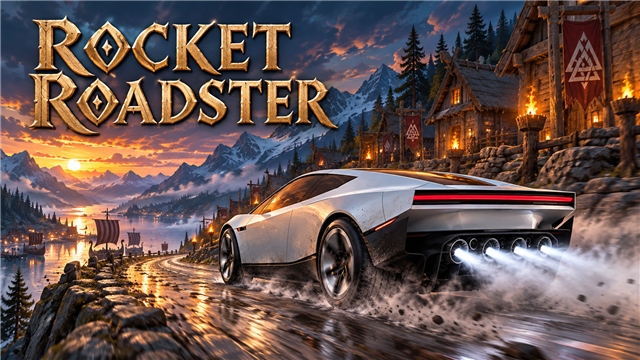
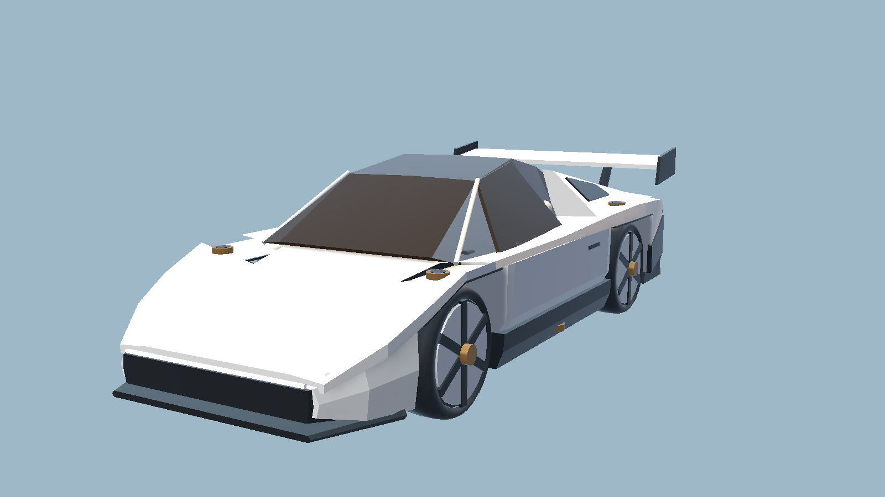

<!-- This page is made by tools/modpages/make_pages.py from the mod's thunderstore.toml, DESCRIPTION.txt, CHANGELOG.txt,
     settings and the repo's README. Change those, or the HAND-WRITTEN parts, not the rest of this page. -->

# 🚀 Quad's Rocket Roadster

**A flying sports car: a white wedge two-seater with cold-air thrusters. It hops, flies for a few seconds, barrel rolls and flips, and attitude jets land it on its wheels. Built with the hammer.**

    

[Source code](https://github.com/HardHeadHackerHead/valheim-mods/tree/main/mods/RocketRoadster)  ·  [Report a bug](https://github.com/HardHeadHackerHead/valheim-mods/issues/new?template=bug.yml&title=%5BQuad%27s%20Rocket%20Roadster%5D%20)  ·  [Discord](https://discord.gg/EwTjQxEZPy)

  

**Install:** press **F7** in the game with our [mod manager](https://github.com/HardHeadHackerHead/valheim-mod-manager), or take `RocketRoadster.dll` from [dist/](https://github.com/HardHeadHackerHead/valheim-mods/tree/main/dist). It isn't on Thunderstore.

## ✨ Features

A flying sports car for Valheim: a low white wedge of a two-seater with a surtling-core motor and cold-air thrusters. Tap Space and it hops over a cart or a wall; hold it and it flies for a few seconds; in the air it barrel rolls and flips, and its attitude jets turn it wheels-down before it lands.

### Driving it

- Build it with the hammer on dry land, near a forge: 20 Iron, 6 Surtling Cores, 6 Crystal and 10 Fine Wood.
- Press E on the driver's side to get in (the scissor doors lift as you walk up).
- Hold W to go, Shift+W to boost on the four rear thrusters, S to brake and back up, A and D to steer.
- At speed its fans press it onto the road, so it holds steep ground.
- Run into an enemy at speed and it takes blunt damage and is knocked away. Players and tamed animals are never hurt.
- E gets you out once you are down. The hammer takes it apart again (not while someone is in it).

### Flying it

- Space fires the lift thrusters under the floor: a tap hops it, holding it lifts it. They run on a tank of compressed air that fills again with the wheels on the ground.
- In the air, A and D roll it (a barrel roll takes about a second) and W and S flip it. Let go and it turns the shortest way back to wheels down.
- Attitude jets on the fenders, in the wheel hubs and under the floor puff white gas whichever way it is turning, so you can see them work.
- Near the ground a landing guard takes over and turns it wheels-down in time: it always lands on its wheels.
- The camera stays level through rolls and flips. Land a trick and it says what you pulled off.
- Nobody can get out high in the air, and anyone who leaves it high up comes down without fall damage.

### Room for two

- A passenger seat on the right (E on the passenger side). In the air the passenger stays put.

### The look and the sound

- Folded white panels, a long bronze-tinted canopy narrowing between two rear fins, scissor doors, a white light bar across the nose and a red one across the tail, a black diffuser with four bronze nozzles, a tall rear wing, black six-spoke wheels with white inserts, and two white bucket seats with a yoke inside.
- Headlights and tail lights at night while someone drives it. Paint it: E on the hood gives the next colour (white, black, red, silver, blue, bronze). Everyone sees it.
- White cold-gas plumes and a cloud that rolls across the ground under the lift jets; a thruster roar, a "pssht" as the lift jets kick in, and the electric motor's whine rising with speed.
- A gauge at the bottom right: speed, what it is doing (or its height in the air) and the air tank.

Everyone in the world needs it installed, and the host above all.

## 📸 Screenshots

<!-- HAND-WRITTEN: screenshots -->
**The roadster: white folded panels, the bronze canopy narrowing between its rear fins, black six-spoke wheels and a bronze jet in each hub (a render of the model)**

<!-- END HAND-WRITTEN: screenshots -->

## 🎮 How to use

| Key | What it does |
|---|---|
| **E** on a roadster | Get in and drive (**E** on its passenger side: ride along; **E** on its hood: paint it the next colour; **E** on one lying on its side: stand it up) |
| **W** / **Shift**+**W** / **S** | Go / boost on the rear thrusters / brake, then back up; **A** / **D** steer; **E** gets out once you are down |
| **Space** | Lift thrusters: tap to hop, hold to fly. In the air **A** / **D** roll and **W** / **S** flip; let go and it lands on its wheels |

<!-- HAND-WRITTEN: how-to-use -->

<!-- END HAND-WRITTEN: how-to-use -->

## 🧩 Other mods

<!-- HAND-WRITTEN: other-mods -->
**Known clashes:** none known.
<!-- END HAND-WRITTEN: other-mods -->

Found a clash with another mod? [Tell us](https://github.com/HardHeadHackerHead/valheim-mods/issues/new?template=bug.yml&title=%5BQuad%27s%20Rocket%20Roadster%5D%20) which one and what happened.

## 👥 Multiplayer

**Who needs it:** Everyone, and **the host above all**: a game without the mod deletes the pieces when their area loads. Restart after installing or updating them.

<!-- HAND-WRITTEN: multiplayer -->

<!-- END HAND-WRITTEN: multiplayer -->

## ⚙️ Settings

In `BepInEx/config/com.quad.rocketroadster.cfg`, made the first time the game runs with the mod. r2modman and Thunderstore Mod Manager edit it under **Config editor**.<!-- GITHUB-ONLY --> With our mod manager: **F7**, then **Mod settings**.<!-- END GITHUB-ONLY -->

**1 - Driving**

| Setting | Default | What it does |
|---|---|---|
| `CruiseSpeed` | `22` | How fast it goes holding W (metres per second; a walking player does about 5). [Synced with Server] |
| `FullSpeed` | `34` | How fast it goes holding Shift+W with the air tank empty (metres per second). [Synced with Server] |
| `ReverseSpeed` | `7` | How fast it backs up holding S once stopped (metres per second). [Synced with Server] |
| `Acceleration` | `14` | How quickly it picks up speed (metres per second, each second). Braking is stronger. [Synced with Server] |
| `Coasting` | `3` | How quickly it slows down with nothing held (metres per second, each second). [Synced with Server] |
| `TurnRate` | `100` | The fastest it can turn (degrees per second), at low speed. Faster, it turns on a wider circle. [Synced with Server] |
| `Grip` | `7` | How much it holds its line in a turn instead of sliding sideways (higher grips more). [Synced with Server] |

**2 - Thrusters**

| Setting | Default | What it does |
|---|---|---|
| `BoostSpeed` | `58` | Its top speed with the rear thrusters firing (Shift+W with air in the tank), metres per second. [Synced with Server] |
| `BoostPush` | `26` | How hard the rear thrusters push (metres per second, each second), on the ground and in the air. [Synced with Server] |
| `LiftStrength` | `1.6` | How hard the lift thrusters push (Space), in times its weight: over 1 climbs, under 1 only slows a fall. [Synced with Server] |
| `HopSpeed` | `11` | How hard a tap of Space throws it up off the ground (metres per second). [Synced with Server] |
| `TankSeconds` | `8` | How many seconds of lift a full air tank gives (boosting uses a little more than half as much). [Synced with Server] |
| `RefillSeconds` | `14` | How many seconds an empty tank takes to fill again with the wheels on the ground. [Synced with Server] |
| `RollRate` | `420` | How fast A and D roll it in the air (degrees per second: 360 is a barrel roll a second). [Synced with Server] |
| `PitchRate` | `320` | How fast W and S flip it in the air (degrees per second). [Synced with Server] |
| `SelfLevel` | `4` | How quickly it turns back to wheels-down in the air when you hold no direction (0 never). [Synced with Server] |
| `Downforce` | `1.4` | How hard its fans press it onto the road at speed, in times its weight (over 1 lets it drive round a loop). [Synced with Server] |
| `LandingGuard` | `true` | Near the ground, the attitude jets take over and turn it wheels-down in time, so it always lands on its wheels. [Synced with Server] |

**3 - Building**

| Setting | Default | What it does |
|---|---|---|
| `Cost` | `Iron:20, SurtlingCore:6, Crystal:6, FineWood:10` | What a roadster costs to build with the hammer (near a forge). Item prefab names and amounts, separated by commas, like FineWood:12, BronzeNails:30 (Claude Tools' `prefabs <text>` shows exact names). A cost with a mistake in it keeps the last good one. [Synced with Server] |

**4 - Combat**

| Setting | Default | What it does |
|---|---|---|
| `RamDamage` | `12` | Blunt damage to an enemy you run over, for each metre per second over 3. Players and tamed animals are never hurt; 0 turns it off. [Synced with Server] |

**5 - Look**

| Setting | Default | What it does |
|---|---|---|
| `MotorVolume` | `1` | How loud the electric motor's whine is (0 is silent; the game's own volume settings apply on top). |
| `ThrusterVolume` | `1` | How loud the thrusters are (0 is silent). |
| `ShowControls` | `true` | Show the controls the first time you get in during a session. |
| `TrickCallouts` | `true` | Say which rolls and flips you landed. |
| `UprightCamera` | `true` | Keep the camera level while the roadster rolls and flips (it follows the car from above and behind, horizon straight). |

## 🤖 Made with AI

Made with the help of Claude (Anthropic), with Claude Code: designed, written and checked together, and tried in the game.

## 💬 Join us on Discord

Come hang out with the people who make and play these mods. In the **Quads Lab Discord** you can:

- 🛠️ **Get help** and report bugs straight to us
- 👀 **See new mods first**, and help test them before they're released
- 🗳️ **Suggest ideas** and vote on what we make next
- 🏰 **Share your builds**, bases and arena runs
- 🤖 **Talk AI coding and vibe coding** with people building things with AI, the way these mods are made

**[Join the Quads Lab Discord →](https://discord.gg/EwTjQxEZPy)**

## 🧪 About Quads Lab

Quads Lab is where **Quad H** ([HardHeadHackerHead](https://github.com/HardHeadHackerHead)) builds software with AI, of every kind:
these Valheim mods are one of its projects. Each mod is designed by a player, written with [Claude Code](https://claude.com/claude-code)
and tested in our own world, with **bobisme** as our tester.

- 🌐 [quadslab.io](https://quadslab.io)
- 🧰 [All Quads Lab mods on Thunderstore](https://thunderstore.io/c/valheim/p/Quads_Lab/)
- 💻 [Source code on GitHub](https://github.com/HardHeadHackerHead/valheim-mods)
- 💬 [Discord](https://discord.gg/EwTjQxEZPy)
- ☕ [Buy me a coffee](https://buymeacoffee.com/quadh)
- 🐞 Found a bug? [Open an issue on GitHub](https://github.com/HardHeadHackerHead/valheim-mods/issues/new/choose)

## ☕ Support my mods

Every Quads Lab mod is free, and it stays that way. If one of them made your game better and you'd like to say thanks, a coffee
helps me make new mods and keep improving the ones you already play. It's 100% optional, and always appreciated!

**[☕ Buy me a coffee →](https://buymeacoffee.com/quadh)**

## 📜 Recent changes

- **0.1.0** First release: a two-seat roadster built with the hammer near a forge. W/S/A/D drive, Shift+W boost on the rear thrusters, Space fires the lift thrusters (tap to hop, hold to fly) from a tank of compressed air that refills on the ground. In the air A and D roll it and W and S flip it; attitude jets on the fenders, in the wheel hubs and under the floor puff white gas to turn it, and a landing guard turns it wheels-down before it touches the ground. The camera stays level through rolls. Fans press it onto the road at speed. Scissor doors, a passenger seat, a gauge with speed, air tank and height, trick callouts, paint (E on the hood), an electric whine and a thruster roar. English only so far.

<!-- GITHUB-ONLY -->[Every change](CHANGELOG.txt)<!-- END GITHUB-ONLY --><!-- THUNDERSTORE-ONLY: Every change is on the Changelog tab. -->
