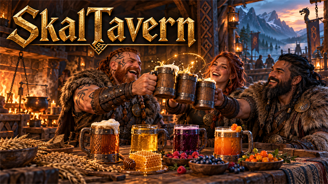
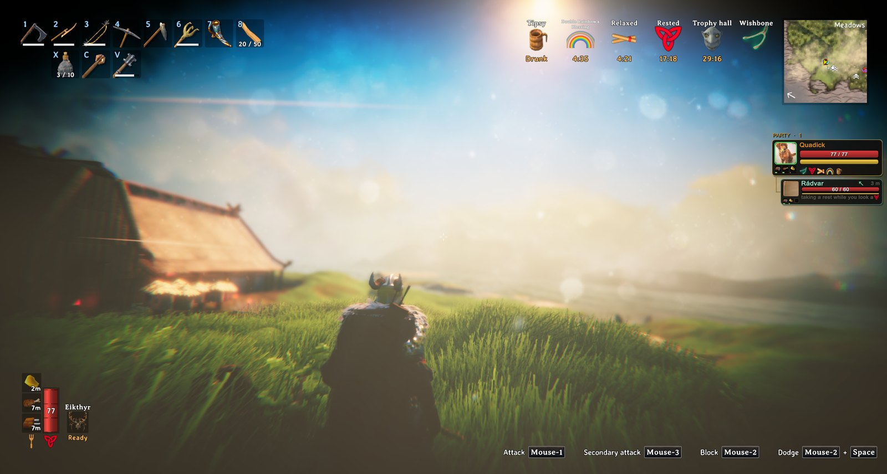
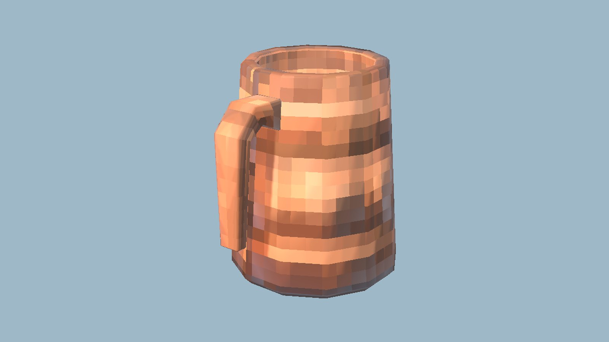

<!-- This page is made by tools/modpages/make_pages.py from the mod's thunderstore.toml, DESCRIPTION.txt, CHANGELOG.txt,
     settings and the repo's README. Change those, or the HAND-WRITTEN parts, not the rest of this page. -->

# 🍺 Quad's Skal Tavern

**Ale and mead that get you drunk (tipsy, stumbling, a hangover), and a Skål! toast with your friends for a buff.**

    

<!-- GITHUB-ONLY -->[Thunderstore](https://thunderstore.io/c/valheim/p/Quads_Lab/Quads_Skal_Tavern/)  ·  <!-- END GITHUB-ONLY -->[Source code](https://github.com/HardHeadHackerHead/valheim-mods/tree/main/mods/SkalTavern)  ·  [Report a bug](https://github.com/HardHeadHackerHead/valheim-mods/issues/new?template=bug.yml&title=%5BQuad%27s%20Skal%20Tavern%5D%20)  ·  [Discord](https://discord.gg/EwTjQxEZPy)

<!-- GITHUB-ONLY -->**Install:** with [r2modman](https://thunderstore.io/c/valheim/p/ebkr/r2modman/) or Thunderstore Mod Manager from [Thunderstore](https://thunderstore.io/c/valheim/p/Quads_Lab/Quads_Skal_Tavern/), or press **F7** in the game with our [mod manager](https://github.com/HardHeadHackerHead/valheim-mod-manager).<!-- END GITHUB-ONLY -->

## ✨ Features

### What is in it

- Four drinks from the cauldron: Tankard of Ale (barley and honey), Honey Mead (honey and raspberries), Blueberry Wine (blueberries and honey) and Skaldic Mead (honey and cloudberries). They are the real tankard in your hand and on the ground, each with its own colour.
- Each drink makes you drunker, and it wears off with time. As you get drunk the picture darkens at the edges, blurs and doubles, colours drift and the view sways; your body leans and weaves, stars circle your head, you hiccup, sounds go muffled, you slide when you walk and your aim floats, and your chat slurs. Too much too fast and you throw up (the game's own effect), which sobers you a little. A little warms you and gives some stamina. More and the view sways and your feet wander, but the cold no longer bites; very drunk and you stagger now and then; too much and you fall down. A big night ends in a hangover.
- Press B (changeable) to raise a cup. Everyone near you who has the mod and toasts within a few seconds, and your AICompanion companions standing by, drink together and get a Skal! buff: faster stamina and health for five minutes, more with more to drink with.

Every number and key is in the settings: how long to sober up, how strong the sway and wander are, whether you stumble, fall or get a hangover (on a server, the server's settings decide those). Only the player who drinks needs the mod for the drinks; a toast needs it on both sides.

## 📸 Screenshots

<!-- HAND-WRITTEN: screenshots -->
**Drunk: the world blurs, glows and sways**

**A Tankard of Ale**

<!-- END HAND-WRITTEN: screenshots -->

## 🎮 How to use

| Key | What it does |
|---|---|
| **B** | Raise a cup: toast with friends and companions beside you for a Skål! buff |

<!-- HAND-WRITTEN: how-to-use -->

<!-- END HAND-WRITTEN: how-to-use -->

## 🧩 Other mods

<!-- HAND-WRITTEN: other-mods -->
**Known clashes:** none known.

**Works with our mods**

- [Quad's Companion](https://thunderstore.io/c/valheim/p/Quads_Lab/Quads_Companion/): companions within 12 m count as drinking partners for a Skål!
<!-- END HAND-WRITTEN: other-mods -->

Found a clash with another mod? [Tell us](https://github.com/HardHeadHackerHead/valheim-mods/issues/new?template=bug.yml&title=%5BQuad%27s%20Skal%20Tavern%5D%20) which one and what happened.

## 👥 Multiplayer

**Who needs it:** Everyone, and **the host above all**: a game without the mod deletes the pieces when their area loads. Restart after installing or updating them.

<!-- HAND-WRITTEN: multiplayer -->
A toast is shared: friends with the mod who raise a cup together all get the buff.

**The host decides:** how long drinks last, their strength and their effects (reversed controls, puking, drifting, stumbling, passing out, hangovers) and the toast window. While you play on their world their values replace yours (your file isn't changed); a host without the mod leaves everyone their own.
<!-- END HAND-WRITTEN: multiplayer -->

## 🌍 Languages

**English, Русский (Russian), Deutsch (German), 简体中文 (Chinese), Português do Brasil (Portuguese), Español (Spanish), Français (French), Polski (Polish), Türkçe (Turkish).** It follows the game's own language setting.

The translations were made with AI, so a few words may be off. To correct one, or to add your language, put a file in `BepInEx/config/translations/com.quad.skaltavern/` named after the game's name for the language (`German.json`, `Italian.json`, `Japanese.json`...) with only the lines you change, copied from [English.json](https://github.com/HardHeadHackerHead/valheim-mods/blob/main/mods/SkalTavern/translations/English.json) (it wins over the built-in one). Or [tell us](https://github.com/HardHeadHackerHead/valheim-mods/issues/new?template=bug.yml&title=%5BQuad%27s%20Skal%20Tavern%5D%20Translation%3A%20) the better words and we'll put them in for everyone.

## ⚙️ Settings

In `BepInEx/config/com.quad.skaltavern.cfg`, made the first time the game runs with the mod. r2modman and Thunderstore Mod Manager edit it under **Config editor**.<!-- GITHUB-ONLY --> With our mod manager: **F7**, then **Mod settings**.<!-- END GITHUB-ONLY -->

**Drinking**

| Setting | Default | What it does |
|---|---|---|
| `MinutesToSober` | `8` | How many minutes it takes to sober up from very drunk (100). Longer and you stay tipsy for longer. In multiplayer the server's value applies. |
| `EffectStrength` | `100` | How strong everything about being drunk is (percent): the picture, the sway, your steering, the sound. 0 for none, 200 for a night you will not remember. In multiplayer the server's value applies. |
| `ScreenSway` | `100` | How much the view sways when you are drunk (percent). 0 for none. |
| `FeetDrift` | `100` | How much your walking wanders when you are drunk (percent). 0 for none. In multiplayer the server's value applies. |
| `Stumble` | `true` | Very drunk, you stagger now and then. In multiplayer the server's value applies. |
| `PassOut` | `true` | Too much drink knocks you down (and sobers you a little). In multiplayer the server's value applies. |
| `Hangover` | `true` | After a big night you wake with a hangover: slower stamina and health for a few minutes. In multiplayer the server's value applies. |

**Effects**

| Setting | Default | What it does |
|---|---|---|
| `Picture` | `true` | The picture changes as you get drunk: dark edges, colour fringing, blur, double vision, colours that drift. |
| `Sound` | `true` | Sounds go muffled and wobbly as you get drunk. |
| `Stars` | `true` | Stars circle your head when you are drunk. |
| `Weave` | `true` | Your body leans and weaves when you are drunk. |
| `Hiccups` | `true` | Hiccups now and then, and a drunken cheer when you stand still. |
| `SlurredChat` | `true` | What you say in chat comes out slurred when you are drunk. |
| `ReversedControls` | `true` | Sloshed, your controls reverse for a moment now and then. In multiplayer the server's value applies. |
| `Puke` | `true` | Too much drink and you throw up. In multiplayer the server's value applies. |

**Toast**

| Setting | Default | What it does |
|---|---|---|
| `Key` | `B` | Raise a cup: a toast with whoever is near. Friends who toast at the same time (and your companions) give each other a Skal! buff. |
| `Window` | `6` | How many seconds apart two toasts can be and still count as together. In multiplayer the server's value applies. |

## 🤖 Made with AI

Made with the help of Claude (Anthropic), with Claude Code: designed, written and checked together, and tried in the game.

## 💬 Join us on Discord

Come hang out with the people who make and play these mods. In the **Quads Lab Discord** you can:

- 🛠️ **Get help** and report bugs straight to us
- 👀 **See new mods first**, and help test them before they're released
- 🗳️ **Suggest ideas** and vote on what we make next
- 🏰 **Share your builds**, bases and arena runs
- 🤖 **Talk AI coding and vibe coding** with people building things with AI, the way these mods are made

**[Join the Quads Lab Discord →](https://discord.gg/EwTjQxEZPy)**

## 🧪 About Quads Lab

Quads Lab is where **Quad H** ([HardHeadHackerHead](https://github.com/HardHeadHackerHead)) builds software with AI, of every kind:
these Valheim mods are one of its projects. Each mod is designed by a player, written with [Claude Code](https://claude.com/claude-code)
and tested in our own world, with **bobisme** as our tester.

- 🌐 [quadslab.io](https://quadslab.io)
- 🧰 [All Quads Lab mods on Thunderstore](https://thunderstore.io/c/valheim/p/Quads_Lab/)
- 💻 [Source code on GitHub](https://github.com/HardHeadHackerHead/valheim-mods)
- 💬 [Discord](https://discord.gg/EwTjQxEZPy)
- 🐞 Found a bug? [Open an issue on GitHub](https://github.com/HardHeadHackerHead/valheim-mods/issues/new/choose)

## 📜 Recent changes

- **0.4.0** Now in your language: English, Russian, German, Chinese (Simplified), Portuguese (Brazil), Spanish, French, Polish and Turkish, following the game's own Language setting. The game's own names are used for its things (items, creatures, lands, stations). The translations were made with AI: to correct a line, or add a language, put a file in BepInEx/config/translations/com.quad.skaltavern/ named after the game's name for the language (German.json...) with only the lines you change, copied from translations/English.json on GitHub.
- **0.3.3** A clearer page: what it does, who needs it in multiplayer, how it gets on with other mods, and where to report a bug. The game itself is unchanged.
- **0.3.2** Its test command for Claude Tools (skal ...) follows the game's cheat rule: level, sober and puke work only in single player, for the host or with devcommands; status, find, drink and drop (what a player does anyway) still work for everyone.

<!-- GITHUB-ONLY -->[Every change](CHANGELOG.txt)<!-- END GITHUB-ONLY --><!-- THUNDERSTORE-ONLY: Every change is on the Changelog tab. -->
