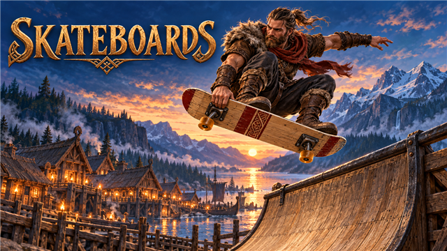
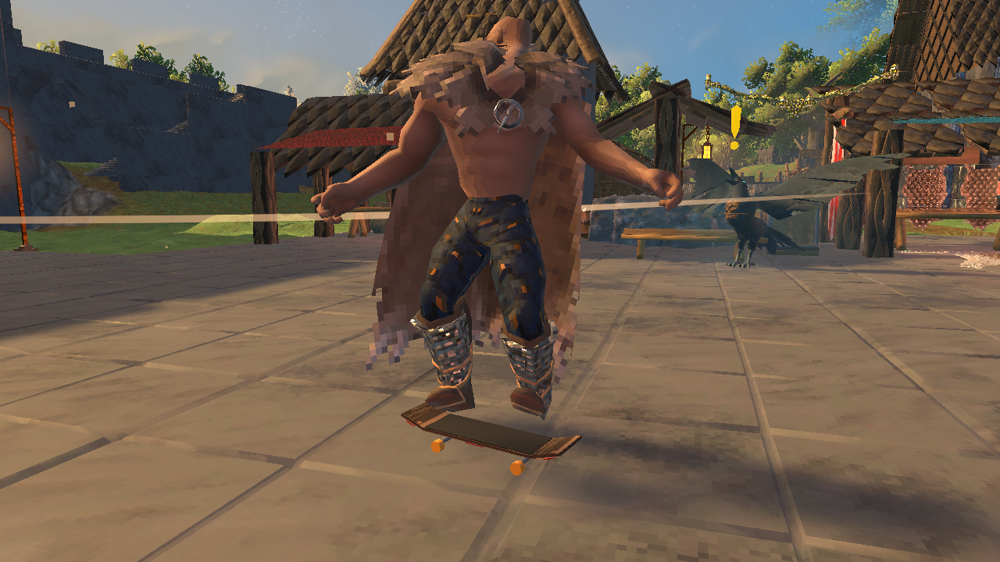

<!-- This page is made by tools/modpages/make_pages.py from the mod's thunderstore.toml, DESCRIPTION.txt, CHANGELOG.txt,
     settings and the repo's README. Change those, or the HAND-WRITTEN parts, not the rest of this page. -->

# 🛹 Quad's Skateboards

**Skateboarding in Valheim, played like the classic skateboarding games: push, ollie, flip, grab, grind and manual your way through long combos, with a score on screen, a special meter and a skate park you build yourself.**

    

[Source code](https://github.com/HardHeadHackerHead/valheim-mods/tree/main/mods/Skateboards)  ·  [Report a bug](https://github.com/HardHeadHackerHead/valheim-mods/issues/new?template=bug.yml&title=%5BQuad%27s%20Skateboards%5D%20)  ·  [Discord](https://discord.gg/EwTjQxEZPy)

  

**Install:** press **F7** in the game with our [mod manager](https://github.com/HardHeadHackerHead/valheim-mod-manager), or take `Skateboards.dll` from [dist/](https://github.com/HardHeadHackerHead/valheim-mods/tree/main/dist). It isn't on Thunderstore.

## ✨ Features

### Riding

- Make a skateboard at the workbench (8 Wood, 4 Resin, 2 Leather Scraps, 2 Flint). Hold it in your hand and press Attack to drop it and hop on; E steps off.
- W pushes (Shift pushes harder, both cost a little stamina), S brakes, A and D carve. Slopes and ramps speed you up; built floors and paths roll best, grass slowest. Roll back down a ramp and you ride fakie.
- Hold Jump to crouch and let go to ollie (held longer, higher).

### Tricks

- In the air A and D spin, Attack is a flip trick and Block (held) a grab, picked by the move key you hold: Kickflip, Impossible, Pop Shove-It, Heelflip, Hardflip; Indy, Nosegrab, Tailgrab, Melon, Method. Attack twice for a double.
- Land on a beam, a wall top, a fence, a rail or the edge of a raised floor to grind it (50-50, Nosegrind, 5-0, Boardslide, Crooked); A and D keep the balance needle in the middle. Hold Crouch on the ground to manual (W and S balance).
- Crouch right after landing on a ramp: a revert, which keeps the combo going into a manual.
- Tricks chain into a combo: points times the multiplier (each trick and each half turn of spin adds to it), banked when you roll away clean. Land straight for a Perfect, crooked for a Sloppy, sideways or mid-flip and you bail and lose it.
- Gaps anywhere: Big Air, Rail 2 Rail, Long Grind, Transfer, Mega Ollie.
- The special meter fills as you land tricks. Full, you go faster and the specials open: A then W, then Attack (Ragnarök Flip); D then S, then Block (Valkyrie Air); D then S before a rail (Bifröst Grind).

### The skate park

- Build with the hammer at a workbench: a Grind Rail, a Skate Ledge, a Kicker and a Quarter Pipe (two facing each other make a half pipe), with curved ramps you can ride straight up for a vert air.

### The look and the sound

- You stand side-on on the board (regular or goofy), push with your back foot, pop the tail on an ollie, and the board flips and spins under your feet; grabs reach for the board, grinds sit the trucks on the rail, bails throw you down while the board clatters away. Others with the mod see it all.
- The combo, the score, the balance meter and the special meter on screen in the game's own fonts; the wheels' roll, the pop, the landing clack and the grind's scrape, made in code.
- A new Skateboarding skill makes pushes faster, ollies higher, spins quicker and balance steadier.

Everyone in the world needs it installed, and the host above all (it adds build pieces).

## 📸 Screenshots

<!-- HAND-WRITTEN: screenshots -->
**Skateboards in the game**

<!-- END HAND-WRITTEN: screenshots -->

## 🎮 How to use

| Key | What it does |
|---|---|
| **Attack** with a skateboard in hand | Drop it and hop on (**E** steps off) |
| **W** / **Shift**+**W** / **S** | Push / push harder / brake; **A** / **D** carve; hold and let go of **Jump** to ollie; hold **Crouch** to manual |
| **A** / **D**, **Attack**, **Block** in the air | Spin / flip trick / grab (the move key held picks which); land on a rail or ledge to grind (**A** / **D** balance) |

<!-- HAND-WRITTEN: how-to-use -->

<!-- END HAND-WRITTEN: how-to-use -->

## 🧩 Other mods

<!-- HAND-WRITTEN: other-mods -->
**Known clashes:** none known.
<!-- END HAND-WRITTEN: other-mods -->

Found a clash with another mod? [Tell us](https://github.com/HardHeadHackerHead/valheim-mods/issues/new?template=bug.yml&title=%5BQuad%27s%20Skateboards%5D%20) which one and what happened.

## 👥 Multiplayer

**Who needs it:** Everyone, and **the host above all**: a game without the mod deletes the pieces when their area loads. Restart after installing or updating them.

<!-- HAND-WRITTEN: multiplayer -->

<!-- END HAND-WRITTEN: multiplayer -->

## ⚙️ Settings

In `BepInEx/config/com.quad.skateboards.cfg`, made the first time the game runs with the mod. r2modman and Thunderstore Mod Manager edit it under **Config editor**.<!-- GITHUB-ONLY --> With our mod manager: **F7**, then **Mod settings**.<!-- END GITHUB-ONLY -->

**1 - Riding**

| Setting | Default | What it does |
|---|---|---|
| `PushSpeed` | `8` | How fast pushing with W gets you on flat ground (metres per second; running is about 7). Slopes and ramps take you faster. [Synced with Server] |
| `SprintPushSpeed` | `11` | How fast pushing with Shift+W gets you (metres per second); it tires you more. [Synced with Server] |
| `TopSpeed` | `24` | The fastest a board ever rolls, downhill or off a ramp (metres per second). [Synced with Server] |
| `PushAcceleration` | `6` | How quickly pushing picks up speed (metres per second, each second). [Synced with Server] |
| `Braking` | `10` | How quickly S slows you down (metres per second, each second). [Synced with Server] |
| `TurnRate` | `150` | The fastest A and D carve (degrees per second), at low speed; faster, you turn on a wider circle. [Synced with Server] |
| `PushStamina` | `2` | Stamina each second of pushing (a harder push with Shift costs two and a half times that). Rolling, carving and tricks are free. 0: pushing never tires you. [Synced with Server] |
| `PushSpeedPercentAtSkill100` | `20` | How much faster pushing gets you at Skateboarding skill 100 (percent; less in between). [Synced with Server] |

**2 - Tricks**

| Setting | Default | What it does |
|---|---|---|
| `OllieSpeed` | `6.5` | How fast an ollie pops you up (metres per second; about 1 m high, higher with the skill). [Synced with Server] |
| `OllieChargePercent` | `35` | How much faster an ollie pops when Jump is held down a moment before letting go (percent). [Synced with Server] |
| `SpinSpeed` | `420` | How fast A and D spin you in the air at Skateboarding skill 0 (degrees per second). [Synced with Server] |
| `SpinSpeedAtSkill100` | `620` | The same at Skateboarding skill 100. [Synced with Server] |
| `FlipSeconds` | `0.5` | How long a flip trick takes at Skateboarding skill 0 (seconds): land before it is done and you bail. [Synced with Server] |
| `FlipSecondsAtSkill100` | `0.35` | The same at Skateboarding skill 100. [Synced with Server] |
| `LandingAngle` | `40` | How far the board may point off the way you are going when you land (degrees, nose or tail first) before it is a bail. [Synced with Server] |
| `BalanceWobble` | `1` | How hard grinds and manuals pull you off balance at Skateboarding skill 0 (1: normal, 0: never). [Synced with Server] |
| `BalanceWobbleAtSkill100` | `0.55` | The same at Skateboarding skill 100. [Synced with Server] |
| `SafeDrop` | `8` | How far you can drop on the board without fall damage, landed or bailed (metres; the game's own falls hurt from 4). Further than that, the rest hurts as the game's falls do. [Synced with Server] |
| `SkillGain` | `1` | How fast the Skateboarding skill rises (1 = like the game's skills). [Synced with Server] |

**3 - Making**

| Setting | Default | What it does |
|---|---|---|
| `SkateboardCost` | `Wood:8, Resin:4, LeatherScraps:2, Flint:2` | What a skateboard takes to make at the workbench. Item prefab names and amounts, separated by commas, like FineWood:12, BronzeNails:30 (Claude Tools' `prefabs <text>` shows exact names). A cost with a mistake in it keeps the last good one. [Synced with Server] |
| `GrindRailCost` | `Wood:6, Resin:2` | What a Grind Rail takes to build with the hammer (at a workbench). Item prefab names and amounts, separated by commas, like FineWood:12, BronzeNails:30 (Claude Tools' `prefabs <text>` shows exact names). A cost with a mistake in it keeps the last good one. [Synced with Server] |
| `SkateLedgeCost` | `Wood:8, Flint:2` | What a Skate Ledge takes to build. Item prefab names and amounts, separated by commas, like FineWood:12, BronzeNails:30 (Claude Tools' `prefabs <text>` shows exact names). A cost with a mistake in it keeps the last good one. [Synced with Server] |
| `KickerCost` | `Wood:10` | What a Kicker (a launch ramp) takes to build. Item prefab names and amounts, separated by commas, like FineWood:12, BronzeNails:30 (Claude Tools' `prefabs <text>` shows exact names). A cost with a mistake in it keeps the last good one. [Synced with Server] |
| `QuarterPipeCost` | `Wood:24, Resin:4` | What a Quarter Pipe takes to build. Item prefab names and amounts, separated by commas, like FineWood:12, BronzeNails:30 (Claude Tools' `prefabs <text>` shows exact names). A cost with a mistake in it keeps the last good one. [Synced with Server] |

**4 - Feel**

| Setting | Default | What it does |
|---|---|---|
| `Goofy` | `false` | Ride goofy (right foot forward) instead of regular (left foot forward). |
| `CameraFollow` | `true` | The camera swings round behind you as you roll, a moment after you last moved the mouse. |
| `ShowScore` | `true` | The tricks of your combo, its points and the balance meter on screen while you skate. |
| `Hints` | `true` | A short hint the first time you do each thing in a session. |
| `Sounds` | `true` | The board's sounds: wheels rolling, the pop of an ollie, landings, grinds (others hear yours too). |
| `SoundVolume` | `0.8` | How loud the board's sounds are (on top of the game's sound effects volume). |

## 🤖 Made with AI

Made with the help of Claude (Anthropic), with Claude Code: designed, written and checked together, and tried in the game.

## 💬 Join us on Discord

Come hang out with the people who make and play these mods. In the **Quads Lab Discord** you can:

- 🛠️ **Get help** and report bugs straight to us
- 👀 **See new mods first**, and help test them before they're released
- 🗳️ **Suggest ideas** and vote on what we make next
- 🏰 **Share your builds**, bases and arena runs
- 🤖 **Talk AI coding and vibe coding** with people building things with AI, the way these mods are made

**[Join the Quads Lab Discord →](https://discord.gg/EwTjQxEZPy)**

## 🧪 About Quads Lab

Quads Lab is where **Quad H** ([HardHeadHackerHead](https://github.com/HardHeadHackerHead)) builds software with AI, of every kind:
these Valheim mods are one of its projects. Each mod is designed by a player, written with [Claude Code](https://claude.com/claude-code)
and tested in our own world, with **bobisme** as our tester.

- 🌐 [quadslab.io](https://quadslab.io)
- 🧰 [All Quads Lab mods on Thunderstore](https://thunderstore.io/c/valheim/p/Quads_Lab/)
- 💻 [Source code on GitHub](https://github.com/HardHeadHackerHead/valheim-mods)
- 💬 [Discord](https://discord.gg/EwTjQxEZPy)
- ☕ [Buy me a coffee](https://buymeacoffee.com/quadh)
- 🐞 Found a bug? [Open an issue on GitHub](https://github.com/HardHeadHackerHead/valheim-mods/issues/new/choose)

## ☕ Support my mods

Every Quads Lab mod is free, and it stays that way. If one of them made your game better and you'd like to say thanks, a coffee
helps me make new mods and keep improving the ones you already play. It's 100% optional, and always appreciated!

**[☕ Buy me a coffee →](https://buymeacoffee.com/quadh)**

## 📜 Recent changes

- **0.1.0** First release: a skateboard item (Attack to drop it and hop on, E to step off), pushing, carving, charged ollies, spins, five flip tricks with doubles, five grabs, grinds on rails, wall tops and ledges, manuals with balance meters, reverts, combos with multipliers and Perfect/Sloppy landings, gaps, a special meter with three specials, bails, a Skateboarding skill, and four skate park pieces (Grind Rail, Skate Ledge, Kicker, Quarter Pipe). Score HUD, sounds made in code, and other players see you skate. English only.

<!-- GITHUB-ONLY -->[Every change](CHANGELOG.txt)<!-- END GITHUB-ONLY --><!-- THUNDERSTORE-ONLY: Every change is on the Changelog tab. -->
