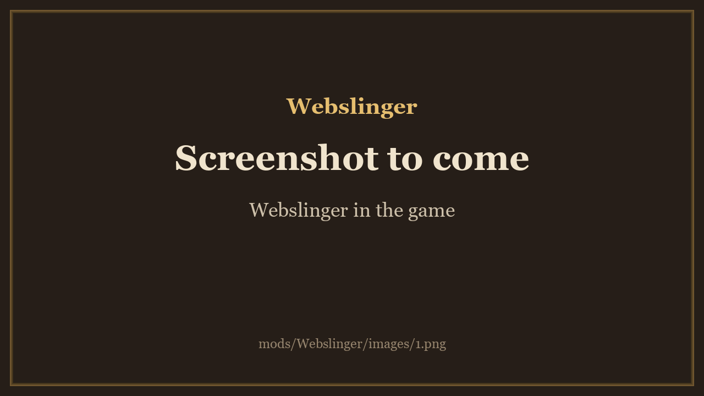

<!-- This page is made by tools/modpages/make_pages.py from the mod's thunderstore.toml, DESCRIPTION.txt, CHANGELOG.txt,
     settings and the repo's README. Change those, or the HAND-WRITTEN parts, not the rest of this page. -->

# Quad's Webslinger

**Swing through the world on webs, Spider-Man style: put on the Web Shooters to web-swing from trees, cliffs and buildings and zip to rooftops; crawl on walls, leap far ahead, and a spider-sense that warns you of attacks, with a Webslinging skill.**

    

<!-- GITHUB-ONLY -->[Thunderstore](https://thunderstore.io/c/valheim/p/Quads_Lab/Webslinger/)  ·  <!-- END GITHUB-ONLY -->[Source code](https://github.com/HardHeadHackerHead/valheim-mods/tree/main/mods/Webslinger)  ·  [Report a bug](https://github.com/HardHeadHackerHead/valheim-mods/issues/new?template=bug.yml&title=%5BQuad%27s%20Webslinger%5D%20)  ·  [Discord](https://discord.gg/EwTjQxEZPy)

  

<!-- GITHUB-ONLY -->**Install:** with [r2modman](https://thunderstore.io/c/valheim/p/ebkr/r2modman/) or Thunderstore Mod Manager from [Thunderstore](https://thunderstore.io/c/valheim/p/Quads_Lab/Webslinger/), or press **F7** in the game with our [mod manager](https://github.com/HardHeadHackerHead/valheim-mod-manager).<!-- END GITHUB-ONLY -->

## ✨ Features

### The Web Shooters

- A pair of wrist gadgets, made at the workbench (4 Leather scraps, 10 Resin, 2 Flint), worn in the utility slot. Swings and zips need them (the leap, the wall crawl and spider-sense don't), and others with the mod see a shooter on each of your wrists.

### The moves

- Swing: jump, then press and hold Jump in the air. A web shoots up and ahead to the best spot in reach (a tree, a cliff, a roof, a tower) and you swing from it. Keep holding and the next web fires by itself at the top of each swing; let go to fly off. Let go near the top of a swing while still rising for a perfect release: a bigger fling and a flip. A quick tap gives one short swing. Steer with the move keys.
- Webs stick to real things only: something solid that stays put, up and ahead of you, high enough to swing under (about 8 metres over the ground below it). In the air, a small white web mark shows where your web would stick: no mark, nothing to swing from, and Jump is just Jump.
- Spider-Man leap: jump while sprinting and you leap far ahead in a high arc (look up to leap higher). A jump without sprinting is the game's own. A jump off the ground never shoots a web: press Jump again in the air to swing.
- Zip: press Sprint in the air to pull yourself to the spot under your crosshair: onto a roof or a ledge (you land on it), onto a wall (you stick to it), or under something. A light blue ring shows when a spot is in reach. With nothing in reach, a short zip forward (2 before you touch the ground, 3 with the skill).
- Wall crawl: move into a wall in the air (or swing into one) and you stick to it. Crawl with the move keys, faster with Sprint, over the top at its edge; Jump kicks off it, Crouch lets go.
- Spider-sense: wavy lines round your head, a glow on the side it comes from and a tingle, a moment before an enemy's attack or an arrow reaches you (only for those you can't see, or every one: a setting).
- No damage landing from a web move, and half the game's fall damage from other falls.

### The suits

- Two suits for the trinket slot, made at the workbench (level 2). They change how you look, not what you wear: your armour stays equipped and keeps protecting you, and the suit shows instead. Your own helmet and cape stay, in the suit's colours.
- Spider-Viking suit (Leather scraps, Deer hide, Raspberries, Blueberries): red and blue with black web lines, a mask with white spider eyes, spiders on chest and back, a leather belt with a gold buckle, leather bracers, leg wraps and fur-topped boots. Your helmet turns red, your cape blue with a red spider on its back.
- Venom suit (Leather scraps, Deer hide, Ooze, Coal): symbiote black with a blue sheen, a huge white spider, jagged white eyes and a grin of fangs, black leather and silver. Your helmet and cape turn black (a white spider on the cape), and your webs turn black.
- Others with the mod see your suit; others without it see you without your armour's look.

### How it looks and sounds

- Your own web sounds: a thwip as a web shoots, a thunk as it sticks, a snap as you let go, wind rushing past at speed.
- The pose on a web: your arm up the web (the hand on the web's side, so long chains alternate hands), legs trailing and tucking at the top of a swing, both arms up a zip, hand over hand with knees out on a wall, and a flip on a perfect release.
- Webs leave a mark: a web patch where each web sticks, and a web you let go of stays stuck and hangs there, swaying, for a while.
- Speed lines and a slight camera roll and dip at speed, and the view widens a little.
- Others with the mod see your webs, your poses and your flips; others without it see you fly and lean.

The Webslinging skill rises with every web, zip and crawl: longer webs and zips, faster swings, more zips forward.

Works with Quad's Parkour: Jump in the air is a web whenever a web is possible, otherwise Parkour's wall kick. Only the players who want it need it: movement is each player's own. The Web Shooters can only be made where the server (or host) has the mod too, since a server without it would delete a dropped pair; its NeedsWebShooters setting turns the item off.

## 📸 Screenshots

<!-- HAND-WRITTEN: screenshots -->
**Webslinger in the game**

<!-- END HAND-WRITTEN: screenshots -->

<!-- HAND-WRITTEN: how-to-use -->

<!-- END HAND-WRITTEN: how-to-use -->

## 🧩 Other mods

<!-- HAND-WRITTEN: other-mods -->
**Known clashes:** none known.
<!-- END HAND-WRITTEN: other-mods -->

Found a clash with another mod? [Tell us](https://github.com/HardHeadHackerHead/valheim-mods/issues/new?template=bug.yml&title=%5BQuad%27s%20Webslinger%5D%20) which one and what happened.

## 👥 Multiplayer

**Who needs it:** Only the players who want it.

<!-- HAND-WRITTEN: multiplayer -->

<!-- END HAND-WRITTEN: multiplayer -->

## ⚙️ Settings

In `BepInEx/config/com.quad.webslinger.cfg`, made the first time the game runs with the mod. r2modman and Thunderstore Mod Manager edit it under **Config editor**.<!-- GITHUB-ONLY --> With our mod manager: **F7**, then **Mod settings**.<!-- END GITHUB-ONLY -->

**1 - Moves**

| Setting | Default | What it does |
|---|---|---|
| `Enabled` | `true` | Webslinger on or off (all the moves). |
| `NeedsWebShooters` | `true` | Webs (swings and zips) shoot only while the Web Shooters are worn (the utility slot); the leap, the wall crawl and spider-sense never need them. Off: webs always work, and the Web Shooters do nothing. [Synced with Server] |
| `WebShootersCost` | `LeatherScraps:4, Resin:10, Flint:2` | What the Web Shooters take to make at the workbench. Item prefab names and amounts, separated by commas, like FineWood:12, BronzeNails:30 (Claude Tools' `prefabs <text>` shows exact names). A cost with a mistake in it keeps the last good one. [Synced with Server] |
| `SpiderVikingSuitCost` | `LeatherScraps:6, DeerHide:4, Raspberry:10, Blueberries:10` | What the Spider-Viking suit takes to make at the workbench (level 2). Item prefab names and amounts, separated by commas, like FineWood:12, BronzeNails:30 (Claude Tools' `prefabs <text>` shows exact names). A cost with a mistake in it keeps the last good one. [Synced with Server] |
| `VenomSuitCost` | `LeatherScraps:6, DeerHide:4, Ooze:10, Coal:10` | What the Venom suit takes to make at the workbench (level 2). Item prefab names and amounts, separated by commas, like FineWood:12, BronzeNails:30 (Claude Tools' `prefabs <text>` shows exact names). A cost with a mistake in it keeps the last good one. [Synced with Server] |
| `Swing` | `true` | Swing: press and hold Jump in the air to shoot a web up ahead and swing from it; let go to fly off. Only when something is in reach to stick to: otherwise a jump is just a jump. |
| `HoldToKeepSwinging` | `true` | Keep holding Jump and, at the top of each swing, the next web shoots ahead by itself. Off: one web per press. |
| `Zip` | `true` | Zip: press Sprint in the air to pull yourself to the spot under the crosshair (a top: land on it; a wall: stick to it). Nothing in reach: a short zip forward. |
| `WallCrawl` | `true` | Wall crawl: move into a wall in the air to stick to it. Move keys crawl, Jump kicks off, Crouch lets go. |
| `Hints` | `true` | A short hint the first time you do each move in a session. |

**2 - Spider-sense**

| Setting | Default | What it does |
|---|---|---|
| `Enabled` | `true` | Spider-sense: wavy lines round your head, a glow on the side it comes from and a sound, a moment before an attack or an arrow reaches you. |
| `From` | `OutOfSight` | OutOfSight: only for attacks you can't see (behind or beside you) and anything shot at you. Everywhere: every attack aimed at you. |

**3 - Strengths**

| Setting | Default | What it does |
|---|---|---|
| `WebReach` | `40` | How far a swing web reaches at Webslinging skill 0 (metres). [Synced with Server] |
| `WebReachAtSkill100` | `60` | The same at Webslinging skill 100 (metres). [Synced with Server] |
| `SkyWebs` | `false` | With nothing in reach high enough to swing from (open plains, the sea), a swing web sticks to the sky up ahead, as in The Amazing Spider-Man. Off: webs need something solid, and with nothing in reach a jump is just a jump. [Synced with Server] |
| `SprintLeapForward` | `22` | The Spider-Man leap: a jump while sprinting throws you this fast ahead (metres per second; the game's sprint is about 7). 0: a sprint jump is the game's own. A jump without sprinting is always the game's own. [Synced with Server] |
| `SprintLeapUp` | `13` | How fast the leap goes up (metres per second; the game's gravity on a player is about 20, eased while the leap rises). Looking up leaps higher and shorter. [Synced with Server] |
| `ZipReach` | `35` | How far a zip reaches at Webslinging skill 0 (metres). [Synced with Server] |
| `ZipReachAtSkill100` | `50` | The same at Webslinging skill 100 (metres). [Synced with Server] |
| `ZipSpeed` | `30` | How fast a zip pulls you (metres per second). [Synced with Server] |
| `AirZips` | `2` | Zips forward into nothing (no spot in reach) before touching the ground, at skill 0. [Synced with Server] |
| `AirZipsAtSkill100` | `3` | The same at Webslinging skill 100. [Synced with Server] |
| `MaxSpeed` | `35` | The fastest a swing, a dive or a flight can ever go (metres per second; the game's sprint is about 7). SwingSpeed is the usual speed. [Synced with Server] |
| `SwingSpeed` | `20` | How fast swinging gets at Webslinging skill 0 (metres per second): pumping builds speed up to it, and faster (a dive) the air slowly brings it back. [Synced with Server] |
| `SwingSpeedAtSkill100` | `26` | The same at Webslinging skill 100 (metres per second). [Synced with Server] |
| `SwingSteer` | `100` | How fast a swing turns toward the move keys (degrees per second). [Synced with Server] |
| `SwingPump` | `12` | How much holding a move key speeds up a swing that way (metres per second, each second). [Synced with Server] |
| `ReleaseBoost` | `4` | The fling upward when you let go of a web (metres per second). [Synced with Server] |
| `PerfectReleaseBoost` | `8` | The fling when you let go near the top of the swing, still rising (metres per second; more with the skill). [Synced with Server] |
| `CrawlSpeed` | `3` | How fast you crawl on walls (metres per second; half as fast again sprinting). [Synced with Server] |
| `FallDamagePercent` | `50` | Of the game's fall damage, how much you still take on other falls (percent): spider agility. 100: the game's own. [Synced with Server] |
| `WebLandingDamagePercent` | `0` | Of the game's fall damage, how much you take landing from a swing, a zip, a wall or a flight off one (percent). 0: none, as in the Spider-Man games. [Synced with Server] |
| `SpiderSenseRange` | `30` | How far away an attack sets off spider-sense (metres). [Synced with Server] |
| `SkillGain` | `1` | How fast the Webslinging skill rises (1 = like the game's skills). [Synced with Server] |

**4 - Feel**

| Setting | Default | What it does |
|---|---|---|
| `Sounds` | `true` | The web's sounds: the thwip as it shoots, the thunk as it sticks, the snap as it lets go, the wind at speed, the spider-sense tingle. |
| `SoundVolume` | `0.8` | How loud the web's sounds are (on top of the game's sound effects volume). |
| `WebSplats` | `true` | A small web patch where each web sticks, fading after a while. |
| `WebsLeftHanging` | `true` | A web you let go of stays stuck where it hit and hangs down from there, swaying, until it fades: a trail of webs behind you (others' webs too). |
| `HangingWebSeconds` | `10` | How long a web left hanging stays (seconds). |
| `SpeedLines` | `true` | Speed lines streaming past at swinging speed. Turn it off if motion on screen makes you feel sick. |
| `CameraMotion` | `true` | The camera rolls a little into turns and toward the web, and dips at the bottom of a swing. Turn it off if camera motion makes you feel sick. |
| `SpeedFov` | `true` | The view widens a little at high speed. Turn it off if camera motion makes you feel sick. |
| `WebMarks` | `true` | In the air, a small web mark shows where a swing web would stick (no mark: nothing in reach, a jump is just a jump), and a ring under the crosshair when a zip can reach it. |
| `BodyLean` | `true` | The body leans along the web and takes the moves' poses: the arm up the web, legs tucked at the top of a swing, flips on a perfect release, a spider's crawl on walls (players with the mod see them too). |

**5 - Stamina**

| Setting | Default | What it does |
|---|---|---|
| `SwingWeb` | `0` | Stamina for each swing web. [Synced with Server] |
| `SwingPerSecond` | `0` | Stamina per second hanging on a swing web. [Synced with Server] |
| `Zip` | `0` | Stamina for a zip to a spot. [Synced with Server] |
| `AirZip` | `0` | Stamina for a zip forward into nothing. [Synced with Server] |
| `CrawlPerSecond` | `0` | Stamina per second crawling on a wall (nothing while still). [Synced with Server] |
| `SkillCutPercent` | `33` | How much less every move costs at Webslinging skill 100 (percent; less in between). [Synced with Server] |

## 🤖 Made with AI

Made with the help of Claude (Anthropic), with Claude Code: designed, written and checked together, and tried in the game.

## 💬 Join us on Discord

Come hang out with the people who make and play these mods. In the **Quads Lab Discord** you can:

- 🛠️ **Get help** and report bugs straight to us
- 👀 **See new mods first**, and help test them before they're released
- 🗳️ **Suggest ideas** and vote on what we make next
- 🏰 **Share your builds**, bases and arena runs
- 🤖 **Talk AI coding and vibe coding** with people building things with AI, the way these mods are made

**[Join the Quads Lab Discord →](https://discord.gg/EwTjQxEZPy)**

## 🧪 About Quads Lab

Quads Lab is where **Quad H** ([HardHeadHackerHead](https://github.com/HardHeadHackerHead)) builds software with AI, of every kind:
these Valheim mods are one of its projects. Each mod is designed by a player, written with [Claude Code](https://claude.com/claude-code)
and tested in our own world, with **bobisme** as our tester.

- 🌐 [quadslab.io](https://quadslab.io)
- 🧰 [All Quads Lab mods on Thunderstore](https://thunderstore.io/c/valheim/p/Quads_Lab/)
- 💻 [Source code on GitHub](https://github.com/HardHeadHackerHead/valheim-mods)
- 💬 [Discord](https://discord.gg/EwTjQxEZPy)
- ☕ [Buy me a coffee](https://buymeacoffee.com/quadh)
- 🐞 Found a bug? [Open an issue on GitHub](https://github.com/HardHeadHackerHead/valheim-mods/issues/new/choose)

## ☕ Support my mods

Every Quads Lab mod is free, and it stays that way. If one of them made your game better and you'd like to say thanks, a coffee
helps me make new mods and keep improving the ones you already play. It's 100% optional, and always appreciated!

**[☕ Buy me a coffee →](https://buymeacoffee.com/quadh)**

## 📜 Recent changes

- **0.3.0** Two suits for the trinket slot that change how you look, not what you wear (your armour stays on and keeps protecting you): the Spider-Viking suit (red and blue web suit with a mask and white eyes, leather belt with a gold buckle, bracers, leg wraps and fur-topped boots; your own helmet turns red and your cape blue with a red spider on its back) and the Venom suit (symbiote black with a huge white spider, jagged eyes and fangs, black leather and silver; your helmet and cape turn black, and your webs turn black). The Web Shooters now show on both wrists with the cartridge on the inside. 0.2.0: The Web Shooters: a utility item made at the workbench (Leather scraps, Resin, Flint); swings and zips need them (a server setting can turn that off), and a shooter shows on each wrist; the leap, the wall crawl and spider-sense work without. A plain jump is the game's own again, and never shoots a web (a web could fire right after a jump off the ground); a jump while sprinting is a Spider-Man leap far ahead, in a high, long arc. Press Jump in the air to swing. 0.1.0: First release: web-swinging from trees, cliffs and buildings (hold Jump in the air), zips to the spot under the crosshair (Sprint in the air), wall crawling, a higher Spider-Man jump, spider-sense, and a Webslinging skill. Web marks show where a web would stick. Its own web sounds, poses and flips, web patches and hanging webs, speed lines and camera motion. No stamina costs by default. Works with Quad's Parkour.

<!-- GITHUB-ONLY -->[Every change](CHANGELOG.txt)<!-- END GITHUB-ONLY --><!-- THUNDERSTORE-ONLY: Every change is on the Changelog tab. -->
