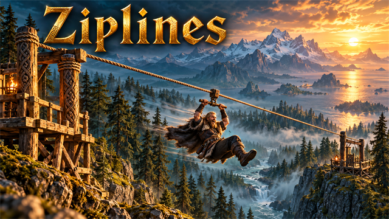
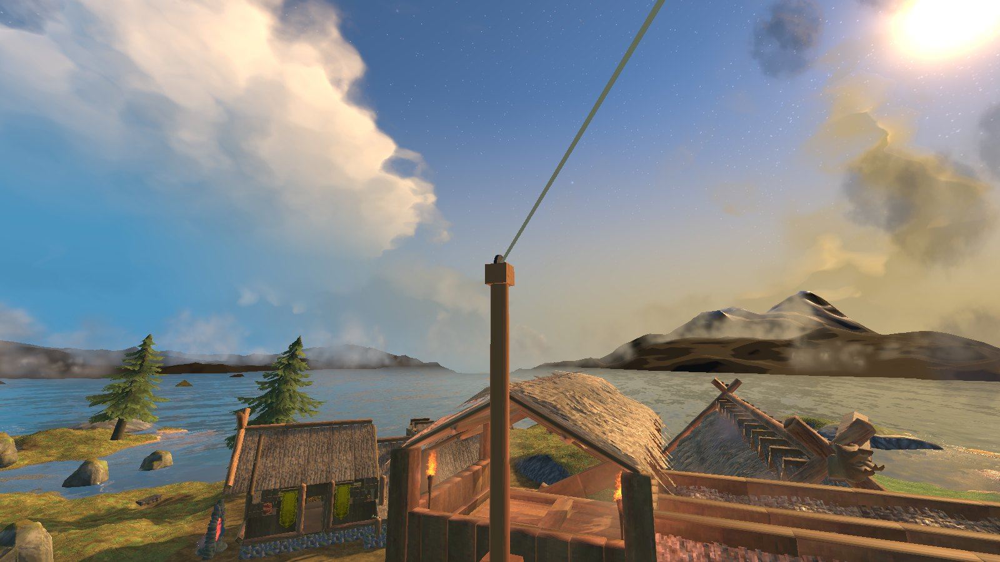
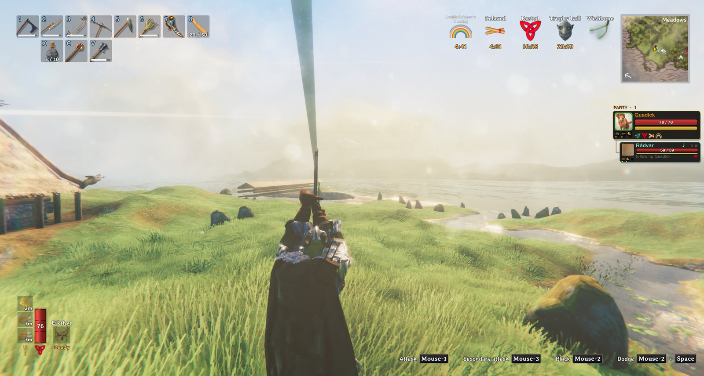
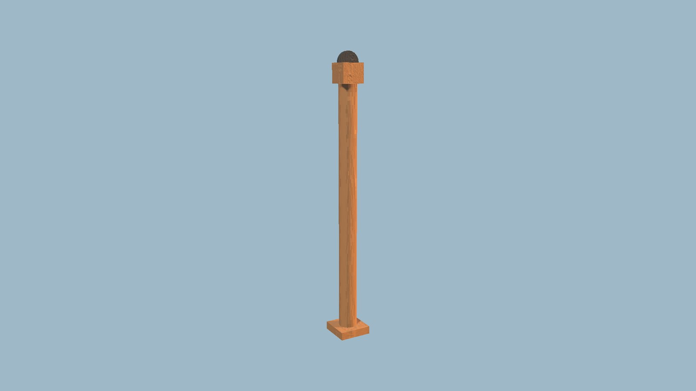

<!-- This page is made by tools/modpages/make_pages.py from the mod's thunderstore.toml, DESCRIPTION.txt, CHANGELOG.txt,
     settings and the repo's README. Change those, or the HAND-WRITTEN parts, not the rest of this page. -->

# 🪢 Quad's Ziplines

**Ziplines: build two posts, run a rope between them and ride it, hanging from your axe.**

    

<!-- GITHUB-ONLY -->[Thunderstore](https://thunderstore.io/c/valheim/p/Quads_Lab/Quads_Ziplines/)  ·  <!-- END GITHUB-ONLY -->[Source code](https://github.com/HardHeadHackerHead/valheim-mods/tree/main/mods/Ziplines)  ·  [Report a bug](https://github.com/HardHeadHackerHead/valheim-mods/issues/new?template=bug.yml&title=%5BQuad%27s%20Ziplines%5D%20)  ·  [Discord](https://discord.gg/EwTjQxEZPy)

<!-- GITHUB-ONLY -->**Install:** with [r2modman](https://thunderstore.io/c/valheim/p/ebkr/r2modman/) or Thunderstore Mod Manager from [Thunderstore](https://thunderstore.io/c/valheim/p/Quads_Lab/Quads_Ziplines/), or press **F7** in the game with our [mod manager](https://github.com/HardHeadHackerHead/valheim-mod-manager).<!-- END GITHUB-ONLY -->

## ✨ Features

### What is in it

- The Zipline Post is in the hammer menu (Misc). Build one, build another (a line can be kilometres long), press E on the first and then on the other, and a rope runs between them.
- A line only runs downhill: press E on the higher post to ride. You hook your axe over the rope and hang from its handle with both hands, feet dangling. Without an axe (or with the setting off) you hang from a wooden triangle instead.
- You are lifted to the rope and slide along it, faster downhill and faster on longer lines, the view widening and the wind rising, and are eased down at the far end. Press jump to let go. Shift+E on a post takes its line down.
- A line has to be rideable: it must fall enough, your feet must clear the ground all the way and nothing may stand in the way; if not, it says why.
- The lines are saved with the world (each post keeps its partner's place, so the far end need not be loaded), and others see you glide.

Everyone in the world needs it installed (the post is a building piece: a game without the mod deletes it when its area loads). Restart after installing.

## 📸 Screenshots

<!-- HAND-WRITTEN: screenshots -->
**A Zipline Post on the roof, its rope rising out over the bay**

**Riding down the line, hanging from your axe**

**The Zipline Post**

<!-- END HAND-WRITTEN: screenshots -->

<!-- HAND-WRITTEN: how-to-use -->

<!-- END HAND-WRITTEN: how-to-use -->

## 🧩 Other mods

<!-- HAND-WRITTEN: other-mods -->
**Known clashes**

- **Ziplines** by Einherjer: both work side by side, each with its own posts and ropes.
<!-- END HAND-WRITTEN: other-mods -->

Found a clash with another mod? [Tell us](https://github.com/HardHeadHackerHead/valheim-mods/issues/new?template=bug.yml&title=%5BQuad%27s%20Ziplines%5D%20) which one and what happened.

## 👥 Multiplayer

**Who needs it:** Everyone, and **the host above all**: a game without the mod deletes the pieces when their area loads. Restart after installing or updating them.

<!-- HAND-WRITTEN: multiplayer -->
A line is saved on both posts, so it comes back with the world. Running or taking down a line needs ward permission at both posts; anyone can ride.

**The host decides:** line length and slope, speeds, and whether you need an axe. While you play on their world their values replace yours (your file isn't changed); a host without the mod leaves everyone their own.
<!-- END HAND-WRITTEN: multiplayer -->

## 🌍 Languages

**English, Русский (Russian), Deutsch (German), 简体中文 (Chinese), Português do Brasil (Portuguese), Español (Spanish), Français (French), Polski (Polish), Türkçe (Turkish).** It follows the game's own language setting.

The translations were made with AI, so a few words may be off. To correct one, or to add your language, put a file in `BepInEx/config/translations/com.quad.ziplines/` named after the game's name for the language (`German.json`, `Italian.json`, `Japanese.json`...) with only the lines you change, copied from [English.json](https://github.com/HardHeadHackerHead/valheim-mods/blob/main/mods/Ziplines/translations/English.json) (it wins over the built-in one). Or [tell us](https://github.com/HardHeadHackerHead/valheim-mods/issues/new?template=bug.yml&title=%5BQuad%27s%20Ziplines%5D%20Translation%3A%20) the better words and we'll put them in for everyone.

## ⚙️ Settings

In `BepInEx/config/com.quad.ziplines.cfg`, made the first time the game runs with the mod. r2modman and Thunderstore Mod Manager edit it under **Config editor**.<!-- GITHUB-ONLY --> With our mod manager: **F7**, then **Mod settings**.<!-- END GITHUB-ONLY -->

**Lines**

| Setting | Default | What it does |
|---|---|---|
| `MaxLength` | `12000` | The longest a zipline can be (metres). A line remembers where its other end is, so the far post does not have to be loaded: the world around you loads as you ride. In multiplayer the server's value applies. |
| `MinSlope` | `0.005` | How much a line must fall to be ridden, as a part of its length (0.005 is 5 m in every 1000). A line only runs downhill, from its higher post to its lower. In multiplayer the server's value applies. |

**Riding**

| Setting | Default | What it does |
|---|---|---|
| `LongLinesFaster` | `true` | The longer the line, the faster you go (up to eight times), so a line of kilometres takes minutes, not an hour. You slow down for the last stretch either way. In multiplayer the server's value applies. |
| `TopSpeed` | `24` | How fast you go downhill at the most (metres per second). In multiplayer the server's value applies. |
| `MinSpeed` | `5` | How fast you go on the flat or uphill at the least (metres per second). In multiplayer the server's value applies. |
| `HangBelowRope` | `2.5` | How far below the rope your feet hang (metres): your arms reach up to the handle, so this is about your height plus a little. |
| `NeedAnAxe` | `true` | You hook an axe over the rope and hang from its handle, so you need one with you to ride. Off, you hang from a wooden triangle instead. In multiplayer the server's value applies. |
| `SpeedPercent` | `50` | How fast the whole ride is, as a percent of the standard speed (50 is half as fast, 200 twice). In multiplayer the server's value applies. |
| `WindVolume` | `0.12` | How loud the wind is at full speed (0 to 1). |
| `WideView` | `true` | The view widens as you speed up, for the feel of it. |
| `WindSound` | `true` | The sound of the wind, rising with your speed. |

## 🤖 Made with AI

Made with the help of Claude (Anthropic), with Claude Code: designed, written and checked together, and tried in the game.

## 💬 Join us on Discord

Come hang out with the people who make and play these mods. In the **Quads Lab Discord** you can:

- 🛠️ **Get help** and report bugs straight to us
- 👀 **See new mods first**, and help test them before they're released
- 🗳️ **Suggest ideas** and vote on what we make next
- 🏰 **Share your builds**, bases and arena runs
- 🤖 **Talk AI coding and vibe coding** with people building things with AI, the way these mods are made

**[Join the Quads Lab Discord →](https://discord.gg/EwTjQxEZPy)**

## 🧪 About Quads Lab

Quads Lab is where **Quad H** ([HardHeadHackerHead](https://github.com/HardHeadHackerHead)) builds software with AI, of every kind:
these Valheim mods are one of its projects. Each mod is designed by a player, written with [Claude Code](https://claude.com/claude-code)
and tested in our own world, with **bobisme** as our tester.

- 🌐 [quadslab.io](https://quadslab.io)
- 🧰 [All Quads Lab mods on Thunderstore](https://thunderstore.io/c/valheim/p/Quads_Lab/)
- 💻 [Source code on GitHub](https://github.com/HardHeadHackerHead/valheim-mods)
- 💬 [Discord](https://discord.gg/EwTjQxEZPy)
- 🐞 Found a bug? [Open an issue on GitHub](https://github.com/HardHeadHackerHead/valheim-mods/issues/new/choose)

## 📜 Recent changes

- **0.3.1** Fixes. Moving, attacking, blocking or crouching while you ride no longer drops you off the rope (only Jump lets go, as before). Logging out or the game saving while you ride now brings you back on the ground under the line, not hanging in the air to fall. Reloading the mod mid-ride sets you down on the ground instead of dropping you. Taking down a line, or running one, to a far post that isn't loaded on your game now changes that post too in multiplayer (the host does it), so no rope is left running to nowhere; the host needs this version for that.
- **0.3.0** Now in your language: English, Russian, German, Chinese (Simplified), Portuguese (Brazil), Spanish, French, Polish and Turkish, following the game's own Language setting. The game's own names are used for its things (items, creatures, lands, stations). The translations were made with AI: to correct a line, or add a language, put a file in BepInEx/config/translations/com.quad.ziplines/ named after the game's name for the language (German.json...) with only the lines you change, copied from translations/English.json on GitHub. A blocking piece's name keeps its capital letters (German nouns need them).
- **0.2.3** A clearer page: what it does, who needs it in multiplayer, how it gets on with other mods, and where to report a bug. The game itself is unchanged.

<!-- GITHUB-ONLY -->[Every change](CHANGELOG.txt)<!-- END GITHUB-ONLY --><!-- THUNDERSTORE-ONLY: Every change is on the Changelog tab. -->
